# 约翰霍普金斯大学《神经网络基础｜Foundations of Neural Networks》中英字幕 p08 0_循环神经网络.zh_en -BV1w1uqzSEHZ_p8-

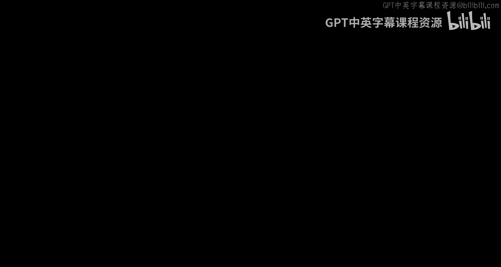

All right， let's get started， so today we're going to talk about the current neural networks that these are special neural networks because they are able to handle the dimensionality of time。

And so we're going to jump into it。So， so what is？So let's begin with kind of like what is a sequence modeling right so the definition there is to capture patterns in temporal data temporal meaning the dimension of time where order and time are essential right and so example of these are kind of like time series forecasts。

 speech recognition and natural language processing。

And so why do we do that right and so so real world data often comes in sequences and traditional norm。

Ourwn networks lack a design to capture that kind of temporal probe。

So you enter RNNs right and so this is a type of neural network designed to recognize patterns across time。

And so of the key features here is the。Feed at least that give RNms kind of a form of memory， okay。

And so why does this matter， right， RNNs open up a range of applications right essential for kind of advanced fields like machine translation and speechs a synthesis。

RightAnd so an understanding of these R is critical to anyone diving deep into modern AI and I'm a deep partnerner。

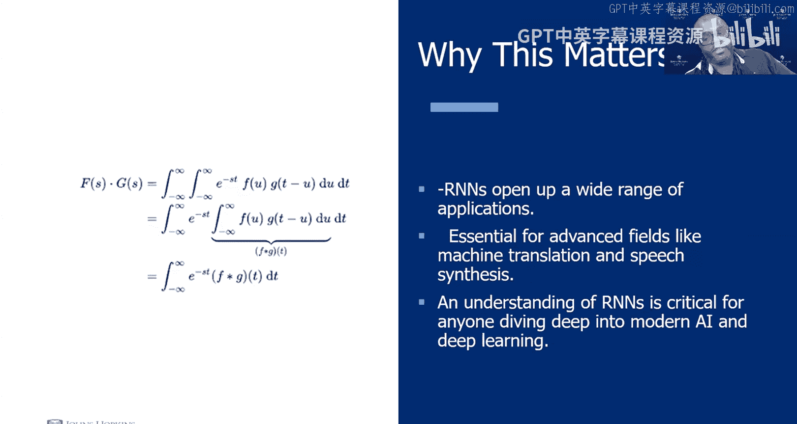

So let's talk about this concept called unfolding the computational graph right and so the definition there is to unfold a computational graph refers to the process of writing out each step of the re current computationally explicitly。

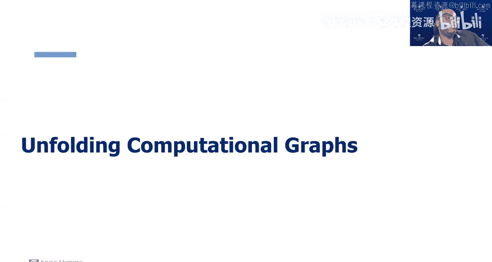

Right so the purpose there is to allow。to convert Rs into to networks with kind of like feed for its toppology enabling us to apply kind of those Ame optimization techniques that we know and lot。

 and so to better understand the computational structure， right。

 this is how can we do that right and to apply back application and optimize the network。

And so right so what are some of the events right so kind of clearance her and representation is the big one right it allows applications of the back propagation through time right this is the algorithm that that we have right and it simplifies parallel computations in hardware。

And so what are some of the challenges right and so RNNs have kind of become kind of the black sheep they're kind of unpopular right they have a lot of challenges when it comes to convergence in particularing exploding and vanished ingredients。

Um and computational complexity right so kind of the managing longer sequences can be challenging in terms of memory。

I so what are some of the practical implications right so truncated BPPTT right is a common practice to mitigate some of those challenges right and so you're always going to have those trade offs between accuracy。

Right so we have so real world applications right so kind of like natural language assessment like machine translation time series forecasts。

 speech recognition， these things are things that we use RNs for a lot right so let's talk about you know re currentrent neural network。

In general right so what are they right there are neural designed to recognize patterns across temporal data。

The key feature there is that feedback black loop that gives the RN a unique form of memory。

And so why do we use them， traditional networks？We can't store previous information in those things right and so sequences and real world data demands that time series kind of way of doing things and soN like RNNs they maintain a form of internal state that can kind of like remember past data。

And so right， the one of the things that trips it up is things like long term dependencies right so if I think about a long long sentence or something like that。

 right these things are going to really， really trip up RNs in general the traditional。

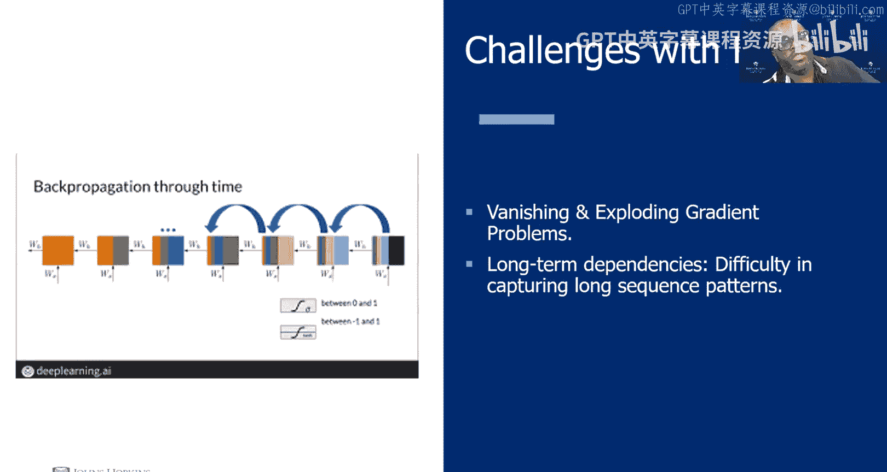

And so let's talk about。

Bdirectional R this is another form of a rN and so traditional r is process sequence from start to right from left to right conduct right and so some tasks require。

Ige of the future context to understand the current context。

RightAnd so income comess bi directionional RNNs right and they aim to harness both past and future influence。

so。And so what does it do right it maintains two hidden。

Layers for each time step right so it process equals both forward and backwards。

And so and what it does is it it comprehends both past and upcoming content。

And so the benefits there is a comprehensive understanding of the sequencing context， right？

It improves accuracy and tasks like speech recognition part and part of speech tagging and it provides like a richer representation of data rights so you kind of think how can you tell the information about the future well if someone when you think about speech if you're training it right if you train about like if you're giving it full sentences right and you won't give it a sentence at a time you're give it things that's going on in the future right and it kind of。

Right， sometimes words depend on like so what we're going to say in the future and so this is an idea of how you're able to use those bidirectional paths。

And so so what are some of the challenges right it requires right access to the entire sequence right again that's I come up with saying when Ha your language a lot of times you have access。

And so it's not ideal for online or real time tests。

Right increase computational complexity because you're doing two because you're doing four damn pass and pass you are I mean because you're doing past damn future。

 you have to store twice as much data right and you have a potential for kind of。Overfitting as well。

So again， so what are some of those？Realware applications right， name entity recognition。

 identifying entities boundaries reason and types right machine translation right。

 this is that context where language conversion， right audio signal。啊实先噶。

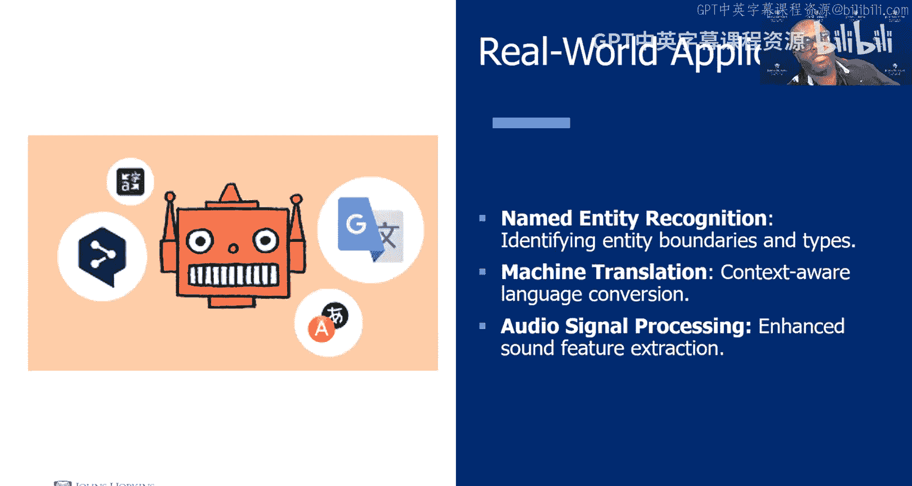

Okay， so now let's talk about encoded decor sequence to sequence architectures right so kind of like GNs so which youve seen be for auto encoders right but this is kind of in the in the realm of Rs as well so what is the encoder right it compresses the input sequence into a fixed size context vector。

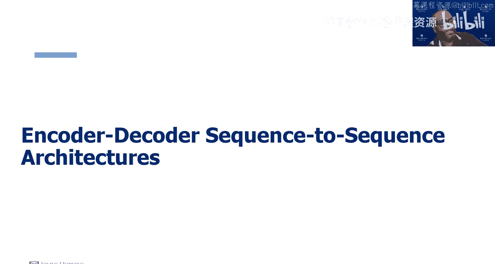

And the Ecota expands the context vector into the desired output space。Okay。

 and so what is the role of the encoder right is to process the input sequence。

 right it creates a comprehensive representation。And it passes the final hidden state as the context of the decoder。

 okay？And so what's inside the decoder right， it uses the context of the encodeder to start its operations and it produces the output sequence step by step right and so it can use attention mechanisms right to focus on different parts of the input sequence as well。

G。So what are some of those so benefits， right flexibility in handling arable length sequences。

 right， powerful and task like translation， summarization and questions answering， right？

And then right， encodedr andcoders can be tailored independently so based on the task。

So what are some of those challenges that relies really heavily on context actors to transfer information？

The longer the sequence。I mean， it might like lose our details and then attention academic can help。

 but that introduces complexity in it。

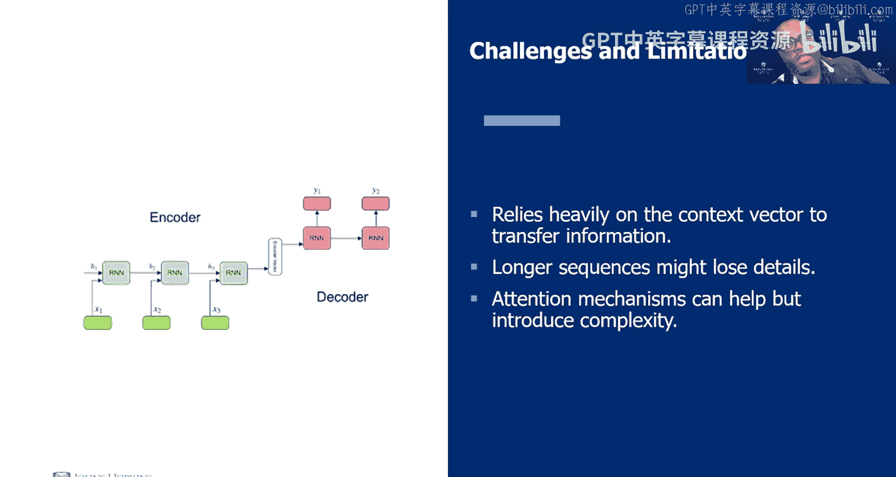

Okay， and so， you know， with every neural network we we tend to try to go deep if we can and's not and so that's no difference in this context and so what about deep RNAs？

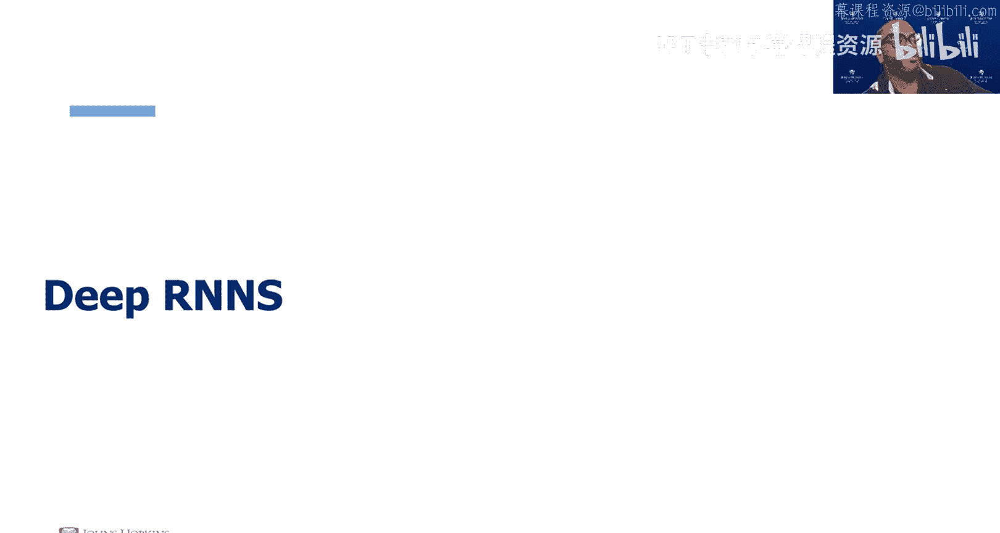

Right so a basic RNA handles sequences acting connections right so some of those shortcomings。

It struggle with long term dependencies so what's the solution that could do for that。

 well go deeper right， add more terms right and go and use a deeper neural network。

So why we do that more layers equals so richer hierarchical representation right and so it captures complex patterns and structures in this way。

 and you can also enhance the memoryum processing capabilities with more parameters， right？And so。

So what's the anatomy here right so multiple hidden layers between inputs and outputs right in each layer receives a hidden state from its preceding layer right and then the output of one of the layers is the input of the next one right。

The the anatomy there and right and the advantages there is as you know。

 it's hierarchical in nature and so you get a better feature extraction and you have enhanced out complex sequences。

And kind of improvements in tasks like language model and speech recognition。

And some of the challenges right and so increased the risk of vanishing and expding gradient training can be computational intensive and you need to be careful about the initialization of an advanced optimization strategies right particularly what RN is right this is true for all deep neural networks。

 but particularly it is just true for RNs。

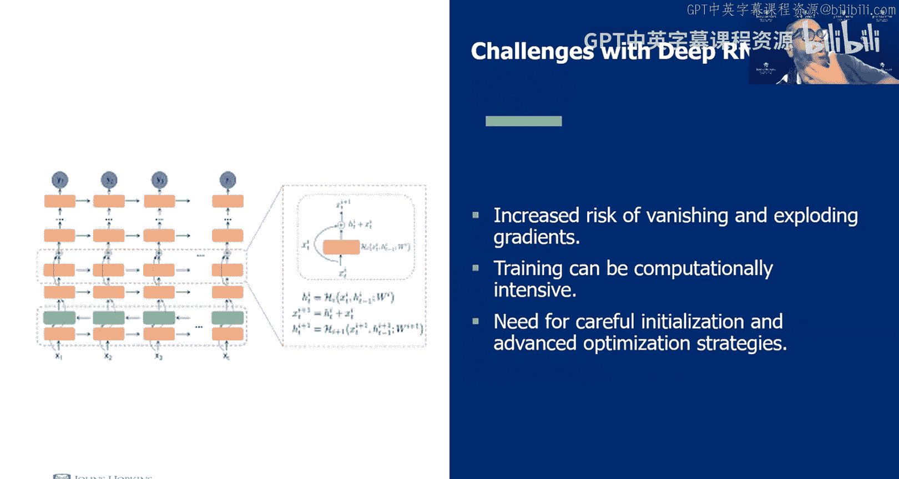

Okay， and so now you know we have Rine right， those are current neural networks。

 but let's talk about these things called recursive neural networks as well。

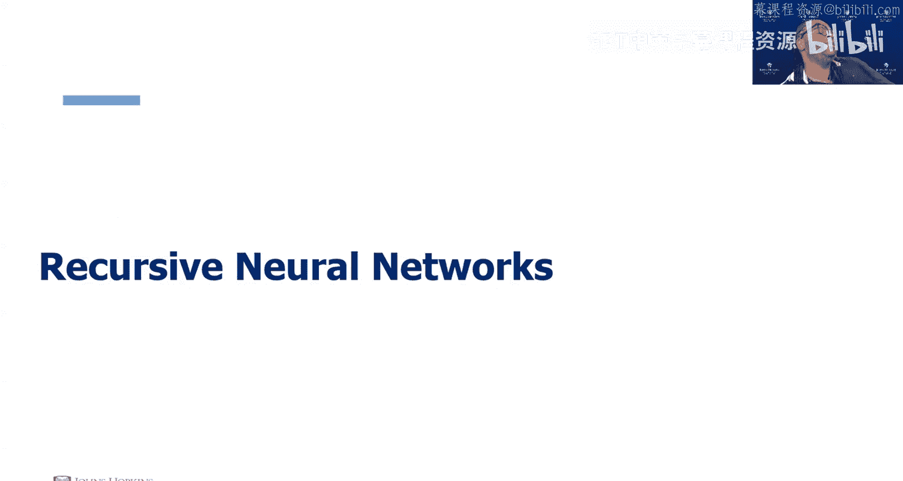

And so what is the idea there right and so basic RNs are suited for sequences recursive neural networks are suited for highererarchical to tree structure data okay so and so examples right actual language computer programs。

 abstracts， syntax trees， these kinds of things。Do that are interesting， right。

 for these hierarchical ways of thinking about stuff。

AndSo the core idea here is that data isn't always linear right it can it can be hierarchical and a lot of times it's hierarchical right think about right if I wanted to classify the animal kingdom or something like that right？

And so nodes in the tree combine and create higher level nodes right each node in the tree is represented so by a vector。

And so you combine child nodes to form parent nodes right and the use of weights of weight of matrices to merge node and pass through activation functions right and so recursive。

Proagation propagation into the root node is formed right and so kind of the same thing that you see here you kind of pass through the tree until you get down to the root node。

And so what's the math article representation， right。

 you have P right and it's this function F of W callss C1 and C2 plus B where P is that parent node。

And C1 and C2 are child notes right and w is the weight matrix and F is the activation function right and we a lot of times we use things like 10H。

And so what's the difference between recursive and recurrent right and so again。

 RNDNs are for sequencing in order matters right H in recursive neural networks a higher or high hierarchical matter and the structure of the thing that matters in this case？

Right and so applications of recursive neural networks so building syntax trees for cuses is a great example right semantic compositionality right。

 so understanding the meaning of cus based of structure on structures。

 things like COVID analysis these things foring abstract syntax trees of computational put istail。

ItSo right， it passes stretch De。It captures the hierarchical patterns。

 right and some of those limitations is more complex than that 100 and normal RNNs。

And computationally demanding， right due to that tree structure。I that we're dealing with， okay。

And so what are some of those variants right so tree LSTMs are one of them right and so they incorporate LSTMs right so we'll talk about LSTMs in a minute in a tree structure right and then recursive autoenrs for kind of those unsupervised learnings that have a tree structure into it。

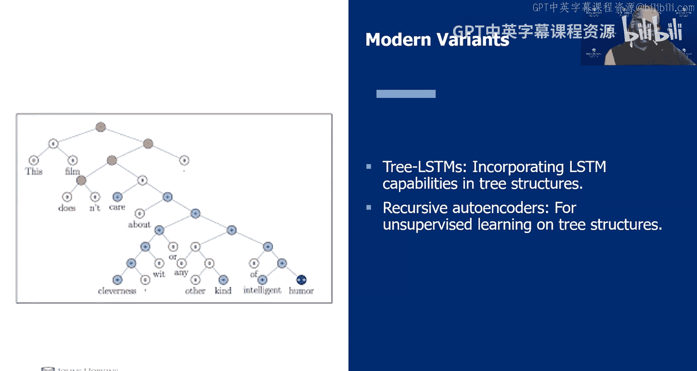

Okay so now let's start talking about stuff we've been saying kind of that like so one of the sticking points of these right here is these long term dependencies right so how are we trying to deal with those？

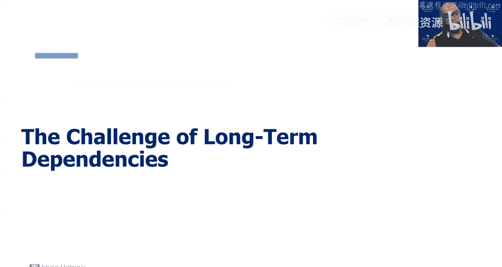

Right so Rs are designed to remember past information right。

 but how far in the past can we can we effectively remember right I mean in your brain right。

 how far past， how far in the past does your brain actually remember things right？

And so the challenge here is to connect is connecting distant paths with the present， right？

And so when does this happen right， when situations to where the current output depends on older inputs right。

 so Rs Ily should be able to capture these dependendencies right and so understanding the subject of a alone sentence is a great example of that。

You know the hilarious thing， how many times have you been in the middle of a long sentencecing right it was so long that you forgot。

 you know the beginning of the sentencecing like so what you even even talk about is maybe I'm sure in my age。

 but I've definitely done it before， right？And so gradients tend to get smaller during the back propation right so this is how come this kind of forgetfulness kind of thing happens right and so as a result the weights don't get adjusted significantly and at leads to forgetfulness in the networks。

😡，Okay。And so。So what that does is it makes the RNs become shortsideed and it only focuses on recent inputs and not the loan。

So it has a difficulty in learning patterns separated by considerable time gaps。

so this limits the power and potential of these vanilla irons。Okay。

 and so so what are some of the theoretical solutions there so creepiping that gradient right to handle the explosion is one of them right and then initializing the weights for better propagation。

 but like so what about that vanishing gradient right， what's the one of the things that we do right？

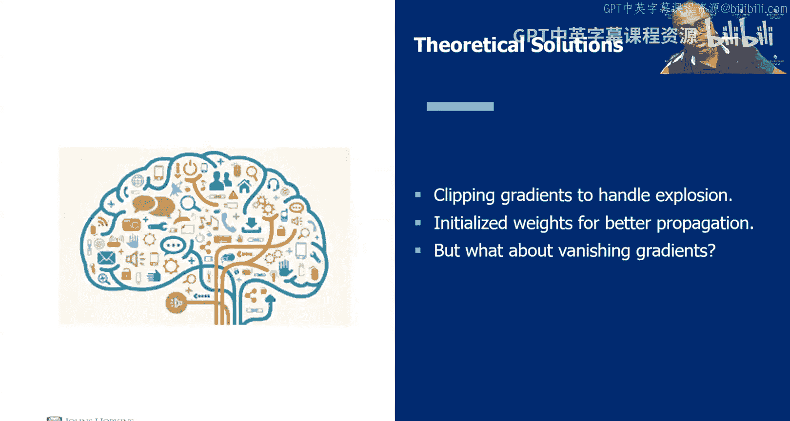

So incomes， right， the families。leaky sorry。Iki units and other strategies for long time scale right so RNA struggle with long term dependencies right and traditional units face that that expect that that vanish in the exploding gradient right and so we need strategies to handle multiple time scales basically right。

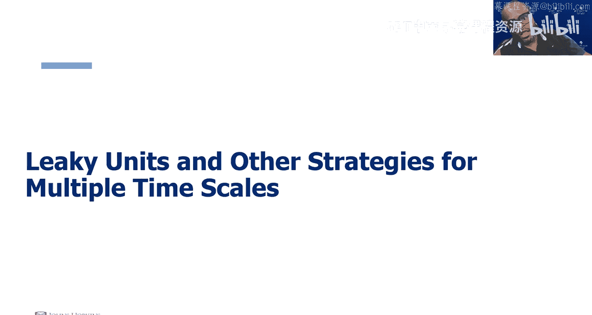

And so。And when you think about leaky Ro Ralu， the idea there is to maintain some memory the of the past days right and so leakki integrate the past integrates the past information here right and a that A is to depend on how much is going to remember。

 right？And so so modelto after Iki integration neurons in the brain right。

 so kind of the the you know it doesn't fire strongly， but like it stays on just a little bit。

 is kind of what's happening here。So small alpha means that the fast update debt adaptation to you know。

 kind of like so recent events， so it kind of you know have a small a it makes it to where it'll forget things quicker right large alpha is a slower adaptationature and it captures those longer term dependencies。

And so it gives R&M with spectrum of time， scales and sensitivities and what you would do throughout your network is kind of varied those As。

Right it's kind of say， you know， this is for long term things， this is for short term things。

 that kind of thing。Okay， and then other strategies include things like S connections across time steps right and so and then de diated recurrent layers and then hierarchical approaches with to multiple RNANs and we'll go through a few of these okay。

So it skip connections right it directly links in non adjacent time steps right so it kind of skips through the。

The network and what that does is that mitigates the vanishing gradient issue and then faster information for across time scales。

It's what it does there。And then with dilated recurring networks and so these are inspired by de dilated convolutions right and so Rna layers operate at different time scales and so it expands and expands the field without increasing the parameter set。

Right， right， and then hierarchical RNANs they had their that's a multiple RNAs stacked in a hierarchy and so higher layers operate at coar or time scales。

And so it efficiently captures some multiple scale temporal structures， right in this way。

AndSo so what is some of the importance of time skills right so real world data exists on multiple time scale think about stock markets right so you have daily prices but you also have things like you know totals over over a year or something like that right and totals over a month right these are things that we all capture right and so it helps en like speed synthesis and video analysis。

😡，And it improves RNs abilities to generalize and predict。

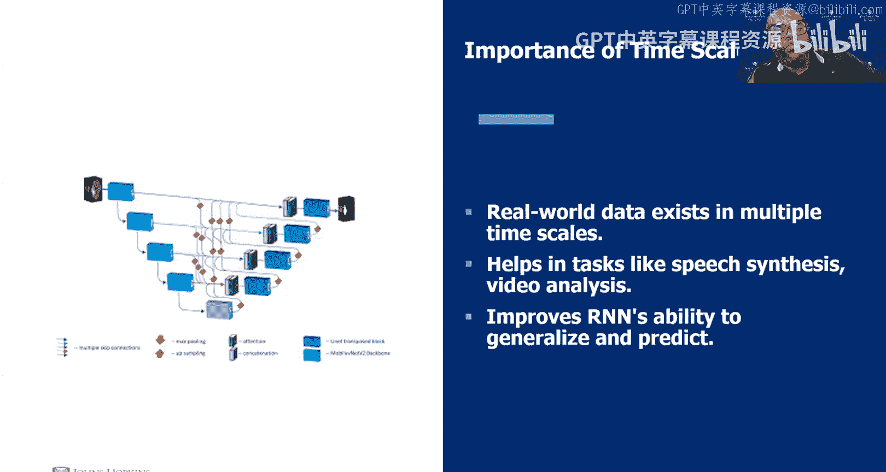

All right， and then now we have these things called short term long term short term memory and other dated RNAs。

 right？

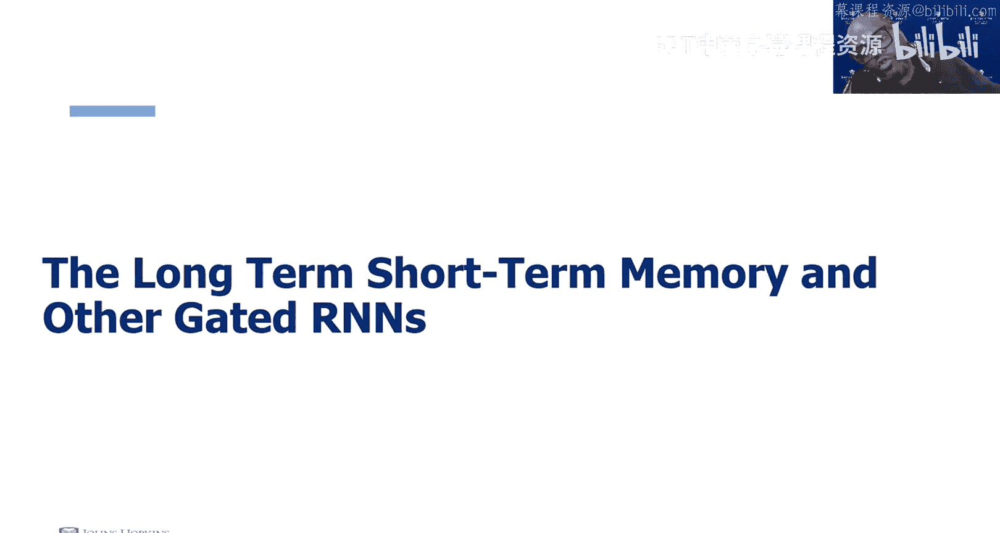

And so traditionally RN and vanishing traditionally RN。

Traditional RNNs have problems with vanishing and exploding gradients。

 right and so they have difficulty in learning long term dependencies right and so gated RNNs are a solution to this challenge。

 right？And so the famous LSTM， or long term， short term so memory sale was introduced by Hktra and Schmmiider right in '97 and it uses gates to control information flow right and so it was designed to remember information for extended periods of time。

Okay， and so there's a few elements of it there's the forget gate right。

 which has the the following equation that you see on the screen right here and it decides the information to throw away from the sales state and it uses a sigmoid to out to out。

Put value between zero， which is kind of like forget it and one， which is kind of like to keep it。

Do you have an input gate right and so so what that does is is it decides what information to store in your。

And it combines a sigmmaoid layer and a10age layer。

Okay and then you kind of update the extra sales stakes right and so you buying your forget decisions with your input against new value right and the key mechanism and this is the key mechanism to allow LSTMs to learn you know。

 those long term dependencies。Right and then you have your output gate right and so that determines the next hidden state and it uses the current cell state pass through a 10H right in order to do this。

And then so， you know， you know。I think that LSTMs are the ones that get the most attention right。

 but there are other gated you know RNNs right so we have。Adit recurrent units。

 and that's a simplified LSTM variant， right？And then you have highway networks， right。

 it's using g in fif。A floor net right and then you have you know other architectures that adaptedating some mechanism in some kind of way as well。

All， so what are gated recurring networks units right， and so would that would introduced in 2014。

And they combine forget and input gates and they have fewer parameters than your LSTM right and they're often you know equally as effective as your LS。

Right and so the importance of these guys is there are key components to things like speech recognition and kind of machine translation right and so they they demonstrate the ability to learn complex patterns dependencies。

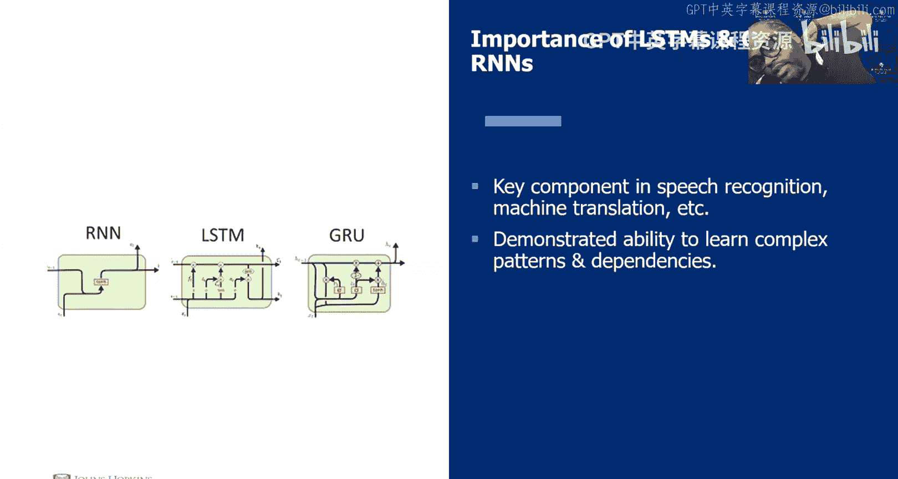

So how do you optimize these guys， right for a long term dependencies， right？

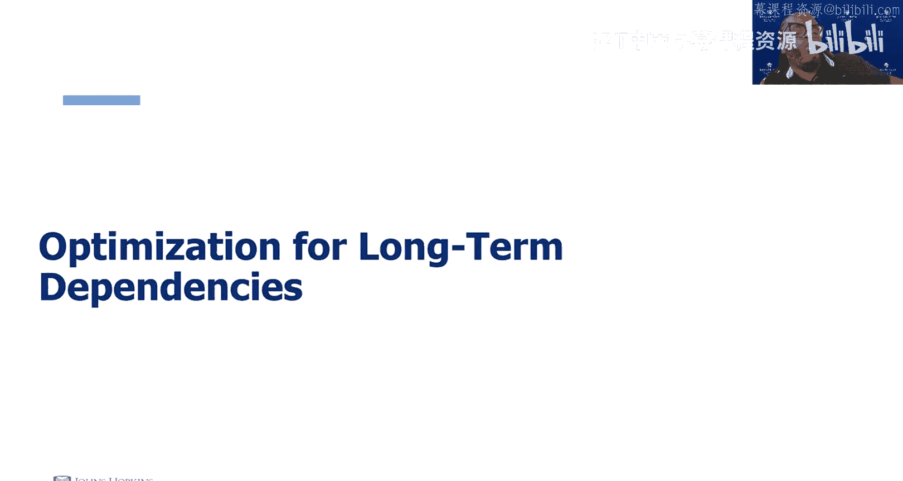

It's so right。嗯。You know。The one of the things that we are trying to do here is to figure out how to capture。

 you know long entry short term。嗯嗯。Depenencies right in RN， right？And so。What， you know。

 so what are long term dependencies right these are that we learn right and。

That we need to maintain over a longer period of time right and so traditional RNNs have limitations on that。

 particularly because of things like so vanish and exploded gradient， right？嗯。And so。

How do we do how do we combat that right so with exploding gradients we have a few methods one of'm as gradient clipping。

Right and another one is so what you do is you kind of say， all right。

 so once my group rating gets to this point， right。

 this large I'm going to clip it and I'm going to rescalell it。Okay， and then。

Addressing the And a gradient， right？Its kind of the this is the thing that we do so the way that we。

Kind to do that is in two ways so we introduce to different architectures like LsTMs right。

 we also do things like change activation layers like from 10H to things like like a Ralu or something like that。

Okay， and then we do things like the dynamic learning rate。

 so kind of adaptive earn rates things like RMS propp right in at so which we' talked about before and so what they do is that ask is it makes it converge faster right and it has so better performance because of right？

And then right there's also things like so weight initialization right and so this is going to impact training dynamics a lot right and so things like orthogonal initialization is a thing that we do it that we do a lot right and kind of like ensuring right and so the way that you。

Deth。Theyre kind of like heuristic or theoretical justification that is kind of ensuring the diverse like un。

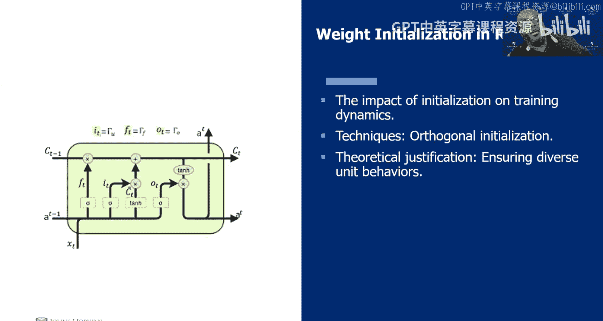

At the beginning of the training。And so that's recurren early that time， I'm in a nutshell。

I am excited for all of you to dive into a reader and we stand by for questions if you have them。

