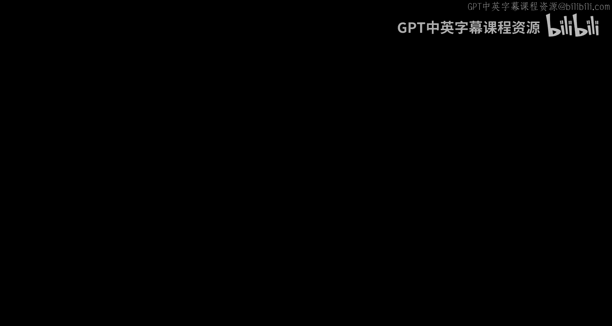
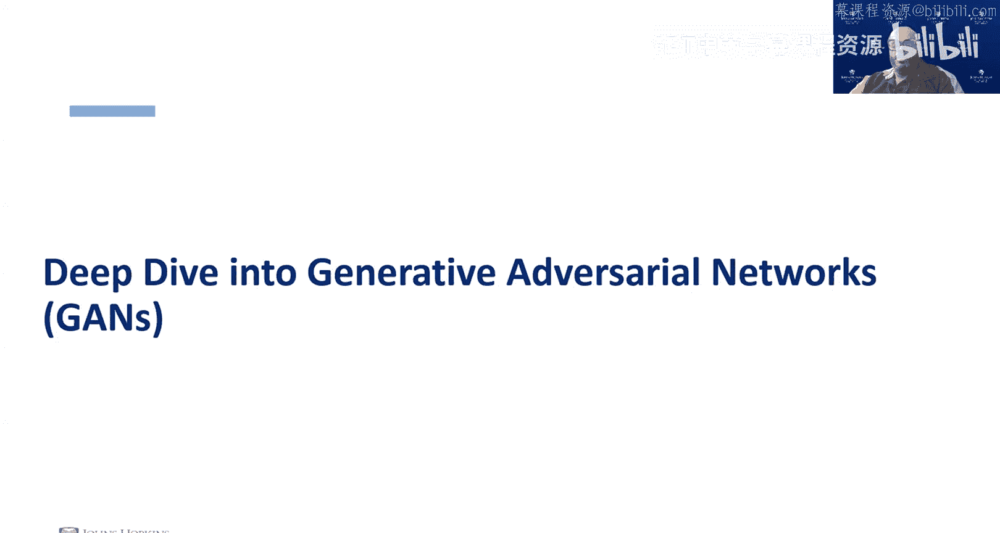
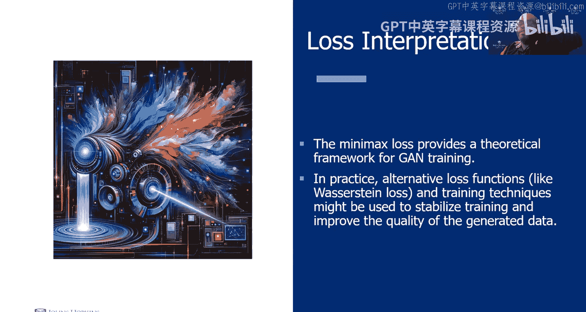
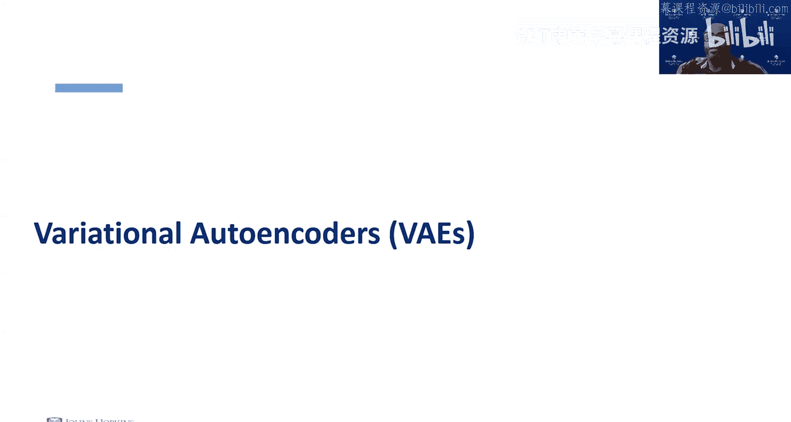
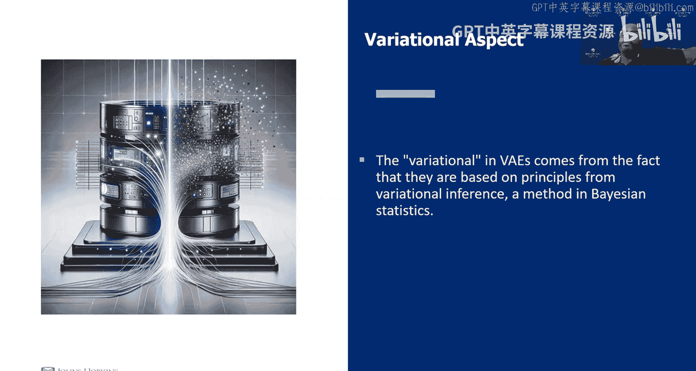
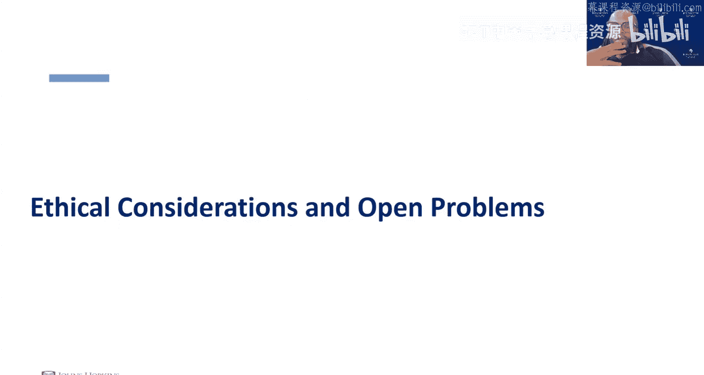
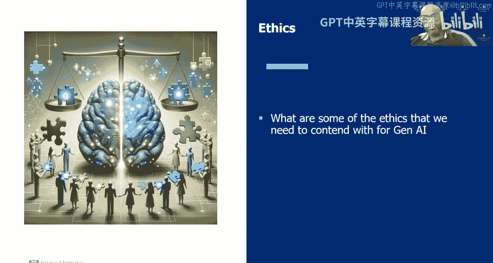

# 约翰霍普金斯大学《神经网络基础｜Foundations of Neural Networks》中英字幕 p10 2_生成式深度学习.zh_en -BV1w1uqzSEHZ_p10-

喂好。All right。Well let's start talking about kind of some of the。

Exciting parts well I think all of is exciting， but let's start talking about some of the things that you've seen in like the media and like in the news and stuff like that earlier。

 I mean so recently generative AI wanted to。Exciting part about the world of machine learning and also the world of deep learning and so we're going to jump into that for a second okay。

So generative models are a class of models that focuses on basically creating novel data right you get you train on some data and then you're able to create new data。

m in the process of that right and so unlike you know， the traditional things to where we kind of。

categorize or predict outcomes based on input data rightgenrative models learn the underlying distribution of the data and what that does is that enables them to create new data in the process。

So。😡，The characteristics of it is that it is's able to create new data right and so this can be a lot of things from you know music or imagess or text。

It's able to learn to underlying a distribution of data and so you because we are trying to create new data right you have to learn the distribution and so you're able to understand and interpret to underlying a distribution of it right and so what that does is that's able to create new inputs and is's able to create new outputs right and then it actually utilizes unsupervised learner which is actually really really great because as we know unsupervised learning is a really really important part of the field right and so like what you're able to do is learn things from unable data and start of requiring label data。

And so so what are right some of the big things about geogenerative AI right so the data augmentation right so it's able to generate additional training data which so which can be particularly useful when where when the original data is smaller and balanced right？

And it's also able to do things like like a nominly detection right so because you're learning the underlying distribution of the data right the model can identify outliers and anomalies right that significantly differ from your like a learning distribution。

You also are able to create like realistic data rights so we've seen these cool things from chat GT and from Dolly and all of these things right and so stuff like art and design and entertainment right generative AI is able to produce realistic images。

 music， text， etc right and that just kind of expands our creative。嗯。

Abilities some and then stuff like the data interpretation right so the model so if you want to if you model how the data is generated right then the models can help us understand you know the data distribution right which is often complex right and。

And what they's able to let us do is extract some meaningful as a pattern and stuff like that， right？

And then you're able to do stuff like semiupvised learning right so generative models can be used to improve the performance of models when there's a limited amount of data right and then there's unlabeled data as well so you're able to pair those together to make the data set larger which will make your gift model better。

Right and then things like data for privacy and so if you can generate synthetic data sets to mimic real data sets。

 you're able to train on models for privacy and things and things like that are a concern so you you don't have to use real data on things like HIPA data you're able to generate syn addict data and use that which will help us sidestep that problem or at least not large amounts of others data which。

Obviously， it' always a concern for us， right？Right right。

 and so so what so there are two popular models that we're going to go through here。

 one of them is general adversarial neural networks and the other one is variational autoencoders right and so GANs learn to generate new data that is indistinguishable from real data right and variational autoenderrs focused on encod data into latent in space and they're trying to reconstruct it after。

All right so let's do a deep dive into into GAS for a second and CC what's interesting going on here right so general adversarial networks or Gs right are a novel class of data models right and they were introduced by Ian。

Good fellow。And his colleagues in 2014。They consist of two main components that are trained simultaneously through adversarial processes。

 right the generator and the discriminator okay。And so the interaction between these two components is what makes gangs unique and powerful。

 okay？And so the generator's role right and again is to produce artificial data that's actually as realistic as possible right in general you're actually trying to trick the network into believing that that artificial data is actually real data right and so what you do is you start with a random noise vectorctor and you're going to sample it from your latent space right and transform this noise into data that it makes the real add function okay。

And so the input will be just kind of random noise right usually from a Gaussian or uniform distribution right those are the easiest things to produce right and your output is going to be data that resembles the real data right in so for example。

 images if the G is trained on the image dataset set right？

The architecture is usually' a deep neural network right and often a deconvolutional neural network in the case of a。

In the case image of image data right and the objective is to fool the discriminator right into thinking that the generated data is。

So what does discriminator do right a discriminator acts as a critic right so we're trying to trick this guy and so its job is to not be tricked。

And so essentially it is a binary classifier that says fake overal。

And so the input is the data out of instance right so which can either be real data from the actual data set or fake generator data by the generator right and the output is a probability score that represented in the likelihood of the。

Of the input that out of being real？And so usually again， this is on a D。

 it's often a convolutional neural network。For images right and so the objective is to basically say。

 hey， that's pe data and you can't trick me， right that's the idea。

And so the training process involves you know an optimization game like between two players right the generator and the discriminator right so we kind of playing a game that says let me give you something let me try to trick right and so the loss function used this context is often referred to as the men max locks。

And its and it's central to the function of the game right and so understanding that house function also involves grasping concepts of Nash equilibrium as it applies to kind of the way that we train those gangs okay and so we'll talk about Nash equilibrium in minute。

Okay， so train a discriminator， right So how do you do that， right， So in each training step， right。

 the discriminator is trained first。It's showing a batch of real data along with a batch of fake data generated to by the generator。

 and then the goal is to maximize the ability to kind of distinguish between the real data and the fake data。

So how you train the generator， the generator is trained is then so okay。

 so the generator is then trained， so you train the discriminator first。

And then you train the generator and the generator's output is fed the discriminator。

Right and then the generator tries to maximize the mistake rate of the discriminator right essentially trying to produce out of that the discriminator is likely to misclassify is real right so it's trying to trick and the discriminator is trying to not trick。

Okay， and so。You know， this is kind of an adversarial training process right the generator and the discriminator at constant battle with each other right is cool right and the generator is trying to produce increasingly realistic data while the discriminator is trying to get better at distinguishing egg data from real data right？

And so at some point you're going to get to an equilibrium right and so equilibrium point。

Is the training ideally reaches an equilibrium to where the generator produces perfectly realistic data and the discriminator is unable to distinguish the real data from the fake data right and so basically your ideal is to be able to get to where a discriminator is at 50 accuracy。

对。And so。The M loss is a type of objective function that reflects the adversary relationship kind of between the generator and the discsriminator。

 right？And so the formula right is based off of game theory and it' defined as the alphabet super that you see。

 I'm at the bottom here。Right， the one of them is kind of to maximize the。

The probability that you're going to trick the discriminator and the other is to maximize the probability or that they won't be tricked basically。

And so if you wanted to break it down right， that Earth term is the expected law that the discriminator correctly classifies the real data as real data and the discriminator tries to maximize this term right。

 and that second term is the expected law probability that discriminator will correctly classify。

eight data right and so the generator tries to minimize this term so it's again it's kind of a fight there right and so in simple terms the discriminator tries to maximize the ability to distinguish real data from eight data why the generator tries to minimize the likelihood of being detected this fake。

And so what Nash equilibrium is is a concept from game theory where it's a state in a game where no player can be interfere by changing their strategy while the other player keeps their unchanged。

So in the context of GNs， the equilibrium is reached when the generator produces data so realistic that the discriminator can't distinguish between really fake data resulting in the 50% classificationification accuracy right essentially is guessing and so at this point any change in strategy about a generator or discriminator it wouldn't improve their performance assuming that others does not change their strategy。

And so achieving that actual national equilibrium right is challenging because it requires the balance to oppose an objective function。

 right？So this often leads to issues like so model collapse where the generator produces limited varieties of outputs right。

And so in the context of gainsNs， right， the generator is tagged to produce data that is indistinguishable from real data。

Why the discriminator job is to distinguish between real and generated data right and so mode absent right occurs when the generator discovers a particular subset or mode。

Right where of data a distribution that constantly fools the discriminator right it's basically saying oh here's a good spot right I'm not going to use the full distribution I'm going to use this particular product the distribution because it it really really gives the discriminator hard time right。

And so as a result。Instead of capturing the full of data distribution。

 that generator starts producing like variations of these specific modes。And so。

So so what so why right so so so what's so what's so what's the big idea right。

 So failure to capture so so so if you if it goes on this road then what's going to happen right you're going have a failure to capture the before the out distribution right so ideally the generator should learn the entire out distribution right in the mode collapse。

It only learns a part of it， right， and it leads to a lack of diversity in generated data samples。

 right？And so how does that impact learning， right the adversarial training process involves a delicate balance where both the generator and discriminator improves over time。

Okay and that mo disrupt this balance as the generator gets stuck producing certain types of outputs and the disc scriminator doesn't get a chance to see a representation of the variety of generateder data right so it's batable part。

嗯。And so how do you do this so how do you address that right and so and so you have this thing called experience replay right and that's keeping a memory of the page generated data and showing it to the discrimator so it doesn't forget page generated distributions right and then that's also architectures right so using different G architecture such as the wire string again which you'll see in a paper that i'm going to assign you right and that's going to have a different loss function that can。

Idiiggate your remote collapsing， okay。And then there's also so many batch discrimination right and so ensuring that the discriminator looks at multiple added points at once right which can make it harder for the generator to keep producing the same outputs right and then there's another one called like you can actually unroll yourgan right and so providing the generator with feedback based on several steps of the discriminator training。

Giv it a broader perspective right of the discriminator strategy， right？

And then you have experience replay， right and this is keeping them。I said that I really sorry。

And then you also have stuff like。Inefficient training right and so since the inertor keeps producing right these are other problems right since the inertor is。

Producing similar outputs。U the trainer becomes redundant， leading into inefficient learning。

 right and so。Ways that you can evaluate this so mold collapse can impact the evolution of the of the G right and so Es like inception score and fresh of it。

Inception。Distance used to evaluate that quality of that diversity。It may give misleading results。😡。

If the few modes generated are high quality， but like not diverse。喂。

And so in practice right perfect national equilibrium is actually rarely achieved right it's really really hard to get to that instead the training process involves finding a satisfactory point right or a generator produces sufficiently realistic outputs。

Right。And then the Min Max loss provides a theoretical framework for G traininger。

 but in practice alternative loss functions like。The wire stress loss and training techniques might be used to stabilize training and improve the quality of that generated data。

嗯。And so what are some applications of Gs right so imaging videos hypoes right so GANs can be used to generate you know photoreistic images and videos right and they can create you know virtual training。

Urtually I based augment do that add a sense for training computer vision right these are cool things that they can do there's also stuff like style transfer right where they are used to apply the style of one image。

To the content of another， and this is popular in creating artistic imagery。

Or transforming photos to match certain artistic aesthetics， these kind of things。

And then there's super resolution， right， so this is kind of enhancing the the revolution of images right and it's known as super resolution。

I mean， it's another application where GANs excel， right， and it adds。Details to upscale images in a。

There's the data augmentation right and so in situations where you don't have a lot of data right GANS can generate additional added data to training machine learning models。

Especially and this is especially useful for stuff like so imaging。

And then drug discovery right so GNs have been right applied to generate。

Elecular structures that could potentially be new drugs speeding up that drug discovery process。对。

Then there's a anomaly detection right so if you learn the normal distribution of the data right GNs can be used to the tech anomalies in the data。

And， you know， you can think by these for applications and say like security or ethical diagnostics or things like that。

It didn't have stuff like。Deep fakes and cloning rightgans have been infamously used to create。

Stet fakes and these are highly realistic and convincing videos of people doing or saying things they never did。

Along with things like calling their voices and things like that。はい。So that was Gs right。

 let's start talking about variational autoenrs and kind of look at a different。

 you know kind of so way of generative models right and so variational autoenrs are a type of generative model that learns to。

In code data。Into a a latent space right and then deded back to the original。

so that's kind of the normal way that auto and encoders work， right。

 but as there's an interesting part two of the architecture of the variation actual autoencoder。

I'm a compose of two main parts， there's the encoder and the decoder。

Which actually work together in a particular way to enable both generation of new data and reconstruction of existing data。

嗯。And so what's the purpose， right， the purpose of the encoder。

Right iss to take input data and compress it into a large dimensional representations right and the process will involve learning the parameters of the。

Ability distribution， right， it should be typically a Gaussian。From which that。

Ly and variable is sample right and so the input would be the original data。

I mean output would be parameters of the invariable distribution right。

 so in particular if it's a Gaussian you would want to mean in variance。All right。

 and so the architecture is usually a neural network and it can be a fully connected network or for simple data or a convolution one for things like images。

 okay？And the final layer output。The final layer outputs， the parameters of the latent distribution。

 such as the mean and the log variance。For each of those was Latin mirror。So， so what is the。

Lightnt space doing right so the8 in space is where the guide is represented in a compressed form。

 okay？And in VAEs， right， this space is defined hyperbabilistically。

And so instead of encoding an input as a single point。

 the encoder outputs parameters that define a distribution of a possible values in latent space。Okay。

 and so what you could do now is you can sample that space right so to generate a new latent variable right。

 the model samples from the distribution defined by either encoders output。

Okay and so this stochastic step right is crucial right for the generation properties of the variation autoenderrs right so in order to make this ajoerative model。

 this is what you need to do。嗯。How about the decoder right the purpose of that is to take the late initial representation and to reconstruct that original input data。

Im mean as closely as possible。And input is a latent space representation right and the output is a reconstruction of the original event。

And the architecture is again used in a mineral network， right。

 and it's typically structured in a way to mirror the in。And so for images。

 this might actually be a deconvolutional neural network that upsles that latent into representation back into the original dimensions。

Okay， and so。So in the case of the data reconstruction right。

 the encoder and the decocor are used in sequence right so the input data is first encoded into the latent space and then it's decoded back into the outer space and what you want to do is you want to aim to match the original data okay。

And so for generating new data， right， one can sample new latent variables from the prior distribution right and pass this through the decoder to create new data。

喂。And so the variational part of this right comes from the fact that they are。

Based on principles from variational inferences and that's of method in Bayesian statistics。

Okay。And so the VAE trains by actually maximizing evidence right on the laable likelihood of the data。

 which involves actually two times the reconstruction loss right and that encourages the decoded sample to match the original input and the KL divergence which is a regularization term that measures how much the learn latent variable distributions differ from the prior distribution right so this term ensures that the latent space has good properties and it enables and it enables us to generate the data in that way。

All rightAnd so variational autoenclosures uses aational inferences right。

 and this is a technique from so Bayesian statistics。And so that to approximate the Interable。

 I'm sorry， intractable posterior distribution of。Laynt variables with the track， okay？

And so it's done by introducing a variational distribution Q sub sigma right。

 and ass usually often assume to be Gaussian right and that's a function of the data X parameterized by Sigma。

Right， and those are typically the weights of the neural network。嘅。

And so this aims to make this aerationational distribution close。

The true posterior distribution where sigma， I'm sorry with Ada， right。

 are the parameters of the model。哎。AndSo VAs optimized。

They optimize the variation of lower bound right this is also known as the evidence lower bound or the elbow right on the marginal likelihood of the battle right so that elbow was given by the equation that you show on the screen there。

And the first term right is the expected law law actually the data added given by that latent variable right and what it does is it encourages the decota to reconstruct the data accurately。

And then the second term is the callback I believe divergence， right。

 we call it the KO divergence right between the variational distribution and the prior distribution of the in variabless and that acts as a regularizer and encourages Q sigma to be similarm to PLZ。

And so the KO diversion is a measure right of information theory that quantifies right how when probably。

How one probability distribution diverges from the second right expected probability distribution。

And so in the context of VAEs， the KO diverg plays a crucial role in ensuring that that learned ba in space has good properties and that the variation of distribution is as close as possible to the true posterior distribution。

And so the KL diversityversion also acts as a regulariz， right？

And so it penalizes aational distributions right that are far from the。Poeror distribution。

and so what this does is it encourages the encoder to map inputs to latent variables in a way that resembles the assumed prior。

 leading to a more structured and interpretable latent space。Okay， and so。And so how do you？Balance。

 right， the reconstruction and the regularization right and so the complete。

Laws function of a VAE is composed of two terms right as the reconstruction loss and' the and ass the KL divergence right and's sort of about balancing the reconstruction laws with the KL divergence that that VAE learns to compress data into a latent space that not only allows for accurate reconstruction but also adherehers to a specific prior distribution as well。

And so this balance is crucial for a generation of data。

 and it's to that's similar to the training data。And so you can also facilitate the sampling of processes with the KL divergent right and so what it does is that it ensures the variables are distributing them and thats similar to your prior。

And it becomes possible to sample from the prior distribution and generate at a points store decoder。

And so without this that decokoder could generate could not generalize will to run themselves from the prior。

 right， so that's really important。And so the KO divergence between two continuous probability distribution is given by the following。

Right and so in the context of the VAE where you know Q's sigma of Z given x is the variational distribution of P of Z is the prior distribution over the latent variable right and so the K divergence。

Term in the VAE loss function， it can often be computed analytically。

When both Q and P of Z are galaxy， right， so when you have that galaxy and you're able to do that only。

So in practice， dec divergent terms helps to avoid posterior collapse。

Where the variation of the distribution ignores the input x and instead it closely matches that prior。

Okay， and so this should make the latent variable Z。嗯。

Kind of uninative right of the data X undermining the model's ability。To create， you know。

 meaningful and representative。Diveversion say， so I said no， no。

And so there's a way to get around of it right that's the re parameterization trick and it's critical to training the variation of autoencoder and it allows for the back applicationreation of gradientdish through a stochastic process。

But the trick is necessary because the samplingpl operation。

 which is inherent in the variational inference is not differentiable。

And so it can't be passed through a random node。Well for optimization， using a gradient descent。

And so， you know， N avaE， the encoder network output。

Prameterters right of a probability distribution right and that represents on a latent space and so to generate a latent variable one should sample from this distribution right the one that's given on the screen。

And the random sampling process poses right a problem for radio based optimization。Um。

 as that as like there's no way to actually compute the grading of a random variableum sort with respect to the。

The actual network prim。Okay so to kind of go around that right the reparameterization trick redefines the random variable Z in such a way that it no longer directly depends on the inherent randomness right and so instead of the random the randomness instead the randomness is kind of separated out right to where that epsilon is given as an auxiliary variable sample from the sample from a simple distribution。

U，And that pun circle with a dot there that knows to paraze the multiification。

And so mu and sigma are still outputted either encoded， but the sampling is now deterministic。

 right that function is a determination as a function of mu sigma and epsilon， right？

And so with the new representation， so with the new parameterization。

 the gradients can be computed with respect to mu and Sigma because epsilon is independent of Sigma at this point。

 and the stoacity is external to the model parameters。对。

And so so what are some applications to the right so there's dimensionality reduction right and so they're used as none any dimensionality reductions right where they can learn to encode data in a lower dimension space and then reconstruct it。

They can also generate text， right？They have been seen to generate coherent and diverse paragraphs of text。

And have applications in natural and processing and machine translation。

They also do things like so recommenders systems， right， so they can be used to model。

 user a preference and predict items a user might like。嗯。And then as speech synthesis right。

 so they have been used to generate human like speeches and it contributes to like。Texas systems。

 drug discovery， GNs and VAEs have been used to generate novel molecular structures for drugs developments by actually learning the distribution of the drug of the drug molecule。

And then there's semi superupvised learning， there's interpretable AI。

 so interpreter AIs that the latent space of VAE can be examined and manipulated to understand the factors of variation in data。

 which is useful for creating an interpretable AI system。

All right， so。You know。So we've kind of， you know， started talking about ethics in AI。

 but right so what are some of the ethical iterations that we need to think about so when we start you know。

 are any things in generative AI， right？And so I'll leave you with that question and I'll always ask that it's on your mind and stuff like that。

 like you sing good。Great cases of Genative AI we've also seen back as Genative AI and so as practitioners of this craft。

 you know， my challenge to you is to always have this thing in mind and to ask yourself。

 so why do you want to use it？

Right，And if there's any questions， I will see you in email or in chat。

