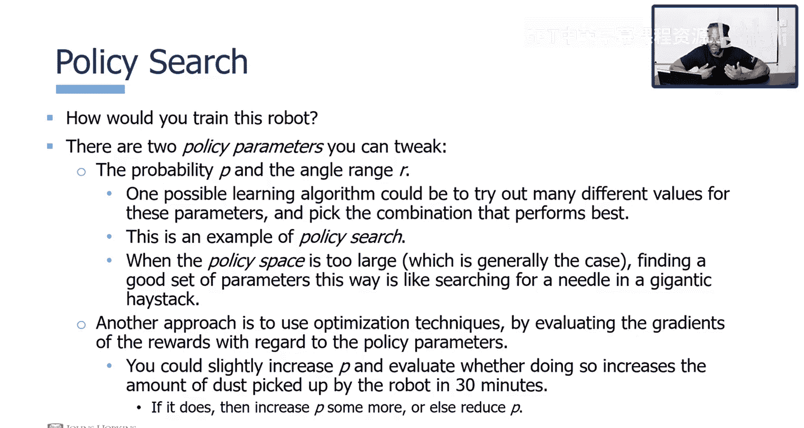

# 约翰霍普金斯大学《神经网络基础｜Foundations of Neural Networks》中英字幕 p11 3_导论与策略搜索.zh_en -BV1w1uqzSEHZ_p11-

So we're talking about reinforcement learning or kind of giving a little sample about so what it is kind of the problems that are are interested I interested about it so let's go ahead and jump into it so so what is it right it's kind of。

People kind of think of it as in between supervised learning and unsupervised learning。

 it's kind of this weird branch that sits off。On its own and it deals with learning how to make sequential。

Decisions on a problem when you have kind of like limitedent feedback。

you's what you can kind of think of it and so it's been around since the 50s so some of those around the same time that supervisor I know was being talked about this is also being talked about。

And it's had many successes， games and all of those kinds of things， bat gamut。

 and all of other things。And in 2013， some researchers from British this startup called DeepMd actually demonstrated that a system that they built could learn and play most Atari games and it even outperformed so most humans in those cases。

And so they only used raw pixel data as inputs， and they had no and the machine actually had no prior knowledge about the game。

And so this was the first series of amazing feats and actually in 2016 there was a system that was made to play off of golf。

Against Lee Soto， who was a legendaiary professional player of the game。And in May of 2017。

 they played against TG and they were both and the both of them were actually like the world champions of that game and the machine actually it won against them。

嗯。And so no program that was previously made had ever even come close to be the masters of the game。

 the game is a super complex game， it's more complex than chess。It has， you know。

 the amount of states that it has is more than the number of。

Particles in the galaxy so it's a whole it has a lot of states and so it was actually an amazing heat to be able to be a human being or a master at the game as compared to something like checkers to where that。

That only has a finite amount of states right I mean Algo has a finite amount of stake too is huge。

 but chess only has a small amount of states and so that company was actually eventually。

Pought out by Google and they paid over $500 million for it and so how did Deep my that actually achieve this right and so in hindsight it was actually pretty simple to do it right so what they did was they applied the power of deep learning to the field of reinforcement learning that was the way that they did it and so what we'll do is we'll first explain what reinforcement is and what is's good at then we'll present two of the most important techniques and deep reinforcement learning as policy gradients and as deep Q networks okay。

And so in reinforcement learning， an agent actually makes observations that takes actions in some kind of environment and so the agent in turn actually receives rewards。

And the object is to learn and act in a way to maximize the expected reward over time right so you can kind of think of positive rewards as pleasure and negative rewards as pain and so using that analogy so what the agent tries to do is learn how to learn actually by trial and error right how to maximize pleasure and minimize pain。

And so it's it's actually a quite broad set in and it can be applied to a lot of tasks and here's a few examples right so the one of them is that the agent can actually be。

Beed a program that controls the robots so so robots this is actually one that is pretty popular in the field right and so in this case that environment is the real world。

I mean the agent observes the environment through sensors and stuff like cameras and touch sensors and the actions actually consists of sending signals to activate the motive right kind of to move about the space in that kind of thing and so it can be programmed to get positive rewards whenever it approaches the target destination and negative rewards so when whenever it's wasting time or goes in the wrong direction or something like that Okay and so another one is Peman or。

Btgam or something like that right and so in this case the environment is a game right the action is the non possible joysticks position right up down center and all of those right and the observations of screenshots and the rewards suggest the game points right？

And so again， right， stuff like Alpha Go， you know， the as the board for Alphago， you know。

 that's another one as well。And so you can also think about something like a smart thermostat right there's thermostats that I actually use to reinforcement learning right and so in order to get a positive reward you have to figure out the target temperature that a human wants or you want to figure out how to save energy and an negative reward is when a human needs to tweak temperature in some way right and so the agent it actually has to learn how to anticipate a human needs and so the agent can actually observe a stock market right that's another one and decide how much to buy or sell every second。

And what was obviously so monetary games and losses are out。

But then there's also this interesting situations too to where there's situations to where you don't even have a positive reward right and so an example is is if an agent is moving around a maze or something like that right and so again you get a negative reward every time every time step that you're in the maze so you want to exit the maze as fast as possible so that's an example of where you don't have any positive rewards at all okay。

And so right， so what is policy search， that was one of the things that we said that we're going to talk about so the algorithm。

Which is an agent uses the it's the algorithm that an agent uses。

To determine its actions as we call policy， and the policy can be any algorithm that you can think of and doesn't necessary to have to even be determined。

OkayAnd so an example is to consider a robot vacuum cleaner whose reward is the amount of dust that it picks up in 30 minutes。

 say。Um， and so its policy could be to move forward with a probability of pe per second and to randomly rotate left the right。

With the probability of11 minusP right and so that policy will involve some kind of randomness of some sort and so it's called a stochastic policy okay and so the robot will have you know kind of at trajectory trajectoryjecties that' sometimes and there's a theory that actually guarantees that it'll eventually get to any place that it can reach and pick up all of the dust。

The question is how much does so pick up in 30 minutes right so you kind of want to maximize that amount that you're getting in 30 minutes。

And so an easy follow on question for that is how do you train that right you know how would you do that right and so there's two policy parameters that you can tweak right the probability P and your angle are and so a possible learning algorithm could be to try out any of those values these parameters and then you pick the one that performance the best。

And so this is an example of something that we call policy search。

And so when the policy space is too large right which is actually the case in most cases finding a good set of parameters this way is like searching for like a needle and a hastack right it's a large it's a large problem right so another approach is to use optimization techniques right by evaluating the gradient of the rewards with regard。

To like the policy parameters。And so you could slightly increase P。

And evaluate so rather doing so increases the amount of dust picked up by the amount of by the robot in early0 minutes and so if it does。

 then you increase piece of more or should reduce pe right so this is kind of a constrained way of doing it。

ok。