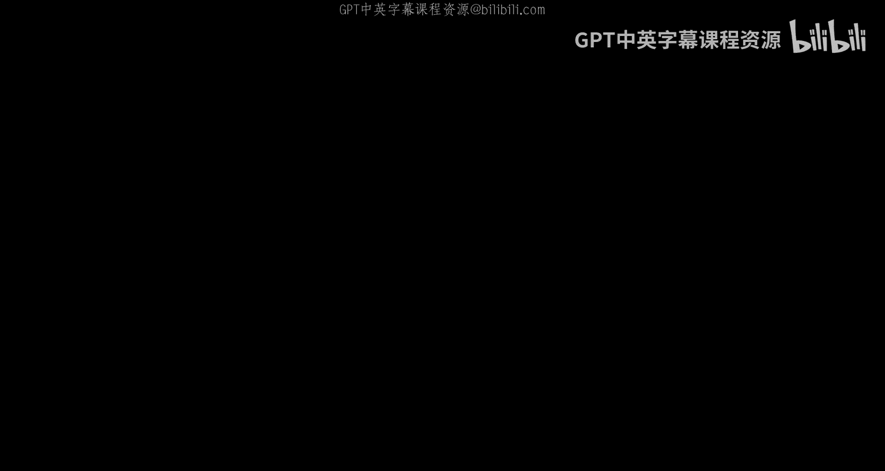
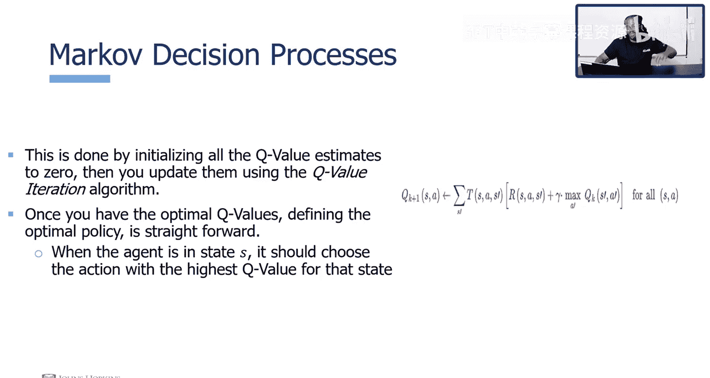

# 约翰霍普金斯大学《神经网络基础｜Foundations of Neural Networks》中英字幕 p12 4_马尔可夫决策过程.zh_en -BV1w1uqzSEHZ_p12-

One of the big assumptions about problems that are sit in reinforcement learning is usually that you assume whether it's a Markoff process。

Okay， and so what is that right and so in the early 20s Andrew Markoff studied stochastic processes with no memory we call them Markov chains and so these processes have a fixed number of states and it randomly evolves from one state to another at each step。

And so the probability for it to evolve from a state S to a state state as prime is fixed and it depends only on the pair S prime and not on past states right so it's memoryless it doesn't care what happened two steps before or two steps after it only cares about what's happening right now okay Bellman found a way to estimate the optimal state value of any state S。

Not V star here， so which is the sum of all of the discounted future rewards that agents can expect on average after it reaches a state S assuming that it acts optimal right so what is that saying right so basically he found an equation to basically say if I'm acting optimally。

😡，So what's my expected reward if I go to step S is basically to what he's asking right and so how should that。

So he showed if the agent X optimally， then this thing called the Belman equation applies。

 which is the thing that you see here on the right。

 and so this recursive equation says that if the agent X optimally。

 then the optimal value of the current state is equal to the reward it would get on average after taking one optimal action。

Plus， the expected optimal values of all the possible in next states that this action can lead to。

And so in case， in that case， TSAAS hat， I mean S prime is the trans probability from state S to state S prime。

 given that the agent chooses action A， okay， and R SS prime is the reward that the agent gets when it goes from state S to state A。

 given that the agent chose action A。And so that gamma is a discount of。Factor of some sort。Okay。

And so this equation leads to an algorithm that can precisely estimate that optimal state value of every possible state。

And so you first initialize all the state value estimates to zero and then you iteratively update them using the value iteration algorithm okay and so a result that's pretty cool here is that given enough time these estimates are guaranteed to converge to the optimal state value corresponding to the optimal policy okay and so in this equation so Vi sub K of s is the estimated value of state S at the case iteration of that algorithm okay。

And so knowing the optimal state values can be actually pretty useful and so this can be useful in evaluating the policy。

 but it does like it doesn't give us the optimal policy for the agent right and so Bellman actually found a very similar algorithm to estimate the optimal state action values and that's generally called Q values so quality values。

And so the optimal Q value of a state action pair essay and they that as Q star is the sum of the discounted future rewards。

 the agent can expect to on average after it reaches the state S and chooses action A。

 but before it sees the outcome of the action assuming that it act optimally after that action。

So you know。And so this is done by initializing all of those Q values to a zero again right and then you update them using the Q iteration algorithm and so once you have the optimal Q values defining that optimal policy is going to be straightforward at that point and so when the agent is in state S you would actually choose the action that has the highest Q values for that state obviously that started to do it。

