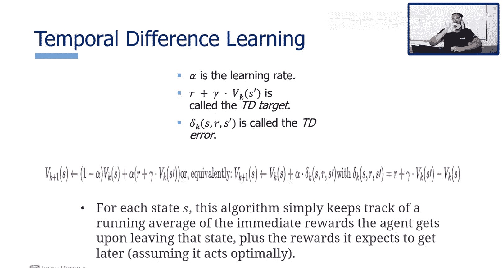

# 约翰霍普金斯大学《神经网络基础｜Foundations of Neural Networks》中英字幕 p13 5_深度强化学习网络.zh_en -BV1w1uqzSEHZ_p13-

So let's actually create a neural network so policy right so we had A decision processes and we figured out ways to basically say unless issues iteration right but alpha forgo right that was solved using a neural network so how did they do that right the network would take an observation as input。

And it will output the action to be executed。Okay， and so so more precisely。

 it'll estimate a probability for each action， and then it will select an action randomly according to the estimated probability。

And so。Ovious question right so why are we picking random actions based on the probability given by that neural network rather than just picking the one that has the highest score right an easy that's an easy question right and so this approach actually be the agent find the right。

Balance between exploring new actions。And exploit in the actions that's known to it well right so here's an analogy right so suppose that you go to a restaurant for the first time and all of the issues look equally good so what you do is you just。

Pick one at random right and so when you pick that when it turns out to be good a good dish and so you have an increased probability that you'll order it the next time but that increased probability shouldn't be 100% right and it shouldn't be 100% because if you do that you won't ever try any other dish right and some of those dishes could be actually better than the other dish so it's the same kind of thing going on here now we have a neural network policy that we will take observations and outputs action and it outputs action probaities and so the question is not how do we train that right？

And so if we knew that the best action was at each step， we could train that neural network as usual。

 right so we could just test it as a。😡，Supervised earning problem right and so you would any you would actually just go ahead and minimize that across entrytropy score that we've been thinking about between the estimated probability distribution and that target。

Probability distribution and so it would as be a normal supervised learning problem right but in reinforcement learn the only guidance that the agent gets is the reward itself right that scar value that reward itself and the rewards are typically going to be sparse right and delayed。

And so this is called the credit assignment problem and so when the agent gets a reward it's hard for to know which action it was credited for or it was blamed for right okay and so it wasn't another allergy or that right imagine you had a dog your dog you told your dog to sit your dog set but you rewarded it 30 minutes later the dog does not know that you rewarded it for sitting it's like I don't know what you rewarded me but thank you anyway and so that's the。

That's the analogy there and so to tackle that problem。

 a common strategy is to evaluate an action based on the sum of all of the rewards that come after it right？

And so you usually and you usually apply a discount factor when you do that at each step， okay。

 and so this sum of the this kind of rewards is called the actions return。And so of course。

 a good action may actually be followed by several bad actions right as an option right and so we want to estimate how much better or worse an action is compared to other possible actions on average。

Okay， and so what this is called is the action advantage right and so for this you must run many episodes and normalize all of those action returns by subtracting the mean and dividing out of standard deviationtion。

And so after that， you can reasonably assume that the actions with negative advantages were bad while the positive advantages were good。

去。And so policy gradient algorithms optimize the parameters of a policy by following the gradient towards the higher reward which is what right and so one popular class of PG algorithms is called so reinforce algorithms。

And it was introduced by So Ronald Williams right and so here's a common variant of that right and so first you let the neural network policy play the game several times and at each step you compute the gradient that would make the chosen action even more likelyly but don't apply these gradients yet okay and then so once you run several episodes you actually compute the action advantage okay？

And if an action's advantage is positive， it means that if the action was probably good and you want to apply gradient the gradients computed earlier to make the action even more likely to be chosen in the future。

 right and if the action was negative，😡，the action advantage was negative。

 it means that that the action was probably bad and you want to apply the opposite gradient to make it less likely in the future okay and so the solution is simple to multiply that each gradient vector by correspondingent action action vector okay action advantage and so finally so what you do is you compute the mean of all of the resulting gradient vectors and use the and use it such a performa of。

80 though。Okay， and so reinforcement learning problems with discrete actions can often be out of as alcohol processes so that we said that earlier。

 but the agent doesn't know in the beginning， so what's the transition？

Our abilities are right it's a completely dumb age it doesn't know anything about infant right so it also doesn't know so what the reward is going to be or anything like that right and so it has to experience each state at each transition at least once。

To all the rewards and it must experience them multiple times if it if it is to have a reasonable estimate of the transition probability and one of the funniest things to actually watch is to watch a video of a R agent like learning over time right because in the beginning of that it's literally doing the dumbest things ever it like randomly running around and doing weird stuff so it just has to experience everything first okay。

And so the temporal difference earning algorithm is very similar to value iteration。

 but tweak to take into account the fact that the agent is only partial knowledge of that MDP and so in general we assume that the agent initially knows only the possible states and actions and it doesn't know anything else and so the agent uses the exploration policy for example right and that she saying is doing purely random things to explore the MDP and as it progresses the T earning algorithm updates the estimates of the states value so based on the transition and rewards that are actually going to be observed okay。

And so here's the equation right here right that alpha is the learning rate R plus gam of EKS9 is called that TD target and that Delta there is called the TD Air right and so for each state S。

 the algorithm simply keeps track of a running average of the immediate rewards the agent gets upon even that state plus the rewards it expect to get。

Later and that's again， assuming that you're going to be acting optimal in some sense。

