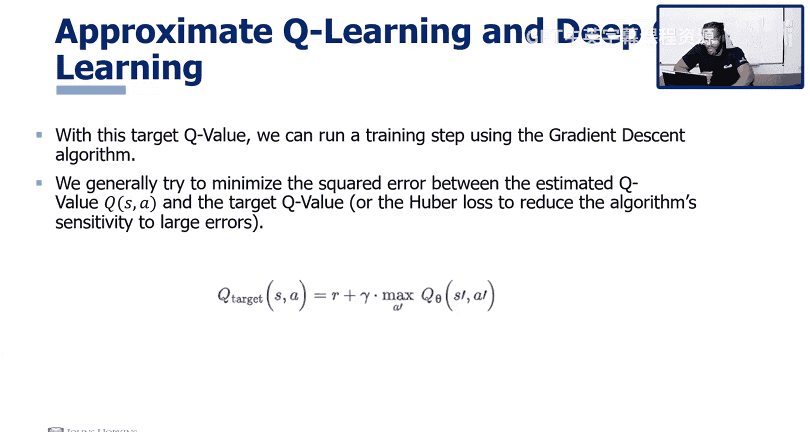

# 约翰霍普金斯大学《神经网络基础｜Foundations of Neural Networks》中英字幕 p14 6_Q学习与深度Q学习.zh_en -BV1w1uqzSEHZ_p14-

So that's what about Q learning， so Q learning algorithms is an adaptation。😡。

Of the Q value iteration to the situation to where the transition probabilities and the rewards are initially unknown。

Okay， and so Q learning works by so watching the agent。

Act randomly right and gradually improving its estimates of the Q values okay and so so once it has accurate Q values estimates or close enough to them right then the optimal policy is true is choosing the action that has the highest Q value right and you know this is a greedy policy in some sense。

Okay。And so for each state action pair， right， this algorithm keeps track of a running average of the rewards the agent gets upon leaving that state S with action A plus to some of the discounted future rewards it expects to get。

😡，And so to estimate this sum， we take the maximum of the Q value estimates for the next state as prime since we assume that the target policy would act optimally from then on。

😡，是。The Q learning algorithm is actually called a off policy algorithm because the policy being trained is not necessarily the one that you're going to execute and so sometimes the policy being executed right for an example。

 the exploration policy is going to be completely random while the policy being trained is always choosing the actions that has the highest Q outcomes。

 right？😡，And so conversely， the policy gradient algorithm is our own policy algorithm because it explores the worldwide you and the policies that is being track。

RightAnd so it's somewhat surprising that Q learn is capable of learning the optimal pop policy by just watching and especially just watching it act randomly right and you can actually imagine right here's a cerely example imagine trying to learn to play golf when your teacher is a drunk monkey right that seems interesting that you can learn anything off of that right and so one obvious question is can we do better right？

And so Q learning can work only if the exploration policy explores the MVP thoroughly enough。

And so although a purely random policy is guaranteed to eventually visit every state and every transition anytime a long time it could actually take a long time to do it right until you kind of think of the vacuum problem that we were thinking about earlier right and so a better option here is to use the E greedy policy I'm sorry uppsilent our greedy policy right and so at each step it acts randomly with。

Probability epsilon or greater with probability so one minus epsilon and it chooses the action with the highest Q value。

 okay？And so the advantage of the epsilon greedty policy compared to being completely random is that you'll spend more and more time exploring the interesting parts。

 the parts that are actually correct as the Q value estimates get better and better while you'll also spend some times exploring the unknown right so you want to explore some of the unknown so it gives you a chance to be able to do that。

😡，And so it's common to actually start with the high value of epsilon right you can harness epsilon of one right and then you gradually reduce it down to 0。

05 or something like that right and so another option is rather than relying only on chance for exploration you could actually encourage the exploration policy to try actions that is not try much before has ways to encourage that and so this can be implemented as a bonus added to the Q value estimation here right we can see here。

So that N of S prime a prime counts the number of times that action A prime was chosen in state S I'm sorry for in state S prime and so FQN is that exploration function right。

 such as the one that you see here to where that K is a curiosity hyperparameter right that as is how much the agent is attracted to what we call it unknown。

The main problem with Q learning is that it actually it doesn't scale well to large problems or even medium problems of MDPs that have a lot of state and action pairs and so an example is suppose you wanted to use Q learninger to train an agent to play Mrs。

 PACman to to play Ms。 PACman right so there's about 150 pellets that that the PACman thing each and of each can actually be present or not present right and so the number of possible states is actually greater than two to the 150。

and so if you add all of the possible combinations of the positions of the ghost and Miss PAman。

 the number of possible stakes become larger than the number of atoms in our planet。

 so there's absolutely no way that you can keep track of an estimate for every single cu values。

 is this impossible。Okay and so the solution here is to find a function Q sub theta that approximates the Q value of any state action pair using a manageable number of parameters right given by that parameter set or that parameter xs theta right and so this is called approximate Q learning。

And so for years， there's been。So recommended to use any combinations of handcrafted features extractive。

From the states right an example some examples is the instance of the closest goes。

 their directions and so on， right to estimate that Q value。But in 2013。

 Deep Mind showed that using deep neural networks can actually work better here。

 especially for complex problems， and it doesn't actually require any feature engineering at all and so a DNN was actually used to estimate Q values is called a network and using the DQN for for approximating Q learning is called deep Q learning。

And so how do you try to de a DQN right and so consider the approximate Q value computed by the DQN for a given state action pair？

And so you know you want this approximate Q value to be close to the reward are that we actually observe after plan action A in state S plus the discounted values of a plan optimal from then on right。

 so to estimate that sum inter discounted rewards， you can actually execute the DNA on the next state。

😡，And for our state and for all possible about actions they prime that's what you do and so you get an approximate future Q value for of。

For each possible action and you pick the highest one since you're assuming that you want to play optimally and then you and you are discounted。

And so this gives us an estimate of the sum of future。

Discounted rewards right and so by suming those rewards the future discounted value estimates we get so we get a target Q value y for a state action pair right pretty yeah and so with。

This。Target Q value right you can actually run a training step using the gradient8 decent algorithm okay and so we generally try to optimize the squared error between the estimated Q value and the target Q value right or we can do another loss function like the Huber loss to reduce the algorithm because it'sivity to the large errors or something like that okay。

😡，And so I'm actually going to end there because there are a lot of different spinoffs of these two things right here right。

 that's actually what。A lot of research papers are I could have went into a few of them。

 but you guys have your own so research。

April so I am going to stop here。