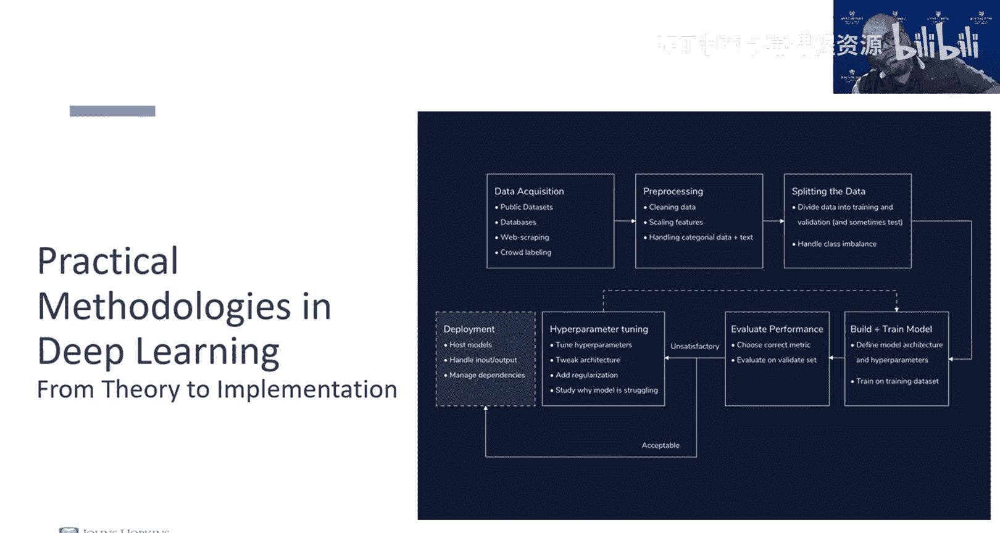
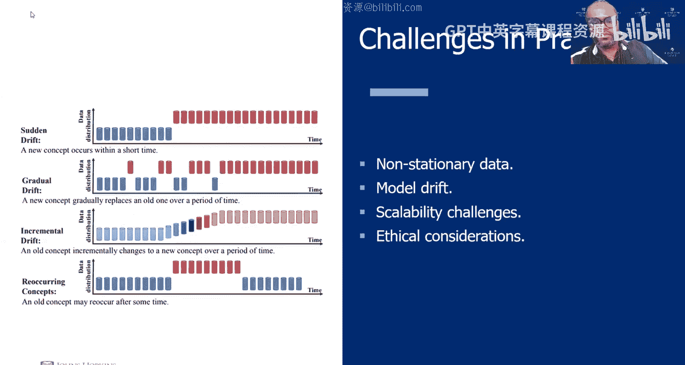

# 约翰霍普金斯大学《神经网络基础｜Foundations of Neural Networks》中英字幕 p15 0_实践方法论.zh_en -BV1w1uqzSEHZ_p15-

All right， so we've been spending a lot of time in theory that was to be expected in this course。

 but I wanted to stop for a second and kind of start thinking about practical methods and so how do we train models and all of that stuff。

So kind of like going from theory to T is the idea here so you want to always think about things like performance metrics right so kind of things like accuracy precision recall F1 score these are ways that you can assess your model I mean and figure out how good you're doing right so it's important is selecting the right so metrics for your problem。

And so what are some cases to where these metrics do not apply right and in that case right so which metrics so would you use instead right and this is going to be particularly dependent on on the problem set that you're doing right and so in particular you will never be able to sidestep right expertise in that field。

And so。Right you want to kind of determine a baseline so you want to kind of determine a baseline when you're doing these kinds of models right and so in particular right establishing a simple model to compare against right is important so you don't want to start with the most complex model right and try to compare against that but kind of like think about a linear model and start comparing against that to kind of see so where you're going to go right and that's important for kind of like so benchmark right？

And so some examples there are a linear regression， logistic regression， right？Example cases for。

You know， and these are a kind of ex for regression and a classification right and they give a good so baseline model。

And so what you do is you improve from the baseline right and so what are some strategies from doing that right you add more data right you get a a better some model architecture a better optimization algorithms right and so you know you kind of get examples of each one of those cases and kind of do a comparison。

And then you need to do hyperparameter tuning right this is a daunting part of it right but here's some example hyperparameter so learning rate so regularization strategy number of layers with。

The width of Larry， et cetera， right， it's important to tune and improve the model it's important to tune these parameters for some model improvement。

And so some examples are things like great search and random search。

And then you have things like the regularization right。

 so this is kind of overfitting and underfitting right L1 and L2 regularization dropout right。

So you don't want to overfit you don't want to underfit right these are and you kind of do the regular techniques to help with these kinds of things right and so what are some examples where underfitting obviously happened what about over I'm sorry so what are some of the examples about where overfitting obviously happened how about underfitting right so can you kind of tell those in general so really really quickly？

All right and then， you know， it's important for u and so it's important to kind of。

Think about your optimization strategy a lot of times you won't just use straight up or gradient descent the most of the time you'll use ovariance of them like some momentum and rMSs propped in atom right and so so why does the added that you have come into play in this decision right like how does that。

How does that help you with the optimization？Strategy that youre going that you're going to。

 I'll ask you。And so what about like？Debuggging strategy right i've never actually done on a very large ML problem and then end up with some bugs that I had to go back and。

Debugging right it's important in an MLl to workflow to have a debugging strategy right and so typical issues so vanish and gradients exploding gradients poor initialization。

Solutions here could be things like gradient and clipping right a better weight initialization。

 right and so。And so right， so if you give me an example right of a bug that's in an ML so work funding。

 give me， you know， a solution to it as well。And then there's things like social monitoring vision issues。

 these are great to have right so things like tensor board and similar tools right are great until you're able to monitor your systems as they train。

And so they're important for tracking training progress and debugging right and so what are some things that we can use to visualize so why we're training our data right so I gave you you know tensor board which is Tensorflow implementation but so what are some of those。

Okay， and then ensuring so reproducibility can I can't stress this a lot the one of the pet peeves that I have about email papers is that they can't is that a lot of the results are that they claim they can't reproduce them right and so what are some of the ways that we can do this kind of settings so random seeds version controls right for data and code right and it's important to do this for things like so publishing research and all of that because you want to be able to reproduce your data。

I mean， all your results are。Transfer learning right so whenever you can right you want to leverage pretrain models right it helps so it's your convergence and all of that good stuff right and so and so what you do is you start with that model you start with the weights that would turn on that model and you do fine tuning for the specific track tasks that you have。

Right so you。So I guess the question is when you expect for transfer learning to work well i'll give you right a general answer to that you want transfer learning when you' task or formula right so you know if I have RGB imagery right on you know specifically on cats and dogs right I would probably use like image that as my pretraining right because it have a lot of cats and dogs and things like that or if I was。

I to use like just black and white images or something like that， right？But like they has reached。

Cnels that im instead of one right the image that right the beginning stages of that has good edge detectors and all of that stuff so those are good chances like two where my。

My。My data is similar to the one that I trained I that I'm training anymore， right？

And then you want to you want to have great strategies about some model evaluation so you so whenever possible you want to have a training evaluation in the test set。

 right if you can't have that， you want to do things like partial evaluations， right？And so right。

 do a refresher and ask yourself so what's different between the sets。

 right and kind of anchor them and let me know what you think。

Okay and so with that that was a short one， but like as you're starting to to kind of implement your models and stuff like that on you final a project I wanted to stop for a second and give you some practical some methods so with that if you have any。

Questions Amy know， I'll see you an email。