# 约翰霍普金斯大学《神经网络基础｜Foundations of Neural Networks》中英字幕 p16 1_人工智能伦理.zh_en -BV1w1uqzSEHZ_p16-

All right， so I think it's important for us to stop for a second we are gaining a lot of knowledge about different AI methods and different neural networking methods and I think that for any person that is。

Diveing into these things we need to stop and think about the ethical considerations of all of this and so let's let's stop。

By kind of you know introducing you know AI ethics right and so that's the study of moral principles and social implications governing AI technology。

 right？And the role of some mathematics in this is to apply mathematical rigor right to ensure ensure that AI systems are developed responsive。

And so some key areas to focus on here is things like fairness and privacy and transparency and accountability in AI system。

And so right how do you define fairness right and so that's equal treatment and opportunity across all user groups right and so what are some of the the mathematical challenges there right identifying and correct them kind of like so biases and the data sets and algorithms right these kinds of things。

😡。

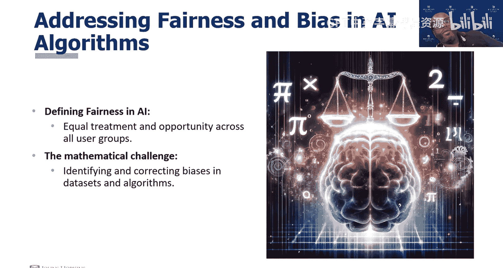

Right and so。So， right？I start with a。A case study， right？Kind of ask the opening question right。

 so should we use AI and。Predictive policing right so you know。You know， could AI。

Shell be involved in kind of like the way that we police America right。

How to think about some concerns and some mitigations。

Take take a moment to pause the the video and think about those two things。

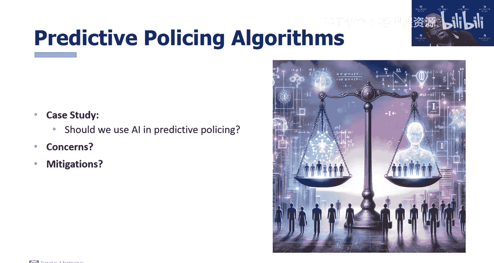

Right。Now let's think about right should AI right algorithms be used in healthcare right and could there be a biases in these kind of things so again I asked the same thing right you know。

 take a second。Think about these kind of things， think about concerns and then some mitigation strategies right along with those。

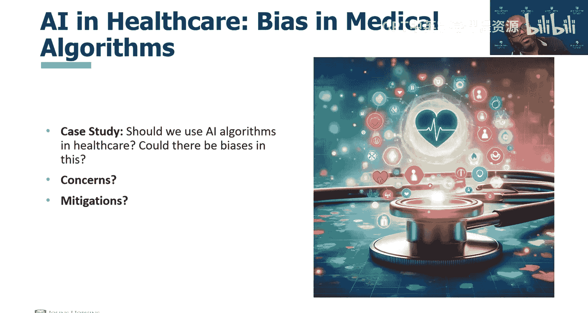

Should we use AI algorithms and loan approvals in credit school？Right， same thing， right， concerns。

 mitigations， what do you think？

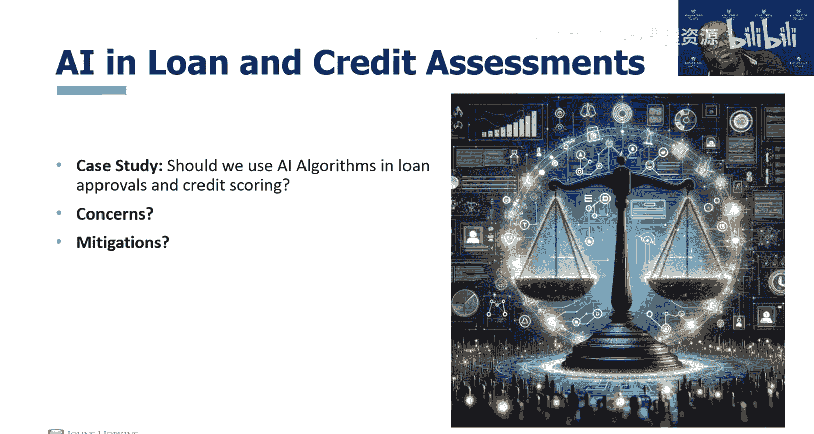

は。So bias some mitigations with fair awareness algorithms right so the equality of opportunity model aims to ensure equitable treatment of individuals across different groups right。

 particularly when this is' have like significant impact on their life right？

And so it's designed right to address and mitigate biases that may arise in algorithmic decision making processes。

 right， so some examples here is hiring， lending， criminal justice outcomes， these kinds of things。

And so the algorithm is based on the principle that certain characteristics， right， race， gender age。

 right， these kinds of things should not influence the outcome of any algorithm in a way that disadvantages individuals belonging in that age group。

Right。And so it focuses on ensuring that the true positive rates are equal across groups defined by these sensitive attributes。

Okay， so in particular terms， right， the model mandates that among individuals who are qualified or eligible for a positive outcome。

Right right an example of that is being granted a loan or receiving a job offer right the probability of actually receiving that positive outcome should be the same regardless of their membership in any particular rights in group okay。

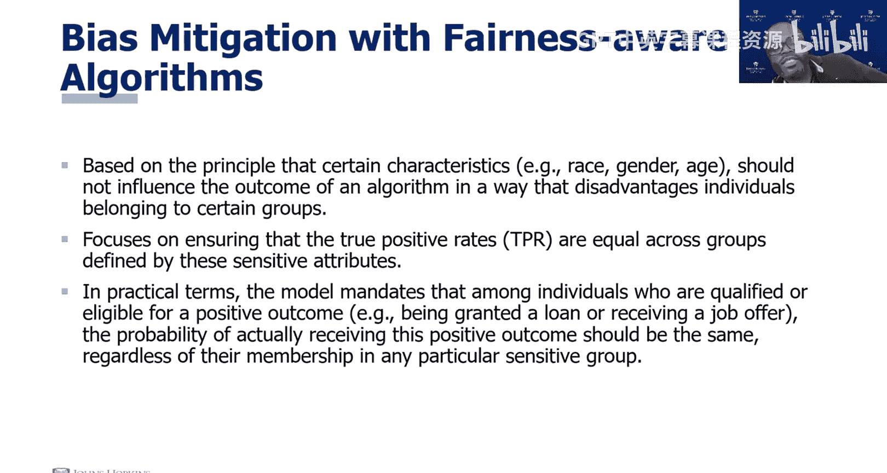

And so now let's consider a binary classic。Patient test where algorithm predicts an outcome y and it' it still only features x right and you're going to let a denote the sensitive attribute with the groups A and B。

 right？The goal of the equality opportunity model is to ensure fairness by equating the two positive rates across those across those groups。

 right？😡，And so the equality of opportunity criterion can be formally stated as the following。

 right and so this equation asserts that for individuals who should positively receive outcome y is equal to one。

 the probability of the classifier Y hat predicts a positive outcome should be identical across all of those a defined groups with those sensitive attributes。

😡，Great。And so implement in this equation right or this model right often involves preprocessing that added to remove those biases right and identifyingifying algorithms to account for fairness constraints during training and post processing right。

 predictions to ensure fairness criteria are met。Correct。

And so this process may introduce trade offs， right， so think about accuracy versus。

Fairness right so if we are completely fair， the question is so we would be completely accurate and if we're completely accurate。

 so we'll be completely fair。Conflicting fairness criteria rights so different fairness criteria might not allow to be。

 so it might not always be simultaneously achievable and that's going to necessitate decisions about which criteria are most important in a given context。

Okay。Okay， and then we have so privacy concerns with data used for right these AI applications right and so the protection of individuals privacy when using data is included in AISO workflow and AISO workflow is highly important。

And so it ensures that the risk of reidifying an individual from published data or statistical summaries is minimized in some way。

 even by right aversaries with Hillary information right。

 sort some examples serious things like census data or healthcare analysis or location out of privacy。

 these kinds of things。And so right， there's a framework called virtual privacy right and it's designed to ensure that privacy of individuals data。

so while allowing valuable insights to be extracted from the database right and so it provides a way to maximize the accuracy of queries from statistical database ofs while also minimizing the chances of identifying these entries。

So this concept is pivot， it's pivotal in the realm of out of science and machine learning where the privacy of individual out of points is actually of the utmost concern。

And so here's another the case study right so in 2018 Stravo which is finished tracking app released a global heat map showing the activities of his users right and so this inadvertently released the locations and lays of secrets so military bases actually and the patrol routes has military personnel used their apps while they're tracking their exercises right so the people had the apps and the watches right and they were running and just kind of illuminated to where they were and they weren't supposed to right so it exposed。

Is ititive。Glocation things right and so what was I'm going to do to do the mitigation rights Strva responded by up to dateating his privacy settings to prevent such data from being shared。

Without a user's explicit consent right and this case underscores the importance of privacy by designing the need for a robust anonymization techniques like before sharing or visualizing that kind of depth。

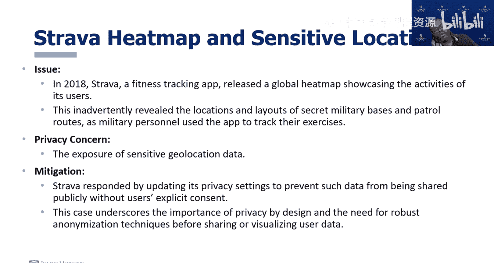

And then we have like the Cambridge analytical scandal， right？

Which involved the collection of personal identifiable information of millions of Facebook users without its consent。

I mean， so without Ericett right， and his data was used to influence Oda's opinions on behalf of political campaigns。

And so what's the concern there right so unauthorized access to use of personal data right for political profiling right and some of the deifications right Facebook kind of tightened up there do that out of access policy and introduced more stringent consent a mechanism for third party apps and that scandal highlighted that need to for transport for transparent debt at of collection。

Practices and inform consent in social media platforms。

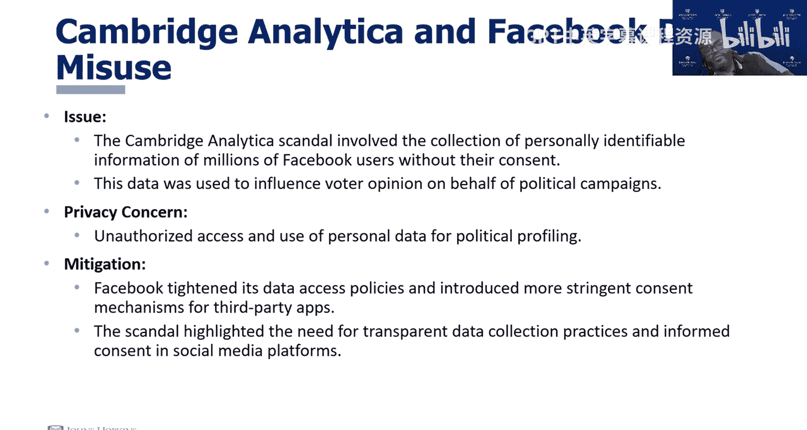

And then we have Amazon Alexa kind of eavesdropping right and so reports。嗯。

Um so my so my device actually just looked over when I said the word right and so reports emerged that Amazon employed human reviewers to listen to voice recordings capture in the homes of Amazon Alexa users to improve systems' understanding of human speech。

 right？And so， so what was some some privacy concerns， right。

 eavesdropping and the recording of private conversation has without explicit user consent？

So what are some of the mitigations right Amazon up to date these policies to offer users more control over their voice recordings。

 including the option to opt out the human。Human review right this case that actually illustrates right the privacy implications of voice assistance technologies and the necessity for clear user consent and privacy control you know one of the things that's interesting about that is that that they implemented the opt out question is should they implement the op so that's a。

That's an interesting thing that you can chew on as well。How about Deep Min， right？

They had to went to where they。To where deep minus subsidiary of alphabet， right。

 which is Google right face criticism for its access of healthcare data。

Of over a million UK national service national health sex service patients without their explicit consent。

 right so the data was used。To test an app designed to detect a kidney injury。

And so what was the privacy concern right， the use of Haitian data without consent right and potentially for due data misuse right。

 so what was the mitigations right， the UKs out of protection watchdog rule that the NHS had breached out of protection laws right and ited out of sharing agreements？

And oversights for similar projects right， so this incident stressed the importance of patient consent right and legal compliance and healthcare values。

Clearview AI and facial recognition right so Clearview AI scrape billions of images from social media and other public sources to create facial recognition that database is used for law enforcement law enforcement agencies。

And so it was done without right consent right and so the concern there is unauthorized collection and use of facial images for surveillance purposes right and so the mitigation is that。

EL challenges and regulatory scrutiny and multiple countries have forced clear view to restrict its services of face fundss right and so this case right it questions right about ethics of facial recognition technology and the need for regulatory framework to protect individual privacy。

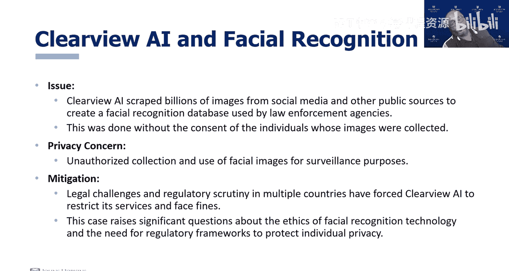

All right and so now let's dive into kind of the math of differential privacy right so differential privacy is formally defined in terms of risk to one's privacy incurred by participating in a statistical in a statistical database right so a randomized function k gives epsilon differential privacy if all data sets D1 and D2 differing on that most one element and all S within the range of K have the following hold right。

Probability is the S E to the epsilon times this other probability。Okay。

 and so epsilon is is a non negative prime parameter of that controls。

Privacy laws which small of values epsilon indicate stronger privacy， right？And a probability。嗯。

K of D and S denotes the likelihood that the output of the randomized function K applied to the I D falls within a set S。

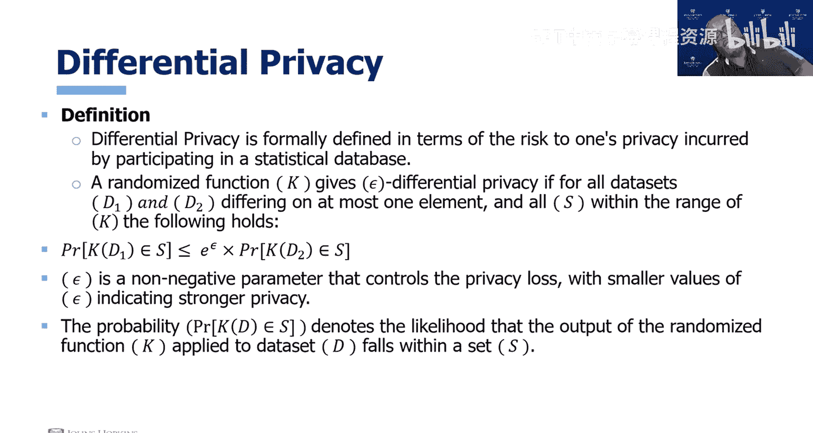

If so。There's another technique called the pla some mechanisms right and so the mechanisms for achieving differential privacy right so there's the pla mechanism then that mechanism is one of the most common methods for achieving a differential a privacy right and so it involves adding noise generated from the plaa distribution。

To the true answer to a query right and so the scale of the laplace noise depends on the sensitivity of the query and the privacy parameter epsilon where the sensitivity toellta e is max is the maximum amount by which any single individual is the added can change the query outcome right and so the noise to be added。

Is drawn from the plaa distribution as follows。

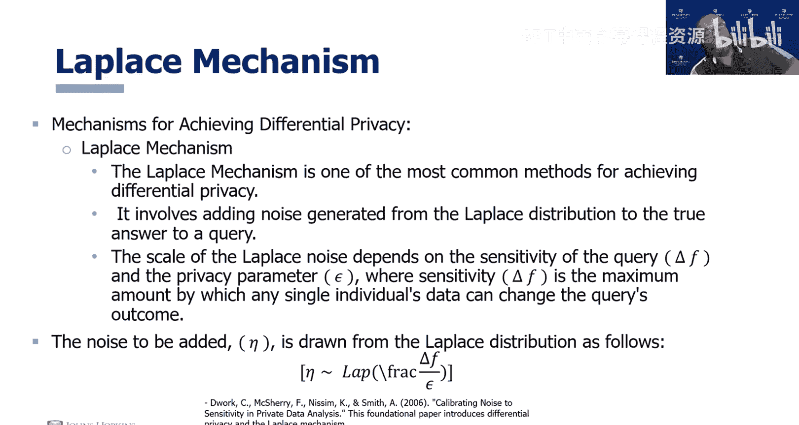

Good。And so then we have exponential some mechanism right and so the exponential mechanism is used for queries where the output is not numerical。

😡，And so it selects the output， it selects an outputs an answer with the probability that decreases exponentially with the increase of badness of the answer is measured in terms of utility function。

Where D here is the data set and R is the possible output。

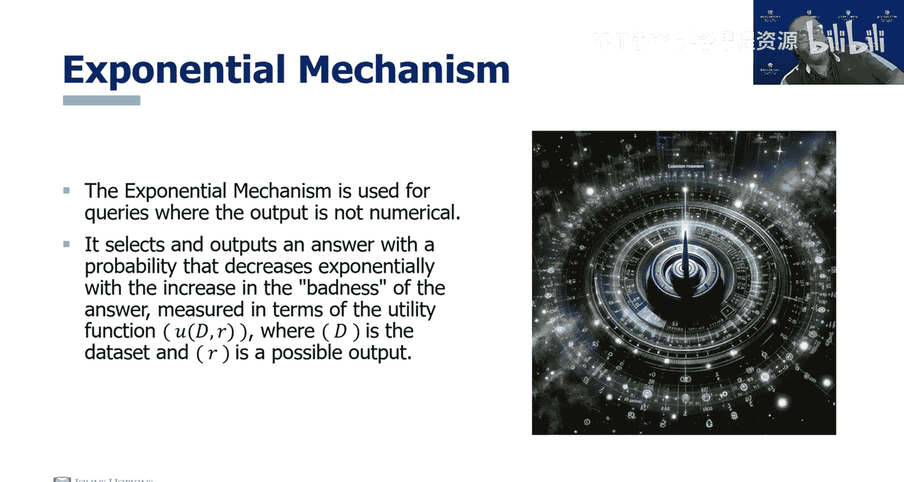

And so some properties of differential privacy right is composition right so how differential privacy allows。

Or the composition of multiple queries。The total privacy laws accumulate。😡，Linear。

 so with the number of queries right and group privacy， right the。

It provides privacy guarantees for groups of individuals， right。

If inential privacy is ensuresured for single entities， it inherently offers privacy for the group。

I'll be right with a weakened privacy parameter。And then us it to post processing right and so it guarantees。

The differentials are not affected by any proof processing applied to。

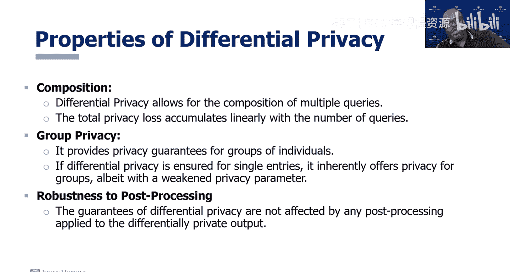

The differential output， which is cool。All right， and then we have transparency and accountability in AI right。

 and so that refers to the openness and clarity about how AI systems work。😡。

How they make decisions and how they are developed and deployed right and so this concept is critical for several reasons right it impacts users。

 developers regulators and society at large right and some of the key reasons here for this in AI just trustt and confidence。

 accountability， preparedness and bias mitigation and regulatory compliance， these kinds of things。

All right， and so here is some much。C studies right so a banker and a financial institutions use AI systems to evaluate loan applications right and so an issue here is that there's a lack of transparency about how these decisions are made and can lead to mistrust and accusations of unfairness right and so what some of the transparency means explaining the factors that influence the loans of approval and rejection helps the applicants understand the decisions address any errors or take steps to improve their chance in the future。

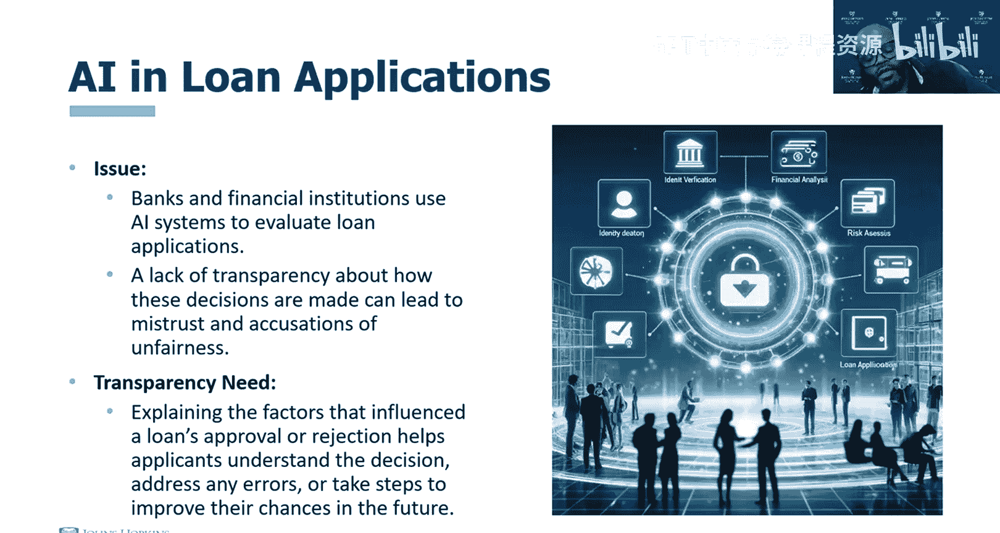

Right。How about in criminal penticing right， so some。Jurisdi has use AI to test the risk of。嗯。

Of like of like of like of like so in his guidelines， right， and so these systems have faith。

Hticism for opacity and potential biases。Right so what are some of the transparent needs。

 sometimes some of the transparency needs right， so making these issues these AI assessments transparent is crucial。

For fairness， right enabling scrutiny for biases and ensuring that this intense。

This hiss are just right and based on accurate， so relevant information here。Yeah。

All right and so what about autonomous vehicles right so autonomous vehicles let's make splits second decisions in complex predictable environments right and so when accidents occur。

 understanding that decision are making is important right and so transparency and how these vehicles AI systems make decisions is crucial for stuff like public safety。

So for regulatory approval and improving system reliability。And so now。I wanted to。

talk about Lyme or o interpretable auto agnostic explanations right and so this is a technique that explains the predictions of any classifier or regressor in an interpretable and faithful manner by approximating it locally with an interpretable model right and so limeme generates a new to that out of it consisting ofing of perturrbbs temple。

And the corresponding predictions of the。Black box model， okay。

 and so it then wastes the new sampless based on their proximity to the instance being explained。Um。

 and it learns a simple interpretable model， like a linear model or something like that on the on the way that dad did data it。

 right？And so in this case right here， you。Either the equation F is a complex model。

 G is an interpretable model and passive of x is approximate a measure right and l is the kind of e loss and omega is the complexity of the model G。

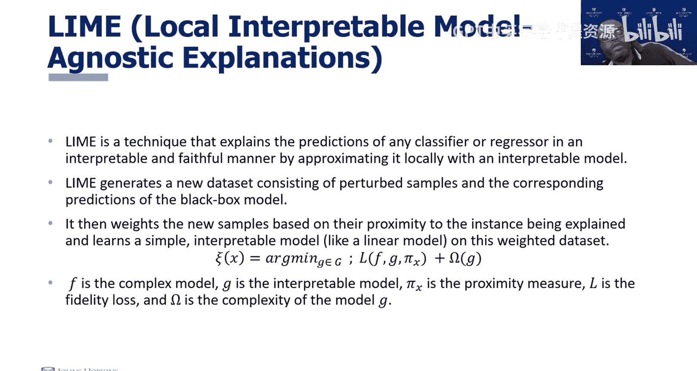

Okay， and then we have shape right， shapely the active。

Exvalliations right and so it leverages the concepts of shaping value right from cooperative game theory to attribute the outputs of any machine touous input of features right and so offering consistent and local accurate explanations right so the shaping value is the average marginal contribution of a feature value across all possible feature coalition right？

So it's given by this equation right here。And in is the set of all features S。

And S is a subset of the features excluding I right。

 F sub x of S is the model prediction with features in S and segmentsig of I is the shapely value right for the feature I。

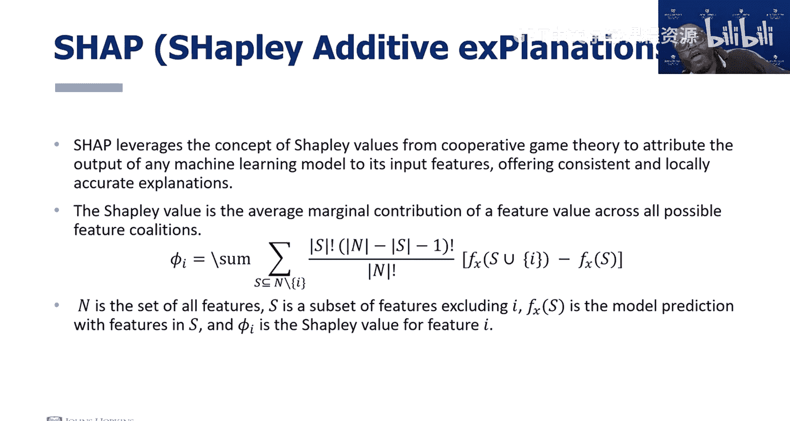

ok。And then we have so PDP， right， so PDP showed the effect of a single feature or a pair of features on the predicted outcome of a model and averages it out right and averaging out the effects of all of the other features。

Okay， so PDPs calculate the average prediction right of the model over a range of values for the features of interest and it keeps all of the。

It就。So in this case right here。X is the feature of interests。

 x sub C I are the values of the other features for instance I and n is a number of inches。嗯。

And then we have counterfactual explanations and they provide insight into to model the decision by explaining what like so minimal changes would need to be made to an output to achieve to achieve a different prediction right and so it finds the nearest point x hat to or x prime right to the original input X that when input it into a model it changes the output prediction right so it's given by this right here right and kind of D is that distance metrics right you can use P in if you wanted to and F is the model is the model's prediction。

Okay， and so right， you know， so we've so went over， you know， a few things right in ethics of AI。

 but I will say that it's complex。嗯。Ts covered here only scratch the surface of what we think about in ethics AI right as the field of AI grows exponentially right your field of ethics in AI grows even faster。

And as AI developers， it is our responsibility to be ethical at all times right and so mathmatics will always play a role in this in the rigor and kind of bring it in so rig into the field。

And with that， right， I look forward to folks diving into the paper that's going on and if there's any questions I'll be standing by for a。

Email， thanks。