# 约翰霍普金斯大学《神经网络基础｜Foundations of Neural Networks》中英字幕 p17 2_深度学习结构化概率建模.zh_en -BV1w1uqzSEHZ_p17-

All right， so I want to talk about kind of， you know。

 how do we start to put these things into practice。

 kind of how do we start to think about the framework of putting neural networks into things that we can start to reason over and start thinking about how do we structure。

How do we in a structured way get an answer right and this is where structured our ballistic models come in in a very very very handy right so let's talk about it so。

Probabilistic auto are basically e frameworks and they're used to kind of present and reason over systems right that exhibit uncertainty right so you think about it。

Every prediction that we have with the neural network is going to have some kind of uncertainty need to figure out how to deal with that。

And so what we do is we encode that knowledge of all of the possible states of the world right and then the likelihood of each of those states occurring so based on the principle of our here。

 right？And in essence right， so what we do is the models that actually provide a structured way of managing that uncertainty right and the interest process and what we do is we quantify the probabilities of varied outcomes and right so we kind of want to reason over all of that uncertainty。

And so right at its core， right a probabilistic model。

 they're built on the foundation of probability theory， right。

 which allows us to represent uncertainty， okay and we kind of want to do it in a rigorous way so that we're able to understand in complexity this in a logical way。

And so we。Leverage the probability distribution right to describe that uncertainty right so with the variables in the system and we use these distributions to make predictions right and so we want to do that to be able to draw inference right it be able to update beliefs right as new information comes in right so you know you have situation where you have a particular you know estimate of the answer you get new information you want to be able to incorporate any new information to be able to update your beliefs right。

And so right to introduce this， they play a crucial role。

Probilistic models right and capturing the inherent uncertainties of real world phenomena， right？U。

Andre they're important stemim in the ability to formally quantify and manage uncertainties， right？

And this will preserve and and the idea there is that like we have to be able to deal with that because it's everywhere in the world right so whenever you dealing with real data not none not you know non academic data things that are not clean right which is the most of the data that we're going to encounter then you want to be able to reason over that uncertainty。

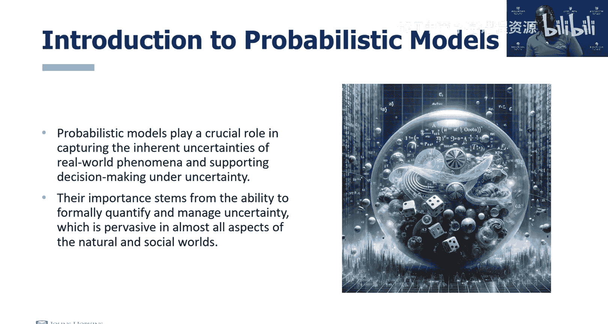

All right so what are the role right so you want to be able to quantify uncertainty right you want to be able to incorporate prior knowledge you want to be able to update beliefs that new information coming in we just said that right you want to be able to to make decisions under under uncertainty you want to be able to。

To do predictions obviously， so you want to be able to make predictive models。

 understand complex systems， right。Think about the risk right of that uncertainty right and then optimize that resource allocation。

 so a very very important concept here right？

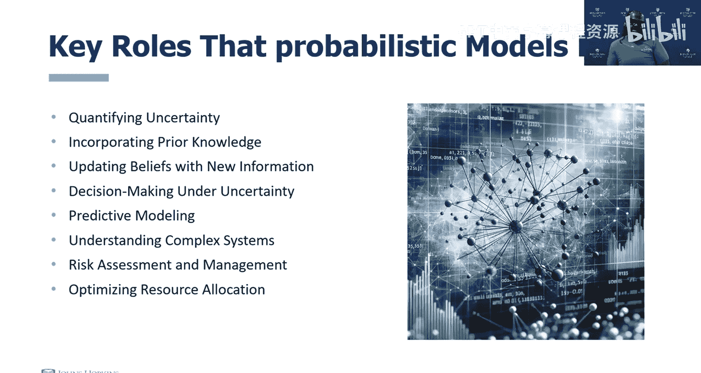

And so some of the key integration techniques right are three of them that are listed here right there's the Bayesian neural network and has the variational autoenco and the Gaussian process with DNs right and so what that Bayesian neural network does it incorporates prior distributions right overweight some model uncertainties okay and then you talk about VAEs right these combined neural networks with probabilistic graph models right for gative tasks right so we actually discussed this already these are cool but these are actually great things to put into probabilistic models right and then you have right the Gaussian process with the Ds right they use。

DNNs to learn feature for representation for Gausing processes。All right。

 so what is a Bayesian model right and so a Bayian neural network extends traditional neural networks by applying right the Bayesian statistics to estimate uncertainty in that weight in weights of their networks right and so in a standard neural network the weights are learned from the data and they're fixed。

And that actually implies that you have a certain like level of confidence about the prediction models。

 right？

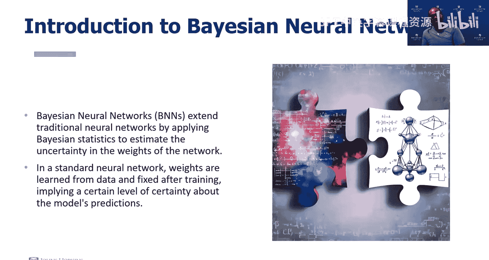

But in contrast， right if you think about a Bayesian model right a Bayesian U network that actually treats to way it random variables right and it has a probability distribution and what that means is that like those things are not fixed right to random variables。

And so this approach allows that Bayesian network approach to express uncertainty in the model prediction and it provides that robust framework。

 especially useful an application a decision making under uncertainty is critical right。

Like we have many examples of that， things like， you know。

 how do we predict some medical outcomes and these kinds of things right these are crucial examples。

 right？

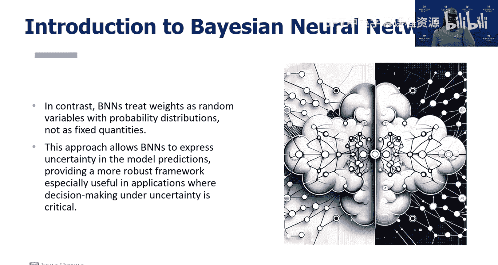

And so the core idea behind that right is to incorporate prior knowledge about the weights right and update this knowledge in light of new observations right so if we're kind of thinking about you know observing things over time you want to be able to get that information in over time right？

And instead of learning a specific weight values right， you have a Bayesian neural network。

 it learns a distribution over the weights right that reflects both prior beliefs about those weight before seeing the data and the likelihood of the observed data giving the weights that you're given right now。

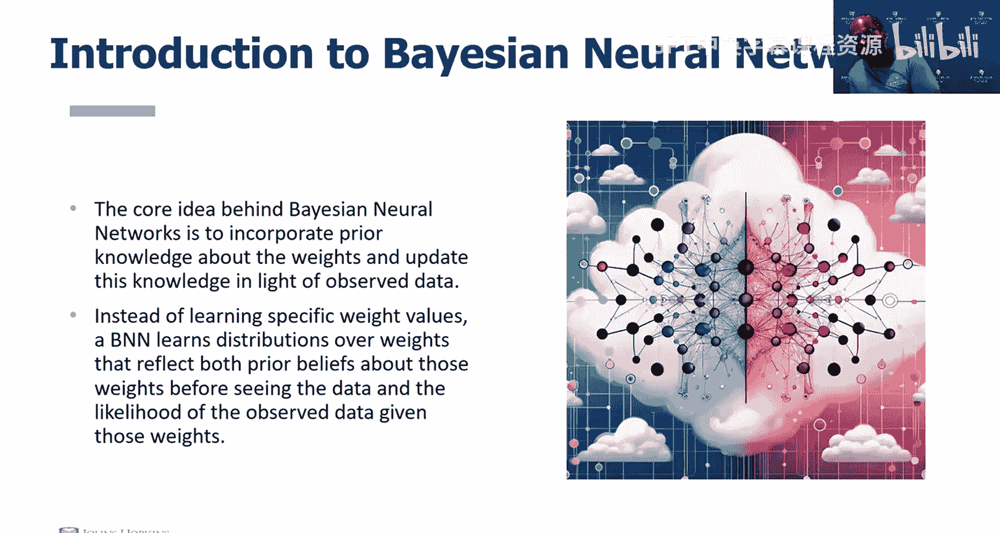

嗯。And so。Right， so what you see here is kind of the math and optical foot。Or formulation of it。

 right， so we're looking at。So you have us set a weight right and so base thermal allows us to sit compute the。

The the posterior distribution excuse to that extra parentheses but this is a probability the weight of giving the data right and it's exactly what that what you in is so take a moment this is you know normal。

Kind of like based there， but this is applying it to the weights that we have in the neural network。

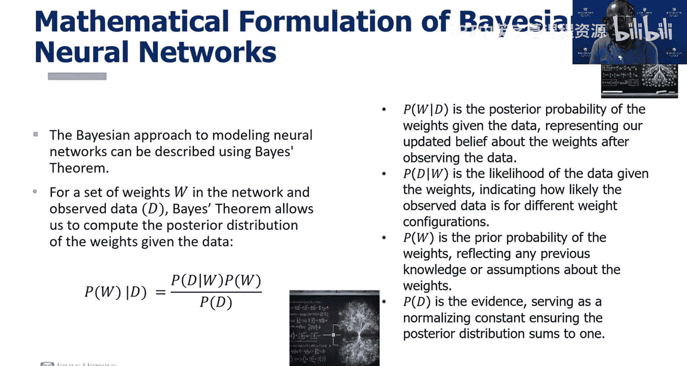

All right and so what is some many the advantages right so you know basically and neural networks are natural estimates for uncertainty right and predictions。

 which is valuable right in applications like healthcare and our time to drive in right these kinds of things and financial models right。

It's really really sort of robust overfintting right。

 so if you use those ways you can you can make the Bayesian neural network more of a robust overfintting。

 especially when you have small data sets。And then then incorporate prior knowledgeage right so you're able to incorporate kind of the prior beliefs that you had in this system with in neural network。

是。So what are some of the challenges right so the computation is expensive right and this is due to the compute or the approximate to the posterior distribution over the waste that is the beefy computation。

And so when we think about things like techniques like variational inferences and Markov chains。

 Monte Carlo right and approximations theyre often use to tackle of this challenge。

 but they introduce their own tradeoff between the computation and efficiency and kind of the accuracy right you have to have this tradeoff in some way right so。

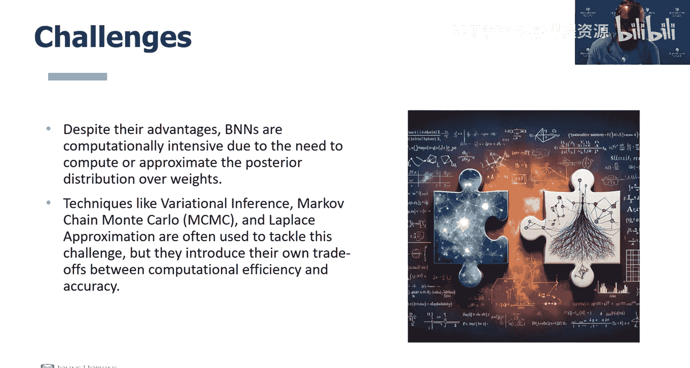

All right and so what is the challenge right I kind of said you know that was a challenging computing of posterior distribution right right the reason is that' that it's highly dimensional right it's high dimensional right and you know if you start to a compute it actually just becomes computationally expensive right？

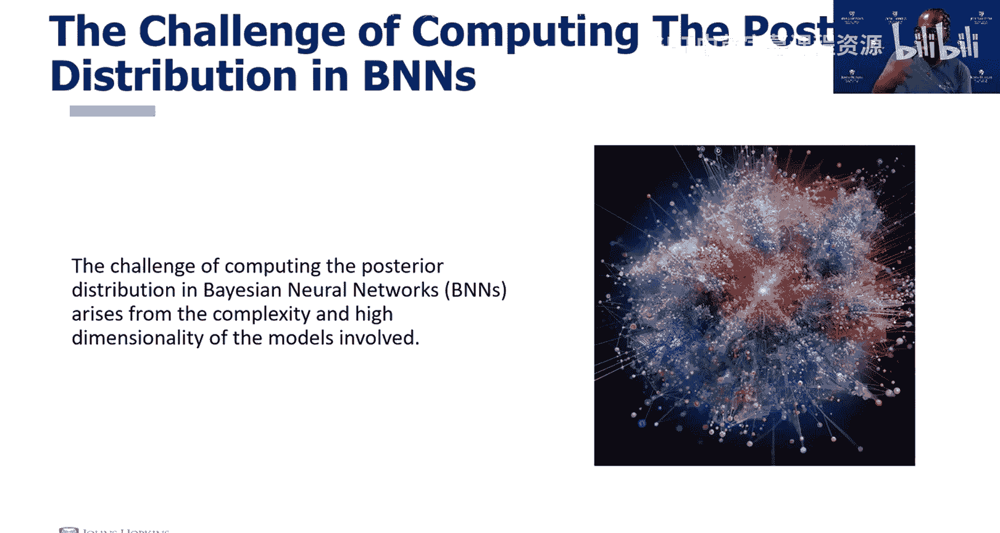

So in detail， right？They have millions of parameters right these deep neural networks that we've discussed they have a lot of parameters right and the posterior distribution is defined over a high dimension parameter space right。

Its it direct computation。Right intractable due to the curive dimensionality right we talk about this right and so and so to。

呃。The denominator right that we saw right is known as the evidence or marginal likelihood right and it involves integrating the product of the likelihood in the prior over all possible peri configurations。

 so you're doing that integral over all of the parameter configurations。

 which is you know exponentially large， right？And so I this integration is really really challenging。

 right because of the complex landscape form of the neural network model， right？

And it'll have a lot of local minimum and potential shock character， so this is a hard one， right？

And so for Mosen non trivial neural networks， right。

 the exact posterior distribution can't be actually computed， right？

And so it necessitates kind of an approximation message right that we have to go through。

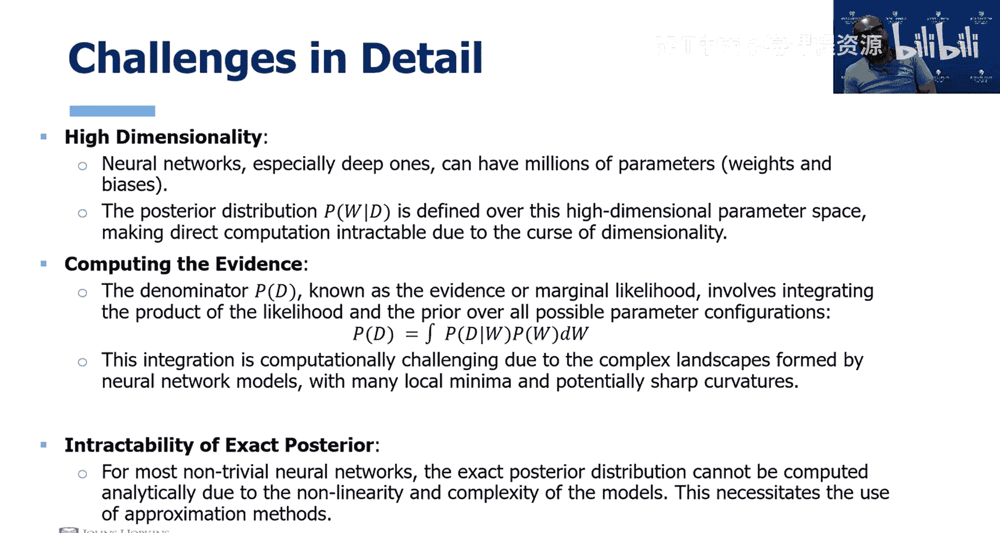

And so one of the approximation methods that we see right。

 there's the variation of inference right and it approximates the true proerior with a simpler distribution by like kind of like so minimizing the divergence between the two。

 right？And this approach right it transformed the problem from an optimization problem to an optimization problem。

 which is way more computationally feasible。RightAnd then you have the Markov chain so much a colorlo method。

 right？And so that samples from the posterior without computing it directly。

 and so it's powerful right， but the Monte colorlo method。嗯。M，'m tired， the Mark chain is about to。

Hlow method can be computational intensity itself。And it require sophisticated techniques to ensure efficient excess of those covariance that is going to compute right。

You have lulast approximation right this method right approximate the posterior with the Gaussian distribution center at the mold。

Right it's computationally simpler， right， but may but may not capture the true shape of the posterior well。

 right， especially in those high dimensional spaces。

And then you have dropout right and so it uses dropping out of neural networks and has been proposed as a practical way of approximating the Bayesian inference right providing computationally efficient means to estimate uncertainty right this is one of the ones that I use one of the ones that are my favorite。

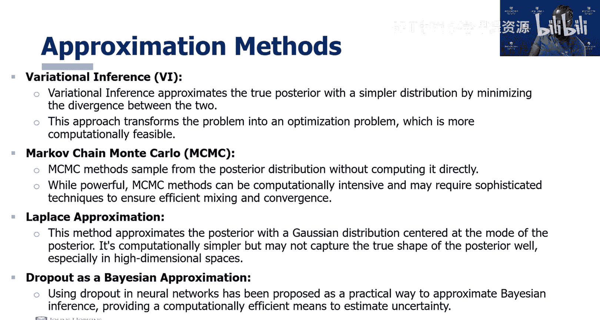

All right， so how do you。Estimate uncertainty with the Bayesian neural networks right and so there's so going go through two kind of definitions right there's eric uncertainty right and that is known as statistical uncertainty that arises from the inherent randomness of the variables I'm sorry in the of the data right and so it is the uncertainty that you actually can't reduce right if you have more of the data collection right？

嗯。And so again， it's associated to the uncertainty within the data， right？嗯。

And so the characteristics of it is one you can't like no matter how much data you're going to collect is going to be there。

 all right， so you can't reduce it with the amount of data that you have。😡。

Right it can be quant directly from the data right and often the model and often the model explicitly have a balling model。

 for example， by assuming that the distribution。By assuming a distribution right for the for the observation of right these are these are these are ways that you can do that right and then you have。

hsmic uncertainty right and that uncertainty is known as the model or systematic uncertainty right and it stems from the lack of knowledge of the complete understanding of the underlying system right so this is kind of like the model uncertainty right and so it represents uncertainty about the model itself right and you know that's going to include a lot of things right so we had to make some traces about structures about parameters right and about the representative of the data。

Right。And so unlike right， the other one， aruistic。

Iatory uncertainty right epismic uncertainty can be reduced by more due data collection right and so some of the characteristics are the results from limited data or incompleteent。

So I'm sorry some of the some of the characteristics is the results from limited data or incompleing some amount of specifications right if you collect more data you can actually reduce this right and also addressed in beian frameworks right right but I placed some prior I'm placed some priors on the model of parameters and updating these so with posterior distribution。

Kind of reflect the observe that。And so Bayesian Er networks offer a principal framework for quantifying。

For both kinds of uncertainty right and this dual capability is particularly valuable and complex decision making right scenarios where understanding the source and the magnitude of uncertainty is crucial。

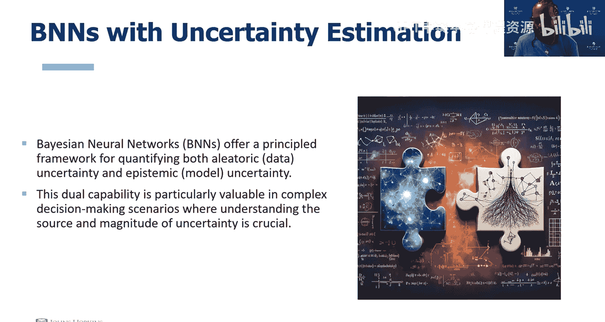

So啊。Allatoryic uncertainty is inherent in the data itself and it often manifests and it's often manifest in as noise in the measurements or variability in outcomes right and so so basically in neural networks quantify this uncertainty by modeling the noise directly in the observation。

Right and so the way that you do this， right， you typically you done by assuming how a LED distribution for the output layer。

Of the neural network that captures the other noise in the data， right？

And then the predictive variance captured in the allic uncertainty indicated how much variability is expected in the outcome for an output due to the data noise。

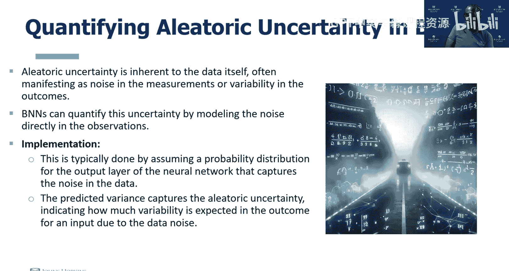

Okay。And so when you think about the mathematical representation of this right so if you let y represent a target output and X the input features then an Bayesian neural network can model the conditional probability of the probability y given x comm W where W is that is the weight of the matrix right and so for all the uncertainty right this conditional probability can be explicitly included include a noise term right in particular you can just add that noise term in there right and。

And if you look at F of x comma W right， this is the mean prediction and sigma square x comma w represents the noise variance right for the input the input x。

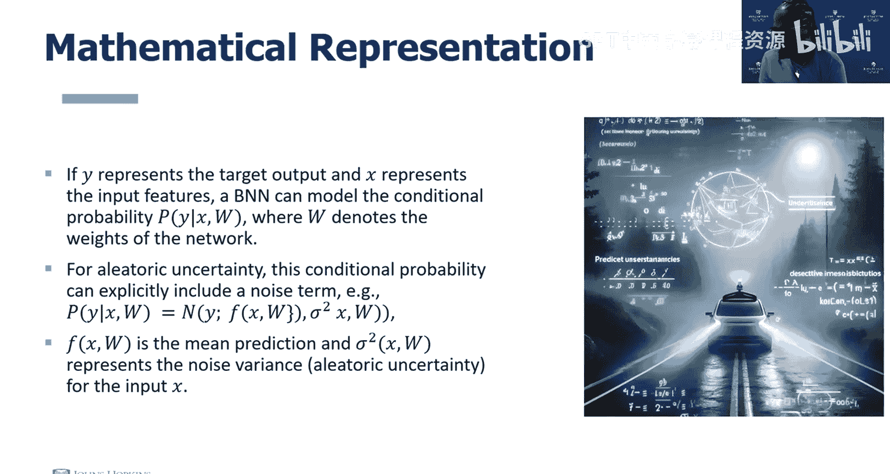

是。All right so how do you quantify the other one right right so with so raising your neural networks address epistmic uncertainty by placing a probability distribution over the modelway themselves？

Right and rather than fixing them to a single point。

so the approach acknowledges that many different sets of weights could explain the observed data right and it quantifies the uncertainty about so which state is correct？

And so right to think about it so mathematically， right， the posterior distribution。

 probably the W given D over the weights given the data set deccaps the epistmic uncertainty。

 and calculating or approximating this distribution allows us to assess how much our beliefs about the weights change in live of data？

So in practice， since the true public spirit is often intract but we can't really do it right approximation ethic like variational inference and Markov chain of Monte Carloos are used in this estimation and that's what we said earlier。

All right， and so by integrating over all possible weights right。

 ba neural neural networks can compute the predictive distribution right for new inputs right and so this predictive distribution encompasses both all and epistmic uncertainties right providing a comprehensive and uncertain estimate for the prediction。

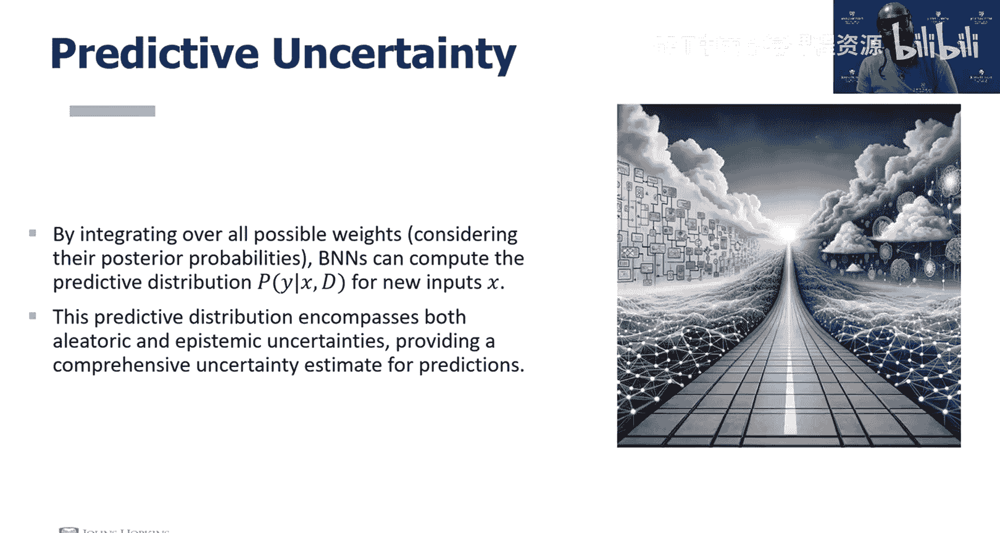

是。so。You know as neural networks have their tradeoffs right and expensiveness of the computation right and the complexity of the basic network right and despite these right the benefits of being able to kind of quantify uncertainty right be able to put in prior knowledge right into neural networks actually just gives us readers to keep on going after this so this is a very open area of research and people and in these problems every day。

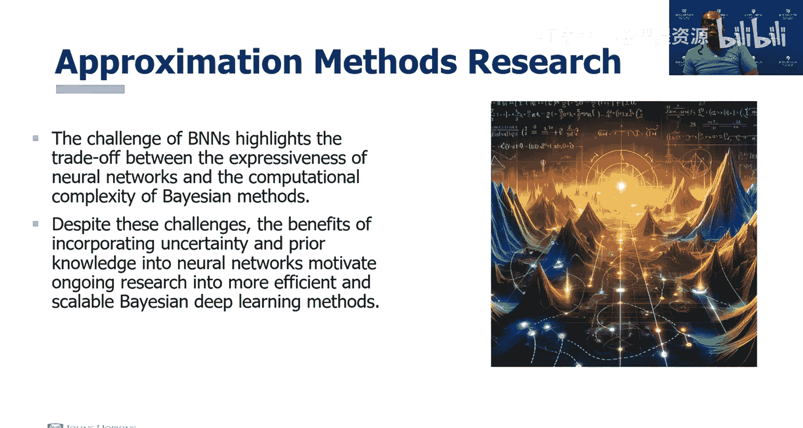

All right so what about Markov chain of Monte Carlo methods right so Markov chain of Monte Carlo methods our class algorithm used to for sampling from complex。

Probability distribution。RightAnd so what they do is they generate samples by constructing a Markov chain right that has the target public energy distribution as the stationary distribution。

And the idea here is to start from an arbitrary point。

And itatively move to new points in the in the sample space right with the transition of ability design such that the chain eventually converges to the target。

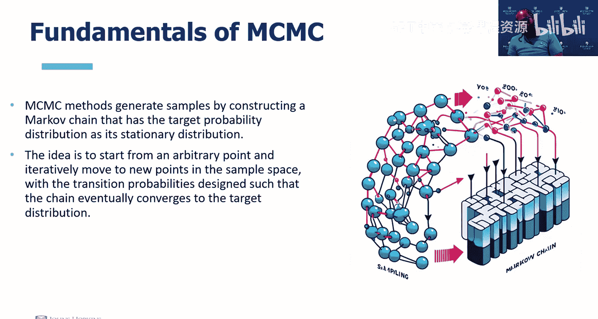

All right， and so。The metropolis hasting algorithm is a key in this method right and so what it does is it allows for sampling from the target distribution by accepting or rejecting。

Poose moves， right based on acceptance。Probability。

 which is determined by preparing the target distribution distributions density at the current proposed。

Right and so so how do you apply it right parameter estimation in complex others for the likelihoods and the priors are known so what the poster distribution is inor。

you have Gibbs a sampling right and so that is a special case of the metropolis hasting algorithms where moves are always accepted right and so it works by sequentially sampling right each variable condition on the current values right of the other variables right？

And so。And so and that's practical and active in high dimensional but structured spaces。

And so how do you apply it right sampling from a joint distribution of all variables and a probabilistic graph model right and it's useful for inference and learning in models with so many interdependent variables。

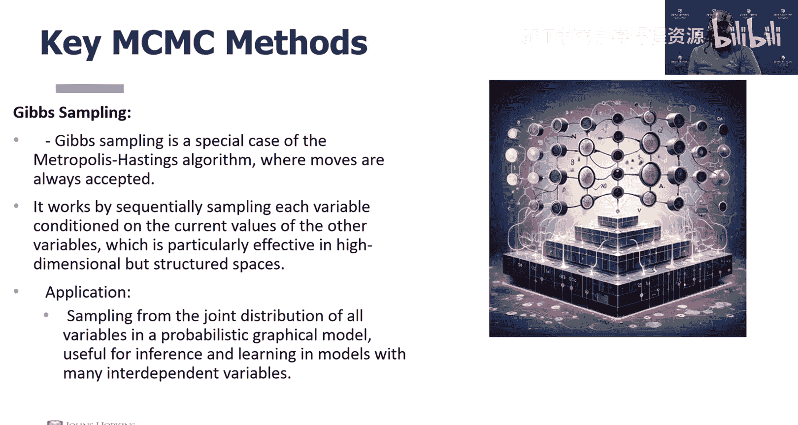

And so in Bayesian deep learnings， So Marov Cha Hollo Methods are used to approximately posterior distributions over weights of neural networks。

 right？And so you have sovasian neural networks， right they and Monte Carlo。

 I'm sorry and Marco changed so Monte Carlo enables sampling from posterior distributions of neural networks weight。

Given the data， which is crucial in baing efforts in deep models， right？

Then you have an uncertainty estimation right so by treating the way it says random variables right and using MCMC right the sample from their posterior distribution is possible to estimate predictive uncertainty in deep learning models。

And so this is right invaluable for applications requiring reliable uncertainty estimates such as our autonomous vehicle and medical diagnosis systems。

All right and so what are some of the challenges right， so despite its theoretical appeal right。

 applying MCMC right directly to the learning models faces challenges due to the high dimensionality of the parameter space？

And the computational cost of right and so variants like Hamiltonian so Monte Carlo and stochastic raia MCM right have been developed and improved to improve efficiency and scheduleal。

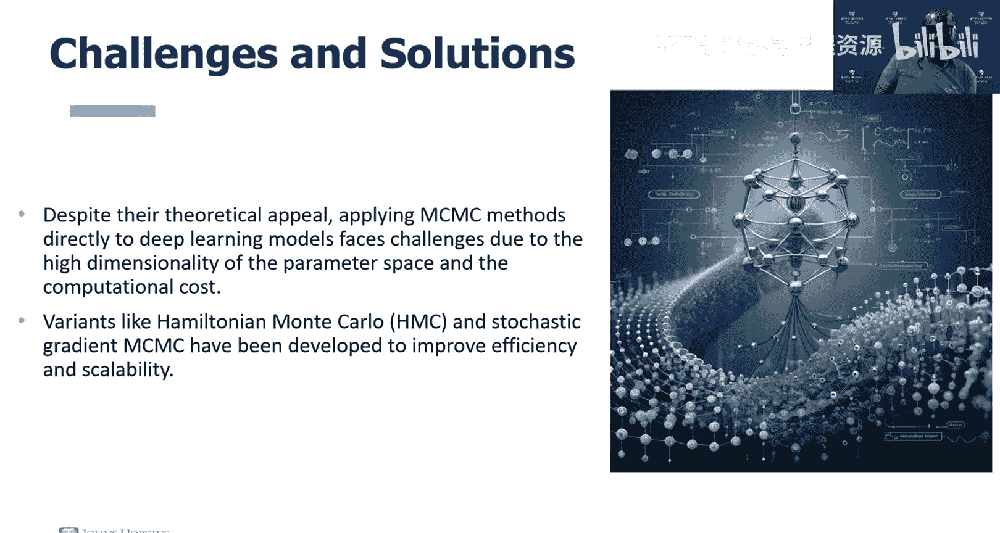

Right， so， you know。Pit together a few so real world case studies right and kind of like right kind of think about this through so realro applications right and so when you think about structure。

Probabilistic models they're instrumental in enhancing deep learning applications across a lot of domains right and so by integrating these models with。

Did do learning research， right and pre。And practitioners。

 they have had the ability to tackle complex problems that require nuanced understandings。

 right and uncertainty structure and that out of generation processes， right？So here's a few。

Notable cases to kind of illustrate the impact of these of these things right so with variational other encoders right so this is a class of degenerative models that are used for structure probabilistic models to learn latent representationations of the data right and they're particularly influenced influential and of image of generation right and so a notable study right is that a VAE was employed to generate high quality diverse image images from complain that at says like Caleb8。

Capturing intractable details。I'm sorry。嗯。cappturing interested detailss and aations in facial features right and so the impact is the integration of VAEs allowed for a generation of new images right that closely a distribution of the training data right and that showcase the models of the ability to capture and to reproduce the underlying data out of distribution。

And then you have NLPs， right， so LDA is a structure。Probabilistic model。Right。

Use for uncovering the topic structure of the document collections right and so when combined with neural networks LDA can enhance topic discovery and text generation process right so a deep learning model augmented with LDA was used to improve topic coherence right and generate and generate text and document classification tag right demonstrate and superior performance of over a traditional methods right。

And so that impact facilitated a deeper understanding of the document in semantics。

 improved the attracttractability of the model and yielded more coherent。T generation。And then。

We have。Speech recognition， right。BMMs combine deep iron and arch models to model sequential。

Data for more more effectively sorry， and they're particularly suitable for tasks where the sequential structure and uncertainty and the data are critical right。

 such as speech to hus recognition right so DMMs have been used right to enhance speech social recognition systems providing more robust frameworks。

For dealing with temporal variations and noise presented in audio that。Okay。

And then you have autonomous driving right， so Bayian neural networks were used in autonomous。

Driving and use。to predict the behavior right of other vehicles and pedestrians right with an associated security method right and so what it does is it enhances the decision making process in uncertain environment。

是。And then you have graphical convolution neural networks right they were used to augment the probabilistic models and they have been applied to predict moleculars of properties and interactions accelerating the。

G discovery our process。是。So。Take a moment， think about all of the impacts so that these guys have had and if there's any questions please don't have in text us。

 send me an email and we can discuss。

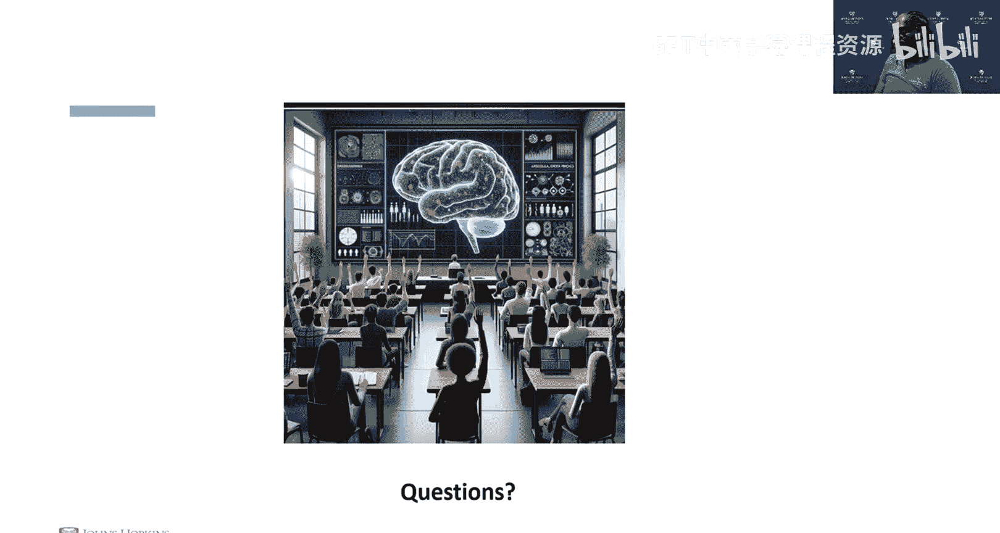