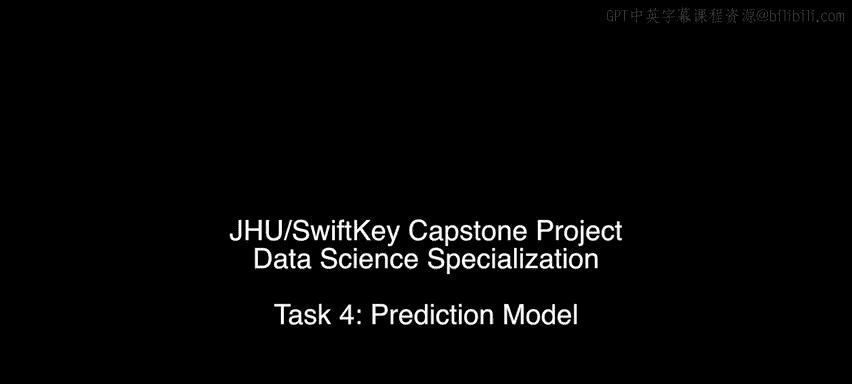

# 约翰霍普金斯大学数据科学课程10：《数据科学毕业课程（约翰霍普金斯大学）》｜data-science-project｜ - P10：9_任务4介绍 预测模型.zh_en - GPT中英字幕课程资源 - BV1ow411S7Vj

Okay， so far you've gotten the data， you've cleaned and processed it a bit。

 you've done a little bit of exploratory analysis and you've built some initial models。

 so now it's Showtime now you've got to build your prediction model for text and the basic goal for this task is to take all the things that you've done up until this point and to put them all together to build the best prediction model that you can。

At this stage， you're going to want to carefully consider your code for and examine it for efficiency and accuracy。

 Think about the computational complexity of your algorithm and maybe consider using things like a profiler to time your code and look for bottlenecks also think a little bit about the environment in which your code is going to run So is it going to run on a high end server or do you think it might be better use on like a mobile phone because the environment that you run your code in will determine the kinds of resources that you have available and so you might even want to think about writing your code in such a way that is easily adaptable to different kinds of environments。

😊，So at the end of this task you need to have a full working model that has decent performance。

 also try to come up with a list of ideas that you can try out that might improve the performance of your model in various ways so good luck with this task we're really looking forward to taking a look at the models that you build。

