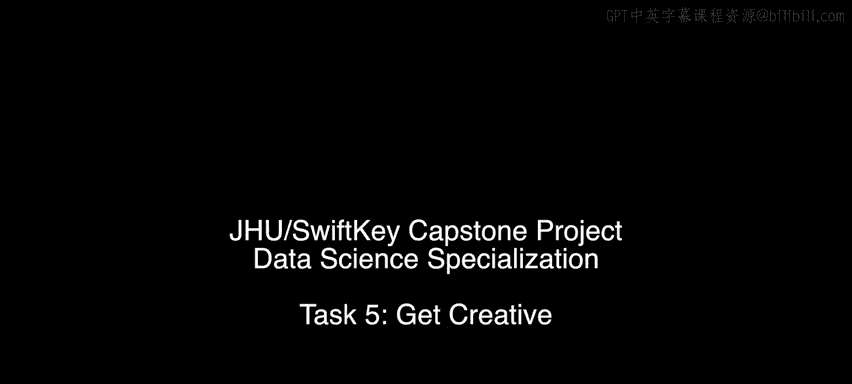

# 约翰霍普金斯大学数据科学课程10：《数据科学毕业课程（约翰霍普金斯大学）》｜data-science-project｜ - P11：10_任务5介绍 创意探索.zh_en - GPT中英字幕课程资源 - BV1ow411S7Vj

Okay， so you've built your predictive model and it seems to be running pretty well。

 maybe it's reasonably fast and it predicts the right word most of the time。 So you're done， right。

No。Put this way。 if you' were playing Maler's third symphony。

 you'd be like in the fourth movement right now。 So you still have like two more movements to go。

 Okay so the goal of this task is to make things better。 Okay， so remember in the last task。

 you're supposed to come up with a list of ideas that you thought might improve the performance of your model in various ways。

 So what we want to do here is go down this list of ideas， try different things out。

 try to think outside the box and see what works and what doesn't。

 Okay as you're going down this list of ideas， you're going to have to evaluate the performance of your model as you go。

 So remember to hold out a test data so that you can evaluate these new creative models that you're building。

 Okay so try to have fun doing this task， because， you know， if you're not having fun。

 you're not being a data scientist。😊。