# 约翰霍普金斯大学数据科学课程1：《数据科学家工具》｜data-scientists-tools｜ - P12：11_github和git.zh_en - GPT中英字幕课程资源 - BV1Ep4y177Cv

Now that we've got a handle on what version control is in this lesson。

 you will sign up for a Github account， navigate around the Github website to become familiar with some of its features and install and configurefigit all in preparation for linking both with your ourt as we previously learned Github is a cloudbased management system for your versionconed files like Dropbox your files are both locally on your computer and hosted online and easily accessible It interface allows you to manage version control and provides users with a web-based interface for creating projects sharing them updating code etc to get a Github account first go to www。

github。com you will be brought to their home page where you should fill in your information make a username put in your email chooseose a secure password and click sign up for Github you should now be logged into Github in the future to log on Github go to Github。

com where you will be presented with a home page if you aren't already logged in。

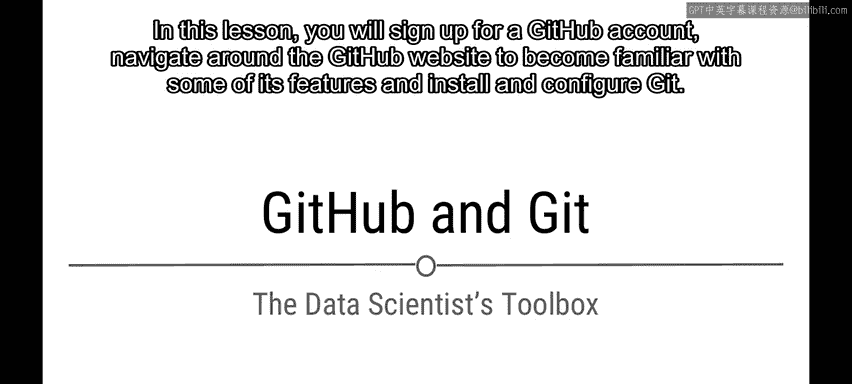

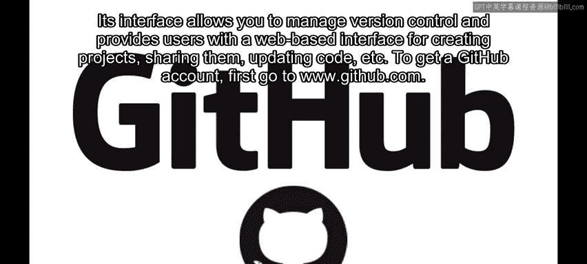

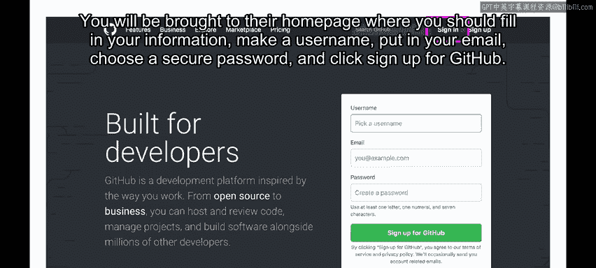

Click on the sign and link at the top Once you've done that。

 you will see the login page where you will enter in your username and password that you created earlier。

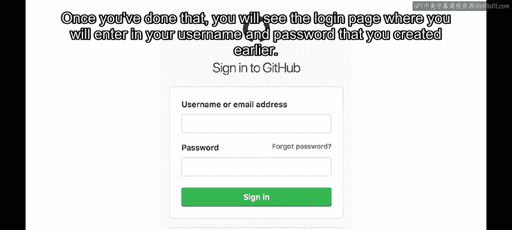

Once logged in， you will be back at Github。com， but this time the screen should look like this。

We're going to take a quick tour of the Github website and we'll particularly focus on these sections of the interface。

 user settings， notifications， help files and the GiHub guide following this tour we'll make your very first repository using the GiHub guide First let's look at your user settings Now that you've logged on to GiHub we should fill out some of your profile information and get acquainted with the account settings in the upper right corner there is a icon with a narrow beside it click doesn't go to your profile this is where you control your account from and can view your contribution histories and repositories Since you are just starting out you aren't going to have any repositories or contributions yet but hopefully we'll change that soon enough What we can do right now is edit your profile go to edit profile along the left-hand edge of the page here take some time and fill out your name and a little description of yourself in the biobox and if you like Up a picture of yourself When you are done click update。

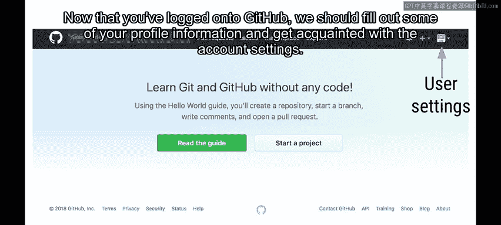

long the left hand side of this page there are many options for you to explore click through each of these menus to get familiar with the options available to you to get you started go to the account page。

Here you can edit your password or if you are unhappy with your username change it。

 be careful though， there can be unintended consequences when you change your username if you are just starting out and don't have any content yet you'll probably be safe though continue looking through the personal setting options on your own when you are done go back to your profile。

Once you've had a bit more experience with GitHub you'll eventually end up with some repositories to your name to find those click on the repositories link on your profile for now it will probably look like this by the end of the lecture though check back to this page to find your newly created repository Next we'll check out the notifications menu along the menu bar across the top of your window there is a bell icon representing your notifications click on the bell。

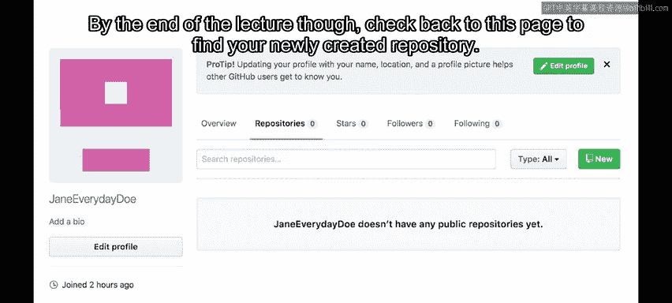

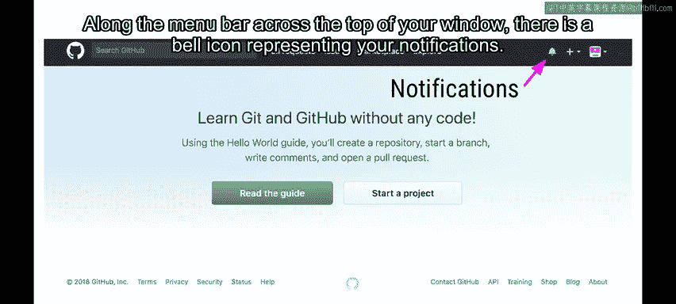

Once you become more active on GitHub and are collaborating with others。

 here is where you can find messages and notifications for all the repositories， teams。

 and conversations you are part of along the bottom of every single page there is the help button。

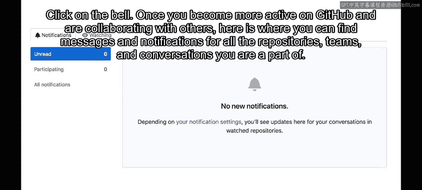

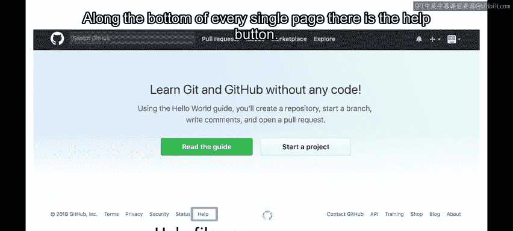

GitHub has a great help system in place if you ever have a question about GitHub。

 this should be your first point to search， take some time now and look through the various help files and see if any catch your eye。

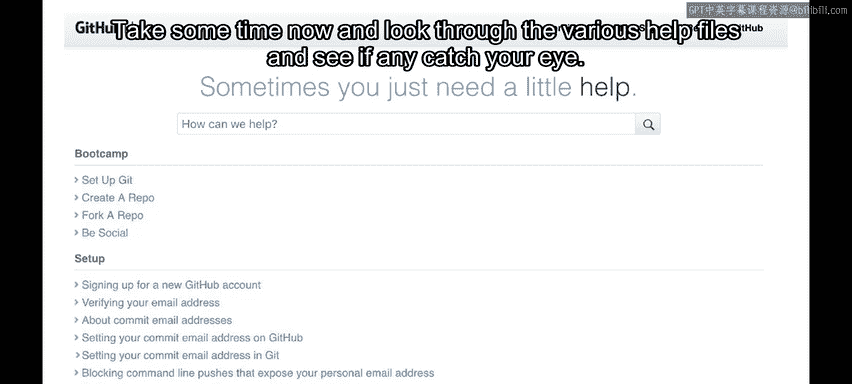

GitHub recognizes that this can be an overwhelming process for new users and as such have developed a mini tutorialial to get you started with GitHub go through this guide now and create your first repository when you were done you should have a repository that looks something like this take some time to explore around the repository check out your commitm history so far here you can find all of the changes that have been made to the repository and you can see who made the change when they made the change and provided you wrote an appropriate commit message you can see why they made the change once you've explored all of the options in the repository go back to your user profile it should look a little different from before now when you are on your profile you can see your latest repository created and for a complete listing of your repositories click on the repositories tab。

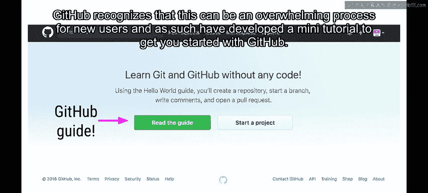

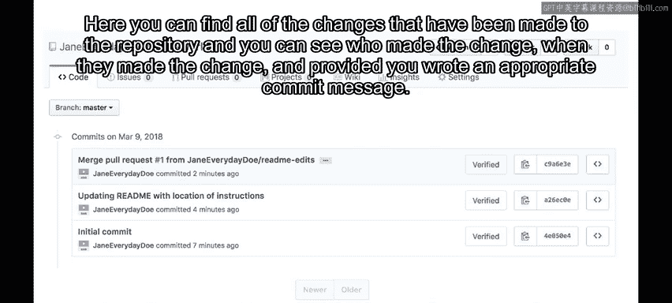

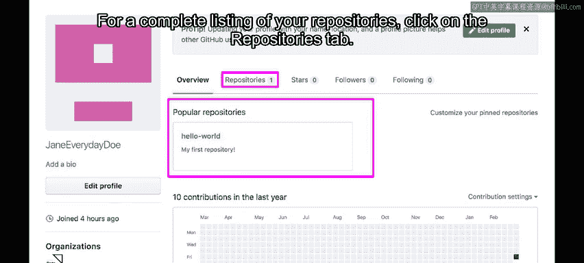

Here you can see all of your repositories， a brief description。

 the time of the last edit and along the right-hand side。

 there is an activity graph showing one and how many edits have been made on the repository as you may remember from our last lecture Git is the free and open source version control system which GitHub is built on one of the main benefits of using the Git system as its compatibility with ourt however。

 in order to link the two software together we first need to download an install Git on your computer to download Git go to Giscm。

com/ download click on the appropriate download link for your operating system this should initiate the download process we'll first look at the install process for Windows computers and follow that with Mac installation steps followow along with the relevant instructions for your operating system for Windows computers once the download is finished。

 open the。exc file to initiate the installation wizard If you receive a security warning click Run。

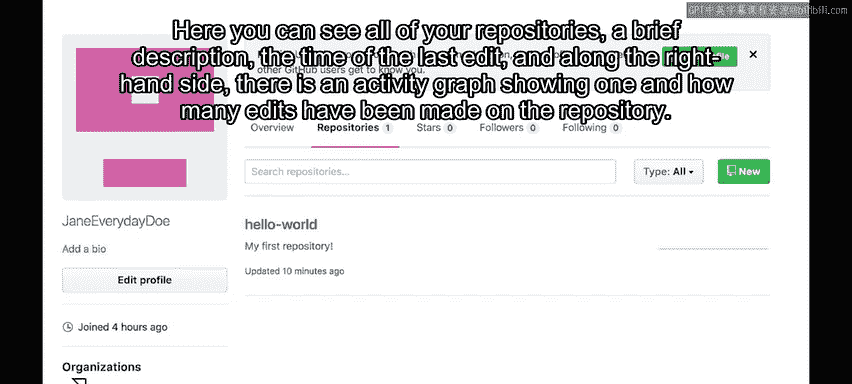

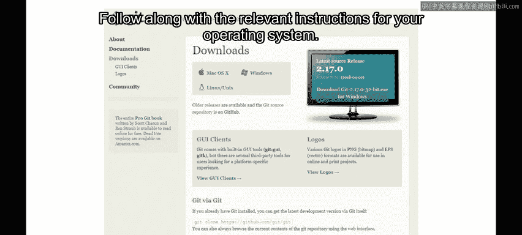

And or allow following this， click through the installation wizard。

 generally accepting the default options unless you have a compelling reason not to。

Click installs and allow the Wiizard to complete the installation process following this。

 check the launch Gitbash option， and unless you are curious。

 deselect a View releaselease Note box as you are probably not interested in this right now。

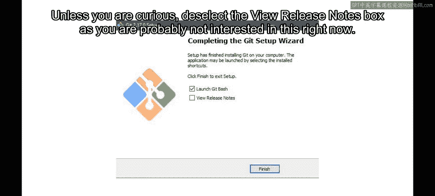

Doing so a command line environment will open provided you accepted the default options during the installation process there will now be a start menu shortcut to launch Gitfash in the future you have now installed Git for Mac we will walk you through the most common installation process however there are multiple ways to getgit onto your Mac you can follow the tutorials at www。

lashin。com/git/ tutorials/installgit for alternativeternative installation routes After downloading the appropriate Git version for Mac you should have downloaded a DMg file for installation on your Mac open this file This will install git on your computer a new window will open double click on the PkG file and an installation wizard will open click through the options accepting the defaults click install When prompted close the installation wizard you have successfully installed Git。

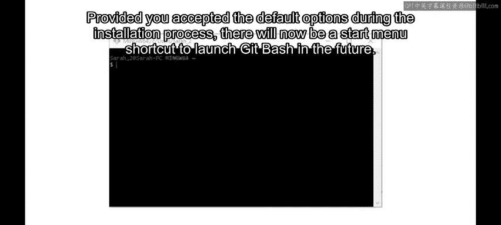

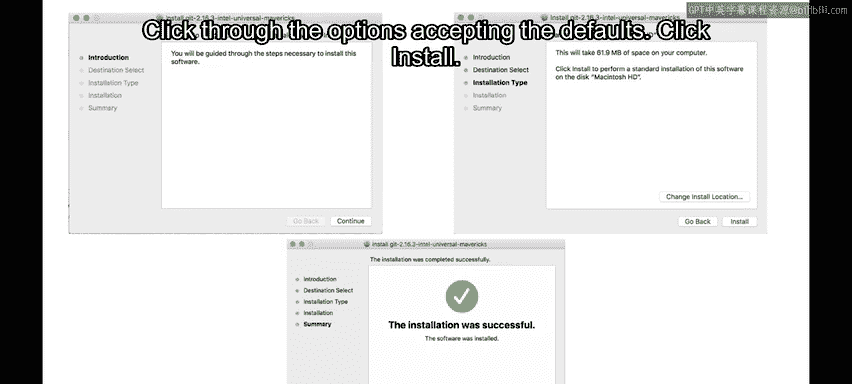

Now that Git is installed， we need to configure it for use with GitHub in preparation for linking it with ourSt。

 we need to tell Git what your username and email are so that it knows how to name each commit is coming from you to do so in the command prompt either Gitbash for Windows or a terminal for Mac type Gitconfigglobaluser。

 name Janeindo with your desired username in place of Janeindo this is the name each commit will be tagged with following this in the command prompt type Gitconfigglobaluser。

email janido at Gmail。com making sure to use the same email address you signed up for Gitthub with。

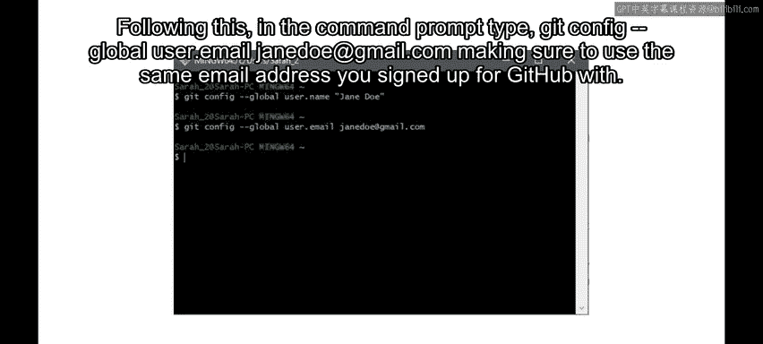

At this point， you should be set for the next step， but just to check。

 confirm your changes by typingGConfiglist， doinging so。

 you should see the username and email you selected above if you notice any problems or want to change these values。

 just retype the original config commands from earlier with your desired changes。

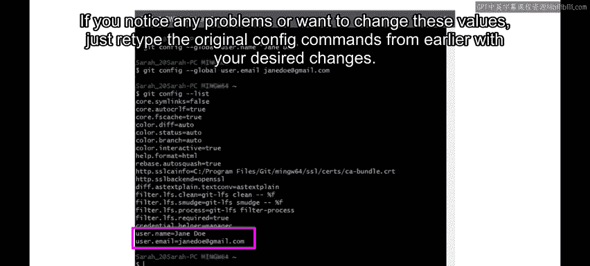

Once you are satisfied that your username and email is correct。

 exit the command line by typing Exit and hit enterter at this point you are all set up for the next lecture In this lesson we signed up for a GiHub account and toured the GiHub website we made your first repository and filled in some basic profile information on GitHub following this we installed Git on your computer and configured it for compatibility with GiHub and RSt。

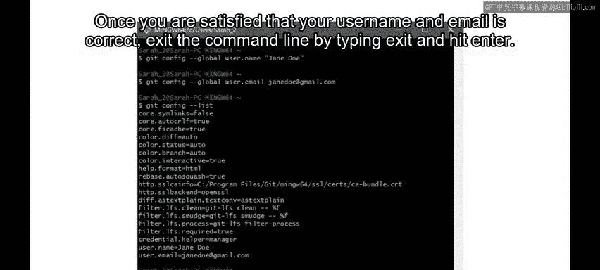

