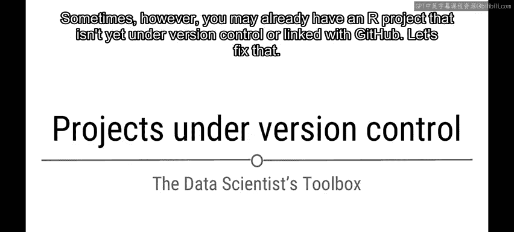
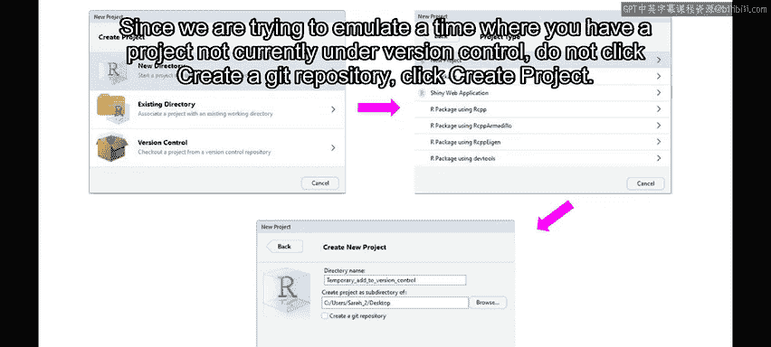
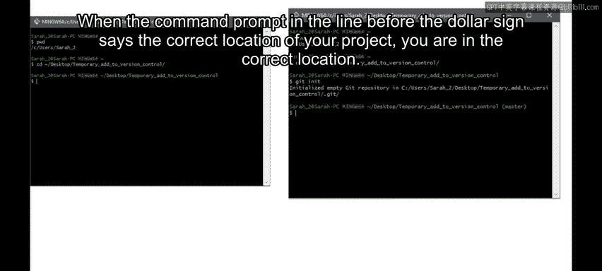
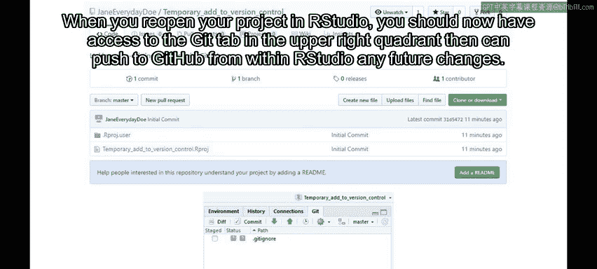
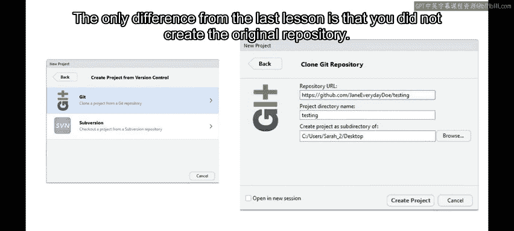

# 约翰霍普金斯大学数据科学课程1：《数据科学家工具》｜data-scientists-tools｜ - P14：13_在版本控制下的项目.zh_en - GPT中英字幕课程资源 - BV1Ep4y177Cv

In the previous lesson， we linked our studio with Git and GitHub in doing this。

 we created a repository on Gitthub and linked it to ourSt， sometimes， however。

 you may already have an R project that isn't yet under version control or linked with GitHub。

 let's fix that。

So what if you already have in our project that you've been working on but don't have it linked up to any version control software thankfully our studio and GiHub recognize this can happen and have steps in place to help you admittedly。

 this is slightly more troublesome to do than just creating a repository on Gitthub and linking it with our studio before starting the project so first。

 let's set up a situation where we have a local project that isn't under version control go to file new project new directory。

 new project and name your project Since we are trying to emulate a time where you have a project not currently under version control do not click createreate a Git repository click create project We've now created an our project that is not currently under version control let's fix that First。

 let's set it up to interact with Git Open Gitash or terminal and navigate to the directory containing your project files Mo around directories by typing CD for change directory followed by the path of the directory。

When the command prompt in the line before the dollar sign says the correct location of your project。

 you are in the correct location Once here type Giin it followed by GitAd period。

 this initializes this directory as a Git repository and adds all of the files in the directory to your local repository commit these changes to the Git repository using Git commit initial commit at this point we have created an our project and have now linked it to Gitversion control The next step is to link this with Github to do this go to Github。

com and again create a new repository make sure the name is the exact same as your R project and do not initialize a Readme file。

 Git ignore or license once you've created this repository you should see that there is an option to push an existing repository from the command line with instructions below containing code on how to do so in Gitbaash or terminal。

 copy and paste these lines of code to link your repository with GitHub。

After doing so， refresh your GitHub page and it should now look something like this when you reopen your project in our studio you should now have access to the GitTab in the upper right quadrant and can push to GitHub from within our studio any future changes if there is an existing project that others are working on that you are asked to contribute to you can link the existing project with your our studio it follows the exact same premise as that from the last lesson where you created a GitHub repository and then cloned it to your local computer using ourSt in brief in ourSt go to fileile new project version control。

Select Gi as your version control system and like in the last lesson。

 provide the URL to the repository that you are attempting to clone and select a location on your computer to store the files locally create the project All the existing files in the repository should now be stored locally on your computer and you have the ability to push editets from your RSt interface The only difference from the last lesson is that you did not create the original repository instead you cloned somebody else's In this lesson we went over how to convert an existing project to be under Git version control using the command line Following this we linked your newly version controlled project to GiHub using a mix of GitHub commands and the command line we then briefly reapp how to clone an existing GitHub repository to your local machine using Rt。

