# 约翰霍普金斯大学数据科学课程1：《数据科学家工具》｜data-scientists-tools｜ - P15：14_r markdown.zh_en - GPT中英字幕课程资源 - BV1Ep4y177Cv

We've spent a lot of time getting R and R studio working。

 learning about projects and version control you are practically an expert at this there is one last major functionality of R/ R studio that we would be remiss and not include in your introduction to R Markdown。

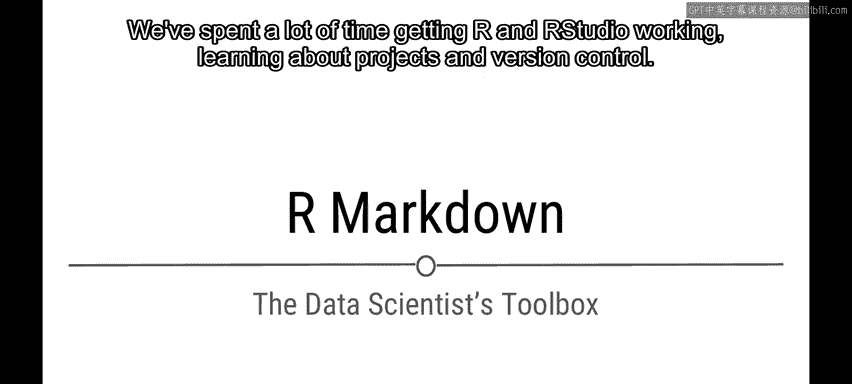

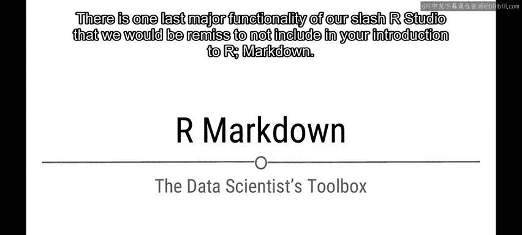

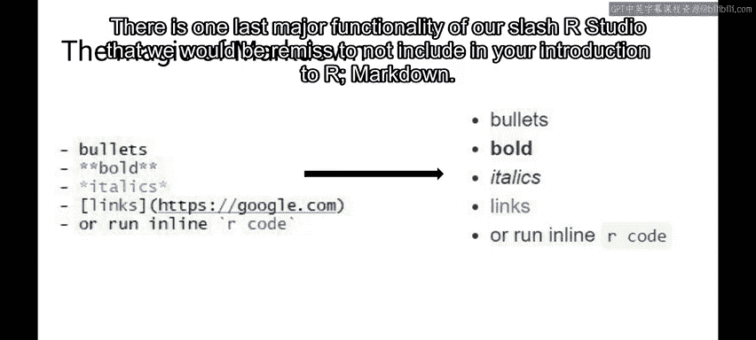

Our markdown is a way of creating fully reproducible documents in which both text and code can be combined In fact。

 these lessons are written using our markdown that's how we make things like bullet lists。

 bolded in italicized text， inline links and run inline our code and by the end of this lesson you should be able to do each of those things too and more despite these documents all starting as plain text。

 you can render them into HTML pages or PDFs or word documents or slides the symbols you use to signal。

 for example， bold or italics is compatible with all of those formats。

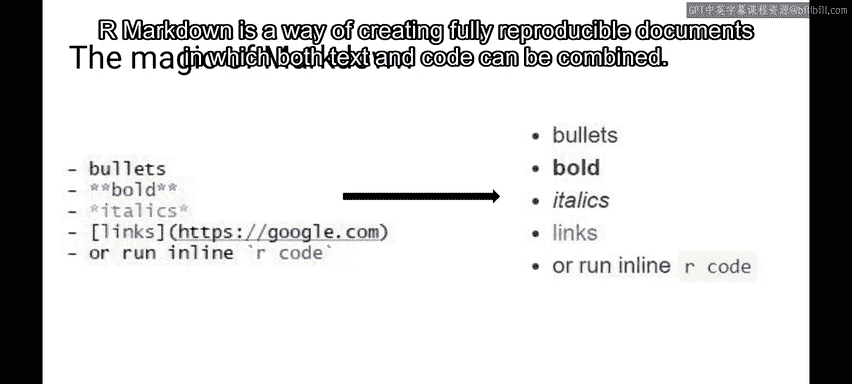

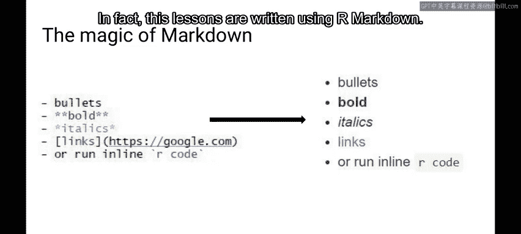

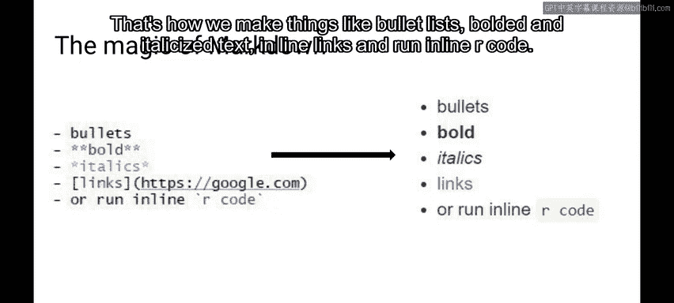

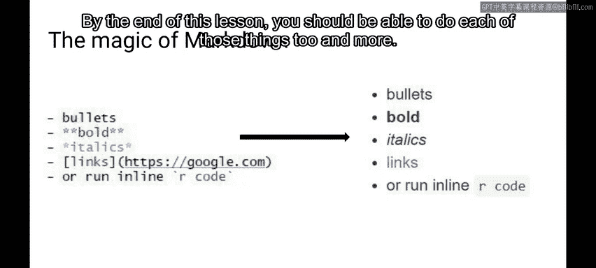

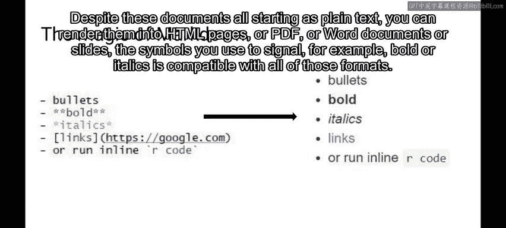

One of the main benefits is the reproducibility of using R markdown Since you can easily combine text and code chunks in one document。

 you can easily integrate introductions， hypotheses。

 your code that you are running the results of that code on your conclusions all in one document sharing what you did why you did it。

 and how it turned out becomes so simple and that person you share it with can rerun your code and get the exact same answers you got That's what we mean about reproducibility but also sometimes you will be working on a project that takes many weeks to complete you want to be able to see what you did a long time ago and perhaps be reminded exactly why you were doing this and you can see exactly what you ran in the results of that code and R markdown documents allow you to do that Another major benefit to R markdown is that since it is plain text it works very well with version control systems it is easy to track what character changes occur between commits unlike other formats that aren't plain text For example in one version of。

LessonI may have forgotten to bold this word When I catch my mistake。

 I can make the plain text changes to signal I would like that word it bolded， and in the commit。

 you can see the exact character changes that occur to now make the word bold。

Another selfish benefit of R markdown is how easy it is to use like everything in R this extended functionality comes from an R package our markdown all you need to do to install it is run install dot package is R markdown and that's it you are ready to go to create an R markdown document in our studio go to file new file R markdown you will be presented with this window I've filled in a title and an author and switch the output format to a PDF Exp on this window in the tabs along the left to see all the different formats that you can output to When you are done click OK and a new window should open with a little explanation on R markdown files there are three main sections of an R markdown document The first is the header at the top bounded by the three dashes This is where you can specify details like the title your name the date and what kind of document you want output if you filled in the blanks in the window earlier these should be filled out for you Also on。

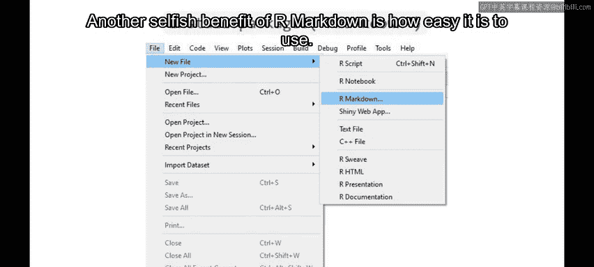

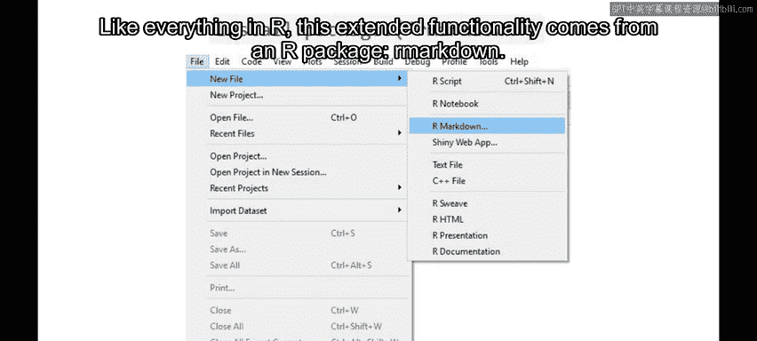

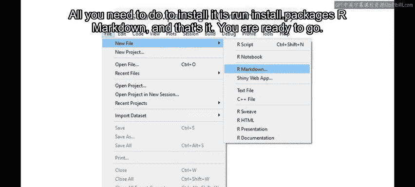

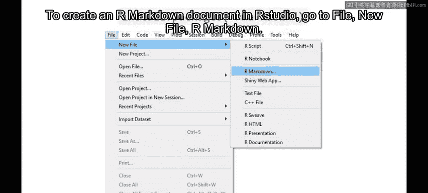

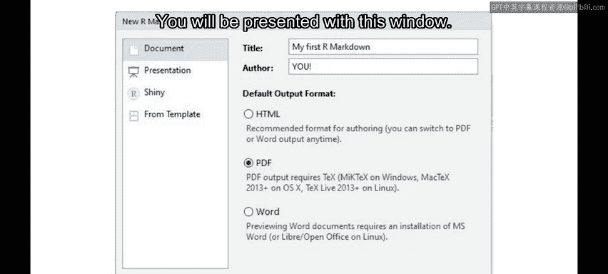

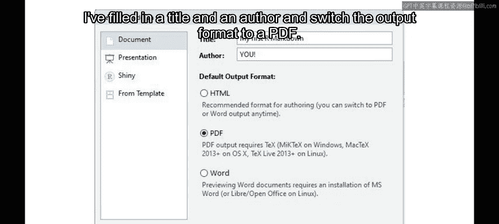

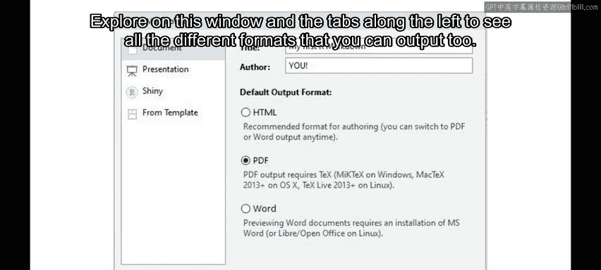

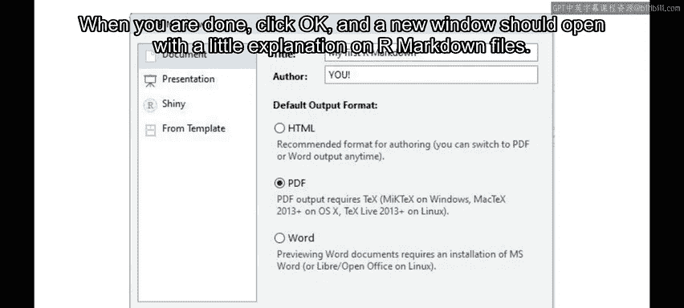

You can see text sections， for example， one section starts with hash hassh R markdown we'll talk more about what this means in a second。

 but this section will render as text when you produce the P of this file and all of the formatting you will learn generally applies to this section and finally you will see code chunks these are bounded by the triple bas These are pieces of our code chunks that you can run right from within your document and the output of this code will be included in the P when you create it the easiest way to see how each of these sections behave is to produce the P when you are done with a document in our markdown you are said to knit your plain text and code into your final document to do so click on the button along the top of the source panel when you do so it will prompt you to save the document as an RMD file do so you should see a document like this one So here you can see that the content of the header was rendered into a title followed by your name and the date the text chunk。

Produced a section header called R markdown which is followed by two paragraphs of text Following this。

 you can see the R code summary Car， which is importantly followed by the output of running that code and further down you will see code that ran to produce a plot and then that plot this is one of the huge benefits of R markdown rendering the results to code in line go back to the R markdown file that produced this PDF and see if you can see how you signify you want text builded Hi。

 look at the word knit and see what it is surrounded by。At this point。

 I hope we've convinced you that R markdown is a useful way to keep your code s data and have set you up to be able to play around with it to get you started。

 we'll practice some of the formatting that is inherent to R markdown documents to start。

 let's look at bolding and italicizing text to bold text you surround it by two asterisks on either side Similarlyly to italicized text you surround the word with a single asterisk on either side we've also seen from the default document that you can make section headers to do this you put a series of hash marks The number of hash marks determines what level of heading it is One hash is the highest level and will make the largest text。

 two hashes is the next highest level and so on play around with this formatting and make a series of headers。

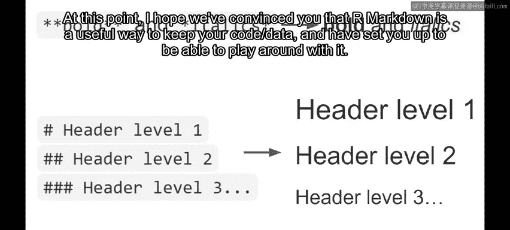

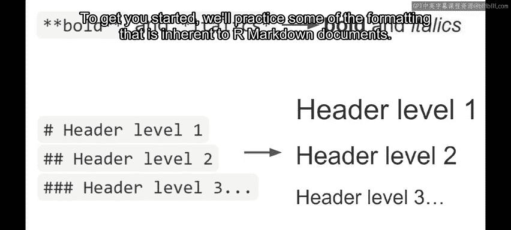

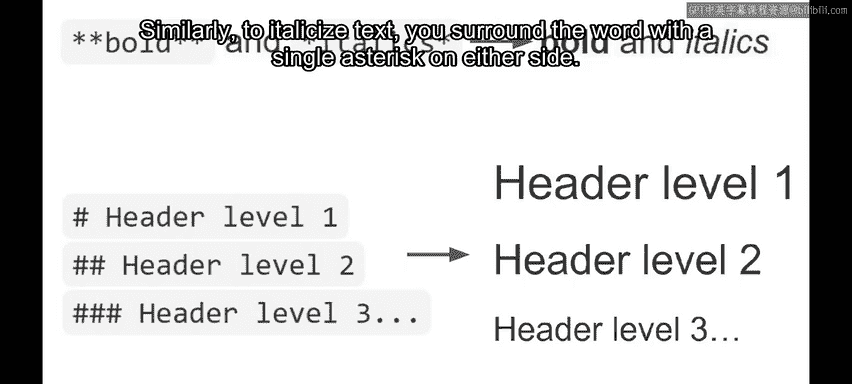

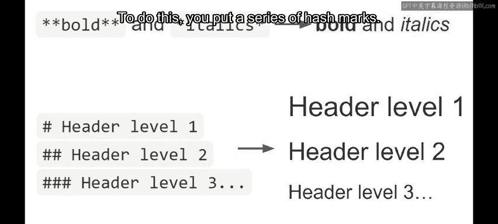

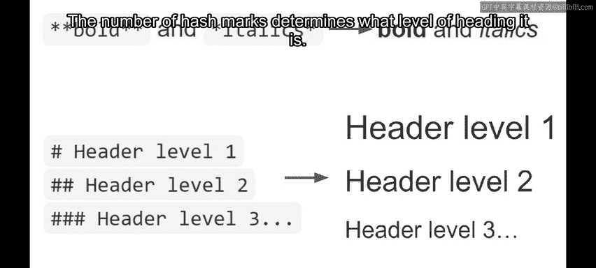

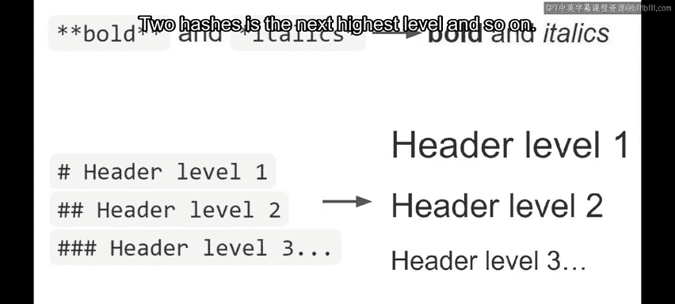

The other thing we've seen so far is code chunks to make an our code chunk。

 you can type the three backtics， followed by the curly brackets surrounding a lower case R put your code on a new line and end the chunk with three more backics Thankly our studio recognized youd be doing this a lot and there are shortcuts。

 namely control alt I for Windows or command option I for Max Additionally。

 along the top of the source quadrant there is the insert button that will also produce an empty code chunk try making an empty code chunk In it。

 type the code print hello world When you knit your document you will see this code chunk in the Adly simplistic output of that chunk。

If you aren't ready to knit your document yet， but want to see the output of your code。

 select the line of code you want to run and use control。

 enter or hit the run button along the top of your source window。

 the text hello world should be output in your console window if you have multiple lines of code in a chunk and you want to run them all in one go you can run the entire chunk by using control。

 shift， enter， or hitting the green narrow button on the right side of the chunk or going to the run menu in selecting runCurrent chunk。

One final thing we will go into detail on is making bulleted lists like the one at the top of this lesson Ls are easily created by precediving each prospective bullet point by a single dashh followed by a space  importantly at the end of each bullets line and with two spaces this is a  cork of R markdown that will cause spacing problems if not include it This is a great starting point and there is so much more you can do with R markdown Thankly our studio developers have produced an R markdown chiche that we urge you to go check out and see everything you can do with R markdown The sky is the limit In this lesson we've delvet into R markdown starting with what it is and why you might want to use it we hopefully got you started with R markdown first by installing it and then by generating and knitting our first R markdown document we then looked at some of the various formatting options available to you in practice generating code and running it within the RSt interface。

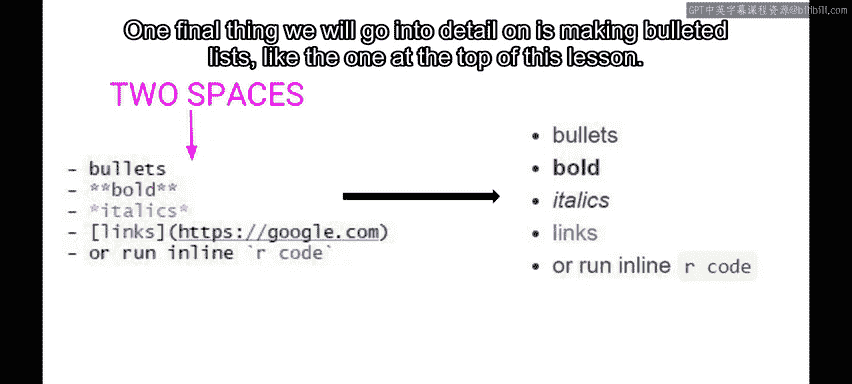

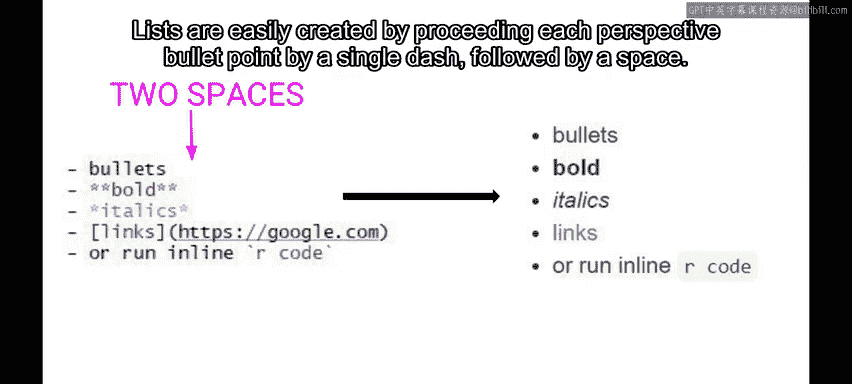

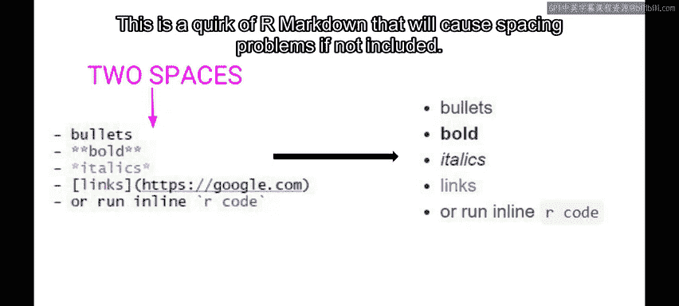

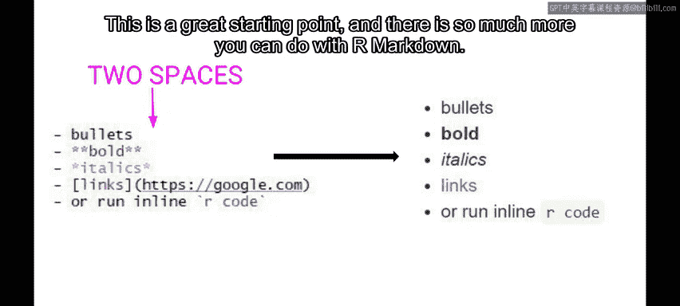

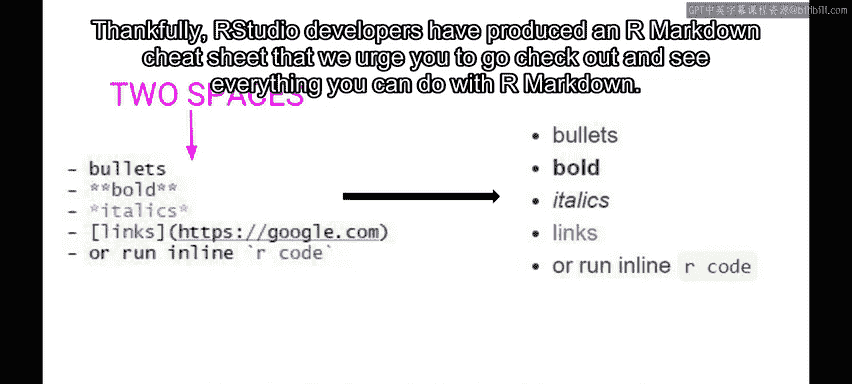

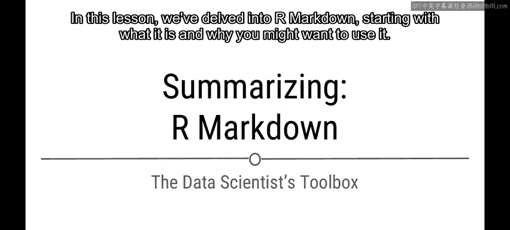

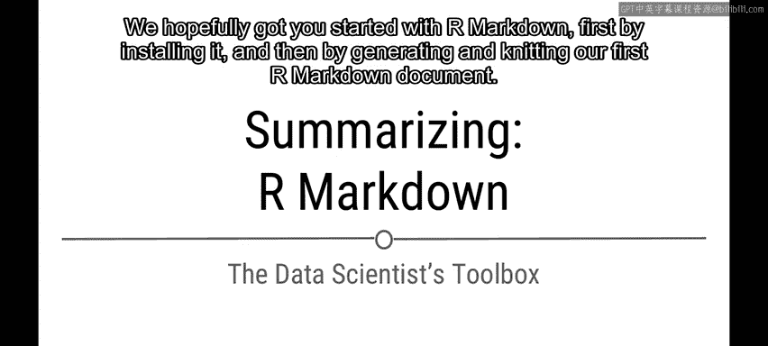

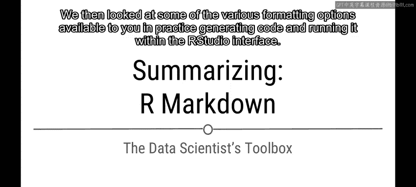

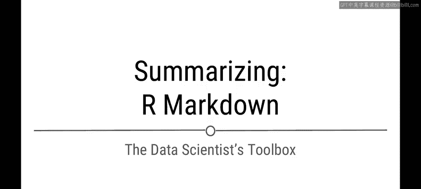