# 约翰霍普金斯大学数据科学课程1：《数据科学家工具》｜data-scientists-tools｜ - P1：0_为什么是自动视频.zh_en - GPT中英字幕课程资源 - BV1Ep4y177Cv

What's the deal with these videos and why do the videos say almost exactly the same thing as the printed lecture material you have probably already noticed that the lectures and videos for this class are structured a little differently than in many MOCs you have taken We created this video to explain to you why we made this change and why we think it highlights the awesome power of R and data science。

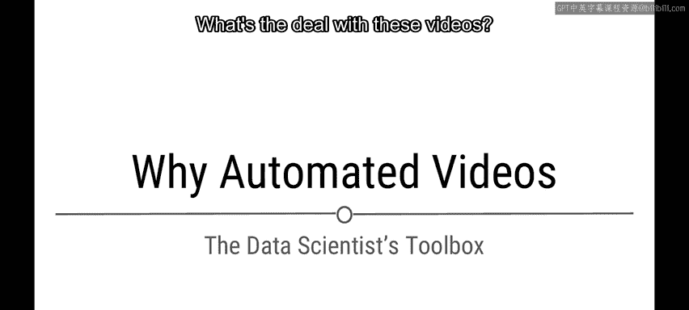

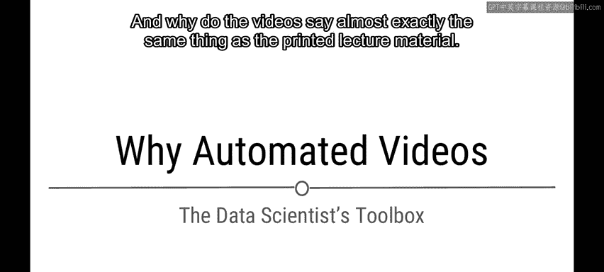

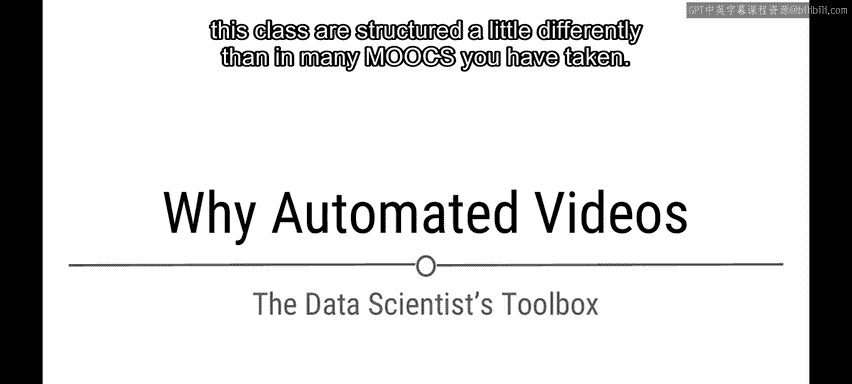

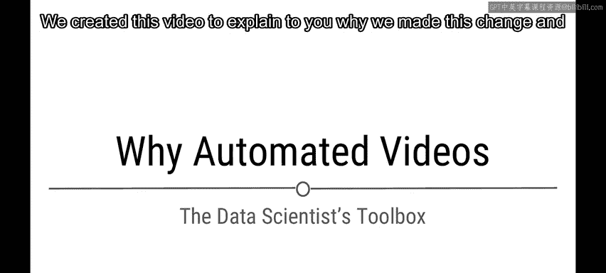

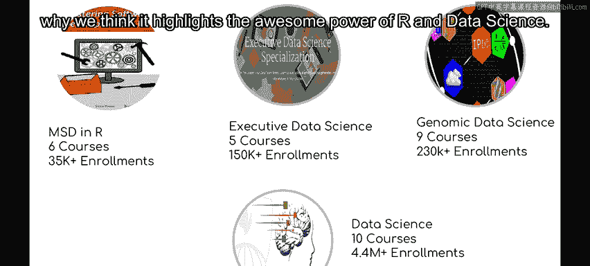

We create a lot of massive online open courses at the Johns Hopkins Data Science Lab we have created more than 30 courses on multiple platforms over the last five years our goal with these classes is to provide the best and most up-to-date information to the broadest audience possible but there are significant challenges to maintaining this much material online our packages go out of date new workflows are invented and typos oh the typos we used to make these courses like many other universities we'd create course material in the form of lecture slides then we'd record videos of ourselves delivering those lectures in some ways this was great。

 you actually got to hear our voices delivering your lectures including all the yasums buts and sos but the downside is that it is difficult and time consuming to update the content when we have to book a recording studio。

 set up special equipment record ourselves delivering a lecture edit those lectures and then upload them to a system the result is that a lot of our lectures。

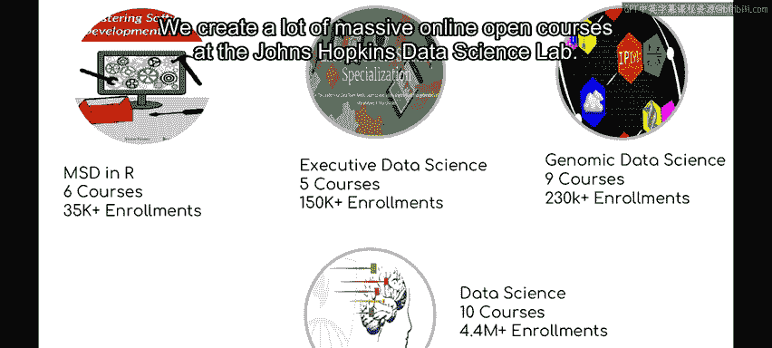

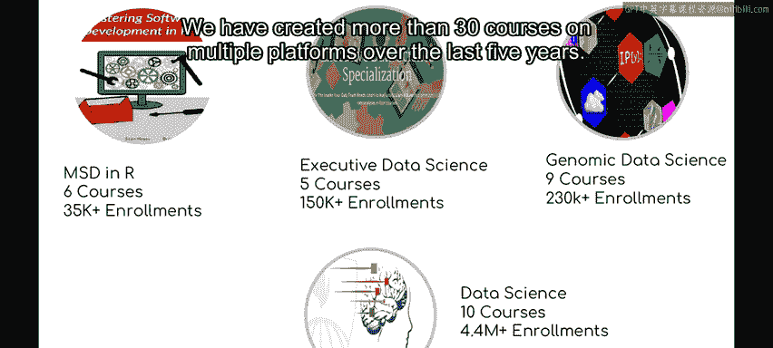

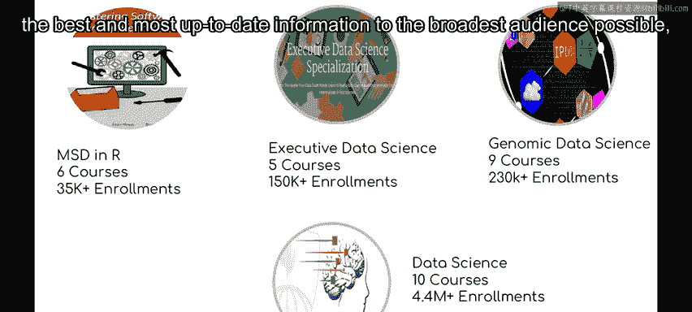

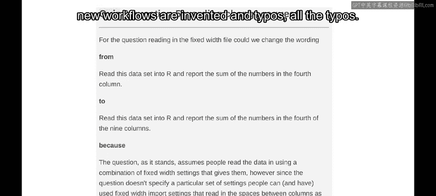

ha been out of date， include errors， or don't include the latest。

 best versions of workflows and pipelines this has been a problem for a while。

 but as the number of courses we offer grows， it has become more and more of a challenge for us to keep them up to date Who websites have been set up to monitor all the problems with our courses。

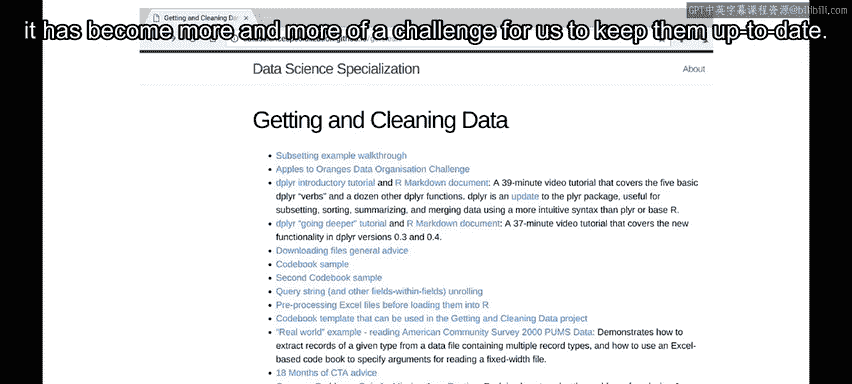

So we started to think about how to solve this challenging problem we realized that while recording and editing videos is extremely time consuming there is another type of content we can edit。

 update， and maintain much more frequently， regular old plain text documents we aren't the only ones who have thought this。

maive online openCourse innovators like Lorena Barba have been saying that videos aren't even necessary for these types of courses。

So when we sat down to develop our new process for creating and maintaining our courses we wanted to see if we could figure out how to make a classmate entirely out of plain text documents we broke down a massive online open course into its basic elements tutorials。

 these we can easily write in plain text formats like markdown are our markdown slides these are easy enough to maintain and share if we make them with something like Google slides assessments here we can use a markup language to create quizzes and other assessments Finally we need videos this was the sticking point how were we going to make videos from plain text documents by a happy coincidence the data science and artificial intelligence communities we're solving a huge part of this problem for us I text to voice synthesis so we could now write a script for a video and use Amazon Polly to synthesize our voices。

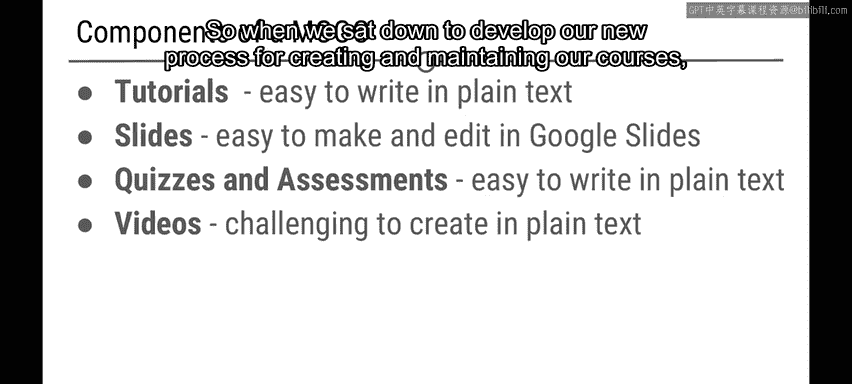

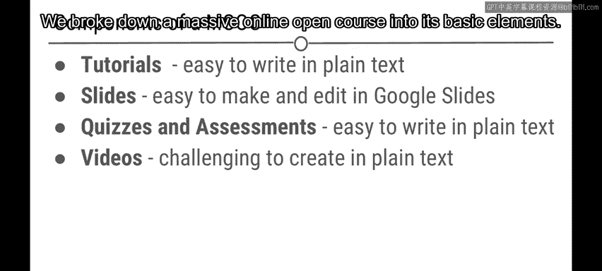

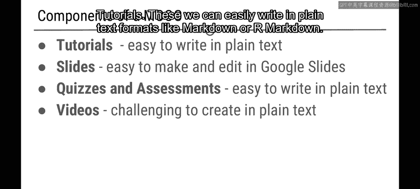

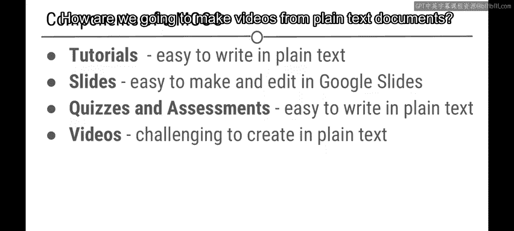

To take advantage of this new technology we create a two new R packages。

 Ari and Dctor Ari will take a script and a set of Google slides and narrate the script over the slides using Amazon Polly it will also generate the closed caption file needed to include captions and ensure that the videos are accessible to those with hearing impairment to Dact automate several of the steps from creating the videos with Ari to uploading them to YouTube so that we can quickly make edits to the scripts or slides。

 remake the videos， re-upload them and reduce our maintenance overhead for keeping our content fresh whenever we change the text file or edit the slides we can recreate the video in a couple of minutes Everything is done in our one of the coolest features of going to this new process is showing you how powerfully our programming language is This is the main language you will learn in this program and we hope you will be able to build cool things like this system by the time you are done with our courses Why did we choose this approach instead of creating each piece of a lesson separately Well first this process。

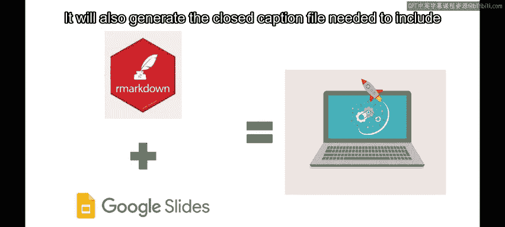

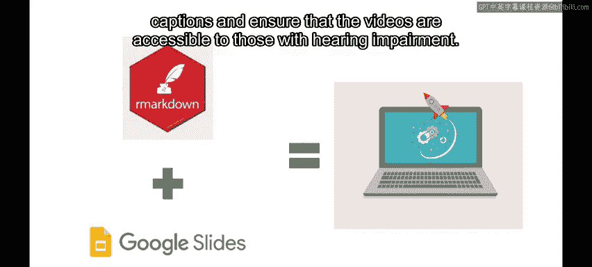

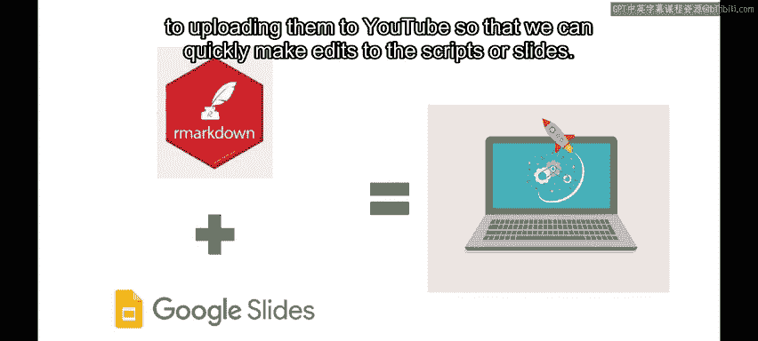

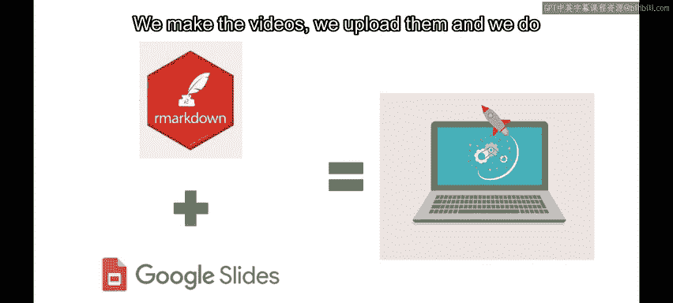

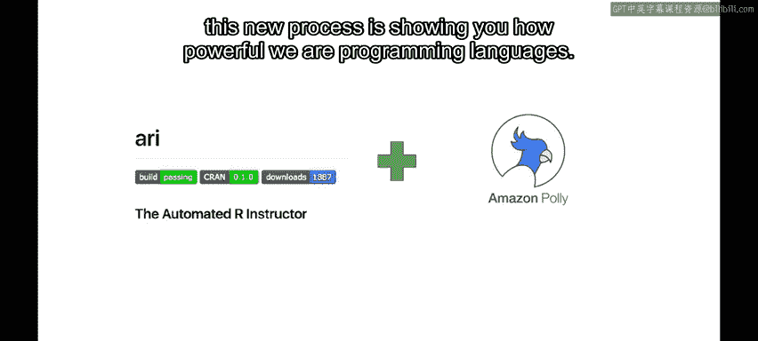

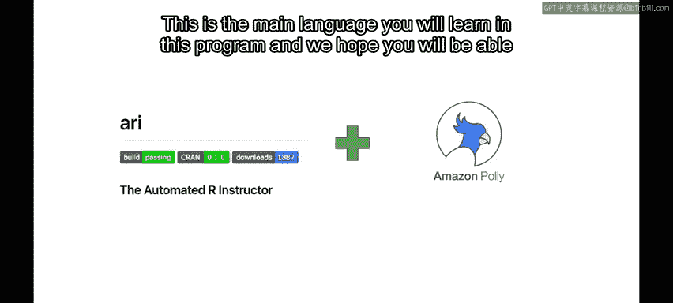

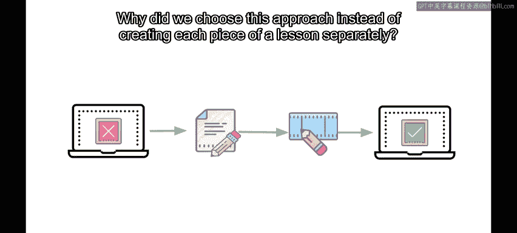

It a lot easier for us to maintain and update the courses If you report an issue or find a mistake with a lesson。

 all we need to do is to change the script or the Google Slides and recreate the courses again Therefore。

 we will have a more efficient way of maintaining the course content and updating it second by using this process we have made our instruction more accessible Since videos have transcripts and transcripts have voiceover the content is accessible by those of us who have disabilities for everyone else you can have a choice of reading verse listening versus watching the content as you wish。

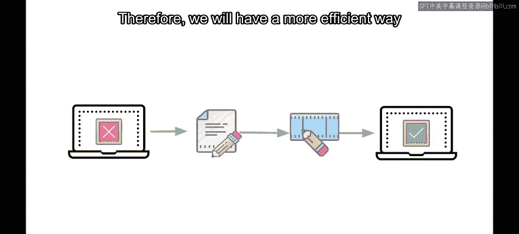

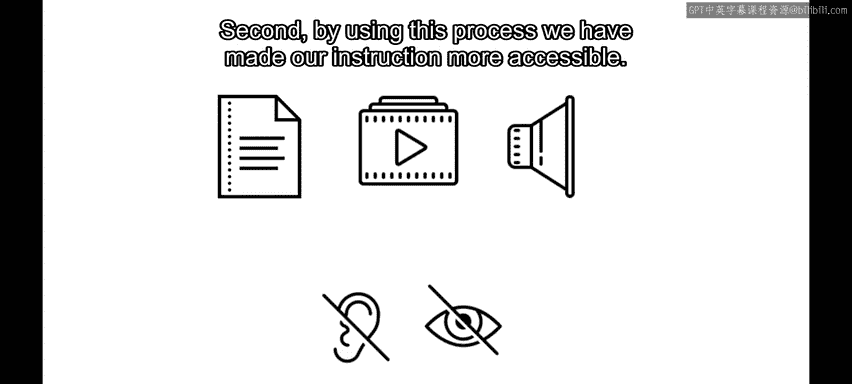

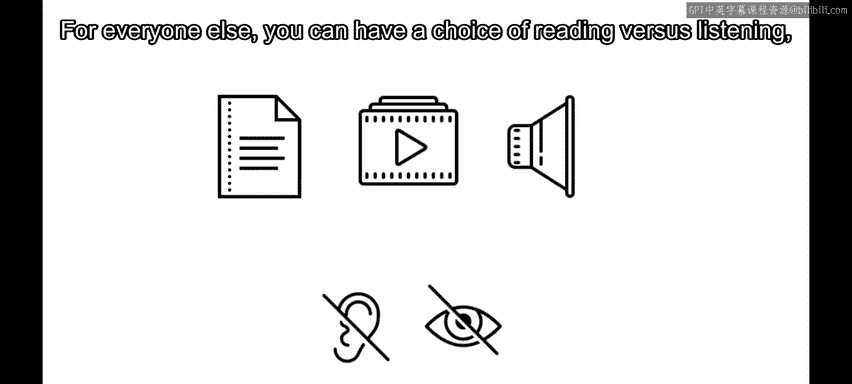

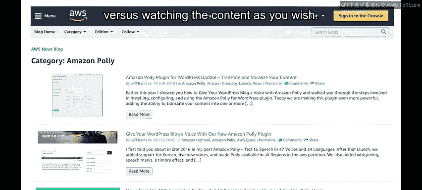

Finally a cool feature of using text to speech synthesis is that our videos will keep getting better as the voice synthesis software improves it means that we can change the voice to different voices ultimately it will allow us to translate our courses into different languages quickly and automatically using machine learning we think this highlights the incredible power of data science and artificial intelligence to improve the world if you find the robot voice annoying we get it we know that the technology isn't perfect yet that's why we've made the written lecture material reflect as closely as possible the video lectures so you can pick how you want to consume our classes we hope that this change will allow us to better serve you with the best content at the fastest speed thanks for participating in this new phase of course development with us。

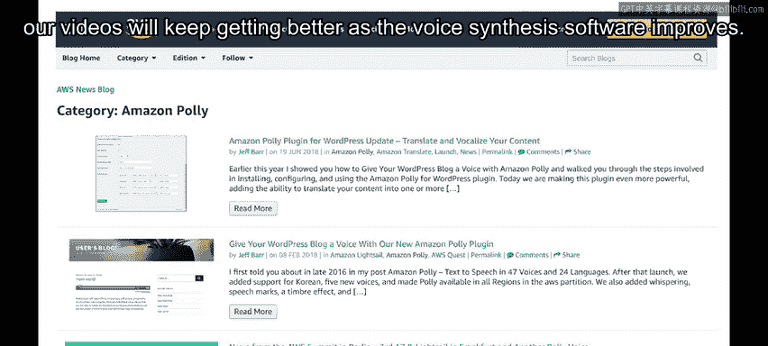

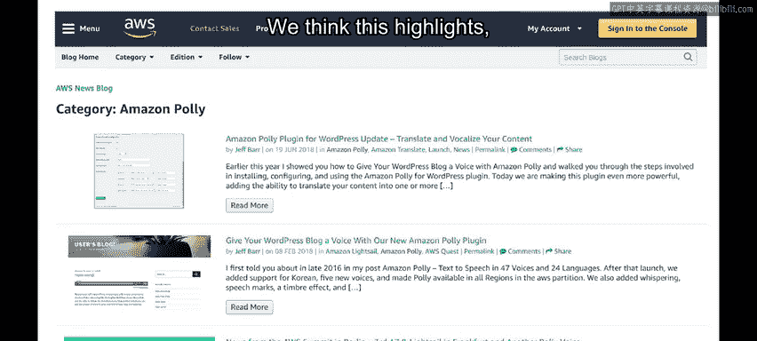

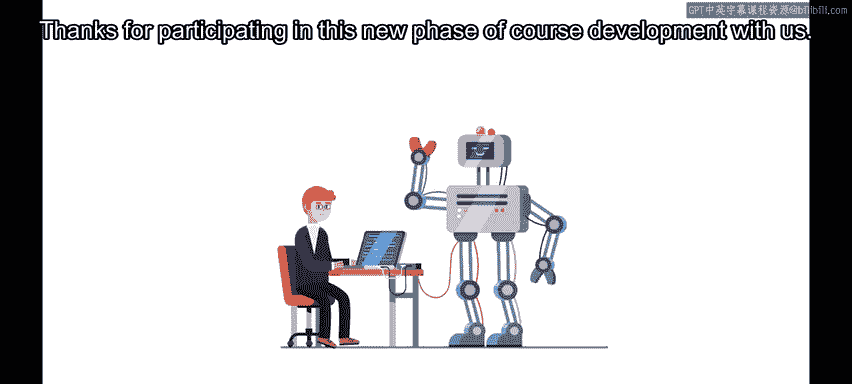