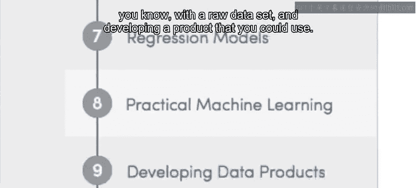

# 约翰霍普金斯大学数据科学课程10：《数据科学毕业课程（约翰霍普金斯大学）》｜data-science-project｜ - P1：0_欢迎来到毕业项目.zh_en - GPT中英字幕课程资源 - BV1ow411S7Vj

Yeah。

Hi everyone， welcome to the Capstone Project for the Johns Hopkins Data Science specialization At this point you've made it through all nine of the specialization courses。

 starting from the data scientist toolbox all the way to developing data products and you've learned an incredible set of skills that would be really useful in doing data science so we wanted to give you an opportunity to take all these skills that you learned and apply them to a brand new project。

 starting from the ground up with a raw data set and developing a product that you could use。

To do this， we partnered with a really great company called Swiftkey。

 which among other things is a world leader in predictive text analytics。

 They're well known for their custom keyboard app on Android and for the Swiftkeynote app on i。

 if you want to learn more about this company you can go to their website here and check them out' a really fantastic company。

 So in partnership with Swiftkey， we've developed an really interesting capstone project that involves developing a predictive model of text it is starting with a really large unstructured database of the English language。

 throughout the course， Jeff Bryan and I will be with you all the way developing milestones and evaluating them。

 in addition， Swiftkey's engineers will be with us helping to answer questions on the forums and talking with us through regular Google Hangouts。

 I know it's been a long road through the nine courses and this is the very last step in this process I think you'll have a lot of fun and you'll learn a lot doing this capstone project。

 So I look forward to seeing you all there。😊。