# 约翰霍普金斯大学数据科学课程1：《数据科学家工具》｜data-scientists-tools｜ - P3：2_什么是数据.zh_en - GPT中英字幕课程资源 - BV1Ep4y177Cv

Since we've spent some time discussing what data science is。

 we should spend some time looking at what exactly data is。

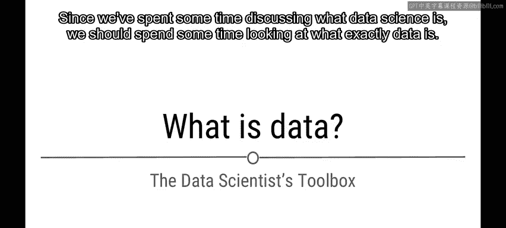

First， let's look at what a few trusted sources consider data to be First up。

 we'll look at the Cambridge English Dictionary， which states that data is information。

 especially facts or numbers collected to be examined and considered and used to help decision- making Second we'll look at the definition provided by Wikipedia。

 which is a set of values of qualitative or quantitative variables。

 these are slightly different definitions and they get a different components of what data is both agree that data is values or numbers or facts。

 but the Cambridge definition focuses on the actions that surround data， data is collected。

 examined and most importantly， used to inform decisions， we've focused on this aspect before。

 we've talked about how the most important part of data sciences the question and how all we are doing is using data to answer the question the Cambridge definition focuses on this the Wikipedia definition focuses more on what data entails。

 and although it is a fairly short definition， we'll take a second to parse this。

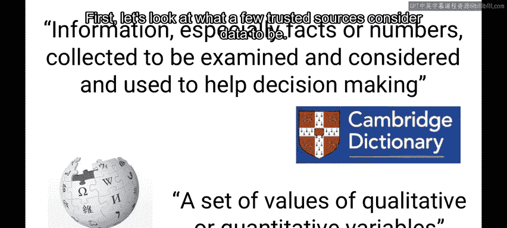

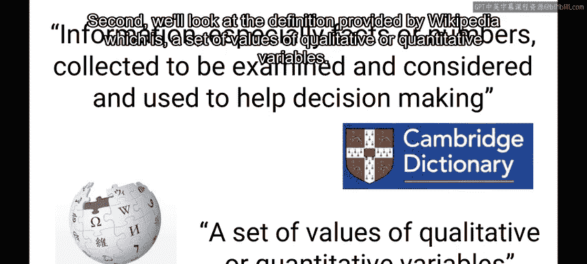

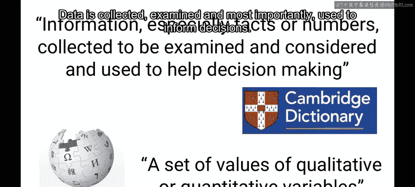

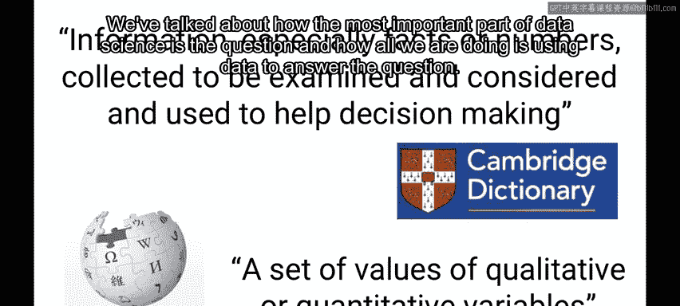

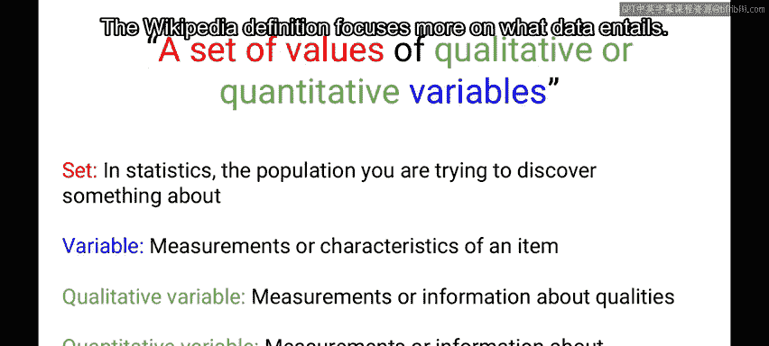

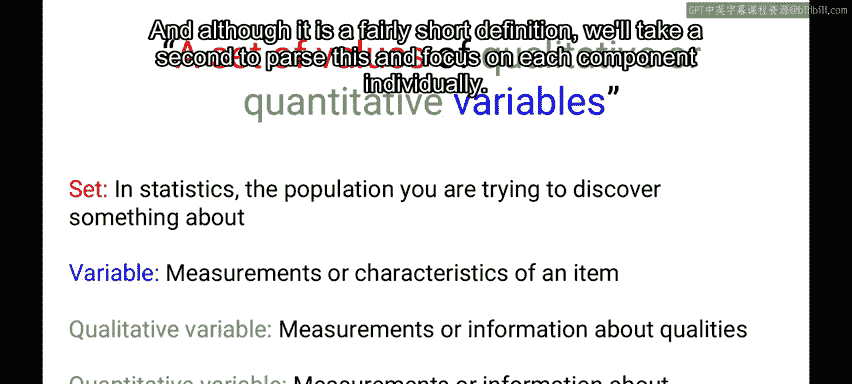

Fcus on each component individually So the first thing to focus on is a set of values to have data you need a set of items to measure from in statistics。

 this set of items is often called a population the set as a whole is what you are trying to discover something about The next thing to focus on is variables。

 variables or measurements or characteristics of an item Finally。

 we have both qualitative and quantitative variables Qua variables are unsurprisingly。

 information about qualities They are things like country of origin。

 sex or treatment group they're usually described by words， not numbers。

 and they are not necessarily ordered Qua variables on the other hand are information about qualities Qua measurements are usually described by numbers and are measured on a continuous ordered scale。

 they're things like height weight and blood pressure So taking this whole definition into consideration we have measurements either qualitative or quantitative。

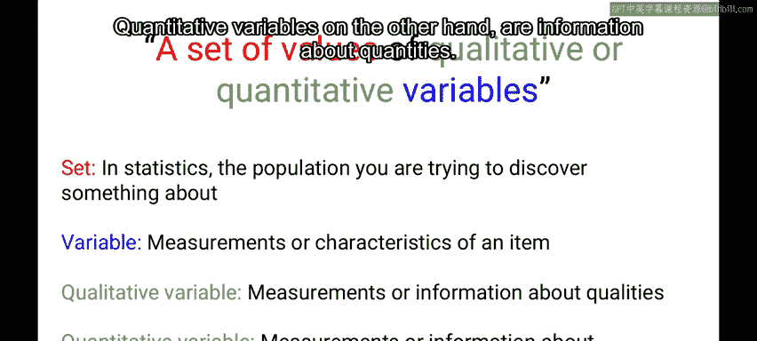

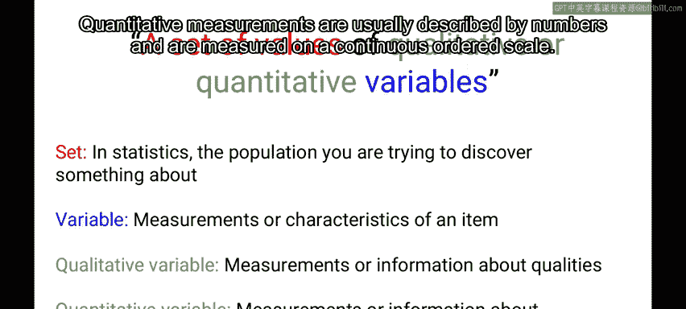

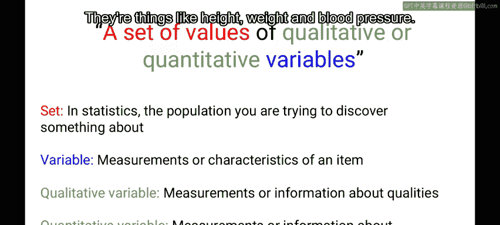

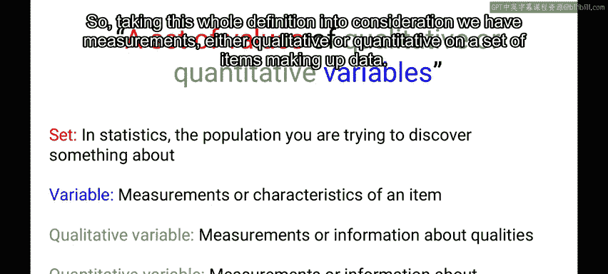

On a set of items making up data， not a bad definition when we were going over the definitions。

 our examples of data， country of origin， sex， height， weight are pretty basic examples。

 you can easily envision them in a nice-look spreadsheet like this one with individuals along one side of the table and rows and the measurements for those variables along the columns unfortunately。

 this is rarely how data is presented to you The data sets we commonly encounter are much messier。

 and it is our job to extract the information we want corral it into something tightly like the table here analyze it appropriately and often visualize our results These are just some of the data sources you might encounter。

 and we'll briefly look at what a few of these data sets often look like。

 or how they can be interpret it， but one thing they have in common is the messiness of the data you have to work to extract the information you need to answer your question。

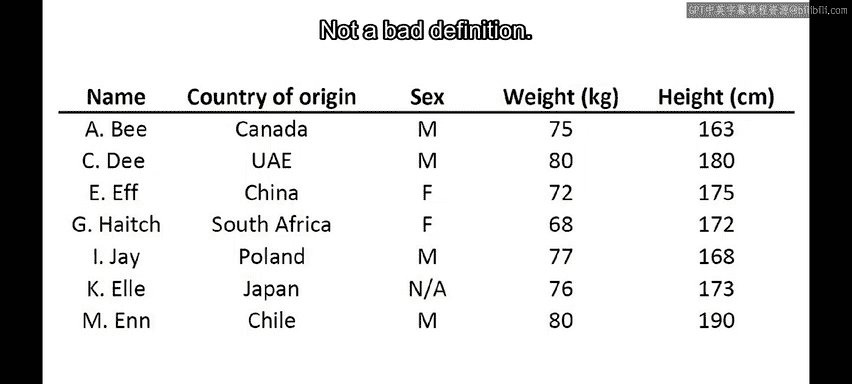

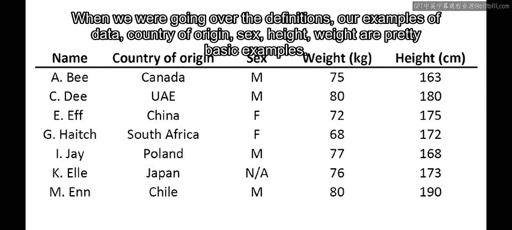

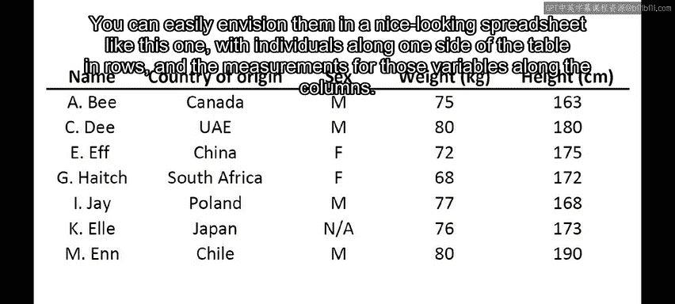

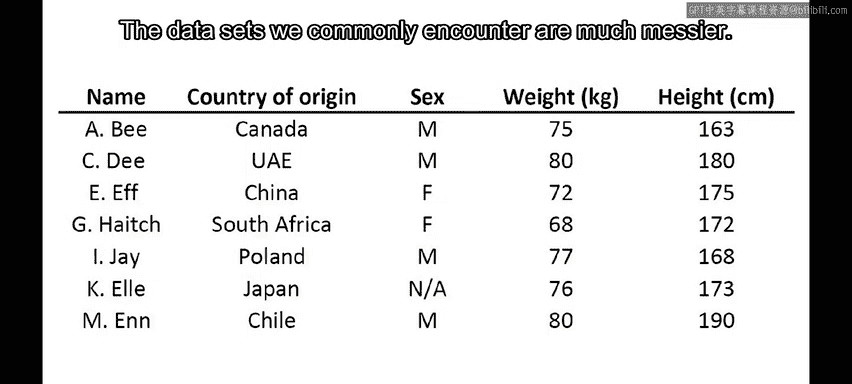

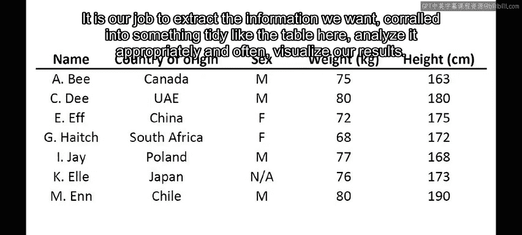

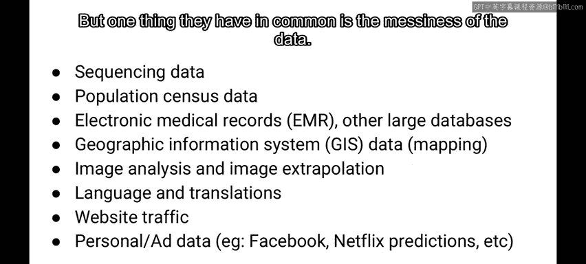

One type of data that I work with regularly is sequencing data This data is generally first encountered in the fastQ format。

 the raw file format produced by sequencing machines these files are often hundreds of millions of lines long。

 and it is our job to parse this into an understandable and interpretable format and infer something about that individual's genome In this case。

 this data was interpreted into expression data and produced a plot called a volcano plot。

 one rich source of information is countrywide censuses In these almost all members of a country answer a set of standardized questions and submit these answers to the government When you have that many respondents。

 the data is large and messy， but once this large database is ready to be queried。

 the answers embedded are important here we have a very basic result of the last US census in which all respondents are divided by sex and age and this distribution is plotted in this population pyramid plot。

 I urge you to check out your home countryens。

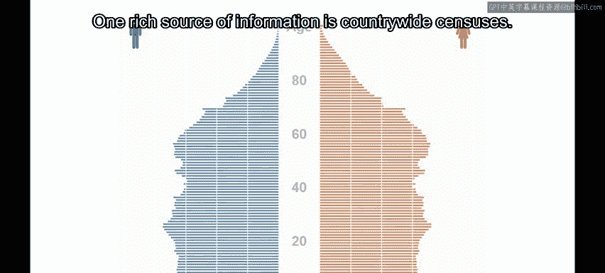

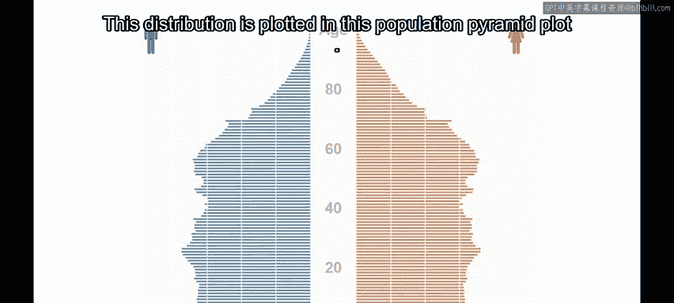

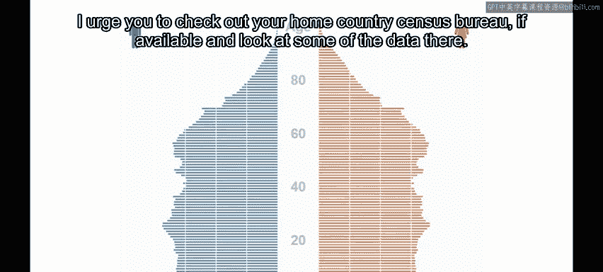

auIf available and look at some of the data there。This is a mock example of an electronic medical record。

 this is a popular way to store health information and more and more population-based studies are using this data to answer questions and make inferences about populations at large or as a method to identify ways to improve medical care For example if you are asking about a population's common allergies。

 you will have to extract many individual's allergy information and put that into an easily interpretable table format where you will then perform your analysis。

 a more complex data source to analyze our image/ videos there is a wealth of information coded in an image or video and it is just waiting to be extracted。

 an example of image analysis that you may be familiar with is when you upload a picture to Facebook and not only does it automatically recognize faces in the picture but then suggests who they may be a fun example you can play with is the deep dream software that was originally designed to detect faces in an image but has since moved onto more artistic pursuits there is another fun Google initiative。

involving image analysis where you help provide data to Google's machine learning algorithm by doodling。

 recognizing that we've spent a lot of time going over what data is。

 we need to reiterate data is important， but it is secondary to your question a good data scientist asks questions first and seeks out relevant data second admittedmittedly。

 often the data available will limit or perhaps even enable certain questions you are trying to ask In these cases。

 you may have to reframe your question or answer a related question but the data itself does not drive the question asking In this lesson we focus on data。

 both in defining it and in exploring what data may look like and how it can be used First。

 we looked at two definitions of data， one that focuses on the actions surrounding data and another on what comprises data the second definition embeds the concepts of populations variables and looks at the differences between quantitative and qualitative data Second。

 we examine different sources of data that you may encounter。

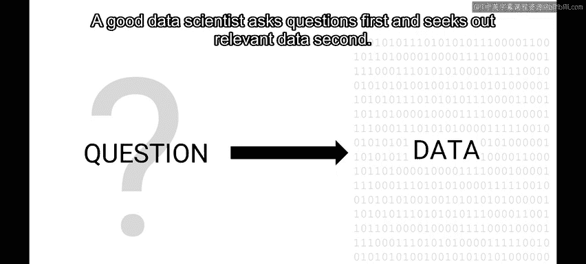

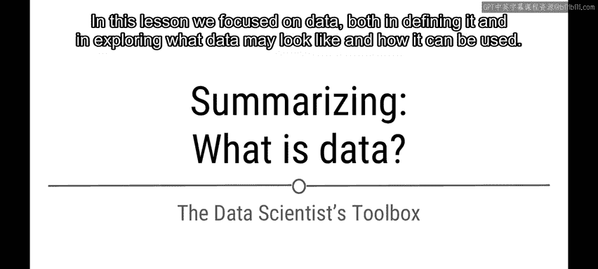

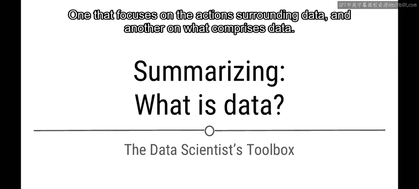

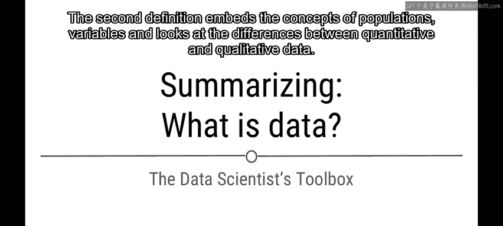

And emphasize the lack of tidy data setsExles of messy data sets where all data needs to be wrangled into an interpretable form can include sequencing data。

 census data， electronic medical records， etc and finally。

 we return to our beliefs on the relationship between data and your question and emphasize the importance of question first strategies you could have all the data you could ever hope for but if you don't have a question to start。

 the data is useless。

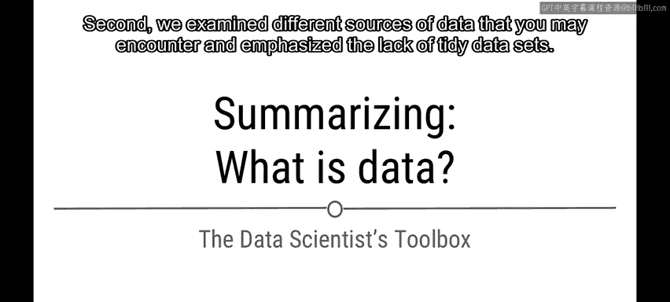

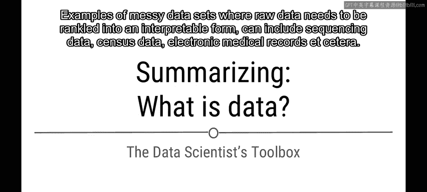

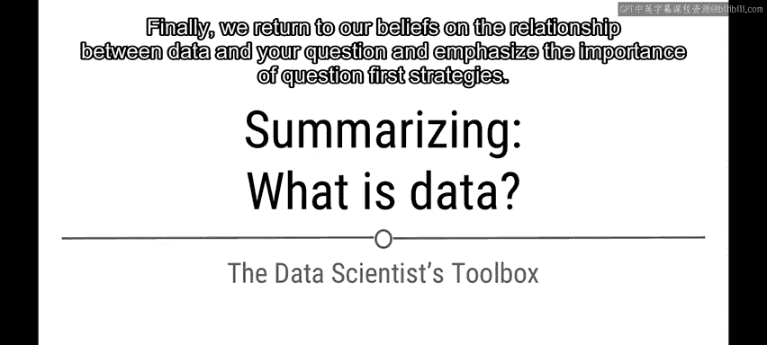

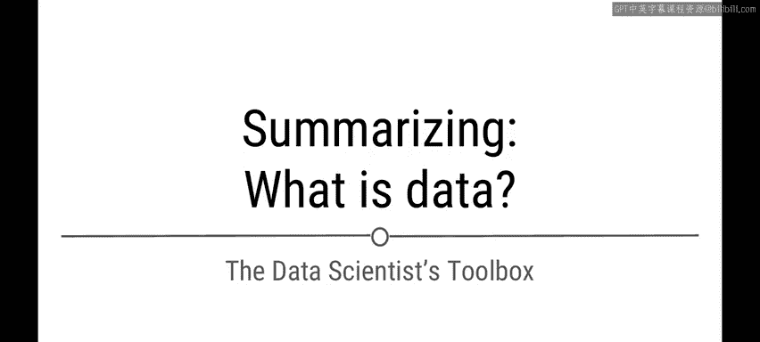