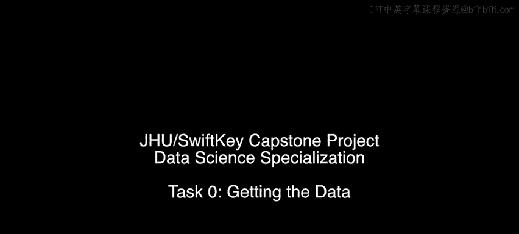

# 约翰霍普金斯大学数据科学课程10：《数据科学毕业课程（约翰霍普金斯大学）》｜data-science-project｜ - P4：3_任务0介绍 理解问题.zh_en - GPT中英字幕课程资源 - BV1ow411S7Vj

Hi everyone welcome to the first task of the capstone Project for the data science specialization This task has two goals the first is to obtain the data from the website and the second is to familiarize yourself with the background for the project if you remember the basic goal for the project is to build a predictive model of English text and so this falls into the area known as the natural language processing and text mining and so if you're not familiar with this area already it's worth it to go and to do a little research do a little homework and to kind of read about the types of models that they use and the types of approaches that they take in this area because I think a lot of that information will be very useful for you as you develop your project over the course of the capstone so we've provided some links in the task description that are really good places to start but I think you should feel free to do some research on your own and to kind of go into more depth and then what be provided in the task description and so again two goals are get the data take a look at it just kind of make sure you can open it and the second is to familiarize yourself with the background。

So have fun doing that， we'll be here all week and Swift engineers will be here to answer questions in case he gets stuck。

 and so we'll see you next time。