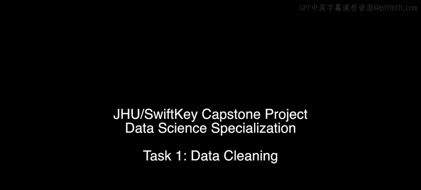

# 约翰霍普金斯大学数据科学课程10：《数据科学毕业课程（约翰霍普金斯大学）》｜data-science-project｜ - P5：4_任务1介绍 获取和清理数据.zh_en - GPT中英字幕课程资源 - BV1ow411S7Vj

Okay you've gotten the data and you've read up a natural language processing and text mining so it's time to start digging into the data。

 The two basic goals for this task are tokenization and profanity filtering so the basic idea is that you want to be able to take a bunch of text and divide it into what we would call words so there are a number of issues that you're going to have to deal with here。

 including things like how to handle punctuation， how to think about digits of capital and lowercase letters and how to deal with typos because people can spell things incorrectly so as you're coding your solution you're going to have to think of an optimal strategy for dealing with all these issues and think about them in a way that optimizes performance but also accuracy。

And so keep in mind， you're going to have to make a lot of decisions as you go through this process and it's not necessarily going to be obvious what is the best decision because there isn't necessarily a right answer。

 but as a data scientist， you're going to have to make these tough decisions in order to move a product forward so don't be shy it's your job to make these decisions and to think about what you think is best and what you think a user might want from the software。

So start digging into the data， we're really looking forward to what you can come up with。

