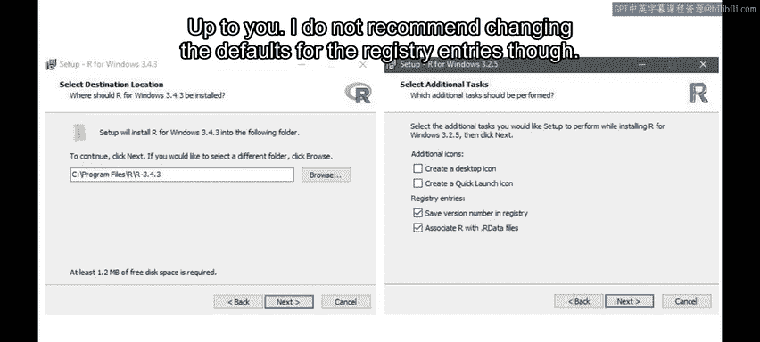
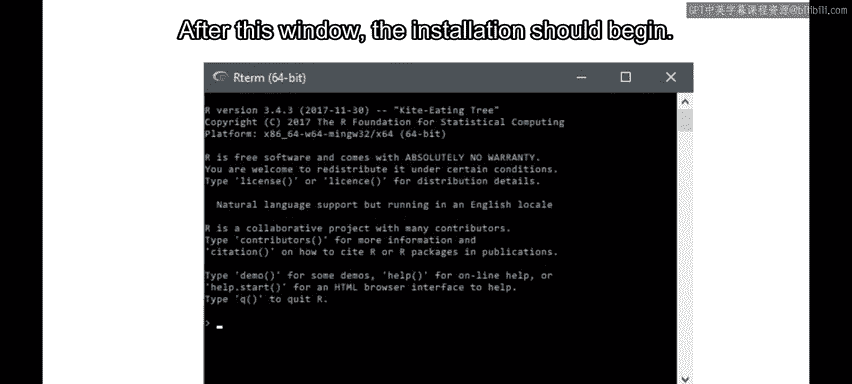

# 约翰霍普金斯大学数据科学课程1：《数据科学家工具》｜data-scientists-tools｜ - P6：5_安装r.zh_en - GPT中英字幕课程资源 - BV1Ep4y177Cv

Now that we've got a handle on what a data scientist is， how to find answers。

 and then spend some time going over a data science example。

 it's time to get you set up to start exploring on your own and the first step of that is installing R first let's remind ourselves exactly what R is and why we might want to use it R is both a programming language in an environment focused mainly on statistical analysis and graphics it will be one of the main tools you use in this and following courses R is downloaded from the comprehensive R archive network or Crran and while this might be your first brush with it。

 we will be returning to Crran time and time again when we install packages so keep an eye out outside of this course you may be asking yourself why should I use R one reason to want to use R as its popularity R is quickly becoming the standard language for statistical analysis This makes R a great language to learn as the more popular software is the quicker new functionality is developed the more powerful。

It becomes and the better the support there is Additionally， as you can see in this graph。

 knowing R is one of the top five languages asked for in data scientist job postings。

 another benefit to R is its cost free this one is pretty self-explanatory every aspect of R is free to use unlike some other stats packages you may have heard of E or SPSS so there is no cost barrier to using R yet another benefit is R's extensive functionality R is a very versatile language we've talked about its use in stats and in graphing but its use can be expanded to many different functions from making websites making maps using GIS data analyzing language and even making these lectures and videos here we are showing a dot density map made an R of the population of Europe。

 each dot is worth 50 people in Europe for whatever task you have in mind there is often a package available for download that does exactly that and the reason that the functionality of R is so extensive。

The community that has been built around R individuals have come together to make packages that add to the functionality of R。

 and more are being developed every day， particularly for people just getting started out with R。

 It community is a huge benefit due to its popularity there are multiple forums that have pages and pages dedicated to solving R problems we talked about this in the Getting help lesson these forums are great both for finding other people who have had the same problem as you and posting your own new problems。

Now that we've spent some time looking at the benefits of R it is time to install it We'll go over installation for both windows and Mac below but know that these are general guidelines and small details are likely to change subsequent to the making of this lecture use this as a scaffold for both Windows and Mac machines we start at the Cran home page if you are on a Windows computer。

 follow the link download R for Windows and follow the directions there if this is your first time installing R go to the base distribution and click on a link at the top of the page that should say something like download our version number for Windows this will download an executable file for installation open the executable and if prompted by a security warning。

 allowow it to run select the language you prefer during installation and agree to the licensing information you will next be prompted for a destination location this will likely be defaulted to program files in a subfolder called R followed by another subdirecty for the version number unless。

Any issues with this The default location is perfect you will then be prompted to select which components should be installed unless you are running short on memory。

 installing all of the components is desirable Next you'll be asked about start options and again the defaults are fine for this you will then be asked where setup should place shortcuts This is completely up to you you can allow it to add the program to the start menu or you can click the box at the bottom that says to not create a start menu link Finally。

 you will be asked whether you want a desktop or quick launch icon up to you I do not recommend changing the defaults for the registry entries though。

After this window， the installation should begin， test that the installation worked by opening R for the first time。

 if you are on a Mac computer， follow the link download R for Mac OSX。

There you can find the various R versions for download Note if your Mac is older than OSX10。

6 Snow Eard， you will need to follow the directions on this page for downloading older versions of R that are compatible with those operating systems。

 Click on the link to the most recent version of R， which will download a PKG file。

Open the PKG file and follow the prompts as provided by the installer First。

 click continueue on the welcome page and again on the important information window page Next you will be presented with the software license agreement again Con Next you may be asked to select a destination for R either available to all users or to a specific disk select whichever you feel is best suited to your setup Finally you will be at the standard install page R selects a default directory and if you are happy with that location go ahead and click install At this point you may be prompted to type in the admin password do so and the install will begin Once the installation is finished go to your applications and find R test that the installation worked by opening R for the first time in this lesson we first looked at what R is and why we might want to use it we then focused on the installation process for R on both Windows and Mac computers before moving on to the next lecture be sure that you have ourin proper。

あり？

