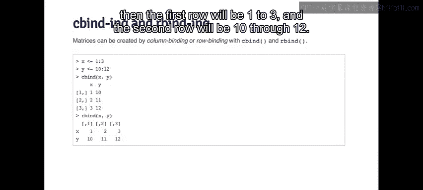

# 约翰霍普金斯大学数据科学课程2：《R编程课程》｜r-programming｜中英字幕 - P12：11_数据类型 矩阵.zh_en - GPT中英字幕课程资源 - BV1114y1k78X

Marices are a special type of vector in R， so they're not a separate class of objects。

 but they're basically vectors that have an attribute called the dimension。

 and so the dimension attribute is an integer vector of length2。

 where the first number is the number of rows， the matrix and the second number is the number of columns。

And so if I can create a matrix， an empty matrix with the matrix function。

 and I can explicitly say how many rows and how many columns there are。

 this is not the only way to create a matrix， but it's one way。

 And so when I autoprint the matrix by typing the object M and hitting enter。

 you'll see that it'll show me that first of all， the matrix is full is initialized with NA values。

 there's no values in here and you can see that there's two rows and three columns and they're labeled。

By the numbers in the brackets， if I call the dim function on M。

 it'll give me the dimension attribute， which in this case。

 it says there are two rows and three columns because the first rows is a number of rows and the second number。

 sorry excuse me。 the first number is the number of rows and the second number and the number of columns。

 If I call the attributes function on M。 you'll see it returns a list where the first element is the dim element and and has the vector 2。

3， So these are all aspects of a matrix， which is a vector that has a dimension attribute to it。

Marices are constructed column wise so you can think of the matrix taking a vector and all the numbers are inserted into the matrix by columns so the first column gets filled and then when when you hit the number maximum number of rows。

 then the second column gets filled in the third column etc。

 So if I create a matrix by taking the sequence one to6 and then I say specify that it has two rows and three columns well how does this matrix gets get constructed so it gets constructed column wise so the first thing it happens is it takes one。

2 and there's only two rows so it can only go to two and then that makes the first column the second column is made up of three4 and then the third column is made up of  five and6。

You can also create a matrix by creating the dimension attribute on a vector so for example I can create a vector that's a sequence 1 to 10 and then add the dimension attribute to it。

 so here I'm using the dim function， but I'm assigning a value to the dim attribute of M so here I'm assigning the vector 25 so what I'm saying is I want to take this vector and transform it into a matrix that is two rows and5 columns and so now after I've done that I've got a matrix M which has two rows and 5 columns and it's filled in the matrix column Y。

Another way to create a matrix and this is a common way is by binding columns or binding rows and so is column binding and row binding can be achieved by the the functions C binding and Rbin so for example suppose I have the two objects X which is sequence from1 to3 and y which is a sequence from 10 to 12 if I c binding those two objects then I'll get a matrix where the first column is one to3 and the second column is 10 to 12 so this is kind of what you might expect when happen if I R binding those two objects then the first row will be 123 and the second row will be 10 through 12 so C binding and R binding is another way to create a matrix。

