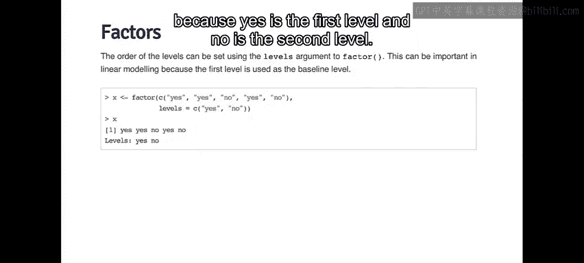

# 约翰霍普金斯大学数据科学课程2：《R编程课程》｜r-programming｜中英字幕 - P13：12_数据类型 因素.zh_en - GPT中英字幕课程资源 - BV1114y1k78X

So a factor is a special type of vector which is used to represent categorical data and there's two types of factor that is unordered or ordered。

 so you can think of this as being as storing data that are have labels that are categorical but have no ordering。

 so for example male and female or you can have ordered factors which might represent things that are ranked so they have an order。

 but they're not numerical， for example， you know in many universities you'll have assistant professors。

 associate professors and full professors， those are categorical but they're ordered。

So you can think of a factor as an integer vector where each integer has a labeled。

 so for example might you can think of it as a vector as 1，2。

3 where one represents you know high and for example。

 a high value and two represents a medium value and three represents a low value。

 so you might have a variable that's called high medium and low and underlying in R is represented by the numbers one。

2 and3。So factors are important because they're treated special by modeling functions like LM and GLM。

 which we'll talk about later， but these are functions for fitting linear models。

And factors are with labels， generally speaking are better than using simple integer vectors because the factors are what are called self describing。

 so having a variable that has values male and female is more descriptive。

Then having a variable that just has ones and twos so for example。

 in many data sets you'll find that there'll be a variable that's coded as one and2 and it's not easy to know whether that variable is really a numeric variable that only takes value is one and2。

 but the problem is that's not something that's coded in the data so it's hard to tell if you use a factor variable then the coding for the labels is kind of built into the variable and it's much easier to understand。

So factors can be created with the factor function and the input into the factor function is a character vector。

 so here I'm just creating a symbol factor which has what two levels and the levels are yes and no。

 and so x is a factor and you can see when it prints out a little bit differently from a character vector in the sense that it prints out the values yes yes。

 no yes no， and then it has a separate attribute which is called the levels and so the levels of this factor are no and yes okay。

So there's only two levels I can call table on this vector and it'll give me a frequency count of how many of each level there are。

 So for example it'll tell me that there are two no's and there's three yeses Now the unclass function strips out the class for a vector。

 So for example， if I call unclass on x it'll kind of bring it down to an integer vector and you can see that underlying the factors represented as221。

2，1， So yes is coded as2 and no is coded as1 Now it's not really essential for you to know this because you can just treat the factor as being a vector of yeses and nos。

 but it's sometimes it's useful just to know underneath kind of how factors are represented by R and so you can see it's really an integer vector with the attribute the levels attribute of no and yes。

The order of the levels in the factor can be set using the levels argument to factor and sometimes this is important because in modeling functions when you include a factor variable。

 this sometimes it's important to know what the baseline level is and so the baseline level is just the first level in the factor and the way this is determined by in R is critical it's determined using alphabetical order so for example if I create a factor variable with the elements yes and no。

 then the baseline level will be the first level that's encountered and because no comes before yes in the alphabet then no will be the baseline level and yes will be the second level。

Now this may not be something that you want， you might want， for example。

 yes to be the baseline level and no to be the second level。 and then in that case。

 you have to explicitly tell R that yes is going to be the first level and you can use that using the levels argument to the factor function。

 So now when I print out the X object， you see that the elements are still the same the still yes。

 yes， no， yes， no， but the levels's attribute is reversed because yes is the first level and no is the second level。

