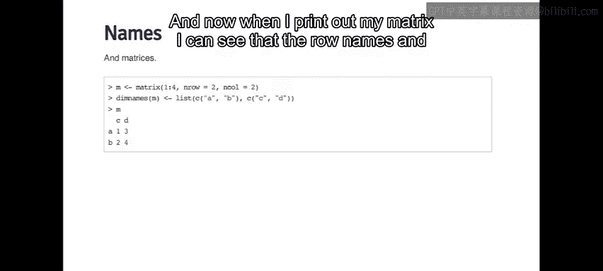

# 约翰霍普金斯大学数据科学课程2：《R编程课程》｜r-programming｜中英字幕 - P16：15_数据类型 名称属性.zh_en - GPT中英字幕课程资源 - BV1114y1k78X

Our objects can also have names。 So this is not true for just data frames。

 It's true for all our objects， and this can be very useful for writing readable code and self describing objects。

 so for example。I'm creating a vector that's an intesger sequence1 to3 and by default。

 there's no name。 So when I call the names function on x， it gives me the null value。 However。

 I I can give a name to each element of the vector X。 So for example。

 if I can say the first element is called food， the second element is called bar and the3 element is called North。

 So now when I print out my x vector， I get a vector 1，2，3， but then each one has a name over it。

 which is the name that just specified。 And so when I call the names function I get the names that are associated with each element of the vector food bar and North。

Ls can also have names and so for example here I'm creating a list with the list function where the first element is called A。

 the second element is called B and the third element called C。

 and so when I print out the list it prints out the names of each element and the values associated with those names。

Finally， matrices can have names， these are called dim names。

 so here I've created a matrix from the sequence one to4， it's a two by two matrix。

And so when I use the dim names function， I pass a list。

 excuse me assign it a list where the first element of the list is the vector of row names and the second element of the list is a vector of column names。

 So here I want to name the rows A and B and I want to name the column C and D。

 So that's what I pass to the dim names function。 And now when I print out my matrix I can see that the row names and the column names are labeled as I wanted。

