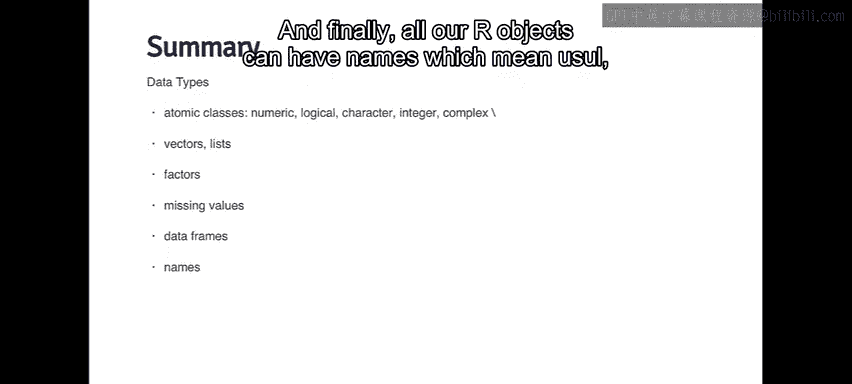

# 约翰霍普金斯大学数据科学课程2：《R编程课程》｜r-programming｜中英字幕 - P17：16_数据类型 摘要.zh_en - GPT中英字幕课程资源 - BV1114y1k78X

So that's kind of the whirlwind tool of the different basic data types in R so far we've talked about the atomic classes the numerological character。

 integer and complex vectors， we talked about how vectors can only have elements of the same class and the main exception to that is lists。

 which can have elements of different classes， there are factors。

 which are used for coding categorical data both ordered in unordered data。

 there are missing values that are represented by NAs and NANs。

 data frames are used to store tabular data where each column can be of a different class。

 and finally our objects can have names which can be useful for creating self-deibing data。

