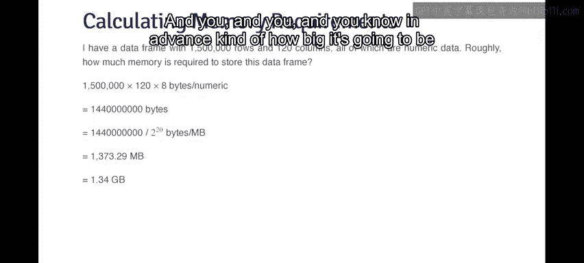

# 约翰霍普金斯大学数据科学课程2：《R编程课程》｜r-programming｜中英字幕 - P19：18_读取大型表.zh_en - GPT中英字幕课程资源 - BV1114y1k78X

So with larger dataset sets so beyond the small to moderate。

 then there are a couple things that you can do when reading in tabular data that will make your life a lot easier and also and more importantly will prevent R from totally choking first you should read the help page for read dot table in fact you should probably have it memorized。

 there's a lot of key hints in that help page a lot of useful information in my opinion。

 not enough people read this help page carefully enough so that they can kind recite it in their sleep so there's so once you've read that you'll see there's a lot of important information for kind how to optimize read dot table in particular for large datasets and so one of the things you're going to want to do is to make a very rough calculation of how much memory you need to store the data you're about to read in that way you can get a sense of well is there enough memory on my computer to store this data because if you recall correctly R will R is going to store your entire data and memory unless you do other。

So when you call read dot table or read dot CSsv， it's reading your entire data set into the Ram of the computer。

 And so you need to know roughly speaking how much。Ram this data set is going to require。

 and we'll talk about how to calculate that in a second。

So another easy optimization you can say is if there's no comment lines in your file。

 then just set the comment cha argument to be blank， so just an empty quote there。

The call classes argument is actually very important because if you don't specify it。

 then what R does by default is it goes through every column of your data and tries to figure out what type of data it is。

😊，Now， that's all fine well and fine when data is small to moderate。

 but reading each of these columns and trying to figure out what type of data it is takes time。

 it takes memory and can generally slows things down。

 if you can tell R what type of data is in each column then R doesn't have to spend the time to figure it out on its own。

 and so itll generally make readt table run a lot faster and so you can save yourself a lot of time。

 So if you have a few columns in your data， then you can usually just say what the classes are。

 But if or if they're all the same for example， if all the columns are numeric。

 you can you can just set call classes equal to numeric。 And if you only give it a single value。

 it will just assume that every column has that same value。 So if you just say numeric。

 it will assume that every column is numeric otherwise what you can do if you have a huge data you can read in maybe the first hundred or the first thousand rows by specifying the n rows argument and then going through each of the。

Looping over each of the columns using S apply and calling the class function。

 so the class function to give you will tell you what class of data is in each column and then you can use this and then you can say store this information and then read the entire data set by specifying the call classes argument。

So the N rows argument is actually very useful too， it doesn't necessarily make R run any faster。

 but it does help with memory usage and so if you can tell R how many rows are going to be read into R。

 then it can calculate the memory that's going to be required and not have to kind of figure it out on the go。

 so even if you mildly overestimate how many rows there are in the data that's okay because it won't make a difference。

 itll still read the correct number of rows。So in general。

 when you're using R with large dataset sets and there's lots of large dataset sets out there nowadays。

 it's useful to have a few things， just kind of a few bits of information on hand。 So for example。

 how much memory does your computer have， how much physical Ram is there these days most computers will have on the order of a few gigabytes up to many gigabytes of physical Ram what other applications are in use。

 So are there other applications that are running on your computer that may be eating up some processor time or memory if you're on a multi-user system are there other users logged into the system are they using up some of the resources on the computer what is the operating system for your computer so is it a Mac。

 is it Windows is it Uniix is it Linux is it something like that and then also it's useful to know whether the operating system that you're running is 32 bit or 64 bit。

On a 64 bit system you'll generally be able to access more memory if the computer has a lot more memory。

So if you want to do a rough calculation before you read in a table into R using the read dot table or the read dot CSV function。

 you can just do a very quick calculation so here suppose I have a data frame here with 1。

5 million rows and 120 columns so this is not a particularly big data set but it's reasonable suppose that all the columns are numeric。

 so I don't have to worry about different types of data all the columns are numeric。

The question is how much memory is required to store this data frame in memory so I can do a simple calculation so the number of elements in this data frame is going to be 1。

5 million times 120 because it's a square object。😊。

And so so that's a number of elements in the data frame Now if it's a numeric all the data are numeric then each number requires 8 bytes of memory to store because because the numbers are stored using 64 bit numbers and there's 8 B per byte so that's 8 bys of memory per numeric object so that' going be so here's the number of bytes there's2 to the 20 bytes per mebyte and so I can divide the number of bytes by 2 to the 20 and that's how many megabytes I got so I've got 1373。

29 mebytes and I can divide that again by2 to the 10 to get the number of gigabtes so it's going to be roughly 1。

34 gig the raw storage for this data frame is a roughly 1。

34 gigabs now you're actually going to need a little bit more memory than that to read the data in because there's a little bit of overhead required for reading the data in and so the rule of thumb is that you're going to need。

twice as much memory to read this dataset into R using read dot table then the object itself requires so if your computer only has。

 let's say2 gigabytes of RA and you're trying to read in this 1。

34 gigabyte table you might want to think twice about trying to do it because you're going to be pushing the boundaries of memory that is required to read this data set in。

 of course if your computer has like4 or 8 or 16 gigabs of RA。

Then you should have no problem in terms of the memory requirements。

 it will still take some time just to read it in just because it takes time to read in all the data。

 but you won't rerun out of memory so doing this kind of calculation is enormously useful when you're reading in large dataset sets but is can give you a sense of do I have enough memory is the reason if you've run to any errors you'll know whether the errors because of memory running out of memory or not so I encourage you to do this kind of calculation when you're going to be reading in large data sets and you know in advance kind of how big it's going to be。

