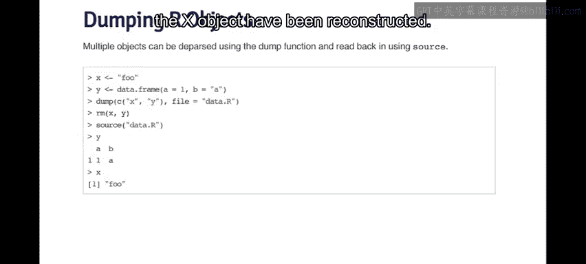

# 约翰霍普金斯大学数据科学课程2：《R编程课程》｜r-programming｜中英字幕 - P20：19_文本数据格式.zh_en - GPT中英字幕课程资源 - BV1114y1k78X

There are other types of formats that you can save data in beyond the tabular format or the CSV file or text file。

 These are also textual formats， but they're a little bit different for from。

The tabular data that we've talked about before and the two main functions for writing out data are dumping and de putting。

 So and and the idea behind these types of formats。Is that they're text formats。

 but they're not theyre not really formatted in a way that's in the same as like a table because they contain a little bit more metadata。

 So data about， for example， the type of the data in in each object， for example。

 if you dump or de a data frame， it will include in the output the class of each column of the data frame so you don't have to specify it when you read it in and so the advantage of doing using this type of mechanism to store data or to read data is that don' it's still a textual format which can be useful but it also contains metadata so that you don't have to specify it every single time you read it in because if the metadata do not get carried with the data set itself they can get lost if they get transferred somewhere else and if you don't remember what the metadata are。

 for example， the classes of the different columns。

 then you kind of have to reconstruct that from scratch So that's one advantage of using。

ussing a function like dump or deput to output data from R。

 and similarly the functions for reading data that have been outputted using dump or deput are source and dege So in general。

 textual formats are very nice formats for storing data because there's a number of different types of different advantages to them。

 first of all， they're editable， so if you want to， you can edit them。

 I wouldn say this is something that I would advise but because you wanted something that's reproducible。

 but if something gets corrupted， then you can at you can look at the file to see if it's possible to recover it so textual formats can be a little bit longer lived if you're going to be storing data for a long time。

 sometimes it's useful if it's possible to use a type of textual format so that you can avoid potential problems with corruption textual format can also work better if you're using like a version control program like subversion or get。

Where you're tracking changes between documents and those types of programs tend to be much more useful with textual data rather than binary data so that you can track changes meaningfully。

Textual formats adhere to the general kind of UniX philosophy is to store all kinds of data。

 which generally stores all kinds of data in text， but the one downside with textual formats。

 they tend not to be very space efficient， so they tend to take up a lot of space。

 and so it often need to be compressed。So the de function takes an arbitrary R object and it will take most types of R objects except for some more exotic ones and it will create some R code that will essentially reconstruct the object in R。

 So here I'm creating a small data frame it's got two columns the first columns called a。

 the second columns called B and then I'm going to de this data frame and you'll see if you just call de。

 it will just output the result of the console and it can see that what have done what' it's constructed some R code for example。

 it's creating this list that has these two elements in it and you can see that each element has has the data that's in it and it has the names embedded here。

 it's got the row names here and it has a class of the object which in this case is the data frame and so all the metadata here like the row names in the names in the class are all included in the output。

 Now of course you generally don't want to print this to the console it's not particularly useful。

 You probably want to save it to a file so you can。objectject to a file。And then later on。

 you can read it into R using D get and when you de get the object you'll get this object and you'll see that you've kind of reconstructed the object from a before。

 so the D put function essentially writes R code， which can be used to reconstruct an R object。

The D function is a lot like D get。 However， the difference is that D get can only be used on a single R object。

 whereas D can be used on multiple R objects。 And so what you do is when you pass the dump is a character vector which contains the names of the object。

 So here I created two objects， one called x， the other called Y。 And when I pass the dump。

Is are the names of those objects， the names are X and Y。

 and I give it a file that I want to store the objects in， and then I can remove them if I want to。

 but to read those objects back into R I can call the source function on that file and you'll see that the Y object and the X object have been reconstructed。

