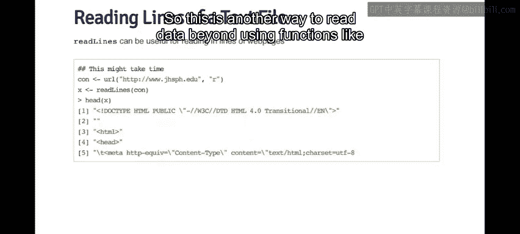
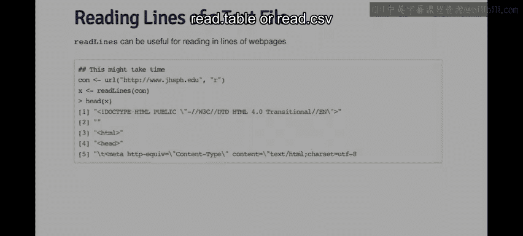

# 约翰霍普金斯大学数据科学课程2：《R编程课程》｜r-programming｜中英字幕 - P21：20_到外部世界的接口.zh_en - GPT中英字幕课程资源 - BV1114y1k78X

So there are a variety of ways that you can interface between are with the outside world and generally speaking there are functions that are used to kind of open up what are called connection to the outside world usually you the most common type of connection is to a file So for example if you want to read a file then you can create a file connection you might want to example read a compressed file that's a slightly variation on that and most functions will do this in the background without you having to know what's going on。

 So for example， when you call read dot table with and you pass the name of a file。

 what it does behind the scenes is it opens up a file connection to that file and then reads from that file connection the connection can be made to other types of objects too for example you can open a connection to a web page using the URL a function and so when you open a connection to a webp page。

 you can read data from that web page using the URL connection and so the idea behind the connection。

Interfaces is that it abstracts out the mechanism for connected to different types of objects that are external to R。

 whether they be files or web pages or whatever。 So the file function function that opens a connection to a standard uncompressed file。

 So this can be useful for text files for reading in other types of text files GZ file and Bz file are used for opening connections to compressed data files So GZ file is used files that are compressed with the G zip algorithm and BZ files is for opening connections to files compressed with the B zip2 algorithm files that are compressed with Gz usually have a Gz extension and files compressed with B zip2 usually have a Bz2 extension。

So the file function here has a few arguments that the description argument is the name of the file and then there's a flag that goes into the open argument and you have to know what the codes are basically R is for reading Ws for writing A is for app pending。

 and then RB， WB and AB are for reading writing a on binary files。

 the other options for file are not particularly important at this time。

So connections can be very powerful and they can let you navigate files and other external objects in a more sophisticated way than just like reading the whole thing。

 for example， generally you don't have to deal with the connection interface in many cases but sometimes it's useful for example so here I've got a simple example I'm opening a file connection to some file called food text I'm going to open it for reading I can call read do CSv on the connection and that by default will just read the entire file then I can close the connection So that three line process is the same as just calling read CSv on the file in this case there was no need to use the connection to read the file。

😊，However， sometimes a connection can be useful if you want to read parts of a file so for example here I've got the read lines function which just reads lines from a text file and I'm going to open up this wordsgz file so this is a file that has words in it it's like a dictionary file and it's compressed using the the G zip algorithm so I'm going to use the Gz file function to open a connection to that and I'm just going to read the first 10 lines so now I'm going to use this connection and to read the first 10 lines and here the first 10 lines are printed out here and see these are the first kind of 10 words in the file and so similarly write lines is a function that can be used to write out lines of text to a file and and what you do is you pass write lines character vector and each element of the character vector becomes a line in the text file。

😊，You can also use read lines to read elements from a web page so for example。

 you can use the URL function to create a connection to a website so this website here is the Johns Hopkins School of Public Health website and I'm going to open a connection there for reading and then I'm going to read lines from this connection and so the lines of text that come from the connection I' going to be stored in this character vector X so when I look at the first couple lines from X you can see that it looks like HTML which is kind of what you would expect and so the URL function is useful for creating a connection to kind of a non filele object and then using read dot lines is useful to read the text from that connection so this is another way to read data beyond using functions like read do table or read csv。

