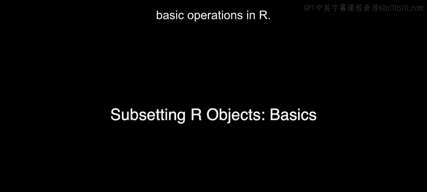
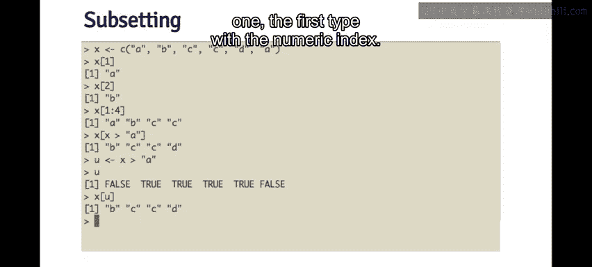

# 约翰霍普金斯大学数据科学课程2：《R编程课程》｜r-programming｜中英字幕 - P22：21_子集基础.zh_en - GPT中英字幕课程资源 - BV1114y1k78X

I'm going to continue to talk about data types and basic operations in R。

 and particular in this video I'm going to talk about subsetting objects in R。

So there are a couple of different operators that you can use to extract subsets of our objects。

 there's the bracket sorry the single square bracket。

 the double square bracket which we saw in the previous video， and there's the dollar sign。

So the basic principles to remember here is that the single square bracket always returns an object of the same class as the original。

 so if you subset a vector， you're going to get back a vector。If you subset a list。

 you're going to get back a list any time you use the single bracket operator to subset an object。

 you'll get an object of the same class back。Furthermore。

 the single bracket operator can be used to select more than one element of an object。

With one exception that we'll get to later， the double bracket operator is used to extract elements of a list or a data frame and can only be used to extract a single element and of that object either the list of the data frame and the class of the return object will not necessarily be a list or a data frame So the idea with the double bracket operators that remember that lists can hold things that are of many different classes they don't all have to be the same So the first element might be a numeric vector。

 the second element might be a data frame， the third element might be a complex vector etc cea。

 And so when you use the double bracket operator to extract an element of a list。

The object that comes back may not be a list， it may be an object of a totally different class。

 so that's what the double bracket operator is useful for The dollar sign is used to extract elements of a list again of a list or data frame that have a name so so objects can have names and one of the reasons you use names in an object is that you can reference elements of that object by the different names otherwise the semantics of the dollar sign are similar to the double bracket in the sense that when you use the dollar sign to extract an element of an object it may or may not be of the same class as the original object。

So here's the first example， a very simple vector character vector called x and I'm going to use the single bracket operator to extract the first element。

 so here what I get back is another character vector with the single element A in it if I use if I try to extract the second element of x。

 what I return back to me is a character vector with the element B in it。

 I can also extract a sequence of element so if I want to get the first four elements of x I can construct sequence 1 through4 and then I get ABCC。

So in these three examples here， what I've done is as I subset the vector X using a numeric index。

 so the numeric index is 12 or the sequence 1 through4 another type of index that you can use is a logical index。

 So in this next example here I'm going to subset the vector X and I only want all the elements that are greater than that are greater than the letter A so it might seem strange to you that I'm using the greater than sign with letters instead of numbers but there is a lexographical ordering to the letters and all the letters that are greater than a or letters like B C D E etc So what I get returned to me is a character vector that only contains the letters that are greater than a So here I got BCC and D。

The other thing I can do is I can create a logical vector which I hear I call u which is just it's a true or false vector which tells me which elements of the vector x are greater than a so if I print out u here I can see that the first element is equal to a so it's not greater than a and then the next four are greater than a but then the last element is equal to a so again that's false so I can subset the vector x with this u vector and then I get out all the elements that are greater than a so there are two types of indices that I use here one the first type was the numeric index and the second type was the logical index。

