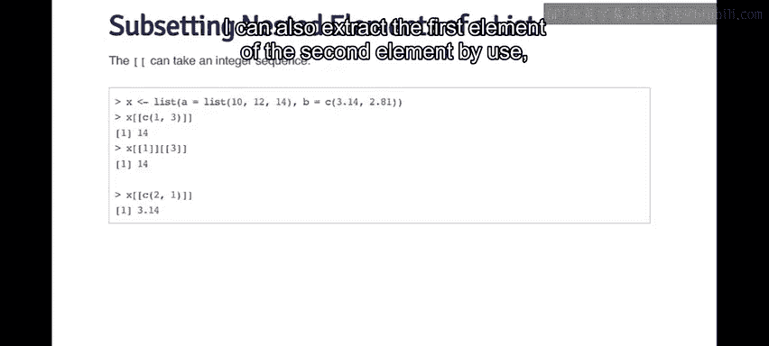
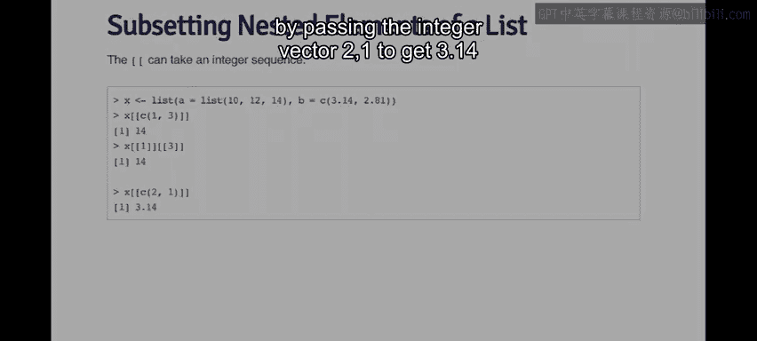

# 约翰霍普金斯大学数据科学课程2：《R编程课程》｜r-programming｜中英字幕 - P23：22_子集列表.zh_en - GPT中英字幕课程资源 - BV1114y1k78X

So substating a list is a little bit different because you can use the double bracket or the dollar sign operator you can also use the single bracket operator。

 So here I've got a list the first element' called is a named element called fo and it's a sequence 1 through 4 and the second element is named bar and it's the number 0。

6 So this is a list of two elements in it I can extract the first element using the single square bracket and I get。

Remember， the single square bracket always returns an element that's the same class as the original。

 So if x is a list， then x bracket 1 is going to be a list too。

 So what I get back is a list that has an element called P， which is a sequence 1 through 4。

Now if I use the double bracket， then if I use say x double bracket 1。

 what I get back is just a sequence1 through4， so the difference here is that in the first example I got a list that contained the sequence one through4 and in the second example I got just the sequence。

 that's the difference between the single bracket and the double bracket operator。

In the next example here， I'm using the dollar sign so I'm saying x dollar bar and what that means is that that gives me the element that is associated with the name bar。

 so in that case it's a single number 0。6 I can also use the double bracket operator and pass it a string so x double bracket quote bar is the same as doing x dollar bar and it just gives me 0。

6 if I use the single bracket with the name， I can say x bracket quote bar that gives me a list with the element bar in it。

 remember because the single bracket always returns a list if I'm going to subset a list So the nice thing about being able to subset an element using its name is that you don't have to remember where it is in the list so if I couldn't remember whether bar was the first element or was the second element I don't have to remember where it is in order to use the numeric index I can just use its name and then don' it will automatically extract that element from the list。

If you want to extract multiple elements of a list， then you need to use the single bracket operator。

 so for example， if I want the first and the third element here in which case which is the F and the Ba element。

 I can pass a vector 13， the numeric vector 13 to x using the single bracket operator and that returns to me a list with the elements's fo in the elements's baths so that's how I extract multiple elements of a list you cannot use the double bracket or the dollar sign operators when you want extract multiple elements of a list。

The nice thing about the double bracket operator， which is different from the dollar sign。

 is that you can use the double bracket operator to index a list where the index itself was computed。

 so notice that when I used the dollar sign before I actually typed out the word bar。

 I had to type out the name of the object。sometimes the name sorry name of the elements。

 but sometimes the name of the element is actually the result of some computation。

 so for example here I've got a list with three elements， fu bar and Baz。

 and then I create a variable called name。Which is actually the string fo。

So if I use the double bracket operator on this variable here。

Notice that there's no element in the list that has the name name in it。

 but there is an element of the list that has the name fo in it。

 So now when I pass this variable called name into the double bracket operator。

 it returns me the element that was associated with F because that's what the value of the name variable is so if I compute the index that I want to use then I have to use the double bracket operator if I use the dollar sign then it's going to literally look for an element of the list that has the word name associated with it and that of course doesn't exist in this list。

 So to use the dollar sign I need to use a literal symbol。

Now the double bracket operator can take an integer sequence as rather than a single number and the way you can think of this is that it kind of recurs into the list so if you look at this current list I've got here with the first element A is another list which has elements 1012 and 14 so suppose I want to extract the number 14 well that's really the third element of the first element right so it's the third element of the list which happens to be the first element of the other list and so I can extract the13 element from it by passing the vector 13 to it to the X list using the double bracket operator and that's equivalent to kind of doing this double subsetting of1 in3。

I can also extract the first element of the second element used by passing the integer vector 21 to get 3。

14。

