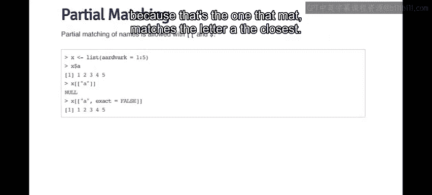

# 约翰霍普金斯大学数据科学课程2：《R编程课程》｜r-programming｜中英字幕 - P25：24_子集部分匹配.zh_en - GPT中英字幕课程资源 - BV1114y1k78X

So partial matching is a handy tool which can often save you a lot of typing at the command line。

 It's not particularly useful when you're writing out programs and functions。

 but it's very useful when you're kind of working at the command line typing things as fast as you can。

 So the idea with partial matching is that it works with a double bracket and in the dollar sign operator。

 So suppose I' have a list X which has an element in it calledardd vrc which is a sequence1 through 5 and suppose typing out the word a vrc every single time is a bit of a pan。

 So I'm just going to type the word a well the way the dollar sign works by default is that it looks for it looks for a name in this list where that matches the letter A in this case is only one element and so。

😊，You get you get the wordardvak and it gives me the object associated with aVc。

 which is the sequence1 through thought。 So if I use the double bracket operator。

 things are a little bit different。 So what the double bracket operator expects is that it's going that the name that you pass it is going to be an exact match for one of the names in the list So by default the double bracket operator doesn't do partial matching like the dollar sign does So now when I pass x double bracket a what happens is I get null back because there's no element of the list that has the name a but there's a second argument that you can pass to the double bracket operator which is the exact argument and if you specify that exact equals false and then when I pass it x double bracket a it gives me the sequence1 through5 because that's the one that matches the letter A the closest。

