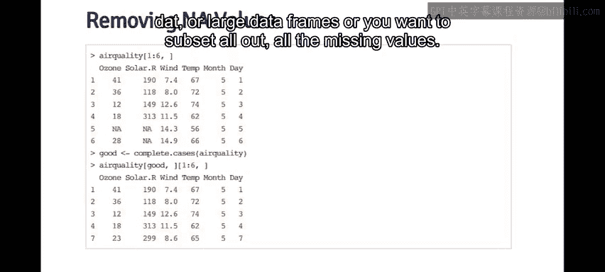

# 约翰霍普金斯大学数据科学课程2：《R编程课程》｜r-programming｜中英字幕 - P26：25_子集移除缺失值.zh_en - GPT中英字幕课程资源 - BV1114y1k78X

Last thing I want to talk about is removing missing values or NA values from an object。

 this is a very common operation in data analysis because most realistic data have lots of missing values and so the way you can do this for either a vector or a matrix or a data frame is you want to create a logical vector which tells you where the NAs are and so that you can remove them by subsetseing so here I've got a vector X this is a very simple example。

Which has the numbers 12， and 4 and 5。 But then there are missing elements NA in the third position and in the fifth position。

 So what I want to do is I want to get a vector back。 that's just 1，2，4，5。 the non missing values。

 And I want to strip out the missing values so I can maybe do some computation。

 So first thing I do is I use the is dot N function to go through the vector and tell me which elements are NA。

 And I create a new vector cult which I call bad here so bad is going to be a logical vector。

Which tells which is true if the element is missing and false， if it's not missing。

 So even though I haven't printed it here， the the the bad vector is going to be a logical vector that has false。

 false， true， false， true， false， right， Because the third and the fifth elements are missing。

 So when I。Now， that tells me which ones are missing， but actually。

 I don't want the ones that are missing。 I want the ones that are non missing。

 so I need to take the kind of the opposite of bad。

 which I can use with the bang operator or exclamation point。 So now I take X single bracket。

 bang bad， and that gives me the good elements， which are 1，2，4， and 5。

So what if there are multiple vectors or multiple objects and you want to take and each one has kind of missing values in slightly different places。

 and kind of you want to take the subset of all the objects that have no missing values right So here I created an x a vector called X。

Which is 1，2，4， and 5 and missing values scattered about。

 And then y is a character vector with also some missing values in it。

 so I can use the complete cases function on both vectors。

 which will give me a vector that tells me which of the two different vectors。

 which ones were which which positions。Are there that have both elements non missing。

 So you can see the first two are both non missing。 I got1。

2 in the first one and A B in the second one。 The third one's missing。 The fourth one is non missing。

 the fifth one is missing。 and the sixth one is non missing。 So for both vectors， X and Y。

 I want the first， the second， the fourth and the6 elements。 So now when I subset x。

 I get the good elements of that。 And when I subset y， I also get the good elements of that。

 So that's how I can look at multiple objects and kind of subset all the missing values out to get the good elements。

You can also remove you can also use complete cases to remove missing values from data frame。

 So here I've got a simple data frame where I'm showing the first six rows。 As you can see。

 there are six columns to this data frame。 So there's six variables。

 And there's some missing values in the ozone variable。

 and there's some missing values in the solar dot R variable。 And so all I want is the。

Is the is are the rows of the data frame where all the values are non missing right。

 So in this simple example， the rows that I want are rows 1 through 4。

 So I can use complete cases on the air quality data frame。

 and I create a logical vector that I call good here。

 So the logical vector here tells me which rows are complete。

 And then when I subset out the air quality。Matrix and I take out the first couple rows。

 you can see that now did none of the rows have any missing values in them。

So that's subsetting out missing values and complete cases is a very handy function。

 which when you have multiple sets of vectors or large data frames where you want to subset out all the missing values。

