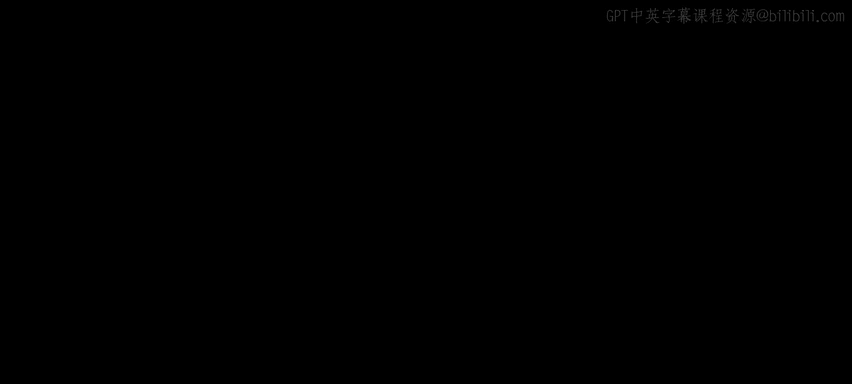
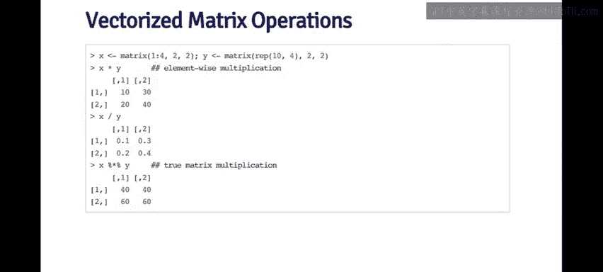

# 约翰霍普金斯大学数据科学课程2：《R编程课程》｜r-programming｜中英字幕 - P27：26_向量化操作.zh_en - GPT中英字幕课程资源 - BV1114y1k78X

This is just a simple note on vectorized operations in R so vectorized operations is one of the features of the R language that makes it easy to use on the command line and makes it very kind of nice to write code without having to do lots of looping and things like that。

 and so it's kind of a natural thing to have in a computational language many other types of languages like MATLb have this kind of feature。

So the idea with vectorized operations is that things can happen in parallel when you for example。

 want to do a computation。 For example， suppose I got two vectors here x and y x is the sequence 1 through 4 and y is a sequence 6 through 9 and I want to add the two vectors together。

 when I say I want to add them What I mean is I want to add the first element of x to the first element of y second element of x the second element of y etc cetera。

 the third element to the third element So I want to kind of do things in parallel like that。

 So in other languages you might have to write a loop to do that so you loop through each element and kind of add them1 by1。

 but it R you can just use the plus on the two vectors and it'll just add them together So x plus y kind of does what you would expect it adds1 to 62 to73 to 8 and 4 to 9 so you get the vectors 7。

91113。Similarly， you can use the greater than or less than symbols to give you logical vectors so for example x greater than 2。

 so well x is actually a vector of four numbers so which one so which number are you comparing to 2 well the vectorized operation compares all the numbers to2 and it gives you a vector of falses and true is depending on which numbers happen to be bigger than 2 so you can also use greater than equal2 and that'll tell you which numbers are greater than equal to 2 and the double equal sign test for equality so it'll take each element of y and test to see whether it's equal to 8。

And the other kind of or arithmetic operations like multiplication by the asterisk and division by the solidladus are all vectorized types of operations。

 so when you want to multiply， divide adds，tract vectors you can do the natural thing。

 just add them together or multiply them together and and the operation will be done in parallel。

Similarly， you can you can add in subtract and multiply divide matrices together。

 so it's useful to know this because there are different types of matrix multiplication。

 So I've created two matrixrices here x and y8 x is the matrix 1 through4。

 it's a2 by2 matrix and y is a matrix that's all1s it's also a two by two matrix。

 So if I just do x times y this is not a matrix multiplication。

 this is an element ys multiplication So the first the11 element of x is multiplied the11 element of y and the two2 element is multiplying the two2 element of the other matrix etc cetera。

 So each element is multiplied together in parallel same when you do division this is not a matrix inverse or something like that。

 this is just dividing one matrix literally element by element by another So if you want to do a true matrix multiplication you have to use the percent star percent that's the symbol for a matrix multiplication。

So when you so this is just， that's it for vectorized operations for now。

 you'll see these a lot more often later on， but the idea I just wanted to introduce this idea because it makes code easier to write and for those of you who are kind of。

Use to other types of programming languages， if you've programmed in other languages where you can't do this kind of thing。

 sometimes it's common to kind of reflexively go to something like a for loop or a Y loop or whatever it is。

 but in a language like R， you can just use the vectorized operations to make the code a lot simpler。

