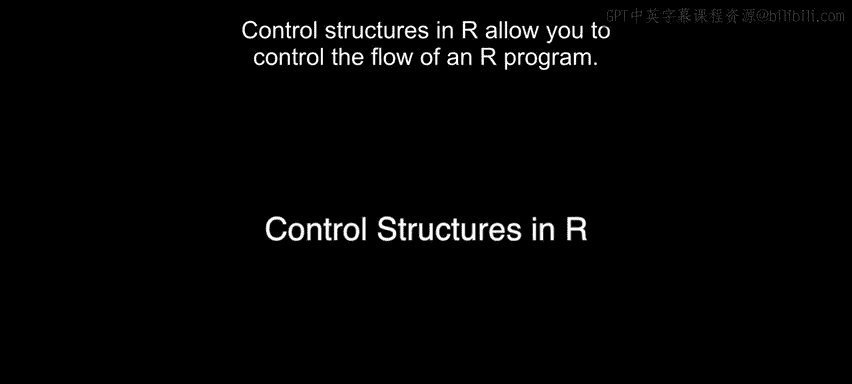
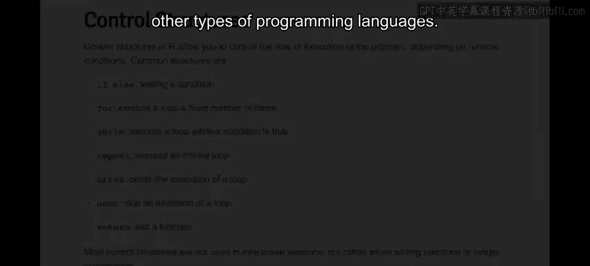
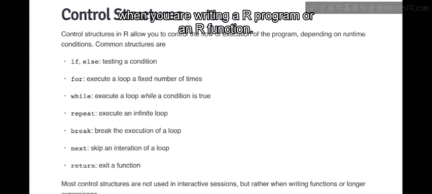

# 约翰霍普金斯大学数据科学课程2：《R编程课程》｜r-programming｜中英字幕 - P29：28_控制结构简介.zh_en - GPT中英字幕课程资源 - BV1114y1k78X

Control structures in R allow you to control the flow of an R program and are very similar to the control structures that you might see in other types of programming languages。

 The basic constructs are things like if else for testing logical conditions for for executing a loop a fixed number of times。

While executes a loop while a condition is true， repeat is a construct that allows you to immediately execute an infinite loop break allows you to break out of any type of loop。

 and next skips an iteration of a loop and return allows you to exit a function so most of these control structures are not things that you use in interactive session so not while you're typing at the command line in R these are the kinds of things that typically you would use when you're writing a our program or our function so a little bit more of a structured format。

