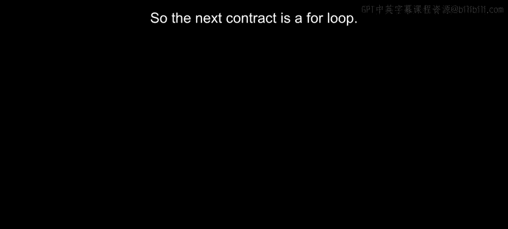
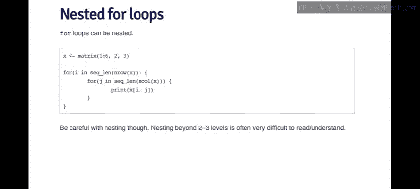

# 约翰霍普金斯大学数据科学课程2：《R编程课程》｜r-programming｜中英字幕 - P31：30_控制结构 for循环.zh_en - GPT中英字幕课程资源 - BV1114y1k78X

So the next contract is a for loop so this is probably the most common type of loop operator that you're going to use in R。

 The basic idea is that you have a loop index which is typically called I but if you have many loops you might say JKL etc and the loop index is going to go from is going to cover a sequence of numbers typically integers so for example here I've got a four loop and it's looping over the numbers1 through 10 so I created a sequence of the colon operator1 through 10 and this for loop is not doing anything particularly interesting it's just printing out the number so printing out I at each iteration。

After the loop is finished， it continues on to the next block of code。

So there's different ways to use a for loop and R is pretty flexible about how you can kind of index the different types of R objects。

 so here I've created a vector， a character vector with the letters ABCD in it and all these four loops are equivalent。

 So for example， the first one I kind of done what you might commonly see in other languages like C that have four looping here I've got an index I that I sequence through one through4。

 I created an integer sequence and then I print out the I element of x each time so here this loop just print out ABCD。

😊，Another thing I can do is use the seek along function。

 so seek underscore along what it does is it takes a vector as an input and it creates an integer sequence that's equal to the length of that vector so this is a vector of length 4 so it's going to create an integer sequence of 1 through4 it's exactly the same as as the previous statement where I've got the sequence1 colon 4 however here I generate the sequence based on the length of the variable x。

 so now my index variable I is going through this sequence it's printing out the I element of x and exactly the same behavior occurs I print out ABC and D。

The third example here。😊，I've got a different index variable I'm calling it letter and the index variable is actually going to be index is going to be taking values from the vector itself。

 so there's no reason why the index variable has to be an integer。

 it can take elements from any arbitrary vector。 So now the for loop is going through this vector of letters ABCD and it's just going to print out the letter itself。

 So now I'm printing out the index variable which happens to be equal to the letters in the vector。😊。

嗯。And so these three four loops are exactly the same so far。

 the last version here is the same as the first one except that I haven't included the curly braces。

 and so for a single expression， if the four loop only has a single expression in this body。

 you can omit the curly braces and put everything on one line。

 which may be useful sometimes because it's a little bit more compact。

 but it's not my particular style for four loops， I generally like to put the curly braces in regardless of how many elements are in the body。

F loops can be nested， so you can have a for loop inside of a for loop， so the common thing。

For example， it is with a matrix that has two dimensions and then you might want to loop over the rows and then loop over the columns。

 So here the outer loop the I with the eye index is is。Looping over the rows。

 And I'm using a function that's called See underscore L。

 So the idea is that it takes the seek underscore L takes an integer。

 which in this case happens to be the number of rows and x。

 And it creates an integer sequence out of that。 So so this particular matrix has two rows。

 And so it's going to create the sequence of1 to2 for， similarly the。

The nested loop with the J index is using the number of columns to create a sequence of this matrix as three columns。

 and so the Cq underscore L function is going to create an integer sequence1 through 3。

 so this doubling nested4 loop is basically printing out all the elements of the matrix。

So one thing to be careful with nested for loops is that it's going beyond two to three levels while it's theoretically okay in R。

 it makes reading the code a little bit difficult to do and so if you're reading code that has three or four nested for loops it gets difficult to understand what's going on。

 sometimes that's the logical thing to do， but many a times there's ways to get around that for example by using functions。

😊。

