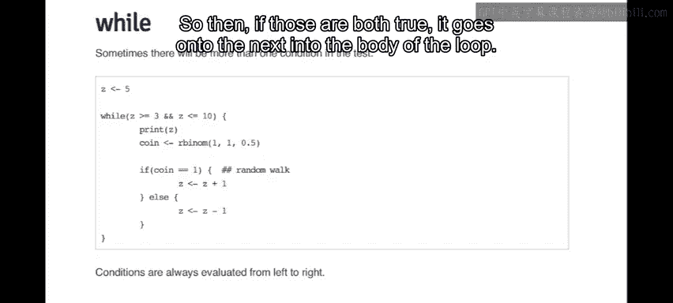

# 约翰霍普金斯大学数据科学课程2：《R编程课程》｜r-programming｜中英字幕 - P32：31_控制结构 while循环.zh_en - GPT中英字幕课程资源 - BV1114y1k78X

So the while loop is the other major looping construct in R and the basic idea is that the while takes a logical expression and will execute the loop based on the value of that logical expression for example I've got a very simple loop here it initializes a count variable equal to0 and then while that count is less than 10 it prints out the count and then increments the count by one so as soon as the value of count gets to 10 the loop stops and then it will go on to the next body of code so the while loop while loop is useful because it makes things easy to read sometimes it's very obvious here that this loop is supposed to stop working or stop executing when the value of the count variable is 10 or more it makes it a little bit more readable however you have to be a little careful with while loops because technically speaking the R infinite loops while ands and you have to make sure that the condition that stops the loop will actually。

😊，Otherwise your program will never finish and so in this case。

 it's fairly obvious that the loop will eventually stop executing。

 but in much more complex pieces of code， it can be hard sometimes to figure out whether the while loop will finish and so often it's safer to use something like a four loop that has a hard limit on the number of times it can execute。

So that's not necessarily saying that you should never use a wild loop but you just have to be careful when you do use them。

So you can test multiple conditions in a while loop or in any type of construct like an if statement。

 for example， by using the logical operators。 So here I've got a variable z which which I initialize that the value of 5 and the condition for the while loop is basically while z is greater than equal to 3 and it's less than equal to 10 so while it's between the values of 3 and 10 then'm what I'm to is going to print the value of z。

 I'm going to flip a coin， a fair coin and if the coin is a1 I'm going to add one to my value and then if it's less than1 excuse me if the coin is equal to 0 or any other value for that matter。

 I'm going to subtract 1 from z so Jerry a little random walk here and the value of z is going to go up or down depending on my little coin flip here。

So here you can see it's a little bit harder to tell when the while loop will finish because the body of the while loop involves random number generation。

 so here the Z value is going to zigzag up and down until it eventually it hits 10 or eventually it hits 3。

Or something less than three， and so this may be kind of nice。

 but you have to be careful that it doesn't go off for too long。

So one thing to note on a more technical level is that the conditions when R tests the condition in kind of a multiexpression condition here I've got z greater than equals to 3 and z less than equal to 10 the conditions are always evaluated from left to right。

 so it checks the C that the lessmost condition is true and then it goes to the next condition。

 So first it'll check the c of z is greater than equal to 3 if that's true then if that happens to be true。

 it'll go to the next expression it'll say it'll check the c of z is less than equal to 10。

 So if those are both true， it goes on to the into the body of the loop。

