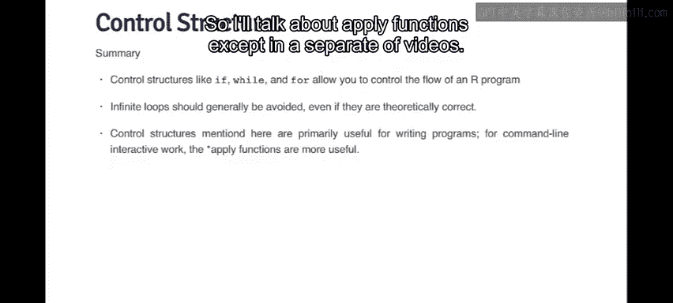

# 约翰霍普金斯大学数据科学课程2：《R编程课程》｜r-programming｜中英字幕 - P33：32_控制结构 repeat next break.zh_en - GPT中英字幕课程资源 - BV1114y1k78X

Repeat is a construct that basically initiates an infinite loop。

 This is not what I would characterize as a commonly used control structure in R。

 but it does have its' use occasionally。 So the only way to exit a repeat loop is to call break。

 So obviously you're going to have to call break at some point unless you feel like running your program forever。

 So here is a pretty simple example here I'm initializing and evaluate x0 to be1。

 and I'm setting what I think of as a tolerance to be 10 to the -8。

 I then I'm going to repeat the following structure Basically I'm going imagine that there's some function that computes an estimate for x。

And I'm going to call that x1。 and basically if the new value of x that is x1 if the absolute value of the difference between x1 and x0 is less than some tolerance。

 in this case，10 to the minus-8， then I'm going to stop the loop and then move on in the next bit of code if the difference is greater than my tolerance。

 then I set x0 to be equal to the new value。 and I run the loop again， I calculate a new estimate。

 and I check to see if if the difference is small。 So this is a common type of formulation。

In many types of optimization algorithms， for example if you're trying to find the solution to some set of equations。

 or if you're trying to maximize a function， often you'll iterate over and over again。

And and you'll stop when when the estimates that you're calculating are getting closer and closer together because that's usually a sign that you're kind of converging to whatever the minimum or maximum of the objective function is。

 So this in theory， this is a perfectly reasonable construction。

 you want to keep recycling through the algorithm until the two values are close。

 So there's one problem， which is that， first of all。

 requires an algorithm that is guaranteed to converge and not necessarily every algorithm has that property。

 second of all， also it it does depend a little bit on the tolerance。

 So the loop will run longer if the tolerance is smaller， generally speaking。

 And because it's hard to predict how。How long this loop will run。

 it can be a little bit dangerous because it's unpredictable it could theoretically run forever and you have no way to guarantee that the program will stop at some point。

 So this construct， although it's theoretically kind of the right thing to do it's usually not a good idea。

 It's better probably better off to use a for loop that has a hard limit on the number of iterations that it's allowed to run that way if you have a problem with your algorithm。

 it will eventually reach the hard limit and stop and you'll know that the reason it stopped is because it didn't converge and then maybe you can try to fix something about the algorithm with the repeat type of approach if your algorithm is not converging。

 you won't have any warning it'll just be running a really long time。

The last control structure element I want to talk about is next and then there's also return next is basically used in any type of loop in construct when you want to skip an iteration so here I've got a basic for loop which is going to run for 100 iterations but the idea is that I want to skip the first 20 iterations and then only kind of execute some code for iteration is 21 through 100 so here I've got I've got a very simple if condition so if I is less than equal to 20 I'm just going skip so I use the next expression and it'll skip everything else in the for loop and go and iterate again So once I is gets beyond 20 then of course the expression I less than or equal to 20 will be false and so it won't execute the next it'll go into whatever the body of the code for the four loop is so next is another is a way to skip an iteration in a loop and of course break is a way to execute the exit the loop entirely the return function is another function that can use to be。

Exit a loop and it's primarily used to exit a function。

 so it'll exit the entire function and return a value that you pass it。

 So we'll talk more about return when we talk about functions。

 but it's something that that can interrupt the flow of a program too。

So that's control structures for now， the basic summary is that control structures like if while and4 that can allow you to control the flow in anR program。

 generally speaking while there are construct constructs that kind of allow you to execute infinite loops。

 you generally want to be on the lookout for these kinds of things and to avoid them if possible。

Even if they are kind of theoretically correct， because they can lead to kind of some unpredictable behavior in programs and the other key thing I haven't mentioned yet is the control structures that I've mentioned here。

A primarily useful for writing programs， I think I mentioned that in the beginning。

 but for command line and interactive work， there are other types of looping type functions that we can use。

 they generally have the word apply in them and they can be a lot more useful for command line interactive work when you're exploring data and things like that。

 not writing programs although they can be very useful in writing programs too so I'll talk about the apply functions in a separate set of videos。

😊。

