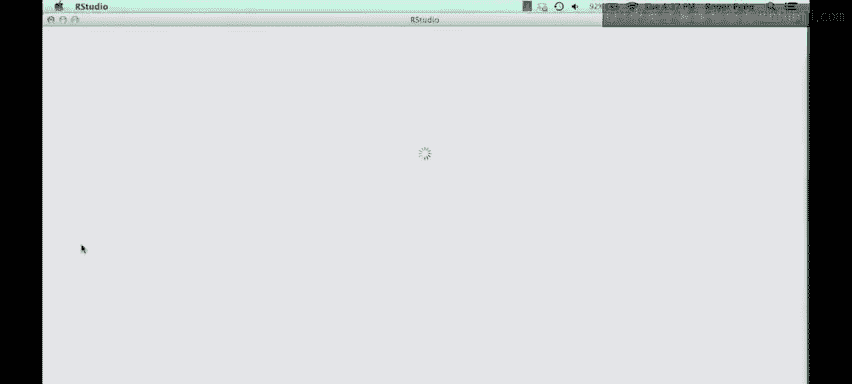
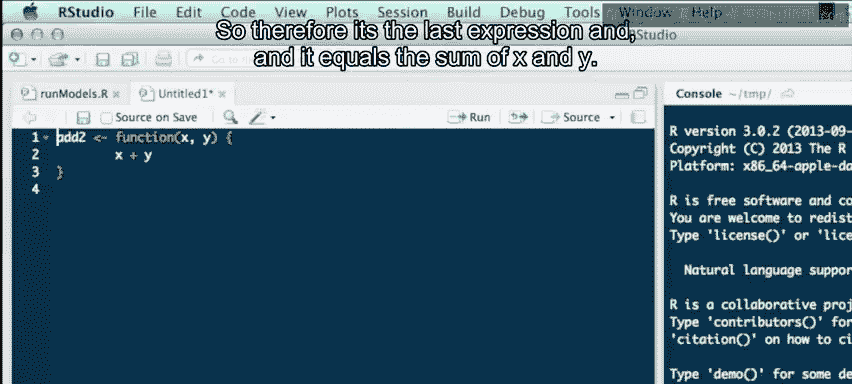
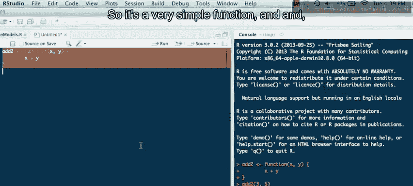
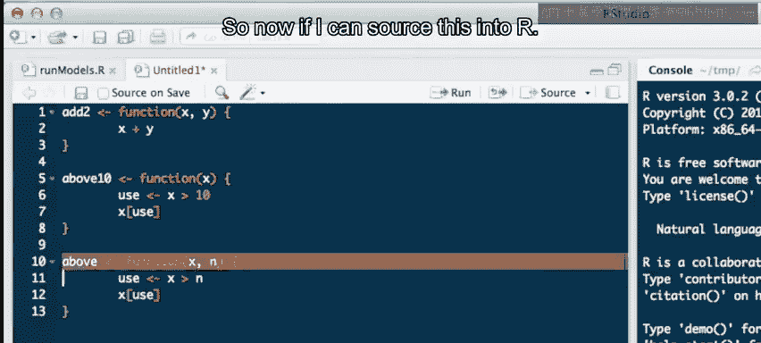
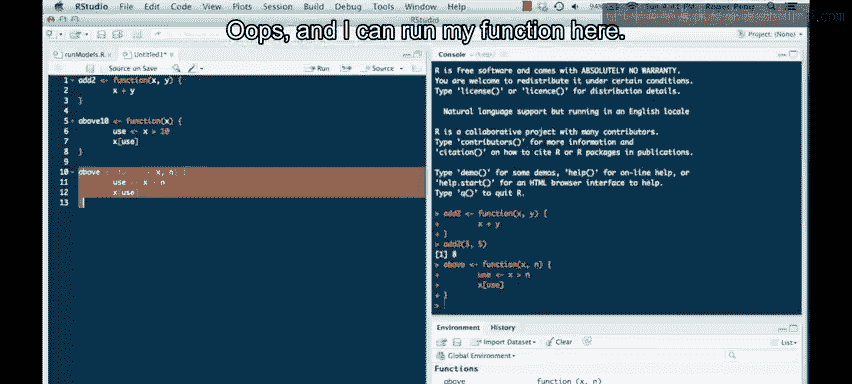
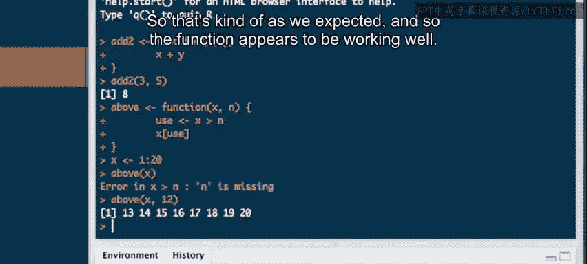
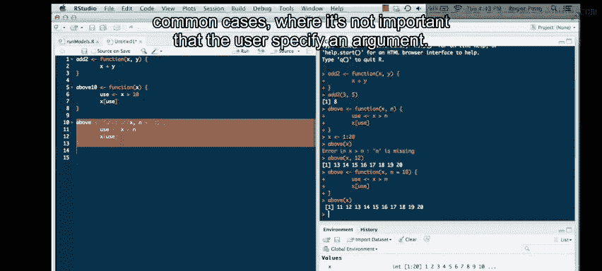
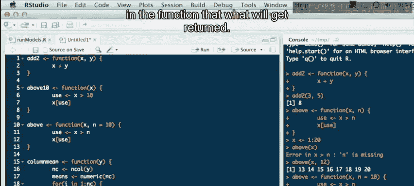
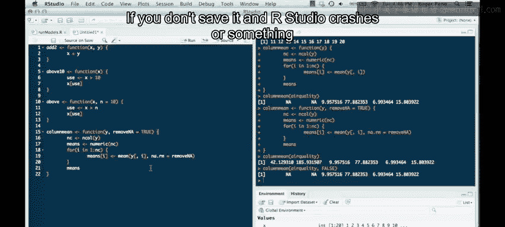

# 约翰霍普金斯大学数据科学课程2：《R编程课程》｜r-programming｜中英字幕 - P34：33_你的第一个r函数.zh_en - GPT中英字幕课程资源 - BV1114y1k78X

In this lecture I just want to get everyone on board with writing functions because functions play a critical role in any R programming and you tend to write a lot of them when you're doing a lot of data analysis or doing a lot of kind of statistical analysis and so I want to make sure that everyone can kind of get started writing functions and particularly for those who are less familiar with programming languages in general So this is just going to be about writing your first functions it's kind of like the hello world so to speak of R so the first thing you're going to want to do is you're going want to write you write you're going to want to write the function in a text file so it's possible to write functions on the command line in R but it's usually not preferable and so usually you're going to want to put your functions in a separate file separate from any interactive stuff that you're doing in the command line in the future youll want to put your functions in an R package which is kind of a more structured type of the kind of environment with documentation。

 everything but we won't talk about that now right now the first thing you're gonna to do。

Is put your functions in a text file。Okay， so the first thing we're going to want to do is open up our studio。

 so let's do that。

And so you can see here in our studio there's some stuff going on here from a previous project that I'm working on。

 so that may happen to you and generally you can either close it or you can just ignore it I wanted to create a new R script here so let's create a clean script here to kind of put our code into。

So the first function I'm going to write is really simple。

 it's just going to take two numbers and add them together so this function obviously doesn't have a real point to it。

 but it shows you how to use the function syntax， how to specify the arguments and how to return the value So the function that adds two values I'm just going to call it add to。

And and so you give it use the function directive to start it off。

 Now its going to it's going to add two values。 So it has to take two arguments。

 So I'm just going to take called it two arguments X and Y。 and then I'm going to。

Take the two arguments and add them together with the plus operator at X plus y。

 and then I close off the function with the curly race。

 So you can see that I didn't have to do anything special to return the value that that's the sum of the two elements because in any R function。

 the function returns， whatever the last expression was。

 So here there's only really one expression So therefore it's the last expression and and it equals the sum of x and y。

 So I can highlight this guy and run it in the console you can see now I've got my function here。

 I can say add two and let's give it say3 and 5。 and hopefully I get 8。 yes， that's a good sign。

 So it adds the two numbers together and that's that。 So it's a very simple function and。

And you've now written your first function in R。

So the next function that I want to talk about is iss only slightly more complicated going to take a vector of numbers and it's going to return the subset of the vector that's above the value of 10。

 so any number in the vector that's bigger than 10 is's going to return those numbers for you so let's bring back our original function we'll call this one above 10。

Just because it gives you any number that's above 10。嗯。And it's going to take a vector here。

 we'll call it X， you don't have to call it X， I'm just calling that。

 and I like to open and close the curly braces right away just so you know where the beginning of the end of the function is。

If you haven't have a lot of code in a single file。

 so the first thing I'm going to want to do is I want to construct a logical statement that figures out which elements of this vector x are greater than 10 right so I'm going to assign an object I'll call it use because these are the numbers that I'm going to use。

And I'll say x greater than 10， right so this will return a logical vector of truths and falses to indicating which element of x is greater than 10。

And then I'm going to subset the vector X with this logical vector。

 So now this function returns the subset of the vector X that is bigger than 10。 Of course。

 if there are no elements in the x that are bigger than 10。

 then it will return an empty numeric vector。Now of course there's really nothing special about the number 10 I just kind of made that up and so you may want to create a function that allows people to to kind of extract the elements of a vector that are above an arbitrary other number right and so it could be 10 it could be 12 it could be 5 it could be anything so maybe you'll want to allow the user to specify that number so I'll just call I'll create a new function here。

Call above。 so it doesn't have the 10 encoded in it。 I'll use the function directed。

 and I'll have a second argument called n， which could be any number， really。So let's start it off。

 I'll get the curly braces in there， and I'll create a logical statement that's x is greater than n。

 right， and then I'll subset the vector X based on that logical statement。

 So now if I can source this into R。

有不是。And。I can run my function here， so I'll just create a vector。

Let's say x is 1 through 20。And I'll say above。X。Oh， I can see so I didn't specify the number n。

 so it's not going to know what to cut it off at， so I need to specify the threshold so as's to 12。

And you can see it returned all the numbers that were greater than 12。

 so that's kind of as we expected， so the function appears to be working well。

Now let's suppose that maybe there is something special about the number 10 and maybe it's something that people are going to be doing very often。

 it's a very common number， so you might want to specify a default argument。

 so you might want the default to be 10。 so when I ran the function before and I didn't specify the number N it gave me an error and maybe you don't want people to have to encounter that error and so you'll specify a default value n equals 10 so people don't specify the cutoff value n it will just automatically default to 10 so now I can run this in R。

And now if I do above just X， you see I don't get the error anymore。

 it automatically gives you all the numbers that are bigger than 10。

 so it's kind of nice in R when you're writing functions to be able to specify default values like this that make the life of the user just a little bit easier。

 especially for very common cases where it's not important that the user specify an argument。

So those are some very simple functions in R that can be used to kind of process data or make do simple calculations like adding two numbers the next function I want to talk about is going to just take a matrix or a data frame and calculate the mean of each column right so this is slightly more complicated you have to take your argument and then you have to loop through each column to calculate the mean of each one right so this is going to involve using a for loop and so we'll talk about it here。

So let's call this function column mean。Because that's where it does。

And I'll use the function directed here and now it's going to take an argument。

 I like to call my arguments X you don't have so I would just call it a Y for fun。

And so y is going to be a data frame or a matrix。And we're going to go through the columns of this data frame or matrix and calculate the mean of each column。

 So the first thing I need to figure out is how many columns does this thing have。

 and that can be easily done， I'll call it NC for a number of columns。

 and we can use the end call function for that。That will calculate the number of columns and then I need to initialize a vector that that's going to store the means for each column and the length of this vector has to equal the number of columns right so I'll just call it means and it'll be a numeric vector equal to the length of the number equal to the number of columns。

 So this is just an empty vector doesn' it's going have it's going to be initialized to be all zeros。

 but we're going to fill it as we go through the column。

 So now we want to four loop through the columns and I'll say I is in。And then I'll say1 through NC。

 so this creates a integer vector that starts at one and ends at the number of columns。

And then I'm going to for loop through and for each I， I'm just going to。A sign of my means vector。

 the mean of x bracket I oh sorry， it's called Y here now。嗯。And that's it。

 And then so now I haven't returned anything yet。 So right now this function doesn't do anything particularly useful。

 but what I want to do is return the vector of means。 And so I'm just going return that。

 And thats since that's the last expression in the function， that's what will'll get returned。

So I can source this into R。And I'll just find some arbitrary data。

 where we can use the air quality data， I guess I'll just take the column means of that。

And see how it works。Okay so are I think there are six columns in this data so it gave me six amine and I can see that the first two columns of NAs and that's because if the vector has an na in it then you can't calculate the mean and so the one thing you might want to do is by default this is kind of draw out all the missing values and just calculate the mean amongst the observed values and so you'll notice a lot of functions have a feature which like where you can choose whether you want to remove the NAs or not so let me just add an argument here it's called remove NA and it'll default to true。

And then I'll pass this argument to the mean function， so the mean has an NA to RM argument。

 and I'll pass it this value。And so now I can default to removing the Ns when I calculate my column mean。

 so source this send to R and we can run in the console column mean。And so now the default will be。

 now I get my means for those columns because the default was to remove the Ns。

 I could say false here and then my Ns will come back so I can always choose to kind of go back to the old behavior if I wanted to。

So the last thing you want to do anytime you're writing a function， the most important thing。

 of course， is to save your file。 So right now this file is unsave if you don't save it and our studio crashes or something happens you'll lose all your work And so you want to go to the save。

Men saveve as menu and just save your file as you know functions or whatever you want to call it。

You can give it the dot R extension。And now your code is saved to a file。

So that should get you started just writing some simple functions in R for your programming assignments。

 you'll have to write a few functions that kind of go through and look at data。

 but I just want to get you started writing your first function so that you know kind of how the function directive works。

 how the arguments work， and you can play around a little bit with more complicated ideas as you work through the assignments。

