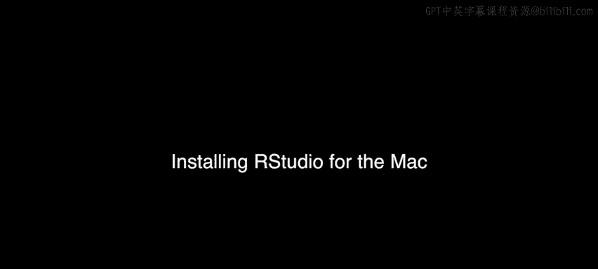
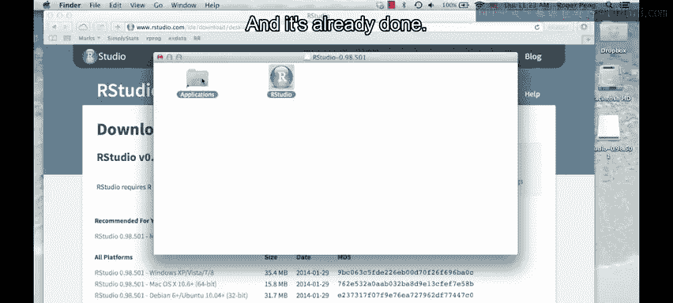

# 约翰霍普金斯大学数据科学课程2：《R编程课程》｜r-programming｜中英字幕 - P3：2_在mac上安装r studio.zh_en - GPT中英字幕课程资源 - BV1114y1k78X

In this video， I'm going to talk about how to install our studio for the Mac。

 It's a very simple process， and it only involves just a few steps。

 The one thing I'll say though is that you must have R already installed before you install our studio。

 So once you've installed R already， you can go to the ourst website， which is ourtudio。 com。

Ex down here on the lower left there's a green button that directs you to kind of download our studio。

 So here there's two versions of our studio that you can download。

 one is for the desktop and one is for the server down here。

 Now we're not going be talking about the server version at all here。

 So you just want to download the desktop version So that's this button right here。

 So the website should detect automatically what type of operating system you're running。

 So here I'm running a Mac。 And so it recommends this Mac OS 10 version。

 So I'm just going to download that right now。And you'll see the download meter go。

Once that's finished downloading， you can go to the downloads folder and it should be the leftmost thing here。

 so I'm just going to click on it to install it。And then just like any other Mac application。

 all you have to do to install it is drag it into the applications folder。

 so I'm going to do that right now。啊。And it's already done。

 so I can just go into the applications folder here。

Let's find our studio。Theyle click on it。I'll say yes， I want to open this application。

And there you go， here're running our studio。