# 约翰霍普金斯大学数据科学课程2：《R编程课程》｜r-programming｜中英字幕 - P40：39_编码标准.zh_en - GPT中英字幕课程资源 - BV1114y1k78X

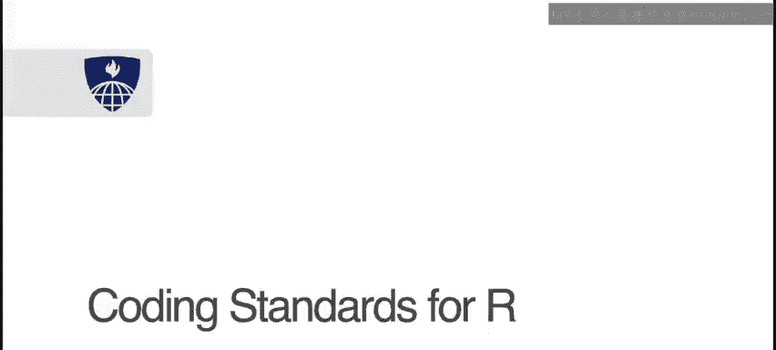

Coding standards in R are really important because they help you make your code readable and allow you and other people to understand what's going on in your code Now。

 of course， just like it is with any other style comes whether it's your clothing or whatever it is It's difficult to get everyone to agree on one set of ideas but I think there are a couple of very basic kind of minimal standards that are important when you're coding in R so I'm just going to talk a little bit about some of the coding standards that I think are important when you're writing R code and I think will help make your code more readable and more usable by others if that's what you're trying to achieve。

So the first principle that I think is very important in pretty much any programming language。

 not just R is that you should always write your code using a text editor and saved as a text file。

 Okay， so a text file is a kind of basic standard。 It usually doesn't have any sort of formatting or any sort of kind of。

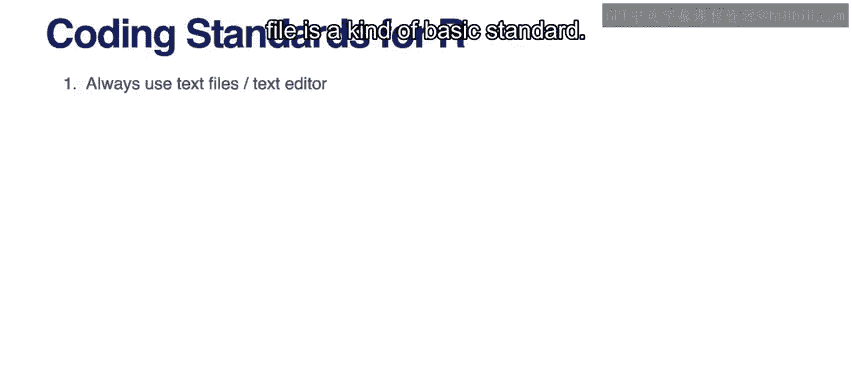

Special appearance， It's just text right and usually typically typically it's gonna to be ask key text。

 but if you're in places outside the US or the UK using non- English languages。

 there may be other standard text formats。 But the basic idea is that a text format can be read by pretty much any basic editing program these days。

 you know when you're writing something， there's a lot of different tools that you can use to write if you're writing a book or or a web page or something like that。

 there's all kinds of different tools that you can use to write to write those things。

 but when you're writing code， you should always try to use a text editor because that's like the kind of least common denominator and it makes it so that everyone will be able to access your code and improve upon it。

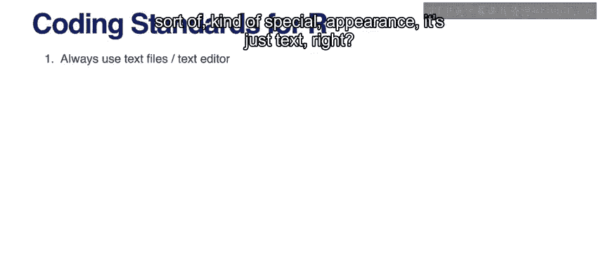

The second principle which is very important for readability is to indent your code。

 So indenting is something that's often hotly debated in lots of mailing lists and other types of discussion groups in terms of how much indenting is appropriate。

 Now I'm not going to talk about that although I do have some recommendations but I think the most important thing that you understand why indenting is important So indenting is the idea that different blocks of code should be spaced over to the right a little bit more than other blocks of codes you can see kind of how the control flow how the flow of the program goes based on the indenting alone So coupled with indenting is the third principle。

 which I think is very simple， which is the limit the width of your code So if you have indenting it's possible to kind of indent off to the right forever So you need to limit on the right-hand side how wide your code is going to be and usually this is kind of turn by a number of columns of text and so one possibility is you limit your text to about 80 columns of text and then and so that。

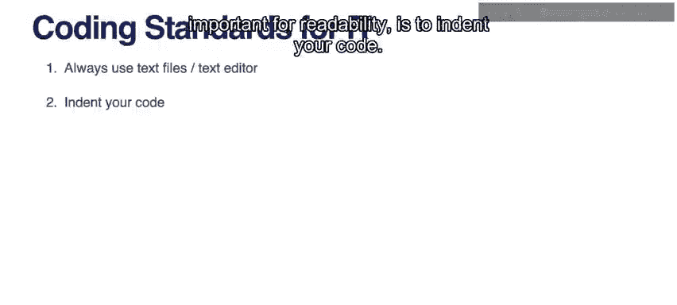

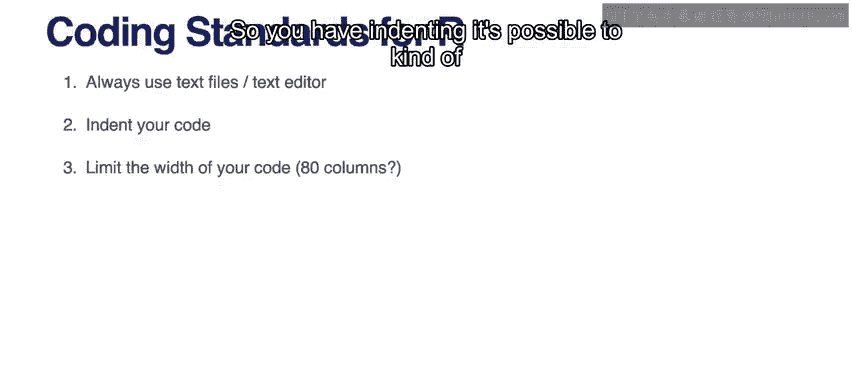

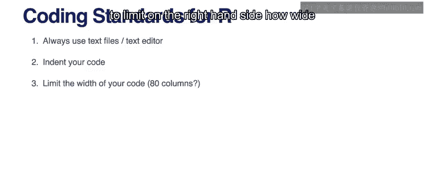

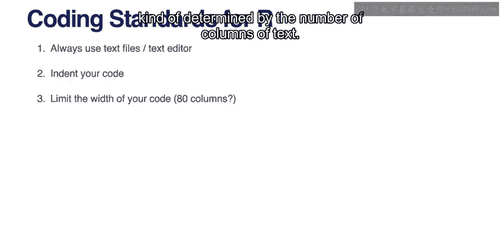

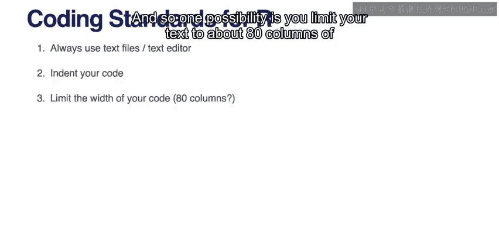

The width of your code never exceeds that， so let's take a look at a quick example here。

So here you can see I've got our studio open here with a simple code file with some R code in it。

 And first of all， let me just mention that the editor in our studio is a text editor。

 so it will always save the R files that you write as text format files So we've already got that kind of handled。

 but you can see the indenting scheme here is equal to one space So every indent is one space。

 and you can see that all the code is kind of matchshed together here on the lefthand side it's difficult to tell kind of where the if blocks are。

 where the else blocks are， where does the function kind of end and begin。

 And so the indenting scheme kind of makes the code not very readable in this case。

 So we can change the indenting in our studio and we just go up to the preferences menu here。

And go to code editing， and let me just change it to four。

And you can see that the margin column is set to 80 characters。

 so it will show you the margin when you've reached 80 characters。

And so I'm going to select all here with the command A and then command I to indent it。

 so now you can see that the indenting is a little bit nicer now。

 you can see kind of where the function begins and ends。

 you can see where the if blocks start and end and the kind of structure of the program is much more obvious。

So I'm going to change this one more time though， because my personal preference for inebing is to use eight spaces。

 so I'm going to change this to eight。H OK and I select all command I。

 and now you can see I prefer eight spaces just because it really makes the structure of the code very obvious and the spacing is nice and clear and it makes the code very readable in general。

So you can see that indenting is very important and the biggest problem you might have is with two little indenting。

 if you don't indentense it all。 if you only use a very small amount。

 the code becomes kind of very mashed together So I recommend at least four spaces for an indent and I prefer8 spaces for an indent just because it makes the code much more readable and spaces it out much more nicely one of the advantages of having something like an8 space indent is coupled with an 80 character margin on the right hand side is that it forces you to think about your code in a slightly different way。

 So for example， if you have  eight space indents， if you're gonna to have a four loop nested within another for loop within another for loop every time you nest another four loop。

 for example， you have to indent over8 spaces。 and by the time you get to maybe your fourth nested for loop。

 you're pretty much hitting the right- hand column at the 80 column margin And so the nice thing about the8 space indent coupled with the 80 column margin is that it prevents you from kind of writing very basic making。

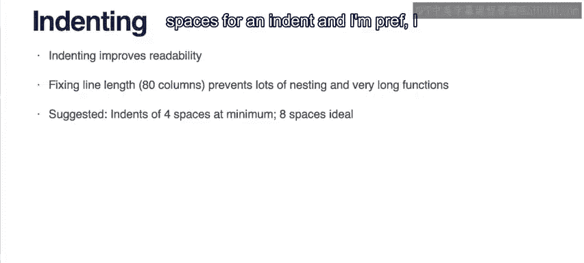

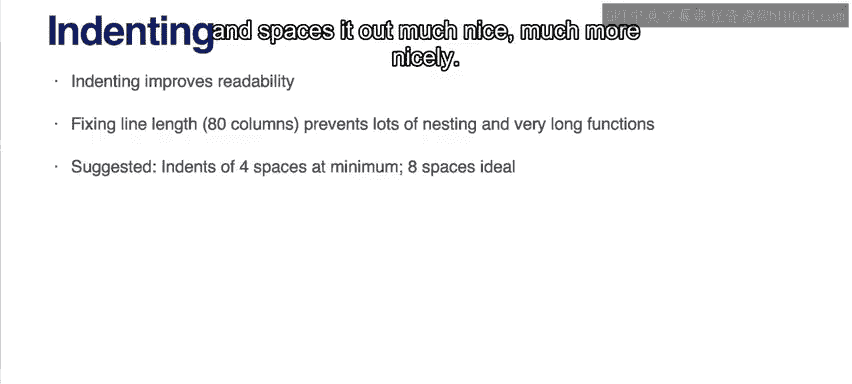

kindind of fundamental kind of mistakes with code readability so for example。

 with an eight space indent and 80 column margin you might not be able to do feasibly more than two nested for loops and but I think that's really the kind of the boundary of what is readable in terms of code typically except for some special cases a three you know three nested or four nested for loops is difficult to read and it's probably better off you know splitting off into separate functions or something like that so。

A good indenting policy not only makes the code more readable。

 but it actually can force you to think about writing your code in a slightly different way。

 and so that's a really nice advantage of having a logical indenting policy coupled with a right-hand side restriction。

So the last thing I want to talk about is to limit the length of your functions。

 All right so functions in R can theoretically go on for quite a long time。 and， of course。

 just like in any other language， but just like in any other language。

 I think logical thing to do with the function is limit it to kind of one basic activity。

 So for example， if your function is named read the data。

 then your function should simply read the data， it should not read the data， process it。

 fit a model and then print some output So you should the logical kind of steps like that should probably be split split into separate functions。

 there are a couple of advantages to doing this。 first of all。

 it's nice to be able to have a function written on a single page of code。

 you don't have to scroll endlessly to see where all the code for this function goes。

 if you can put all the function the entire function on like one screen of the editor。

 then you can look at the whole function and see what it does all at once。

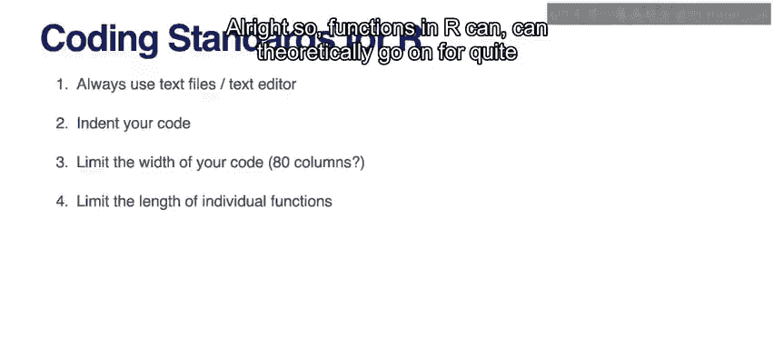

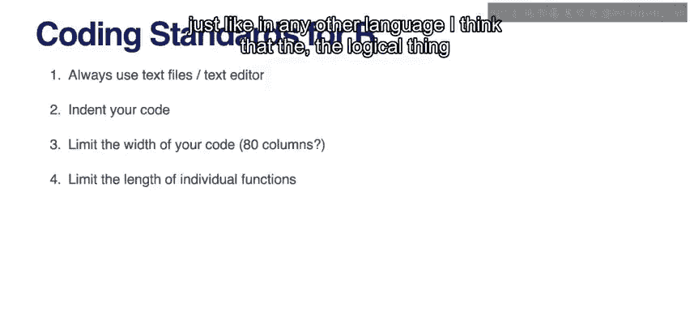

Another advantage of splitting up your code into logical sections logical functions is that if you use functions like traceback or the profiler or the debugger。

 these often tell you where in the function call stack you are when a problem occurs。

 And if you have multiple functions that are all logically divided into separate pieces。

 then when a bug occurs and you know that it occurs in a certain type of function or a certain function。

 then you know kind of where to go fix things So but if you just have a single function that just goes on forever and a bug occurs。

 then the only thing that the debugger or the traceback or the profiler can tell you is that there's a problem in this one function。

 butt it's difficult to tell you where exactly the problem occurs So splitting up your functions has a secondary benefit which is that it can help you in debug into profiling So limiting the size of your functions is very useful for readability and for of debugging。

 of course it's easy to go overboard into having 100 different three line functions。

 So that's not really what you want to do。So you just want to make it so that the separation of different functions into is logical and that each function kind of does one thing in particular。

So those are my basic guidelines for writing code in R there are of course many other things that you might be able to think about。

 but then we start bordering into areas that might we might kind of disagree on and so I'm not going to talk about too much more in terms of coding standards。

 but the basic ideas are always use a text editor always indent your code I'd say at least four spaces limit on the right hand side how wide your code can be and。

And always limit the size of your function so that you can so that they're kind of groups into logical pieces of your program。

 So with those four things， I think your code will be much more readable， It'll be readable to you。

 It will readable to others， and it will make kind of writing our code much more useful to everyone。

