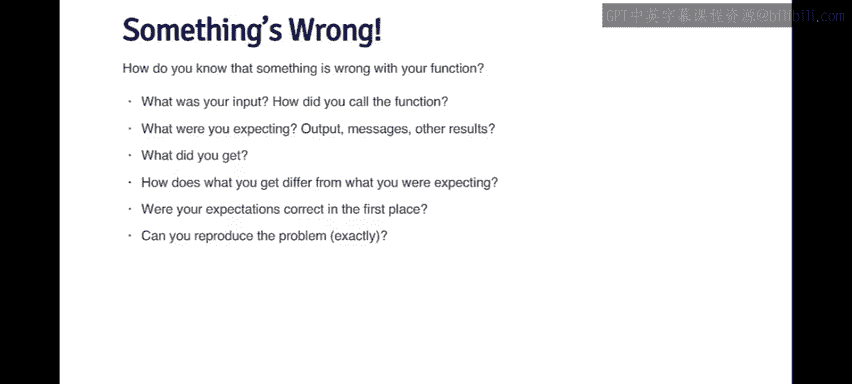
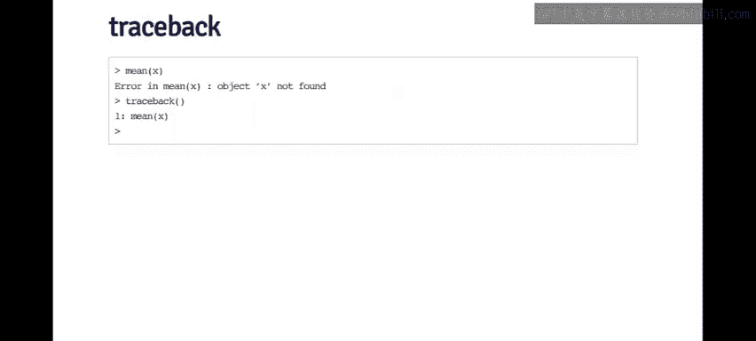

# 约翰霍普金斯大学数据科学课程2：《R编程课程》｜r-programming｜中英字幕 - P48：47_调试工具 基本工具.zh_en - GPT中英字幕课程资源 - BV1114y1k78X

So what are the tools that R comes with to help you to debug a program， right so。

There are five basic functions and a few associated ones that I won't talk about。 But the first。

 most basic one is the traceback function。 Okay Now one thing I want to say that you can get pretty far in R without using any of these functions。

 I work with R for like six years that didn't even know these functions existed so and So I'm not saying that you necessarily have you will always be using these functions。

 but they're actually quite handy in some cases。 So the traceback function。

 what it does is prints out what's called the function calls stack。

 So typically when you call a function， you call the function and that function calls another function then that function calls another function and like and then your four function deep and then maybe the error happens way down here And so traceback just tells you how many function calls you're in and where the error occurred And so you could try to identify where in the sequence of function calls the error occurred otherwise。

 all you know is that you call one function and then error occurred。

 but you have no idea how many other functions were called underneath。

 So the traceback function will tell you that。 and I'。an example。

The debug function is probably the handiest function。

 What it does is you give it a function as an argument， and it flags that function for debug mode。

 Okay， and what debug mode means that any time you execute that function， anytime anywhere。

Even if another function calls it， it will， It will help。

 It will suspend execution of the function at the first line。

And then you can in what's called a browser。 And I'll show you how this works。

 And then you can step through the function line by line。

 And then you can see you can execute one line one expression at a time。

 I should say inside the function。 So you can try to pinpoint。 okay。

 if there is a specific line of code where an error occurs。

 you'll be able to find out which line that is okay。

The browser functions related to debug in the sense that you can stick the browser of call to the browser function anywhere in your code。

 and then when that line of code gets hit， when that browser call gets hit。

 the execution of the function will suspend。😡，Okay， and then you can。

 and then you can go line by line from there。 So sometimes， for example。

 you don't the debug function by will always start start the debugging start the browser right at the top of the function。

 But sometimes you kind of want to run through the beginning and then stop it somewhere in the middle。

 And so， so the browser function allows you to stick the browser call anywhere in your code。

 And then it will run the function up until that point and then suspended。 So。

 so there those two are obviously related。 The trace function。😊，Allows you to insert debugging code。

Into a function without actually editing the function itself。 And and this is handy。

 if you're debugging someone else's code， So for example。

 there's a code in a package or and you can't easily edit the code in that package or there's code in the base R itself or there's something like that。

 And you don't want to go and edit that code because you can't find a file or whatever。

 So you can use the trace function。 just insert a little snippet of code。

 And usually that snippet is just the call to the browser function。😊。

And then then you can kind of browse through that function。

 and then you can turn the trace off and the functions back to normal。

So that and then the recover function is the last function。 It's actually， I should put it up here。

 It's related to the traceback。 recover does。 So normally when you get an error。You get。

 you usually get a message saying what the error was。 And then the and then you get。

 and then the console kind of comes back to you。And then you can start you can just enter more commands。

 you can do whatever you want。 But execution of that function stops and you get the console back that's the default behavior。

 You can change that default behavior by creating what's called or setting what's called an error handler and recover is an error handler function。

 which means that any time you encounter an error anywhere in a function rather than getting the console back the R interpreter will stop the execution of that function right where the error occurred。

And it will kind of freeze it there and then it will print out the function call stack so youll see kind of how far deep you're in and then you can you can kind of jump around to the different function calls to see and to look around then you're in the browser and you can look around to the different function calls to see okay well what happened here and what happened here how did the data get corrupted here and things like that It's a little hard to talk about in the abstract so I'll give you an example So there's these functions kind of allow you to pick apart the lines of code and try to figure nail down where exactly the bug may be you can also just put things like print and cat statements in your codes to print out things if you want to know what's the value of x add line 42 you can just print it out and then see what it is and you can get a lot of mileage out just putting in print statements the only problem with print statements and things like that is that often you'll put in a lot of it's a long piece of code you'll put in 40 print statements and then you're like okay I'm ready to go and then I go back through。

Like delete all the print statements。 so that can be a little bit kind of a pain。

 but you know there's nothing inherently wrong with it Some people that I've worked with。

A against they like opposed to the use of debugging tools。

 I remember I was at a software engineer company many years ago and there was an engineer there who was he was opposed to any debugging tools。

 You never use the debugger All he did was print print statements basically because he thought that the use of the debugger。

 encouraged bad habits and it's true。 I've seen it happen in other places where you just write some code。

 I don't care how it's going to work。 and I's gonna run it。 There's a problem。

 I'll just run it through the debugger and I'll just step through line by line。

 find out what the problem was and it encourages kind of a sloppy code development process because you know that if there's a problem。

 you can just step through execution with the debugger I have to say that is probably not a good habit to get into it's probably better to think about your code write it in a kind of intelligent way and then if there's a problem you can resort to the debugger。

 but I use the debugger all the time。 I use the browser function I use all these functions all the time。

So maybe I just have bad habits。That memory is burned in my brain for some reason。

