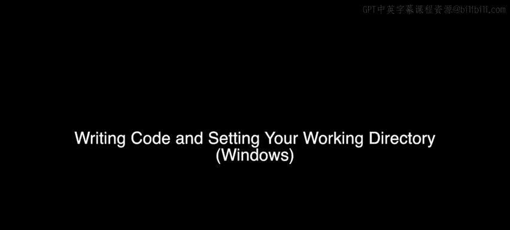
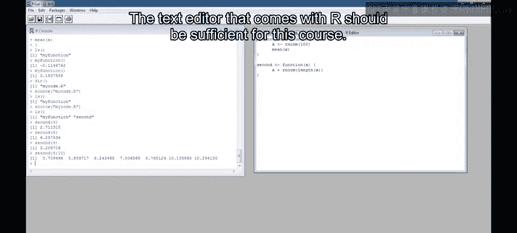

# 约翰霍普金斯大学数据科学课程2：《R编程课程》｜r-programming｜中英字幕 - P4：3_编写代码 设置工作目录 windows.zh_en - GPT中英字幕课程资源 - BV1114y1k78X

In this video I want to talk about two things， how to set your working directory and how to edit our code files in Windows so you can see I've got R started up here and the first thing you're going to want to do is figure out what your working directory is because the working directory is where R finds all of its files for reading and for writing on your computer。

So you can find out what your working victory is currently set to be by using the getWD function。

And you can see it's set to be C colon/us/rDPang/ documents。

 This may differ on your computer depending on what version of windows you're using and what hardware you're using。

 but there will be some directory probably on your C drive。

Now the reason why it's important to know and to set your working directory is because when you read data or when you write things out using functions like read or write CSV。

 they will be read or written to your home your working directory So for example。

 if I do something like read CSv， I want to read thisll say my data CSV。

 if the file is not in my working directory， you'll get an error one that looks much like this because it can't find the file in the working directory。

 So one possibility is that you can if you know where this file is you can move it to your working directory or you can change your working directory to be wherever this file happens to be。

 So I can go to the file menu here。And choose change Deer。

And I'm going to go into my local disc here。Go users already paying。And I'm go to my desktop here。

So now if I type DIR， I'll get a list of the files that are on my desktop here and see that oh lo and behold here is my data。

 CSv file， so now I can say read docB and then my data CSV。

And you can see that the data will be printed to the console because now it can find the file in my working directory。

So thing one thing that I suggest that you do for this course is to perhaps create a single directory or a single folder where you can put all of your materials for the course and not have to worry about them being scattered all over the place anytime you download something from the website or create a new file。

 it's probably best to store it all in one folder so that you don't have to be searching all over for it that way you can always set your working director to be that directory and not have to worry about changing it。

So I'm going to minimize R here for a second I'm going to create a folder on the desktop I'll just call Coursera。

And I'm going to use this folder for everything that I do in this course， so if I go back to R here。

 I can say change working directory again， change De。And go to local disk users。Ay paying。

Now this folder is on my desktop， so' my desktop， and then it's courseurra here。So now， obviously。

 get WD。You see the working directory has changed this Coursera folder。

So one of the things you're going to have to do a lot of in this class is to write our code in order to write our code you need to be able to use a text editorLuckily R comes with a rudimentary text editor which will be definitely sufficient for this course so you can load up the text editor by going to file and say new script。

And this will give you a blank window that you can use to write our code。

So I'm going to write a simple function here， it's going to be my function。嗯。

It's not going to take any arguments， and all it's going to do is going to simulate some normal random variables。

And then it's going to take the mean of those guys。All right， so this is a simple function。

Now the question is， how do I get this R code into my R consoles that I can actually use the function because you'll notice if I go into the R console here。

 I type my function。I can't find the function because I haven't loaded into R yet。 if I type LS。

 you'll see that there's nothing in my workspace right now because I haven't loaded any R code into there。

 So how don't we get the R code into the R console Well。

 there's two ways if you just have a little bit of code like this function over here I can click into my R editor and just hit control A to select all and then control C to copy and I click back into the console and I can control V to paste Now I've just pasted the code into R and you'll see that if I type LS I've got my my function there I can execute it if by just calling it and you'll see it'll give you the mean of 100 random normal random variables if I do it again。

 it'll give me a slightly different number because it'll simulate a different set of numbers the other thing you can do is go into my R editor。

And you can go to the file menu。And can click save as So now you can hit save as you can save the file into your Coursera folder here。

 which I'm going to do right now。And you can save it as whatever name you want。

 so I'm going to call it my code。 R。Dot R is conventional for the extension。So now have I typed DIR。

 excuse me in my console window here。You'll see that there's a file called Mycode。

 R and you can load this into R using the source function， so I can say mycode。 R。

And that loads all the code that is in this file， of course that's just the my function。

 so I haven't done anything new here， but let's say I want to add another function here is let's say second for my second function and it'll take an argument X and it'll take X and it'll add a little bit of noise to it。

With the R& R function。So now I've got two functions here。

 I can save my file with this little disc icon or I can go to file the file menu and hit save。

And I'm going to source this file again。Now when I type LS。

 you'll see that I've got this second function there and I type second， let's say4。

I get a number that's 4 plus a little bit of random noise so I me get4 again。

 the same thing will happen I can say 4 through 10 and it'll give me each one of those numbers with a little bit of random noise edit on so that's how I edit code and that's how I load the code into R every time you edit your file in the editor you have to save it and then if you want that code to be available in R you have to use the source function to source that file back into R you don't have to use a single file you can add a new file you can say new script It'll open another window you can save this to be a different file if you want。

 so that way you can separate code for different projects or different assignments。

If you close the file here。😊，You can always open it back up again by hitting the open button and you can see my code is right there。

 if I open it up' see you'll have all your code right back there again。

 So that's how you edit code in R。's now there's many other text editors that you might see on the web that you can download and those are fine to use but they're not really necessary。

 The text editor that comes with R should be sufficient for this course。

