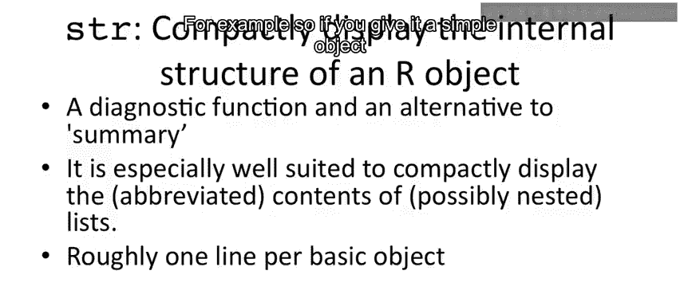
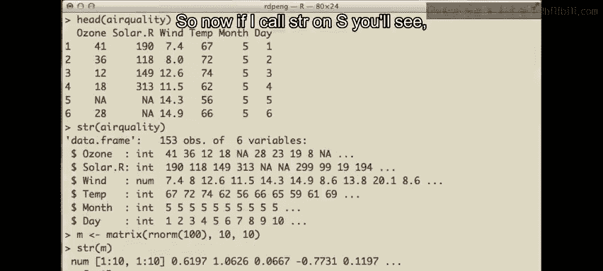

# 约翰霍普金斯大学数据科学课程2：《R编程课程》｜r-programming｜中英字幕 - P50：49_str函数.zh_en - GPT中英字幕课程资源 - BV1114y1k78X

This video is about the most important function in all of our the stir function。

 This function is really handy。 It's really useful。

 I use it all the time and you can use it in all kinds of situations。

 just to help you to look at R object。 So the idea behind the stir function is that it's supposed to compactly display the internal structure of an R object。

 So STR STR you can think of as being meaning structure。 So it's a very simple diagnostic function。

 It's very versatile and the idea is you can use it as like an alternative to summary。

 So if you want to look at an object and see and see what is it and what's in it you can use summary。

 which will often be very useful but stir is another object particularly well suited for compactly displaying large lists which may contain nested lists and also and its goal is to produce roughly one line of output per basic object。

 for example， if you give it a simple object like a vector， it'll give you one line of output back。

Printted to the console。 And so the basic goal of stir is to answer the question。

 what's in this object？I'm going to start up R here。

 and I'm going to just give a little demonstration of how the stir function can work。

 So here you can apply stir itself， and you see it it's a function that takes an object and you can take any R object。

 so you can apply stir to other functions。 So as let's say I want to know what the LM function does。

So here what it gives you， it gives you the function arguments for the LM function。

 so here you can see it's a very brief summary， you take the first arguments of formula。

 the second arguments， data， etc。 I can look at maybe the Ls function and it gives me what are the arguments for the LS function So if you want to look at some data though let's say I'm going to generate some normal random variables here。

100 of them let's say mean two and standard deviation4 one thing you can do is just do summary on x and thatll give you like a five number summary plus the mean so you get the mean median this 25th7 percentiles and the min in the max So that gives you a rough sense of what the range is and how it varies you can also call stir on x and it'll give you a little bit more information So it'll give you one line out but it tells you that x is a numeric vector there are 100 elements and it'll give you the first five numbers in this vector so you can get a sense of of what the data look like。

So you can apply stird to other types of vectors， so here I can create like a factor variable。

 so this is the factor that has 40 levels and each one is repeated 10 times if I call stir on it。

It'll give me a one line output again so here it tells me it's a factor it's got 40 levels。

 level the first four of them are named 1，2，3 and 4， so that's not particularly interesting。

 And then here I say the first couple elements of this factor are all have the label1 So you can also call summary on a factor and you can see that the outputs a little bit different And what this does is it gives you the number of elements in each of the 40 different levels so that's another piece of data that's not quite as compact of output as STR gives you。

So you can use ST for other types data types， so here I can load like a data frame。

Here's the air quality data set， so if I look at the air quality data set I can use the head function to look at the first six rows。

 or I can call stir。To get a little some different output so here it tells me it's a data frame。

 it tells me that there's are 153 observations， so 153 rows in this data frame of six variables and then for each variable it gives me a little output so it tells me that the name of the first variable is ozone。

 it's an integer variable and here the first couple of observations succeeded as some nas there so that's useful to know the second variable is called solar R and it's also integer and you can see that the first couple of values so the stir output here is very useful for kind of just giving you a quick examination of data that you might have in R and what the structure of different R objects is。

We can take this a little bit farther。 so for example， we could create a little matrix here。

 I'm going to put some random normals in there。And it'll be a 10 by 10 matrix。Call stir on M。

 see it'll give me a little bit more information。 And now it knows that it's a matrix。

 it'll say it's a two dimensional array。 it's got 10 rows and 10 columns。

 And here are the first couple elements。 So that's going to be the first column that you're seeing there。

 So if I just print out the first column here， you'll see that that's what it's giving me in the stir output。

The last thing I'll do here is create a little list using the split function and see how stir can look at the list and give a compact summary of it。

 So I'm just going to take this air quality data frame and split it by the month。

 So here I got an air quality。 Im split it by。The month variable。

And so now if I call St on S you'll see there a bit of an output that flies by。

 you see now this is a list that contains five different data frames where each data frame corresponds to the data for a given month So the month the data are only collected over five different months that's why there's only five elements So here you can see that month month5 which is May 31 observations on six variables and that's a little bit of what the data look like you can see for June here there's 30 observations on six variables again。

 same six variables of course and that's what the data look like there and then for July the data are here and August in September so you can see you can have a representation of this split list that's kind of it's not as compact as it was before but it's about as compact as you can make it and STR will provide a very nice summer you can take a quick look at the data。

 see if there's any problem， see there's missing values and get a sense of what to do next So that's the stir function I will repeat again I think it's the most useful function in all of our and you can use it in all cases I encourage。

You to use it anytime you have an R object and you don't know what's there。

