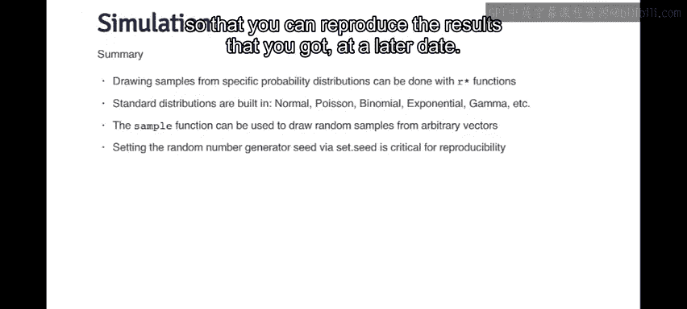

# 约翰霍普金斯大学数据科学课程2：《R编程课程》｜r-programming｜中英字幕 - P53：52_模拟 随机采样.zh_en - GPT中英字幕课程资源 - BV1114y1k78X

So the last function I want to talk about is the sample function and the sample function allows you to draw randomly from a specific set of objects that you specify。

 so if you give it a vector of numbers it allows you to draw a random sample from that vector of numbers and so you can kind of create any arbitrary distribution that you want by specifying a vector of objects and then sampling from it。

 so here for example I'm going to sample from the integers 1 to 10。

 so I pass it the vector of integers 1 through 10 and I tell it that I want to sample randomly four of them without replacement。

So I'm just choosing four random entries from 1 to 10 and here I get 3457 if I do it again。

 I'll get 3985 so in this example I won't get repeated numbers because I'm not sampling with replacement。

I don't have to just sample numbers。 I could sample letters if I wanted to。

 so here I'm taking the letters A through Z， and I' was going to sample five of them without replacement and I just get Q B。

 E X and P。 Now what happens if I don't specify anything I just give it the vector of objects。

 So here I'm passing sample the vector1 through 10 and if I don't specify anything else。

 What it does is it gives me a permutation of those。

 So here the vector1 through 10 is just permut it in a random order。 if I call it again。

 I I get yet another permutation。So lastly， if I wanted to sample from 1 through 10。

 but with replacement， I can specify the replace equals true argument。

 so now I'm sampling1 through 10， I'm getting a vector of 10 numbers from the vector 1 through 1 but because it's with replacement I can get repeat so you can see I got eight three times and I got nine multiple times。

So that's how you sample with replacement。So that's a very quick summary of the simulation functions in R you can draw random samples from specific probability distributions with the R functions so r norm plus r poise R byome we saw already all the standard distributions are going to be built in that probably you will need things like the normal。

 the poisson the bin noial and exponential gamma etc。

 all those functions are built in and you can use the corresponding R functions to simulate from them the sample function can be used to draw random samples from arbitrary vectors so if you want to kind of create your own distribution here and then it's very important to remember to set the random number generator C anytime you simulate data in R so that you can reproduce the results that youve got at a later date。

