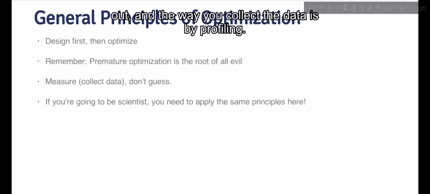
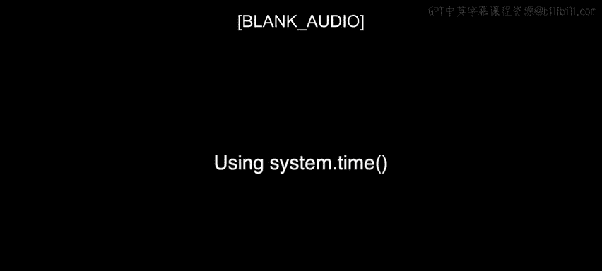
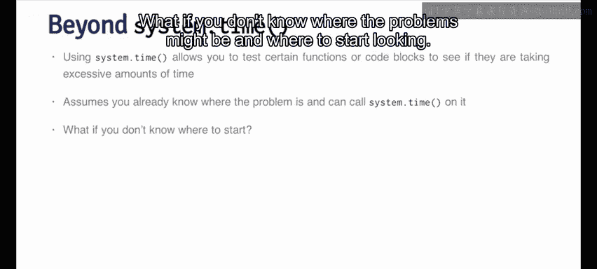

# 约翰霍普金斯大学数据科学课程2：《R编程课程》｜r-programming｜中英字幕 - P54：53_r分析器部分1.zh_en - GPT中英字幕课程资源 - BV1114y1k78X

The profiler in R is a really handy tool for when you're developing larger programs or doing really big data analyses and you're essentially you're running R code that's taking a lot of time or longer than then you want to wait and of course that's all relative depending on kind of what you're working on and maybe there are other things that you can do while you're running a program but if something's taking a long time。

 the profiler is a really handy tool to figure out exactly why it's taking so much time how and to suggest kind of strategies for fixing your problem and so I'm going to talk a little bit about using the R profiler and kind of talking about when you might need to use it。

There are also some other tools that I'll talk about that'll help you kind of time your programs and time your functions and so the conjunction of the profile with these other tools is a really handy toolbox for figuring out how to optimize your software。

So the first question you want to ask yourself is you know is your code actually running slowly and sometimes you can solve this problem by just running your program and then going in doing something else。

 but sometimes that's not an option and you need your program to really run quickly and so profiling a general is a systematic way to examine how much time is being spent in various parts of your program。

And it's particularly useful when you're trying to optimize your code， when you're trying to squeeze。

 you know a lot of efficiency of out of some code and a lot of times when you first start writing code。

 it runs fine you know when you're running it once and maybe you're writing a small piece of a function or a small piece of a larger program and it looks great when you're running it。

 it seems to run very quickly when you're doing it， but then sometimes these pieces get embedded。😊。

In a much larger program， it maybe a larger program is running your piece 1000 times or a 5000 times or even 10000 times。

 and then your one little piece， which was running great when you were running it。

 it's kind of slowing down everything else because it's being run 10000 times and so now you need to make it a lot faster because it's being iterated over a lot。

 and so it profiling can come into play when for example。

 if you have a piece of code that runs great。 but then when it gets embedded in a larger piece。

 it starts it speed becomes much more noticeable。So in general。

 when it comes to optimizing your code， the general rule is that you shouldn't do it。

 And what I mean by that is that you shouldn't think about it at first。

 shouldn the first thing that you think you should think about。Is is that is kind of how。

 how to get the code to run， how to make it readable。

 how to make sure that other people can understand what you're doing。 And because。

 and one of the reasons is that。It's often difficult to understand where exactly your program is spending all of its time and in order for you to speed up your program。

 you need to be able to know where it's spending its time and so this can't be done without any kind of it's difficult to do this。

 I should say without any formal performance analysis of profiling。

And so the basic idea is that you should always design your code first and make it so it's understandable。

 And then after you've got something working， then try to optimize it。

 and the famous phrase is you know premature optimization is the root of all evil。

 If you try to optimize first， the chances are that you'll introduce bugs before you even have it get a chance to kind of get things working in the first place。

 Once you've decided that you want to optimize your code， though。

You should act like a scientist just like you would in any other context。

 you should collect some data right so if you have a sense of where your program is kind of being bogged down or where it's spending all the time。

 you should collect the data to figure it out and the way that you collect the data is by profiling。

So the first tool I'm going to talk about is actually not the profiler。

 It's a very simple function called system do time in R。

 And what system do time does is it takes an arbitrary R expression and it evaluates that expression and then tells you the amount of time it took to evaluate that expression。

 Now， this expression could be very simple like a single function call。

 or it could be very complicated if it happens to be wrapped in curly braces。

 it could be actually a very long expression if you want it to be。So。

The basic idea is that you take this expression and it gives you the time in seconds that was needed to execute the expression if there's an error in the code while the expression is being evaluated。

 then you'll get the time until the error occurred。Now。

There's two very important notions of time when you're executing an expression on the computer。

 The first is called the user time， and this is the amount of time that's charged to the CPU or its CPUs for running this expression so this is the kind of time that the computer experiences。

Roughly speaking， the elapsed time is sometimes called the wall clock time。

 And this is the amount of time that you experience。 Alright。

 so the the so even though youre the user， you're not the user time， you。

 you experience the elapsed time。And so the two different notions of time can have kind of different importance depending on what you care about。

So usually the user time and the elapsse time are relatively close because the amount of time that the computer spends to using executing your function or your expression is roughly equal to the amount of time that you spend waiting for it these are for standard kind of computing types of tasks however。

 there are times when the elapsse time will be greater than the user time and there will be times when the elapsse time is smaller than the user time。

So the elapsse time can be greater than the user time。

 so that means that you spend kind of more time waiting around than the computer actually spent dealing with your code and and the idea is that the computer may spend a lot of time waiting around for other things that happen things that are maybe external to the program itself。

 and so the CPU doesn't actually spend a lot of time working on your code。

 it may be spending a lot of time working on other things that are going on in the background。

If the elapsse time is smaller than the user time， this most commonly occurs if your machine has multiple cores or processor and is capable of exploiting them and so so most computers these days have at least two or four cores or multi corere machines and so this is a very common situation。

 however it's not always that the program that you're running。

 will be able to kind of exploit the use of multiple cores， in particular R。

 the basic R program does not use multiple cores as of yet。However。

 it often links to libraries that do use multiple courses and the most common one will be that a linear algebra type of libraries。

 so if you're doing something like regression or a lot of these prediction routines or matrix computations。

 these all involve linear algebra libraries and many of these libraries have been optimized to use multiple course。

 and so they're called multi-threaded class libraries are for the basic linear algebra standard libraries。

 subroutines libraries and on the Mac sometimes called Vlib or accelerate。

There are more general libraries like Atlas， for AMD machines。

 there's AML or ACML and for Intel machines， there's MKL。There's also parallel processing libraries。

 for example， the parallel package use which can use multiple cores。

 but it can also use multiple computers， and so this will potentially lead to a program that takes more user time than it does a lapse time and I'll give an example of how this will work。

So one example of when the lapse time will be bigger than the user time is if you read something from the web。

 so here I'm just using the read liness function to read a web page off a remote server and you can see that the lapse time is about 0。

4 seconds but the user time is 0。004 seconds so the CPU actually doesn't spend a lot of time running this code because the chunk of the time is just spent waiting for the network waiting for the data to kind of go over the network and to come back to your computer and so waiting for the network to kind of deal with the data going there and coming back is not really part of your program is part of a different thing that the computer is doing and so the amount of time executing your program in this case just the read lines function is relatively small。

In the second example， this is where the eapse time is less than the user time。

 I've created a simple function which creates a Hilbert type matrix。

 and I calculate the singular value conversation of this matrix with the SVD so the SVD function makes use the accelerate framework on the Mac and which is a multithreaded linear algebra library and so it can take advantage of the two different cores of this computer that I'm using and so you can see that the user time。

Was roughly almost double of the eappsse time， so the eapse time was about 0。

7 seconds and the user' time was about 1。6 seconds and the reason is because the underlying linear algebra library split the computation across the two cores and so you can think of it is that basically the elapsseed time was multiplied times two because it was being executed on two different CPUs。

 so the amount of time that the the CPU spent working on your program was actually more than the amount of time that you spent waiting for it to come back。

You can time longer expressions by just wrapping everything in in a set of curly braces so here I've got a for loop here that's just generating some random normal variables and you can wrap that whole thing in curly braces and call system time around it and you can see that here this is a very simple expression it's not multithreaded。

 there's no network activity and so the user time and the elase time are basically the same。

So the system time is a really handy function if you just want to take a little piece of code。

 figure out how long it takes to run it and it may kind of go through a program maybe be expression by expression or align my line to see which parts are taking a lot of time Now the part of the problem with system time is that it assumes that you know where to look it assumes that you know where the problem is and that you can call system time on a given expression。

And so this may be useful for smaller programs for less complicated programs where you have a very good sense of kind of where the bottlenecks are。

 but the question is you know what if you don't know where to start。

 what if you don't know where the problems might be and where to start looking and so you need another functioner to kind of help you along with that。

