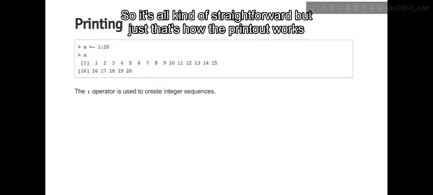

# 约翰霍普金斯大学数据科学课程2：《R编程课程》｜r-programming｜中英字幕 - P9：8_r控制台输入和求值.zh_en - GPT中英字幕课程资源 - BV1114y1k78X

So once we start typing things into the R prompts， then we're going to start coding and doing calculation so the things that we type into the R prompts are called expressions。

 so for example the symbol which looks like a left- hand arrow and is actually the less than symbol followed by a hyphen。

 this is what's called the assignment operator the assignment operator is what assigns a value to a symbol。

 so for example in this first expression here， the symbol that I'm creating is called X in the value that I'm assigning it is one。

and I use the assignment operator to create that so x is one is an R expression and the next expression I'm going to print that value。

 so print is a function and I'm passing it the symbol x so when I print out x I get its value which in this case is1 so another thing to think about is x is also considered is an R object that is a numeric object that has one element so it's really a numeric vector where the first element is the number one。

In the third expression here， you'll notice I'm just typing x at the prompt and when you hit enter。

 what happens is it prints out the value of x so this is called。

This is another way to print out an object without explicitly calling the print function。

So in this expression over here， I'm creating a new symbol called message MSG。

 and I'm assigning at a value of the string hellello right so now this is a character vector and the first element of this character vector is the string hellello。

 I could add other elements to this vector if I wanted to but they would all have to be character。

So the grammar of a language determines whether an expression is exactlyly correct or not or whether it's complete so for example。

 if I just type X followed by the assignment operator and I don't type anything else。

 that's not a complete expression and so when I hit enter nothing will happen because it's waiting for the expression to be completed the other thing Ive got here is this hash symbol here so this hash symbol here indicates that everything to the right of that is a comment and so the R engine will ignore anything that happens to the right of that symbol so you can put things like comments or notes to yourself in code and R will just ignore those comments。

So once you've typed in a staactically valid and complete expression at the prompt。

 when you hit enter， what happens is that the expression is evaluated by the R engine and the result of that expression is then returned。

 and so sometimes when you evaluate an expression， nothing happens because there's nothing to really show and so for example in the first expression here when I say x is assigned to be5。

 so I'm creating an object called X it's a numeric vector and the first element is going to be5。

Now when I hit enter， nothing happens and because there's really nothing to show and so but now when I hit X and I hit enter。

 it prints out the value 5， so it prints out the value of x so when I hit x when I type in X and I hit enter that and it prints out five。

 that's called auto printing and so when you just type an object's name and hit enter。

R will by the default， auto print the value of that。

Object this is the same as calling the print function on that object。

 which will just print out the value of that object so you can explicitly print an object or you can auto print an object。

 So this this sounds a little complicated， but it's really just the natural thing to do and it's what most people would expect you'll notice that when I print out the object X is a little one in brackets here and you might be wondering what that is。

 So all that indicates is that it' telling you what element of the vector is being shown。

 and this will make more sense when we have a longer vectors to look at。

 but all this a shame saying is that the number five that you're seeing there is the first element of the vector。

So for printing， you'll see that here I'm creating an x an object called X and it's the sequence1 to 20 so the colon operator here that I've used is what's used to create a sequence So when I say one colon 20 that creates a sequence of 1。

2，3 all the way up to 20。 so now when I autoprint X in this case you'll see I've got a much longer vector here in this case is an integer vector and you'll see that the first line of the printout has a one next week because that's the first element and then the second line has a 16 in Bs because that's the first element of that line is the 16th element of this vector so it's all kind of straightforward but that's how the printout works。

