# 约翰霍普金斯大学数据科学课程3：《获取和清理数据课程（约翰霍普金斯大学）》｜data-cleaning｜ - P16：15_汇总数据.zh_en - GPT中英字幕课程资源 - BV1wu411P7yX

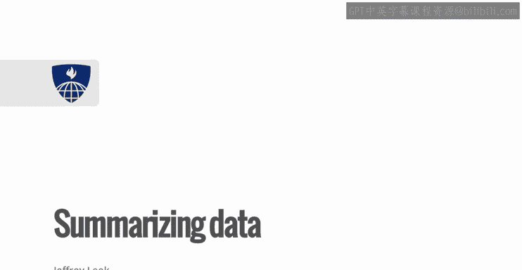

So the key process of data cleaning is looking at the data that you've loaded into R and identifying any sort of quirks or weird issues or missing values or other problems that you need to address before you can do downstream analysis so the first thing that you want to going to be able to do is summarize the data that you have loaded in。

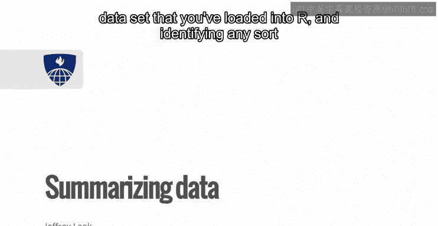

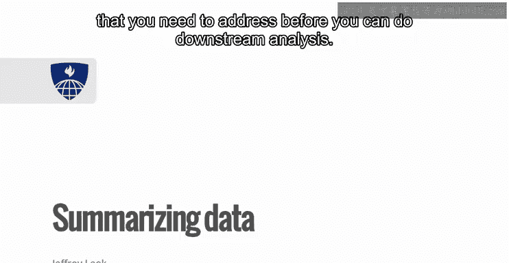

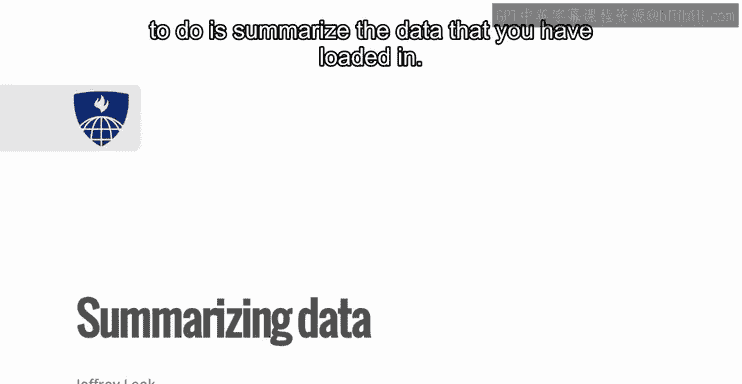

So we're going to be looking at this example data here and this is actually a dataset about restaurants in Baltimore。

 and so we've collected this data again from the web and so if you go to this URL and then you go to exportport。

 you'll be able to see a list of different versions of this dataset。

 we're going to look at the CSV version of the data。

And so we create a data directory and again this is the URL that points to the CSV version of the data that we're going to be talking about。

 the Baltimore City data， and so we're going to download that file and then read it in with read。

csv so this is what you remember from reading data in from the internet sources。

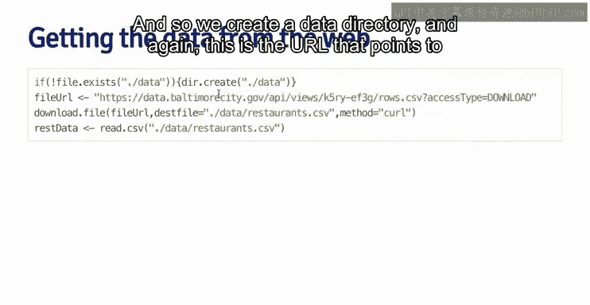

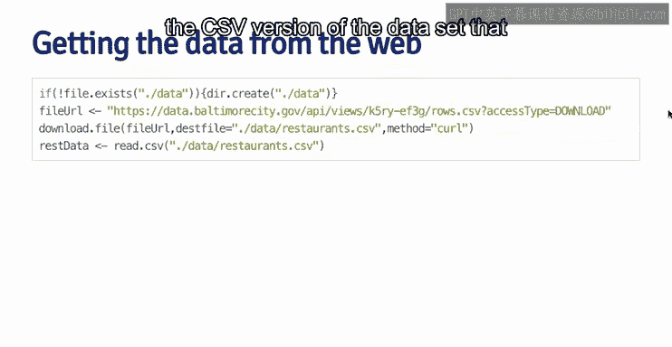

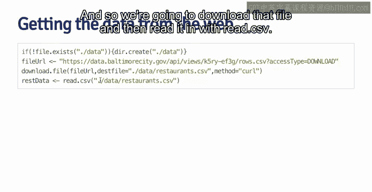

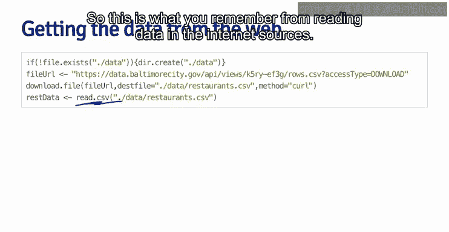

So the first thing that you're going to want to do is look at your data set so one thing that you can do is just type the name of the data frame that we have so in this case it could be rest data。

 you could just type that in and hit return and it will return the entire data frame but often the data frame will be a little bit too big for you to be able to see it all very neatly so the first command that we're going to talk about is the head command。

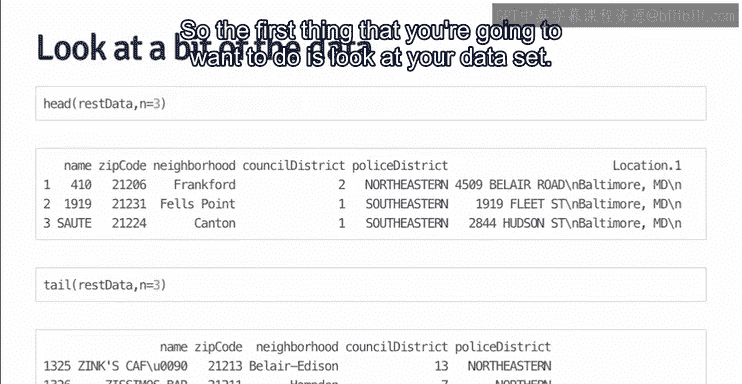

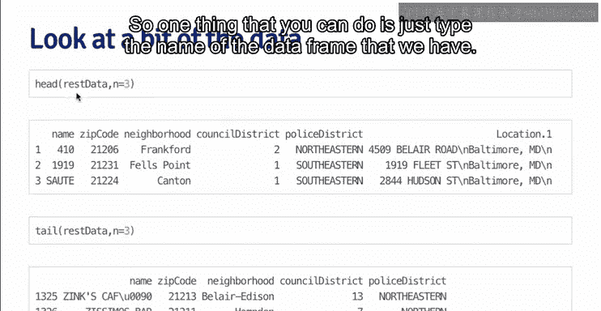

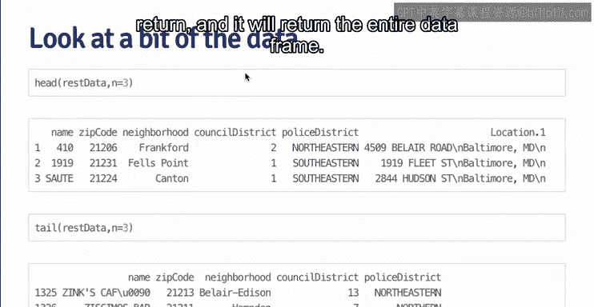

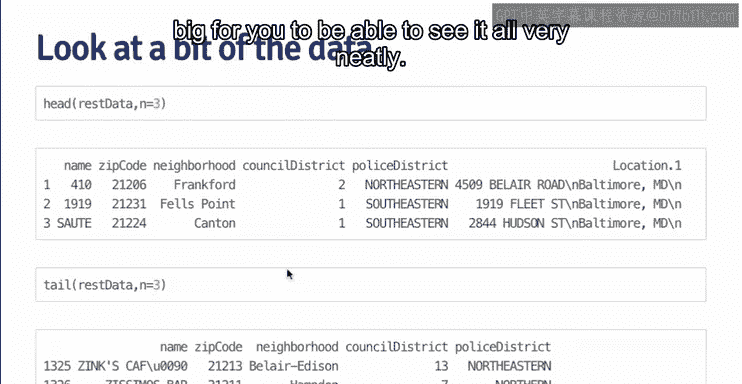

So if I type head of the data frame that I'm interested in and I tell it the number of rows that I should report。

 it'll just show me the top three in this case rows from that data frame by default。

 it'll show me the top six rows of any data frame so if I don't give it the end command or the n parameter it will just return the top six rows of the data frame。

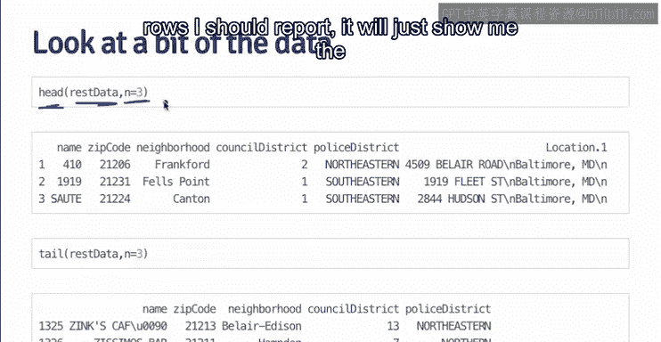

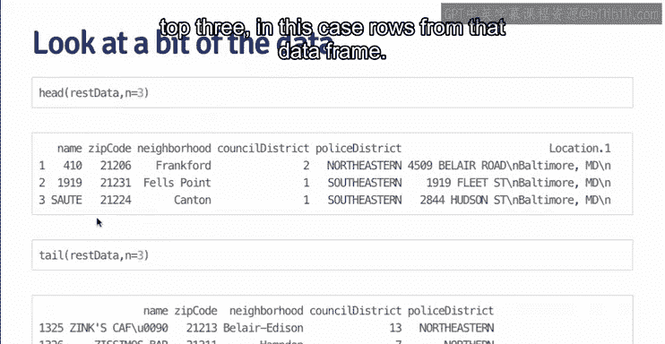

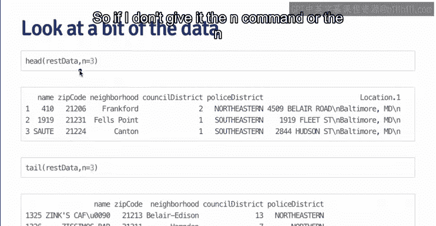

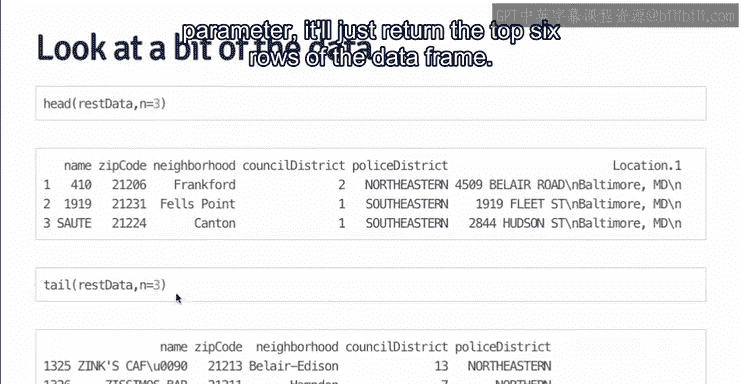

The tail command is another command that will give you a little bit of the data set in this case。

 itll show you the bottom part of the data， so if I pass at this data frame until it n equals 3。

 it'll show me the bottom three rows of the data frame。

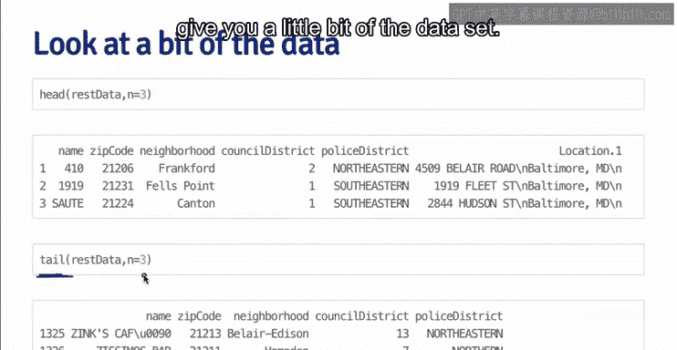

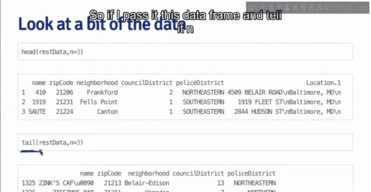

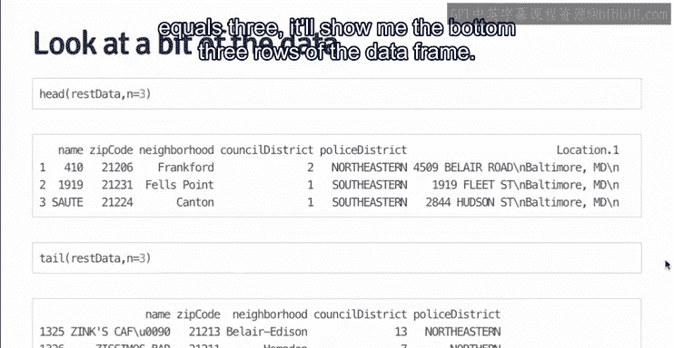

The other thing that we can do is we can use the summary command to get a little bit of an overall summary of the dataset that we have and so what this will do is for every single variable。

 it'll give you some information for variables that are textbased variables or factor variables it will tell you the count of each factor so for example in this dataset there are eight McDonald's and there are seven popeyes fit and spreaded chicken for variables that are quantitative in this case it's treating zip code is a quantitative variable it'll tell you the minimum the first quant the median and so forth So this is already given us an interesting bit of information because one of the zip codes is actually coded as a negative value which obviously probably shouldn't have had。

You can also use the STR command to give you a little bit more information about the data frame so here it tells you the class of variable it is is a data frame if it was a matrix it would tell you it was a matrix。

 it tells you a little bit about the dimensions of the data frame that you have and then it also tells you all the different classes that the different columns correspond to so for example neighborhood is a factor。

 zip code is an integer and so forth so that gives you a little bit of extra information so that you can know if you need to manipulate things and change quantitative variables to qualitative and so forth。

You can use quantile to look at variability in quantitative variables， so for example。

 if I look at the quantile of the canceled district variable。

 if I look at that variable I see that the smallest value is  one and the top value is 14 and the median value is 9。

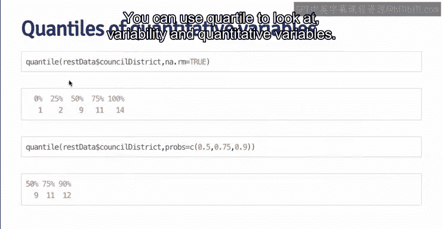

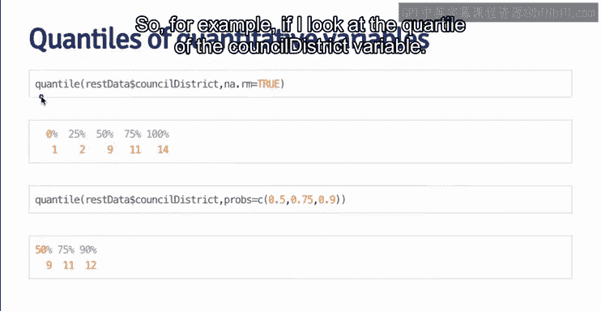

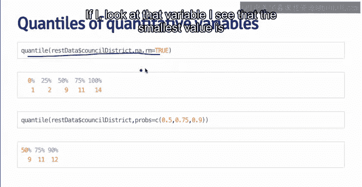

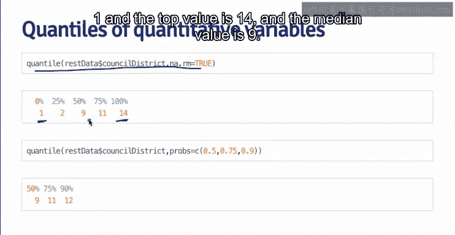

So you can also tell it to look at different probabilities so if I pass quantile pros。

 it will look at different quantiles of the distribution。

 so the zeroth quantile is the minimum value， the 0。

5 quantile is the median the 99th quantile you can think of it as sort of the 99th percentile of the data set so you can do this to look at different percentiles if you're interested in them。

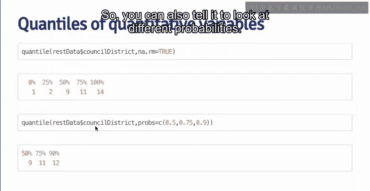

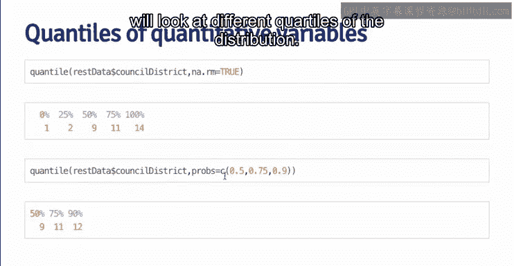

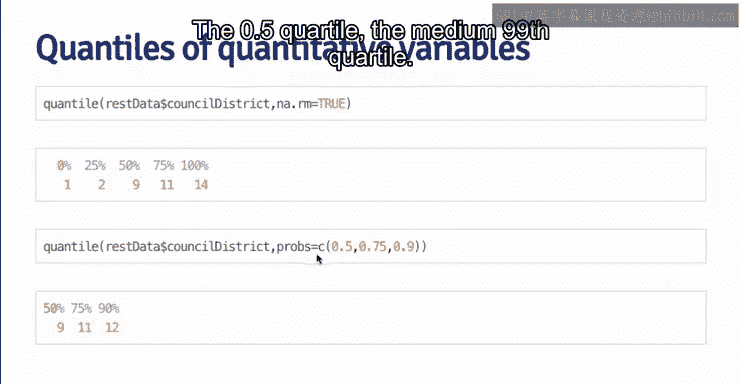

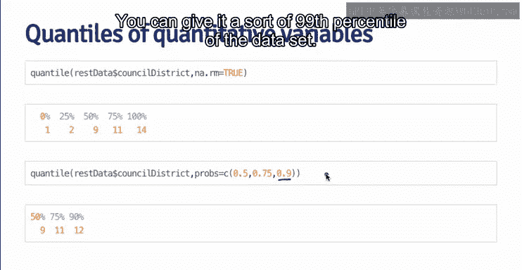

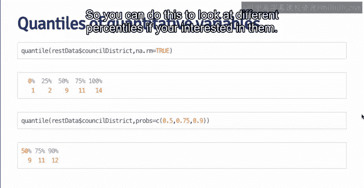

You can also make tables so another way to look at the data is to look at specific variables and make a table and so in this case we're making zip code table and we can see that only one of variant one zip code is quoted as a negative value you can also see where the bulk of the zip code values are so for example。

 21201 has a lot of values so is 21202 and 2 and224 and so forth。

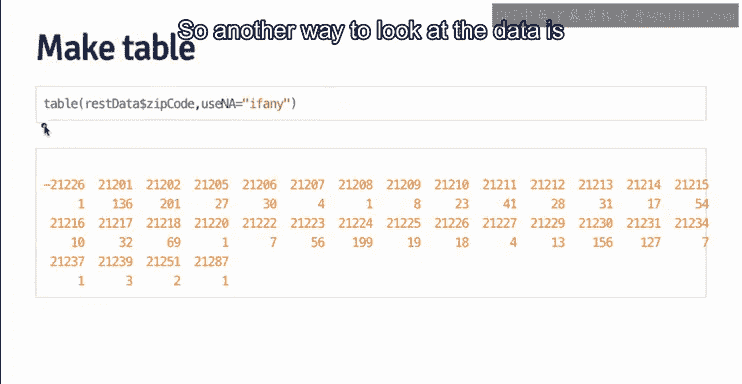

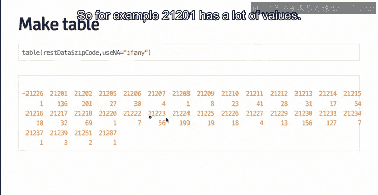

I've added a little bit here to the inside the table command， I say use NA if any。

 and so what this will mean is if there's any missing values。

 there'll be an added column to this table， which will be NA and it'll tell you the number of missing values there is。

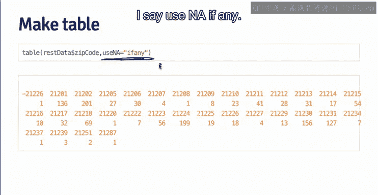

By default， the table function in R actually does not tell you the number of missing values。

 so it's important to use the command use NA， if any。

 to make sure that you're not missing missing values。

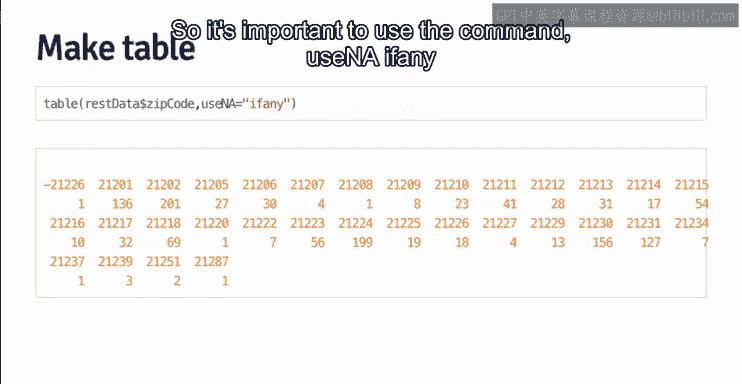

You can also make twodial tables so in this case I'm again using the table command and now I'm passing two variables。

 the council district and the zip code and so now it breaks down a table that's two dimensional by zip code and by district and so for example you see that district 2 has 27 restaurants in the 21206 zip code and so you can do this for different qualitative variables and get a sense of the relationship between those variables。

The next thing you might want to do is check for missing values so the function that can be useful there is the isna function。

 so if you use the is dona function and apply it to this variable。

 the council district and then take the sum of the times it's NA isna will return a1 if it's missing and a zero if it's not missing。

 so if the sum is equal to  zero that means there are no missing values。

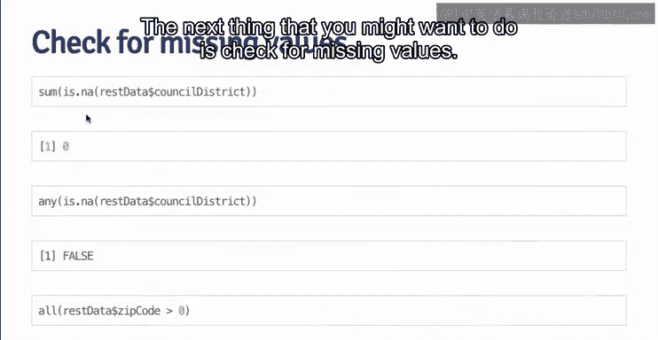

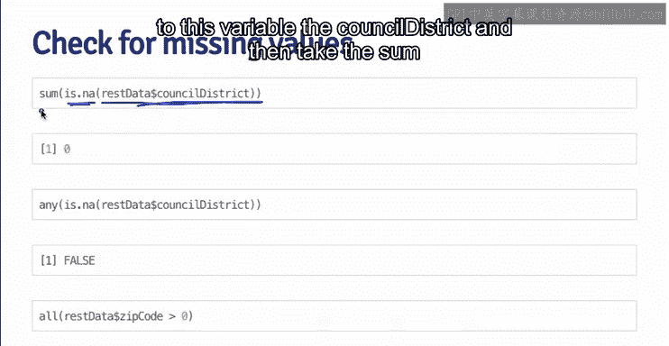

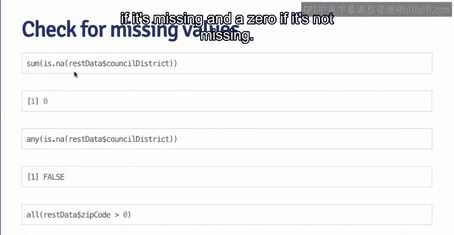

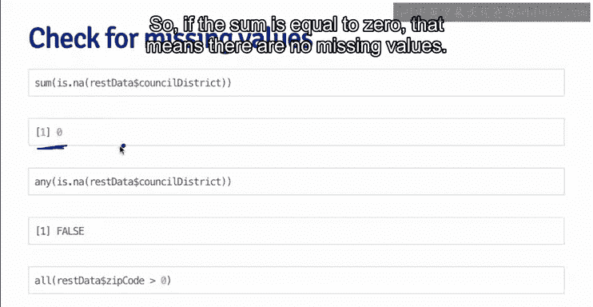

You can also use the any command， the any command will just look through this entire set of values in this case is NA returns true or false and what it can do is then check and see if any of these values are equal to true in that case there would be any value that's equal to NA in this case none of the values are NA so any returns false because all of the values are false theyre none of them are NA。

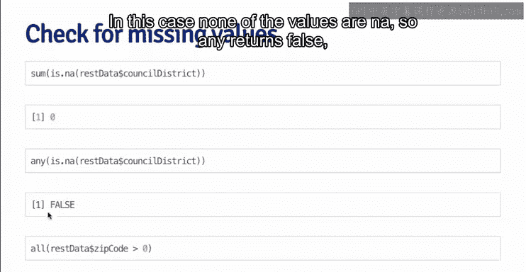

You can also look at all， all will check and see if so， for example。

 every single value satisfies a condition， so we would hope that all the zip codes are greater than zero。

 but it turns out that actually one of them isn't greater than zero so you can see that again with this all command。

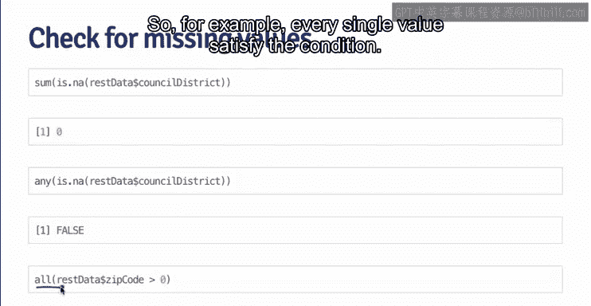

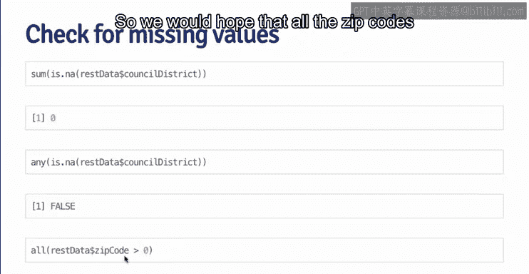

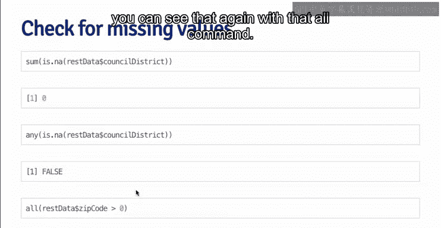

Another thing that you might want to do is take sums， so for example。

 you might want to take sums across columns or across rows。

 you can do that with the call sums and row sums command。

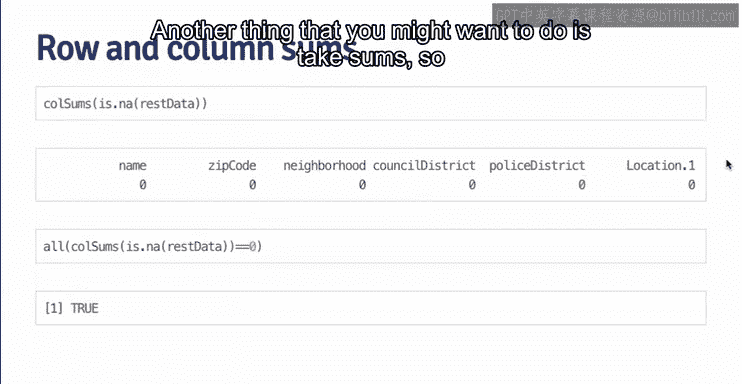

So here I'm going to take the column sums of the I do NA applied to the entire dataset。

 so I've applied I dona to the dataset and that will be true whenever there's an NA value and false whenever there isn't one。

 and then I take the sum down every column of that variable and I see that there are zero NA values for every single variable in this dataset。

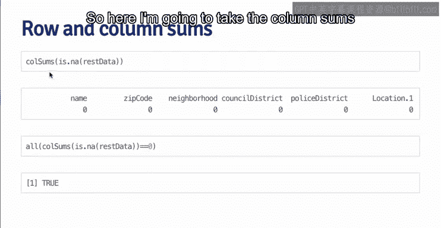

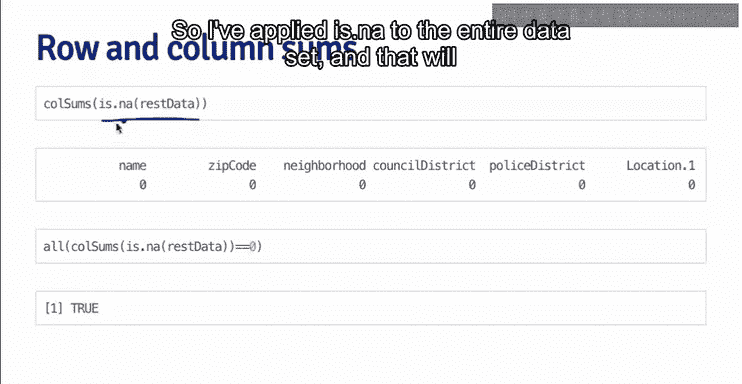

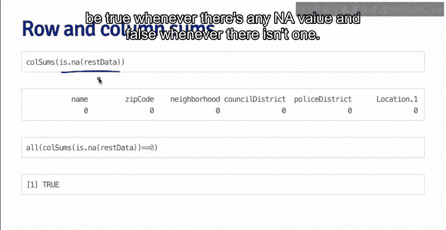

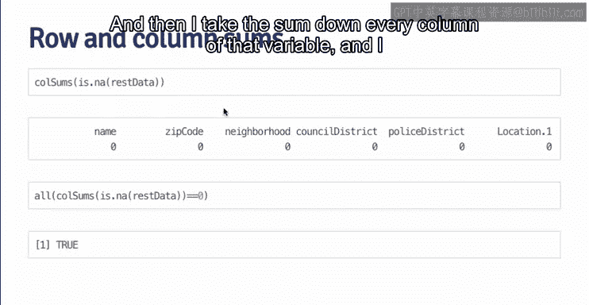

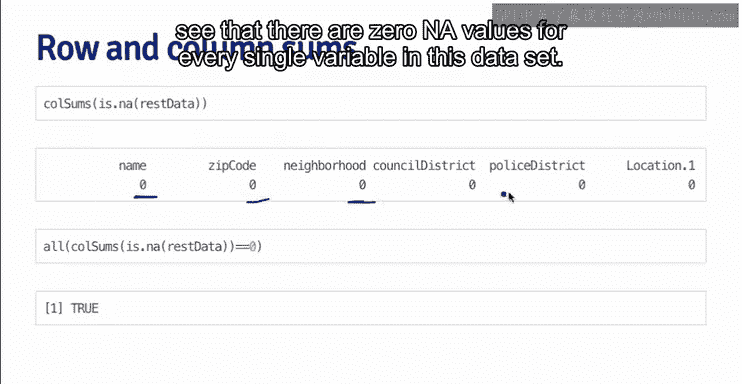

And then I can apply all to the column sums and show that all of them are equal to zero。

 in other words， there are no missing values in this data set。😊。

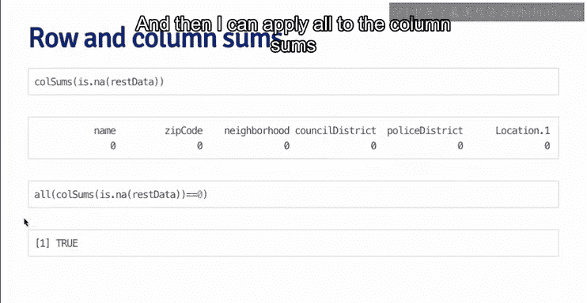

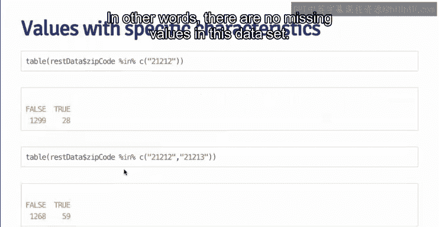

I can use some other commands to find specific characteristics within the dataset。 So for example。

 suppose I want to find all the zip codes that are equal to212 and2。

 I could just use the equals equals command to see if that's true。

 but I could also say are there any values of this variable that fall into this vector over here in this case are there any values that are2 and2 and2 That's not very useful when you only have one value you care about but suppose you want to find all the zip codes that are either equal to 2 and2 and2 or2 and2 and3 then you can use the percent in percent command to say are there any zip codes that are either equal to one or the other of these values and so in this case you see there's a few more of this 59 values that are equal to either 2 and2 and2 or2 and2 and3。

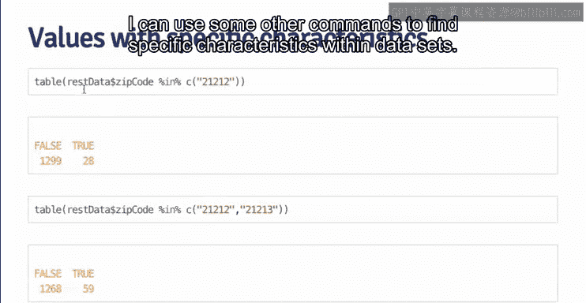

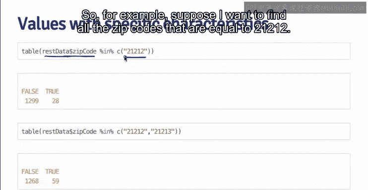

The next thing that you can do is you can actually use this logical variable that you've created by doing this to subset a data。

 so suppose I want to get only the restaurants that appear in either two and two and2 or two and two and three I would create this logical variable here with the percent in percent function。

 and then I would pass that to the row subsetting component of the rest data variable and what would end up happening is I would end up with only the rows that were equal to two and two and2 or two and two and three zip codes。

The next thing you might want to do is make some sort of summaries or cross tabs about the data sets that you observed。

 so for example I'm loading here data on Berkeley admissions data。

 this is sort of one of the classics data sets in R and so I can create a data frame using that data set and if I do a summary I can see that there are four variables admit gender department and frequency and so it tells you how many people of each of the different categories are admitted to Berkeley。

So one thing that you might want to do is make cross tab so identify where the relationships exist in this data so what you can do is on the left this is going to be the variable that you want to be displayed actually in the table so this is frequency in the table and then you might want to break that down by some different kinds of variable so you might break it down by gender and you might break it down by whether they were admitted or not。

 so then this tells you the frequency that males were admitted and this is the frequency that say females were rejected。

And so when you do cross tabs， you have to tell it what data you want to perform the cross tabs from。

One thing that you can do too is actually do crossts for a larger number of variables。

 but they are often kind of hard to see so here I'm using this Warp breaks dataset which is another one of the standard R datas and I'm actually adding in another replicate variable just to illustrate this point so I've got the replicate datas and so I can create an X tabs again where I'm going to have the value that appears in the table to be equal to breaks and I'm going to break that down by all the other variables in the data so when I do that there are three different variables I can break it down by there's replicate tension and wool and so to create a table like this I actually have to create multiple two dimensional tables。

This is a little bit hard to see because there'll be a long list of output you can make flat tables by taking the cross tabs that you made previously and applying the F table command and all that will do is it will summarize the data in a much smaller more compact form so it's easier to see when you have these large tables。

The last thing that you might want to do is actually just seize the size of a data so here I've just generated some fake data with R norm and then what I might want to do is use the object size command to see how many bytes that data is and sometimes that's not very interpretable you might want to know on a different scale so you can use the print command and you can tell it what units you'd like to see it measured in whether it's megaytes or gigabytes or so forth So those are some ways that you can just take a look at your data when you first loaded into R。

