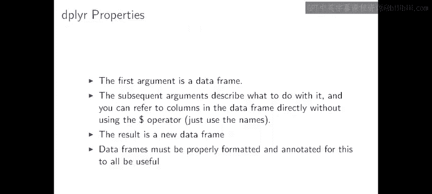

# 约翰霍普金斯大学数据科学课程3：《获取和清理数据课程（约翰霍普金斯大学）》｜data-cleaning｜ - P19：18_用dplyr介绍管理数据框.zh_en - GPT中英字幕课程资源 - BV1wu411P7yX

Hey everyone， this lecture is about the D plier package in R which is a package specifically designed to help you work with data frames so in this lecture I'll just cover the basics to introduce the package and we'll talk about the verbs。

 arrange， filter， select， mutate and rename， and we'll show you how to use these functions to manipulate data frames and to manage data in a more efficient and kind of easy to use way。

The DPer package is about working with data frames and because data frames are key data structure in statistics and in R in general。

 so the basic assumptions that are made by the DPer package are that in a given data frame each observation is represented by one row and then every column represents a variable or measure or characteristics so these are basic concepts from the notion of kind of tidy data and so there are a number of different implementations for the DPer package in terms of backends for representing data frames but we'll use for this presentation just the default R implementation but you can use DPer where things like the data table package and with relational database systems。

So the DPlier package was developed by Hadley Wickham at ourSt。

 it can be thought of as an optimized and distilled version of the plier package。

 which we also talked about here and it doesn't necessarily conceptually provide any new functionality。

 but it greatly simplifies a lot of the existing functionality in R and it makes it a lot faster and one of the reasons why it's lot faster is because a lot of the key operations are coded in C++ at a low level。

So some of the basic Der verbs are select filter， arrange。

 rename and mutate as well as summarize and so we're going to cover each one of these verbs so to speak in the grammar of data manipulation in this presentation so select basically returns a subset of the columns of a data frame。

 filter extracts a subset of rows a range allows you to reorder the rows of a data frame while preserving the order of the other columns rename lets you rename a variable and mutate kind of transforms or adds new variables to a data frame and then finally summarize helps you generate summary statistics of the data frame。

So all the Der functions kind of have a similar format and so the first argument is always a data frame and then the subsequent arguments are just kind of describe what to do with it so in the select function。

 for example you refer to different column names by their name and the filter function you might create a kind of logical logical test to see to subset rows and so that's what goes into the second argument of each of one of these functions the result is always a new data frame so each one of these functions takes a data frame as an argument and always returns a data frame and so you have to be careful that your data frames are always properly formatted and annotated。

 for example， the factor levels are all kind of annotated and that the variable names are all there for all these functions to be useful。

