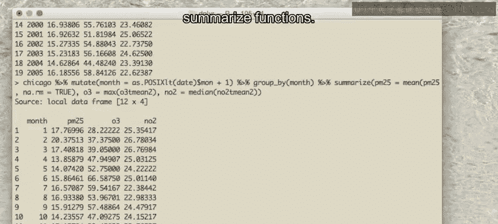
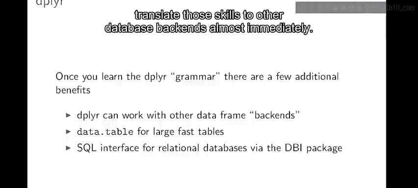

# 约翰霍普金斯大学数据科学课程3：《获取和清理数据课程（约翰霍普金斯大学）》｜data-cleaning｜ - P20：19_用dplyr基本工具管理数据框.zh_en - GPT中英字幕课程资源 - BV1wu411P7yX

So the first thing， of course， is you need to load the Dlier package and you'll get some warning messages as you load the Dlier package。

 but because there are other functions that have the same name。

 but you don't have to worry about that for the moment。

So the first function we'll talk about is the select function。

 and so I'm going to use a sample data set here that you can download from the website and so I'm going to load it here and it's a data set on kind of air pollution and temperature and sorry air pollution and weather variables in the city of Chicago for the years 1987 to 2005 and it's kind of daily data。

 so if you take a look at the dimensions of the data you'll see that there are 6940 rows and eight columns and here are the first couple of rows of the data and the first five columns。

Now one of the things you can do for any data frame is to look at the names of the variable names using the names function。

 so here I'm going to print out the first few variable names and one of the nice things you can do with the select function in Dlier is actually access the columns or a set of columns in the data frame using the names rather than the indices into the columns so here let's say if I want to look at the columns starting with city and ending with DPTP which is the dew point column and I want to include all the columns in between I can just I can use this notation which is city colon DPTP which is not a notation that you would normally be able to use in other functions but you can use it here in the select function and you can see it selects all the columns between the city column and the dew point column so it's a nice and a handy way to look at subsets of columns of data frame by just referring to them by their names。

Similarly， you can use the minus sign to say I want to look at all of the columns except for the columns indicated by this range and you can use the select function to just say minus on that city colon and dew point sequence and you'll get all of the columns except those few columns so the equivalent code to do this in kind regular R without using the dewplliier package is a little bit tricky because you have to find the index for where the city column is and then you have to find the index for where the dew point column is and then you need to take the negative of those indices so it's not particularly complicated but it's an extra two lines of code and perhaps not as readable。

The filter function is the next function and Der that we'll talk about and it's basically used the subset rows based on conditions so for example you might want to take all the rows in the Chicago dataset where PMm2。

5 is greater than 30 so I've got that condition here as a second argument and so that just creates a logical sequence and it subsets the rows in the Chicago data frame based on that sequence and you can see that the first few rows here that I printed out all of the values of PM2。

5 are greater than 30 but you you don't have to just subset rows based on values in one column you could take multiple columns and create a more complicated logical sequence so here looking at PM2。

5 greater than 30 as well as temperature greater than 80 and you can see that now in this when I list when I print out the first couple of rows here all the temperature values are greater than 80 and all the PM2。

5 values are greater than 30 so you can have an arbitrarily complex logical sequence there and and the filter function will subset the rows based on that sequence and again the nice thing about。

This function， just like with select， is that you can refer to the variable names directly using their names and you don't have to kind of subset out each variable using the various subset operators。

The next function arrange has a simple purpose is basically used to reorder the rows of a data frame based on the values of a column and this is something that can be kind of a pain in the neck to do in R and the arrange function makes it quite a bit simpler and easier to read so here this example is very simple I just want to arrange I want to order the rows of the data frame according to the date variable so I want the date variables so kind of the lowest date to be on top and and the highest date be or the latest date to be on the bottom so I arrange the Chicago data set to by the date variable you can see that the first couple rows start in 1987 and then when I use the tail function to look at the last couple rows you can see that they all end in 2005 so the data set is ordered now according to the date。

Now of course， we might want to also， for example， arrange the rows in descending order。

 so the desk function or the DESC indicator you can be used in the arranged functions to say you want to sort the rows in descending order of date in this case。

 you can see now when I print out the first a few rows。

 they start with all the values in 2005 and and go backwards and the last few rows end in 1987 so I've just reversed the order of all the rows in the data frame into according to the date。

The rename function is very simple。 it it can be used to rename a variable in R。

 but actually this is a surprisingly hard and annoying thing to do in R if you don't have a function like this And so here you can see that I've got the names of the variables here and the PM2。

5 variable is called PM25 T mean 2 which is a bit of a mouthful and I might want to simplify that maybe I just want to call it PM2。

5 similarly the dew point variable is called DptP which is not particularly intuitive so I might want to rename that variable2 So here I just call the rename function again I pass it a data frame and then I say I want to I give it the new name and I say equals and then give it the old name so now want to say dow point equals DPP and then I give it PM2。

5 equals PMm25T mean 2 and that renames those two columns in the data frame and and it leaves all the other columns untouched。

So now when I print out the first couple rows of this data frame。

 you can see that the dew point variables there properly named and the PM25 variable there is properly named。

The mutate function is used to simply transform existing variables or to create new variables so here in this example I want to create a new variable called PM25D trend and this is basically the PM2。

5 variable with the mean subtracted off so I want to kind of center the variable and so here I just create this new variable called PM25D trend and I say it equals PM2。

5 sorry PM25 minus the mean of that variable and when I looked at the first couple rows of both the PM25 and the PM25 d trend variable you can see that the PM25 variable is unchanged。

 it's in micrograms of meter cubed but the PM25D trend variable is kind of a deviations from the mean and so it will have kind of negative and positive values。

So finally the group by function allows you to kind of essentially behind the scenes split a data frame according to a certain categorical variables so in this example on what I'm going to do is I'm going to create a temperature category variable which will indicate whether a given day was hot or cold depending on whether the temperature was over 80 degrees or not so I create this factor variable called tempCAT and then I use the group by function to create a new kind of data structure based on the original data frame and this temp catt variable and so I call that new data structure hot cold and you can see you can print it out here and it has a slightly different format。

So now I can use the summarize function and being from the US I use the Z spelling for summarize。

 but you can also use the S spelling for summarize so I summarize group this hot cold object now which has been split based on the temperature category variable and I just want what I want to know is I want to know what's the mean PM2。

5 for both hot and cold days， what's the maximum ozone for hot and cold days and what's the median nitrogen dioxide or N2 for both hot and cold days and you can see here that if I just print it prints out a little data frame。

That has the levels of the tempAT variable which are cold hot and NA so there are some missing values and it gives you the summary statistics for PM2。

5 ozone and N2 in each of those categories now actually so there is missing data in the PM2。

5 variable so I need to specify the NA。RM equals true in order to get some the means of those values with ignoring the missing values so now you can see that PM2。

5 is tends to be lower when it's cold and higher when it's hot and so and these are the summary statistics for each of the pollutants in these temperature categories。

I can also categorize the data on other variables， so for example I might want to do a summary for each year in the dataset and so I can use the mutate function to create a year variable which is based on the date I can extract the year information from the date variable by using the as dotpoLT function and then I group by the Chicago data by year now instead of previously we had this temperature category and I can use the summarized function in the same way and get now I get a summary for each of the three different pollutant variables for each of the years in the data you can see that in general particularly for PM2。

5 there's kind of a downward trend over time， which is nice。

So the DPlier package implements a special operator that allows you to kind of chain different operations together。

 so much like the way we did in the previous kind of operations that I showed you and does it in a way that kind of allows you to see what operations are happening in a kind of a readable way and so it's indicated by a percent symbol and then the greater than symbol and the percent symbol and so I'll just call it the pipeline operator for now and so the idea is that you kind of take a data and you feed it through a pipeline of operations to create a new data set。

So here I've got the Chicago data set and I want to mutate it to create a month variable because I want to create a summary of each of the pollutant variables by month and so I create the month variable with mutate and then I want to take the output of mutate and then group by it according to this month variable and then I want to take the output of group by and then run it through summarize and so notice that when I call mutate group by and summarize and when I use the pipeline operator I don't have to specify the data frame as the first argument because that's kind of implied by the use of the pipeline operator so you can skip that argument and go directly to the operation that you're trying to do with either the mutate group by or summarize functions and so you can see that the output of this long pipeline of operations is is a data frame that shows you the summary statistics of each of the three pollutant variables by each of the 12 months in the year so the pipeline operator is a really handy tool because prevents you from having to kind。

Sign a number of temporary variables that you subsequently feed into another function。

 and it allows you to kind of chain a bunch of operations in one sequence that's both readable and powerful。

So a couple other benefits just to deeply use DPlier is that you can work with other data frame backend。

 so this is just using the default R implementation。

 but for example you can use the data do table package which is for designed for very large and fast tables。

 similarly the SQL interface for relational databases via the DBI package can be used if you have data stored in a relational database。

 you can use all the same functions in the DPer package and manipulate the data in either a datatable object or an SQL database and without having to relearn a whole new set of tools so that's really handy。

 once you've figured out once you've kind of gotten fluent in the DPer package。

 you can translate the skills to other database backends almost immediately。

