# 约翰霍普金斯大学数据科学课程3：《获取和清理数据课程（约翰霍普金斯大学）》｜data-cleaning｜ - P26：25_数据资源.zh_en - GPT中英字幕课程资源 - BV1wu411P7yX

This lecture is just to point you to some data resources so you might be able to get some free data and do some analyses if you don't happen to have any in the organization that you're at。

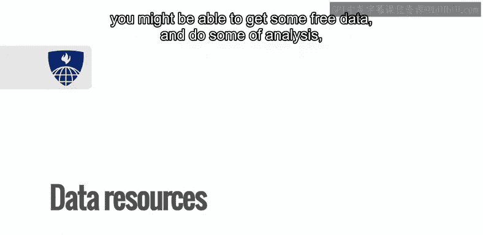

So this website consists of data from a variety of national organizations so we can start off with the United Nations datas。

 which are at this website and then you can find data that are available from the United States at data。

gov and you can go to this blog post to find a bunch of other cities and states within the United States that have open data。

 there's also a lot more information on a variety of other countries and this website down here。

 data。gov open data sites actually gives information on data sites for other countries all around the world so that's a good place to start if you don't know if your country has an open government data site。

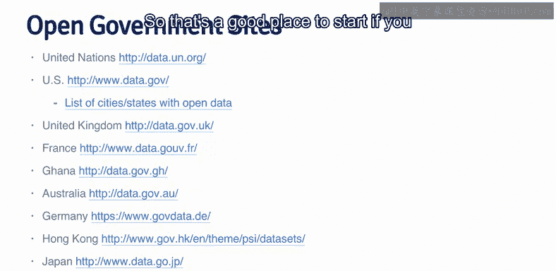

Gapminder is another website that has a lot of data about development in particular and human health。

 and so there's a large number of data sets that are available on that website， which is gapapminder。

org。

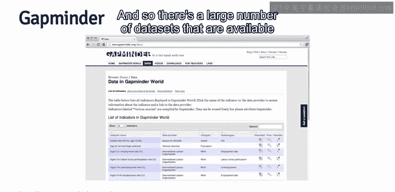

You can also get survey data from the United States。

 this website here gives you a lot of information about how do you actually access the surveys and process them in R so it's actually really nice because the surveys are often very big and unwieldy and this website gives you a lot of information on how to access them。

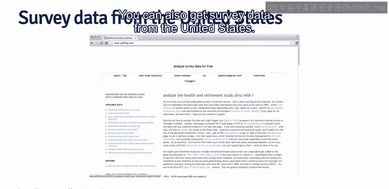

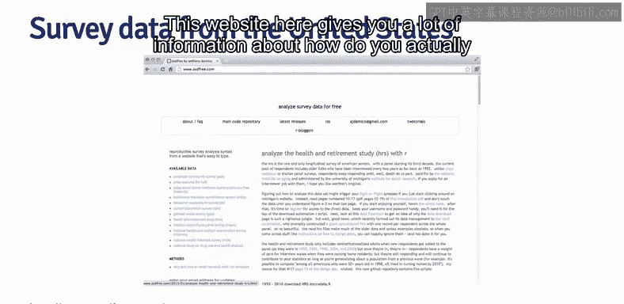

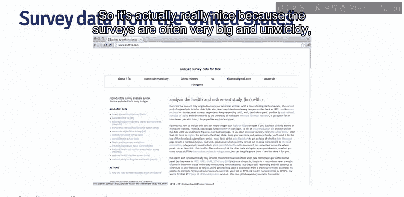

The InfoChimps Marketplace has a bunch of different data sets which you can sort by various different tags and you can identify data sets that might be of interest to use some of them are free and some of them cost money。

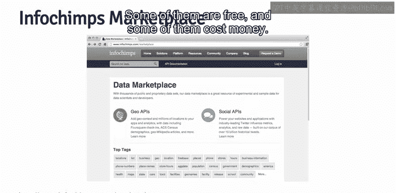

Caggle is another place that you can go to for datas。

 so CaGL is a company that offers data science competitions and they often have very interesting data sets that they make available as part of those competitions。

 so they're good for practice， but they're also good for potentially discovering new interesting things that can help companies solve real problems。

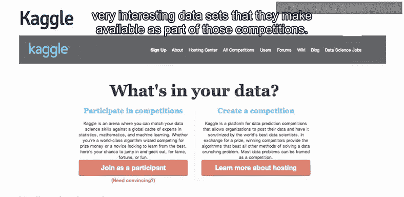

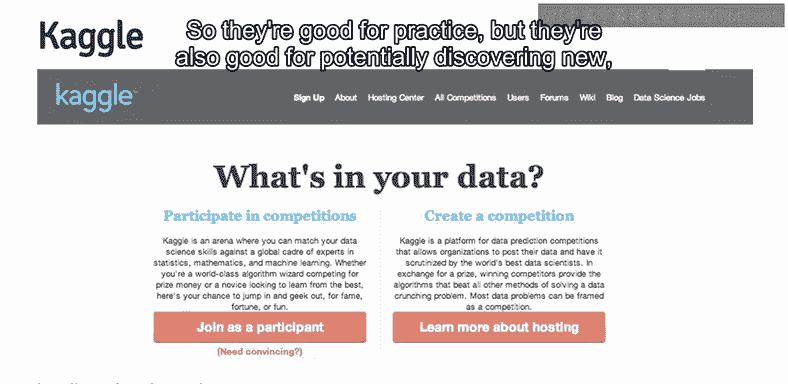

There's also some collections that have been put together by famous data scientists。

 so these are several data scientists Hillary Mason。

 Jeff Hammerbacker and others who have put together data sets that are research quality and that might be useful for you these all come from this blog post which talks about several other data sets that're curated by other data scientists as well。

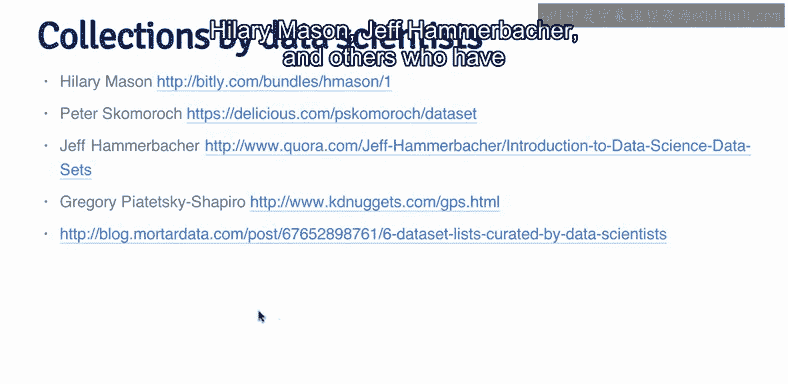

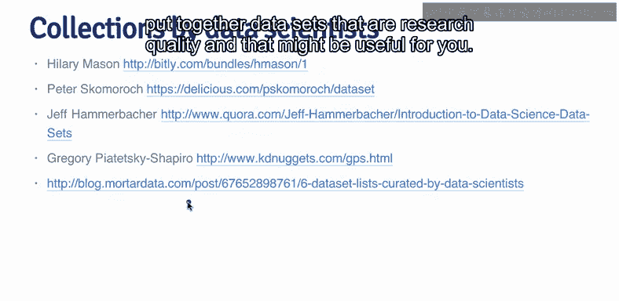

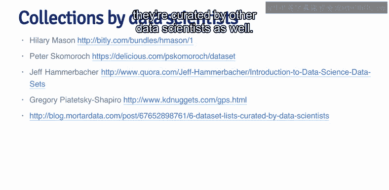

There are also a large variety of other more specialized collections， so for example。

 the Stanford largerge network data archive has a large number of data sets that focus on network data。

 machine learning， the UCI machine learning archive has a variety of data sets that you can be used to practice your classification or prediction the CMU StatLi is one of the most famous canonical sets of data sets that are available。

 gene expression omnibus is focused on data sets that come from human genomic experiments or other organismal genomics experiments。

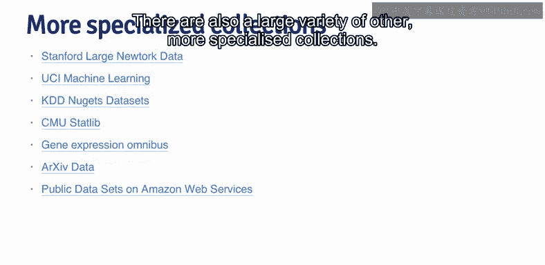

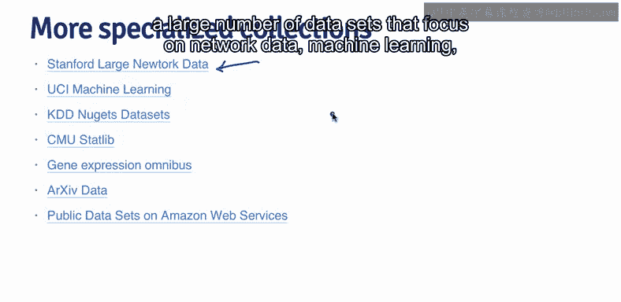

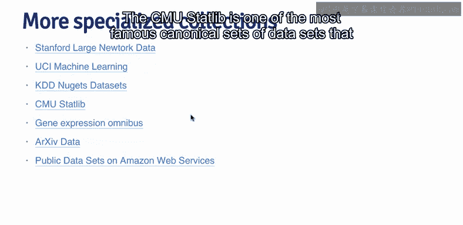

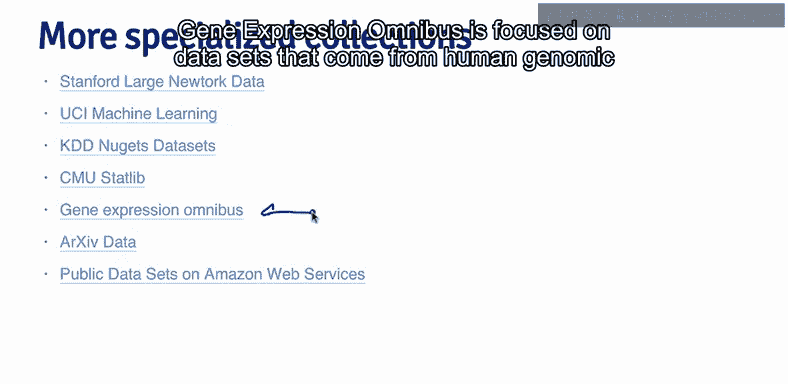

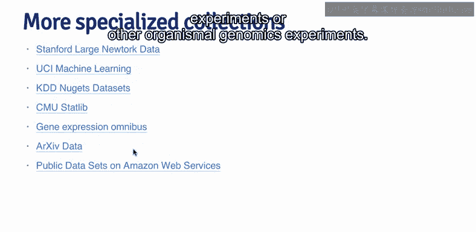

And then there's data from the archive or public data sets on Amazon Web services。Finally。

 there are a large number of APIs that you've now learned how to use and through the course of this class and so for example there's specific packages such as the Twitter package which can be used to access the Twitter API in an easier way than trying to set up a application yourself you can similarly get access to Figshare data or to data from publications like+ one Our open science has a large number of very nice packages that allow you to access data from a variety of sources that are focused on academics There's also dedicated our packages for Facebook and Google Maps All of these mean that there's really no excuse to not be able to find real data to focus on any project that you might be interested in。

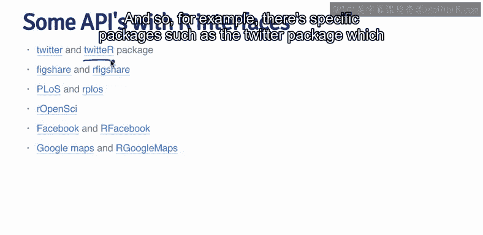

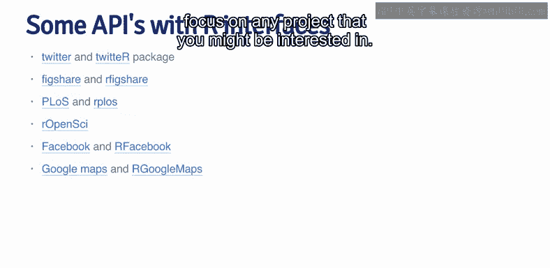