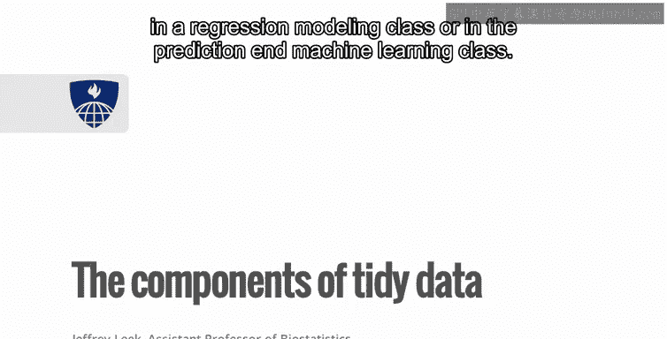
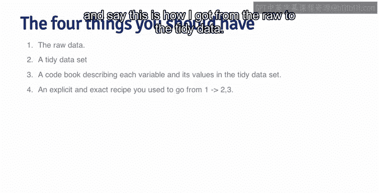
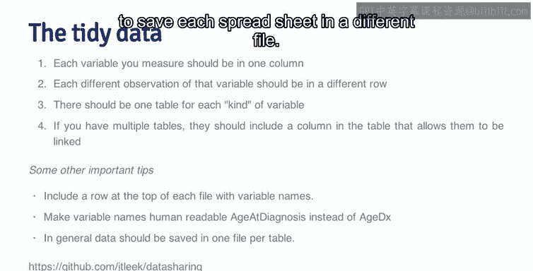
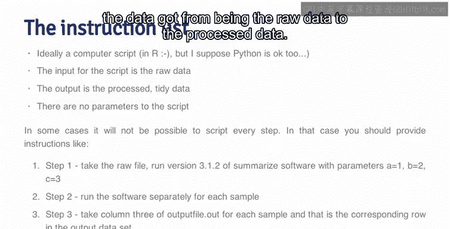

# 约翰霍普金斯大学数据科学课程3：《获取和清理数据课程（约翰霍普金斯大学）》｜data-cleaning｜ - P3：2_整洁数据的组成部分.zh_en - GPT中英字幕课程资源 - BV1wu411P7yX

In the last lecture， we talked about raw data， where you're starting from。

 the messy file that you're trying to extract some data from。

In this lecture we're going to be talking about tiG data。

 this is sort of the target where you're going to take the raw data and turn it into a tiG data set。

 which you can then use to do downstream analysis that you might learn about in the regression modeling class or in the prediction and machine learning class。

So the four things that you should have when you finish going from a raw data to a TG dataset are the following。

 so you should have the raw data， obviously that's the files that you're actually extracting information from。

You should have a tidy data set and we're going to be talking about that in a minute。

And then you should have a codebook describing each variable and its values in the tiG dataset。

 This codebook is often called the metadata， so it's the data that surrounds the data so to speak and explains what the data is trying to say So you might imagine each column in your ti dataset set corresponds to one variable。

 and you might want to describe things like the units of those variables in the codebook。

And the critical part that sometimes is missing， but we're going to learn a lot about in this class is an explicit and exact recipe that you use to go from steps one to steps two and three。

 in other words， you need to report the exact steps that you took to get from the raw data to the process data and you can do that in a variety of different ways but for the purposes of this class will be putting together our scripts that then you can use to process data and those will be the sort of recipe that you can hand off and say this is how it got from the raw to the ti data。

So the raw data， it's important to remember that there are different levels of raw data as we talked about in the previous lecture。

 but for the purposes of your looking at a particular data set the raw data are the rawestt form of the data that you had access to so for example it might be a strange binary file that whatever you're measuring spits out。

 it could be an unformatted Excel file with 10 worksheets that some company you contracted with sent you or it could be something that was handed to you as an Excel file。

Or it could be complicated JSON data you get from scraping an API。

 or it could even be something like hand in numbers you got from looking through a microscope。

And counting cells that appeared in the window。You know the raw data is in the right format if and this is a critical one。

 you ran no software on the data， so someone else might have run some software on the data。

 but by the time it was handed to you， there was absolutely no software that was run。

 and you didn't manipulate any of the numbers in the data or remove any of the data from the data and you didn't do any summarization to the data in any way。

 So this is how you know that the data isn't as rawS form and it's one component of the data that you should have sort of the unadulterated raw data should be one component of the having a ti data set handed over to a collaborator。

The ti data is， on the other hand， the target or the end goal of the whole process and so the idea is you should have each variable that you've measured be exactly one column。

 so there should be one variable per column。And each different observation should be in a different row。

 in other words， if you've measured a particular variable on a large number of people who've been tweeting。

 say you measure the number of tweets that were posted by a large number of users。

 then what you would get is number of tweets in the column and then for every single user you would get the number of tweets in a different row。

There should be one table for every kind of variable， so for example。

 if you collect data from Twitter and Facebook and so forth。

 you might have one table for each of those。If you have multiple tables。

 you should definitely make sure if you're trying to match them up。

 that they include a column in the table that allows them to be linked together。

 so this is often an ID and we'll talk a little bit about merging datas later in the class。

A couple of other important tips that I've found have saved me a lot of trouble in the past is if you include a row at the top of each file with variable names。

 sometimes this won't always appear in a ti dataset。

 but it's much more useful if they are it's also much more useful if the variable names are human readable。

 So for example， if you use something like Age at diagnosis for a column name as opposed to something like Age DX。

 which might be a little bit more confusing and hard for people to read。

 so it's better to be a little error on the side of being more explicit。

And then in general data should be saved in one file per table。

 so it's a habit of some people to save data in multiple Excel spreadsheets within a single Excel file。

 and so it's a better idea to save each spreadsheet in a different file。

 so we'll talk about that in the class。

The next component is often a piece that's missing， which is the codebook。

 so you have this ti dataset set that's very nice and clean and neat and you got that data by doing a whole bunch of things to a broad data。

And so at the end of the day， you end up with a data that constitutes information about a bunch of different variables and you might end up with just the variable names at the top of that file telling you what happened。

But you might want to have more information about the variable。

 So one common example is you might want to know the units。

 So the column header might be the amount of money that we made this quarter。

 and you'd really want to know if that was in units of thousands or millions or so forth。

You might also want to know some information about the summary choices that was made。

 so it might be the variable measure something about the monthly revenue and so you want to know whether the median or mean revenue was taken。

And then information about the experimental study design that you used。

 so you might want to know something about the way that you collected these data。

 whether it was something that was just in a database and you extracted it out or whether you performed an experiment。

 a randomized trial or AV test or something like that。

So a common format for this document is a word or a text file maybe be like a markdown file。

 as you've seen markdown files or sort of a common used format in data science。

 there should definitely be a section called study design and that has a thorough description of how you collected the data so this should say things like how you picked which observations to collect。

 what did you extract as a database， what did you exclude and so forth。

There also should be a section called Codebook that describes all of the variables and its units。

Finally you need the instruction list， so even if you collected all that information and you made it available in terms of the tidy data。

 you should be able to go back to the raw data and reprocess it and get the same tidy data set。

If that doesn't happen， then there's something going wrong in your data processing pipeline。

 and so you want to be able to identify that and fix it。

So ideally this is going to be a computer script that will do this for you and so for the purposes of this class。

 of course are， but I guess you know if you have to， you could do it in Python as well。

 the input for the script is the raw data and so the output is going to be the process ti data and a really important component of this script is that there are no parameters in other words you fix everything that you've done after you've done all the processing and you have an exact recipe that doesn't have to be tweaked or modified by the end user and they will get the same ti dataset set out if they put the same raw data set in。

So in some cases it's not possible to script every step， so for example。

 not everything you can do to data you can do in R。

 I know it's hard to believe that I'm saying that but it's true and so what you might end up having to do is have in addition to the R scripts and the other scripts from the other programming languages you might use you might need a set of。

Command that look like this where it's actually just written out in a text file。

 it says take the raw file and you're going to run some software and you're going to run version 3。1。

2 and you're going to run it with these specified parameters and you have to give all that information because if you don't。

 if you just say run this software on the raw data file if the version changes you might get a totally different answer out。

And then you should say things like oh， I ran the software separately for each sample so that people know exactly how you produce the result And so if you can't write a computer script。

 the best case that you can do is to be as explicit as possible in this recipe with go way overboard in the amount of detail that you gave onto how the。

The data got from being the raw data to the process data。

So this is pretty important that you do this and so this is actually I guess a funny example for us。

 but not such a funny example for Reinhart Rooff， these were two authors and they wrote a paper that talked about growth in the time of debt and so it was actually the paper that was used to justify austerity and a large number of countries and in politically and so it turned out that this graduate student got a hold of the Excel file that they use and he looked at the way that theyd process the data and he found a large number of errors and so paying attention to how the data collected and analyzed and put together。

 actually caused this paper to be called into serious question which called into serious question political decisions by a large number of countries in the face of the recession so the graduate student in question actually ended up on the Colbert rapport and so he got to actually joke around a little bit about how this Excel error brought down all this political enterprise but it's an important safety。

Lesson for all of us that we should pay careful attention and keep the script available that takes the raw data and turns it into the process data that we use for the analysis。

